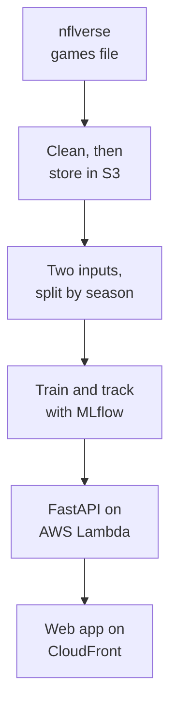

# NFL Prediction Analytics

A pre-game NFL winner predictor, built as a small, complete machine learning system: the data is stored in Amazon S3, a reproducible pipeline trains and tracks a model with MLflow, the model is served as an API on AWS Lambda, and a web app on CloudFront calls that API. Pick a home team and an away team, and the app shows the predicted winner and each team's chance of winning.

- **Live web app:** [https://d1nubiunzfwm0q.cloudfront.net](https://d1nubiunzfwm0q.cloudfront.net)
- **Live API:** `https://9awodatqc5.execute-api.us-east-1.amazonaws.com` (`POST /predict`, `GET /health`)
- **Documentation:** [https://jconnors23.github.io/510-m3-nfl-prediction-analytics/](https://jconnors23.github.io/510-m3-nfl-prediction-analytics/)
- **Course:** Duke AIPI 510
- **Model version:** 1.0, November 2026. See the [Version 1.0 Release Notes](./docs/implementation/extras/release-notes/version-1-0.md).

> **Unofficial coursework project.** Not affiliated with or endorsed by the National Football League. Team names are used only to identify the teams. Predictions are for reference only.

## Project Overview and Goals

The project answers one question before kickoff: **will the home team win?** It is a binary classification task. The target is `home_win` (1 if the home team won, 0 if the away team won), and the metric that judges the model is **accuracy**, compared with the always-pick-the-home-team baseline.

The goals are the ones the course project sets: a cleaned dataset stored in the cloud, a pipeline driven by one settings file, every training run tracked, the model containerized and deployed as a public API, and a front end that calls it. Model accuracy is not the goal. A clean, repeatable process is.



## Dataset

- **Source: [nflverse](https://github.com/nflverse).** The file is the nflverse games file, [`games.csv`](https://github.com/nflverse/nfldata/blob/master/data/games.csv), from the [`nfldata`](https://github.com/nflverse/nfldata) repository maintained by Lee Sharpe. It has one row per NFL game since 1999, with the final score of every finished game. This project is not affiliated with nflverse.
- **Games used:** regular-season games from 2020 through week 10 of 2026, without ties: **1,759 games**. Week 10 is the last week of 2026 in which every game had a final score when the data was taken.
- **Cleaned table:** 7 columns, saved as `data/processed/nfl_matchups_2020_2026.csv`, uploaded to a private S3 bucket, and downloaded back, so every later step starts from the cloud copy.
- **Committed copies:** the raw file, the cleaned table, and the copy downloaded from S3 are all in `data/`, so the project trains with no download and no AWS account.

## Model and Evaluation

- **Inputs (2),** each taken only from games earlier in the same season, so the model never sees the game it predicts:
    - the home team's win percentage minus the away team's
    - the home team's points scored minus points allowed per game, minus the away team's
- **Model:** a scikit-learn pipeline of a standard scaler and a logistic regression (`C=1.0`, `lbfgs`), which turns the two inputs into a home win probability. A probability above 0.5 picks the home team.
- **Split by season:** training 2020 to 2024 (1,339 games), validation 2025 (271), test 2026 weeks 1 to 10 (149).
- **Results:**

| Group | Accuracy | Always-home baseline | Log loss |
| :--- | :--- | :--- | :--- |
| Training (2020 to 2024) | 61.24% (820 of 1,339) | 53.32% | not scored |
| **Validation (2025)** | **63.10% (171 of 271)** | 53.87% | 0.6451 |
| Test (2026 weeks 1 to 10) | 59.06% (88 of 149) | 47.65% | 0.6815 |

- **Tracking:** every training run is logged to MLflow (15 parameters, 8 metrics, the saved model, the confusion-matrix picture, and a copy of the settings). A readable log of every run is committed in [`mlflow-reference/`](./mlflow-reference/mlflow-logging-reference.md).

## Cloud Services

All on AWS in `us-east-1`, except the docs site.

- **Amazon S3:** a private bucket for the cleaned data, and a private bucket for the web app's files.
- **AWS Lambda:** one function serves predictions (the same FastAPI app as on a laptop, through Mangum), and one saves feedback.
- **Amazon API Gateway:** the public HTTPS address of the API, with CORS for the web app.
- **Amazon CloudFront:** serves the web app over HTTPS from its private bucket.
- **Amazon DynamoDB:** stores the messages sent from the web app's feedback form.
- **AWS IAM and CloudWatch Logs:** a narrow role for each function and for the deploy workflow, and the functions' logs.
- **GitHub Actions and GitHub Pages:** four workflows run the Python tests and the web app tests, publish the docs site, and deploy the web app.

The full picture is on [Cloud Architecture](./docs/implementation/extras/architecture/cloud-architecture.md).

## Setup and Usage

You need Python 3.13, `make`, and for the web app Node.js 22.12 or later. Docker Desktop is needed only for the containers, and AWS CLI version 2 only for deploying. Every Python package is pinned to an exact version in `requirements.txt`.

### Set Up

```bash
python3.13 -m venv .venv
```

```bash
.venv/bin/python -m pip install -r requirements.txt
```

### Train the Model

```bash
make train
```

It fits the model, prints the scores above, saves `models/model.joblib`, logs the run to MLflow, and adds it to `mlflow-reference/`. To browse the runs in MLflow's own screen at `http://127.0.0.1:5001`:

```bash
make start-web-ml
```

### Run the Tests

```bash
make pytest
```

Expected: **95 passed** after training, or 93 passed and 2 skipped before (two tests need the trained model).

### Build and Test the API Locally

```bash
make start
```

Then, in a second terminal, send the worked example:

```bash
curl -X POST http://127.0.0.1:8000/predict -H "Content-Type: application/json" -d '{"win_pct_differential": -0.5, "point_diff_per_game_differential": -18.0}'
```

```json
{"prediction":0,"predicted_label":"away win","home_win_probability":0.3296,"model_version":"v1.0"}
```

### Run It in Docker

```bash
make docker-train
```

```bash
make docker-serve
```

The first trains inside a container and checks the run summary. The second serves the same API at `http://127.0.0.1:8000`.

### Run the Web App Locally

Install the web app's packages once, from inside `frontend/`:

```bash
npm ci
```

Then, with `make start` running, from the project folder:

```bash
make start-web
```

Open `http://localhost:5173`. The web app's tests run with `make web-test` (62 passed).

### Deploy to the Cloud

The deployment is a set of written AWS CLI steps:

- **The API:** build the Lambda zip (the serving packages, `src/`, the settings, and the trained model), create the function and its role, and put API Gateway in front of it. See the [Phase 4 Deployment Guide](./docs/implementation/phase-4/deployment-guide.md).
- **The web app:** build it with `npm run build`, upload it to the private bucket, and serve it through CloudFront. After the first setup, the Deploy Web App workflow redeploys it on every change under `frontend/` that reaches `main`. See the [Phase 5 Deployment Guide](./docs/implementation/phase-5/deployment-guide.md).

Every make command is explained on [Makefile](./docs/implementation/extras/development/makefile.md).

## Live Links

- **Web app:** [https://d1nubiunzfwm0q.cloudfront.net](https://d1nubiunzfwm0q.cloudfront.net)
- **API health check:** [https://9awodatqc5.execute-api.us-east-1.amazonaws.com/health](https://9awodatqc5.execute-api.us-east-1.amazonaws.com/health)
- **API predictions:** `POST https://9awodatqc5.execute-api.us-east-1.amazonaws.com/predict` with the two inputs as JSON, as in the local example above
- **Docs site:** [https://jconnors23.github.io/510-m3-nfl-prediction-analytics/](https://jconnors23.github.io/510-m3-nfl-prediction-analytics/)

## Limitations

- **The model sees only two numbers.** It knows nothing about injuries, weather, travel, rest, or anything after the standings date. It is wrong on about 37% of the 2025 validation games and 41% of the 2026 test games.
- **It leans toward the home team.** In 2025 it picked the home team in 172 of 271 games, while the home team won 146.
- **Early-season games carry little information.** In week 1 both inputs are 0, so every week 1 game gets the same home-field edge, 53.64%.
- **Predictions are for reference only.** They should not be relied on for any decision.
- **No personal data is collected.** The web app uses no cookies, no analytics, and no local storage. The feedback form asks for no name or contact details, and saves only a random id, the time, the category, the optional rating, and the message.
- **Not affiliated with the National Football League.** Team names are used only to identify the teams.

## Repository Layout

```text
510-m3/
  config/config.yaml          every setting for the pipeline
  data/                       the raw file, the cleaned table, and the copy from S3
  src/data/                   download, clean, upload to S3, download back
  src/model/                  inputs, split, training, scoring, MLflow export
  src/api/                    the FastAPI app, the Lambda entry points, the feedback function
  src/profiles.py, season.py  the standings files the web app ships with
  tests/                      95 Python tests
  frontend/                   the Vite web app (React and TypeScript)
  results/run-summary.json    the latest run's settings, scores, and learned weights
  mlflow-reference/           a readable log of every MLflow run
  Dockerfile, .dockerignore   one image definition with train and serve targets
  Makefile                    the nine commands used most
  scripts/checks/             every-game checks of the live API against the local model
  .github/workflows/          the two test workflows, and the docs and web app workflows
  docs/                       the documentation site
  requirements.txt            pinned Python packages
```

## Where to Read More

- [Background](./docs/background.md): the nflverse data source, why the project exists, and how it was built, phase by phase.
- [Requirements Rubric](./docs/implementation/requirements/requirements-rubric.md): every requirement of the assignment, linked to the code and the docs that meet it.
- [Design Manifest](./docs/implementation/design-manifest.md): how the developer built the project with AI tools augmenting the work, and every choice and why.
- [Cloud Architecture](./docs/implementation/extras/architecture/cloud-architecture.md): every AWS resource, with its exact name and settings, how they connect, and who can reach what.
- [ML Workflow](./docs/implementation/extras/architecture/ml-workflow.md): the path from the raw nflverse file to a served prediction, step by step, with the command and code for each step.
- [Local Development Guide](./docs/implementation/extras/development/local-development.md): everything that runs on a laptop (the API, the web app, MLflow, the docs, and Docker), the ports each uses, and how to work on each part.
