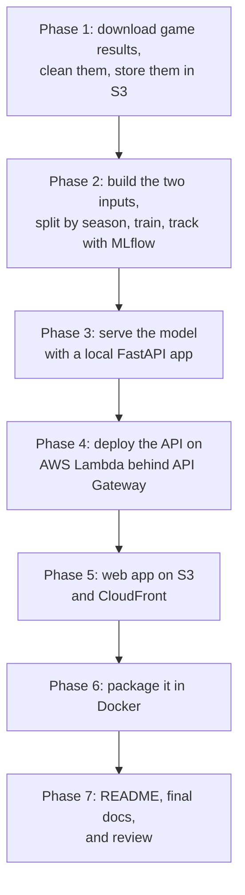

---
hide:
  - toc
---

# Background

This page explains where the data comes from, the idea behind the predictor, the path the project took from raw data to a public web app, and the earlier NFL analytics projects that came before it. Read it after the [Overview](./index.md) for the reasons behind the design. The [Implementation](./implementation/phase-1/brief.md) pages have the detail of each phase.

!!! info "Data Source: nflverse"
    **Every game in this project comes from [nflverse](https://github.com/nflverse), an open-source project that publishes NFL data.** The file used is the nflverse games file, [`games.csv`](https://github.com/nflverse/nfldata/blob/master/data/games.csv), from the [`nfldata`](https://github.com/nflverse/nfldata) repository maintained by Lee Sharpe. This project downloads it, cleans it, and stores its own copy. It does not change the source, and it is not affiliated with nflverse or the National Football League.

## Where Does the Data Come From?

- **The project:** [nflverse](https://github.com/nflverse) is a group of open-source projects that collect and publish NFL data, such as game results, schedules, play-by-play, and rosters.
- **The file:** the nflverse games file, [`data/games.csv`](https://github.com/nflverse/nfldata/blob/master/data/games.csv) in the [`nflverse/nfldata`](https://github.com/nflverse/nfldata) repository. It has one row per NFL game, with the season, the week, the two teams, the date and kickoff time, and the final score of each finished game.
- **How it is downloaded:** `python -m src.data.fetch_raw` reads it from `https://raw.githubusercontent.com/nflverse/nfldata/master/data/games.csv`, the address in the `data.source_url` setting of `config/config.yaml`.
- **The copy this project uses:** downloaded on 2026-11-17, with 7,548 rows and 46 columns, covering the 1999 season through the 2026 schedule. It is committed unchanged as `data/raw/games.csv`, so the project can be rebuilt from the same file even after nflverse updates it.
- **What the project keeps:** 7 of the 46 columns, for the regular-season games from 2020 through week 10 of 2026 that had a winner: 1,759 games. The web app also reads the 2026 schedule (dates, kickoff times, and neutral sites) from the same file. How the file is cleaned is in the [Phase 1 Implementation](./implementation/phase-1/implementation.md).
- **What it does not hold:** injuries, weather forecasts, rosters, or play-by-play. The model uses none of these. nflverse publishes some of them in other files, which [Future Considerations](./implementation/extras/future-considerations.md) lists as possible additions.

## What Is the Idea?

Teams that win more often, and outscore opponents by more, tend to win later games. The model compares the two teams on exactly two numbers, using only games already played earlier in the same season:

- **Win percentage difference:** the home team's win percentage minus the away team's.
- **Point margin difference:** the home team's average points scored minus points allowed per game, minus the away team's.

A logistic regression turns those two numbers into a home win probability. The numbers start over every season. The project does not use play-by-play data, injuries, weather, or anything else beyond those two numbers. It is deliberately small, so every part of the system around the model can be built, checked, and explained: storage, tracking, serving, deployment, and a web app.

Both numbers are worked out from the nflverse games file described above.

## How Was It Built?

The project was built in seven phases. Each phase ends with something that runs, and each was merged into `main` through its own pull request.

- **[Phase 1: Data Pipeline](./implementation/phase-1/brief.md)** fetches the raw game file, cleans it (regular season only, 2020 to 2026 week 10, no ties), uploads the cleaned table to a private S3 bucket, and downloads it back, so later steps start from the cloud copy.
- **[Phase 2: Features, Training, and Tracking](./implementation/phase-2/brief.md)** builds the two inputs, splits games by season (train 2020 to 2024, validate 2025, test 2026), trains and scores the model against the always-pick-home baseline, and records every run in MLflow.
- **[Phase 3: Local Prediction API](./implementation/phase-3/brief.md)** serves the model on a laptop with FastAPI `/predict` and `/health` routes, and rejects bad input with a clear error.
- **[Phase 4: AWS Deployment](./implementation/phase-4/brief.md)** runs the same API on AWS Lambda behind API Gateway, and checks that all 1,759 games get the same answers from the deployed model as from the local one.
- **[Phase 5: Web App and Hosting](./implementation/phase-5/brief.md)** builds the five-tab Vite web app, hosts it in a private S3 bucket behind CloudFront, and checks every home-and-away pair of teams and every 2026 game against the live API.
- **[Phase 6: Docker](./implementation/phase-6/brief.md)** packages the project in one Dockerfile with a `train` target and a `serve` target, and checks that the container reproduces the run summary and the worked example.
- **[Phase 7: Review](./implementation/phase-7/brief.md)** writes the README, checks the docs and comments against the code, and walks the requirements with evidence.

Work that belongs to no one phase, such as the make commands, the GitHub workflows, and the feedback form, is in the Extras section. How the work was split between the developer and the AI tools is on [Design Manifest](./implementation/design-manifest.md).

## What Came Before This Project?

This is the third project in a series of NFL analytics coursework (Duke AIPI 510), all built on nflverse data. The earlier projects are separate pieces of work. Nothing in this project uses their code, data, or results. They are listed only as prior, related work.

- **[Module 1: NFL Data Storytelling](https://github.com/jconnors23/510-m1-nfl-data-storytelling).** Ranks all 32 teams by win-loss record and by point differential for the 2024 regular season, and finds the five teams whose two rankings differ by at least six places. Its conclusion is that neither measure alone fully describes how good a team was.
- **[Module 2: NFL Statistical Analysis](https://github.com/jconnors23/510-m2-nfl-statistical-analysis).** A pilot statistical study of one week's 13 games. It asks whether a sports-media personality's weekly picks were followed by a different change in each game's published pre-game win chances than the games he did not pick. The difference it found was not statistically significant (p = 0.175), so it reads as a direction for a larger study, not a confirmed effect.
- **[Week 13 Sync Activity](https://github.com/jconnors23/510-wk13-sync-activity).** A small class activity: a semantic search page for the 257 picks of the 2025 NFL draft, built with an embedding model, a vector database, and Gradio, and published as a Hugging Face Space.
