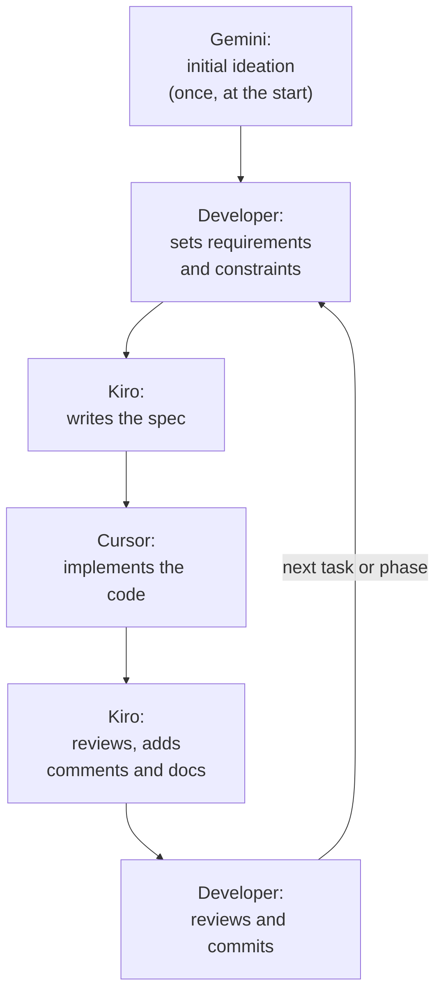

---
hide:
  - toc
---

# Decisions

The key decisions behind the project, in the order they were made. Each one states what was chosen, why, and what was turned down. The decision that shapes everything else, binary classification instead of regression, is explained in full first. Choices that still need the developer's approval are in [Open Decisions](#open-decisions).

## The Prediction Task

### Why Binary Classification and Not Regression?

**The choice:** the model answers one yes-or-no question for each game: did the home team win? The answer is 1 (home win) or 0 (away win), stored in the column `home_win`. The model also gives the chance that the answer is 1. The alternative was regression, which predicts a number, such as the home team's point margin (home score minus away score).

**Why classification fits this project**

- **The question is who wins, not by how much.** The web app shows a predicted winner and a win probability. A classifier produces both directly. A logistic regression outputs a probability between 0 and 1, and the pick is that probability compared with 0.5.
- **A margin model needs an extra step to produce a probability.** Regression would give an expected margin such as "home by 3.2 points". To show "58% chance the home team wins", that margin has to be converted using an assumption about how far real margins stray from the prediction. That assumption would have to be estimated and checked, and it is one more place to be wrong. The classifier avoids it.
- **Margins are noisy, and big margins are a poor guide to who wins.** In the 1,759 games kept, the margin has an average of +1.56 and a standard deviation of 14.19 points, and ranges from -45 to +50. Games decided by 3 points or fewer are 429 (24.4%), and by 7 or fewer are 860 (48.9%). Games decided by 14 or more are 605 (34.4%). A regression fit on margins gives these blowouts a large pull on the fit, although a 35-point win says no more about who won than a 1-point win does.
- **The result is easy to judge.** A classifier is scored by how often the pick is right, shown next to the rule "always pick the home team" (see the next section). A margin model is scored by an average error in points. Always predicting the average margin is off by 11.04 points on average, and a reader has no easy way to say whether 10 points of error is good.
- **It matches the data.** A game ends with a winner or, rarely, a tie. The 6 tied games have no yes-or-no answer, so they are removed. This is covered in the [Phase 1 Implementation](./phase-1/implementation.md#what-is-the-prediction-task).

**What the choice gives up**

- **The size of the win.** A 1-point win and a 30-point win both count as 1 in the answer column. The model cannot say how close a game will be.
- **The margin is not ignored.** It enters through the second input: each team's point margin per game in earlier weeks of the season. The model uses margin as evidence about team strength, and only the final answer is win or lose.

**What was and was not tested**

- No regression model was trained or compared. The choice is made on design grounds above, not on a measured score. A regression comparison would also need a second set of scores and a conversion step, which this project does not build.

**What would change the choice**

- If the web app needed to show an expected score or a point spread, regression (or a regression alongside the classifier) would be the right tool.

### Why Accuracy With a Baseline, and Log Loss as a Check?

- **Accuracy is the headline score.** It is the share of games where the pick matches the result.
- **It is always shown next to a baseline,** the score of always picking the home team, which is the share of games the home team won (52.93% of the 1,759 kept games). A model only adds something if it beats that.
- **Log loss supports it.** It scores the probabilities and not just the picks, so it checks that "70%" means about 7 wins in 10. The web app shows a probability, which accuracy alone cannot vouch for. It is reported for validation and test games only, because the model is fitted by pushing it down on the training games.
- **Reported whatever it is.** The score is not tuned, and a poor score would still be stated.
- Details: [Phase 2 Part 2](./phase-2/implementation-part-2.md#step-5-score-the-model).

## The Data

- **The nflverse games file,** regular season only, 2020 through week 10 of 2026. That stays within the past decade and uses the most recent data. Week 10 of 2026 is the last week where every game has a score.
- **Ties are removed (6 games),** rather than counted as an away win or half a win, because the question has exactly two answers.
- **The cleaned table goes to a private S3 bucket, and every later step downloads it back.** Training always starts from the S3 copy, never from a local file, so every run uses the shared version of the data. The raw file stays on the developer machine.
- **The bucket is created by hand, not by code.** A script that creates AWS resources adds risk for no benefit.
- Details: [Phase 1 Implementation](./phase-1/implementation.md#which-choices-were-made).

## The Inputs and the Split

- **Two raw per-game inputs, not ranks.** They are the home team's win percentage minus the away team's, and the home team's point margin per game minus the away team's. Both use only earlier weeks of the same season, so a game's own result is never an input. A team with no games counts as 0.5 and 0.0, so week 1 gives 0 for both.
- **Why raw values.** Ranks drop the size of a gap (a +14 team and a +2 team can be neighbors), create ties in early weeks, and change when unrelated teams win. Raw values keep the gap, need no tie rule, and read directly ("+7.3 points per game better").
- **The scores were similar,** so the reason is clarity and not accuracy. Logistic regression with ranks got 169 of 271 validation games right (62.36%, log loss 0.6345) and 92 of 149 test games (61.74%). With raw inputs it got 171 of 271 (63.10%, log loss 0.6451) and 88 of 149 (59.06%).
- **Per game, not season totals,** so a team that has played more games, for example after a bye, is not favored.
- **The split is by season, not at random.** Training is 2020 to 2024 (1,339 games), validation is 2025 (271), and test is 2026 weeks 1 to 10 (149). A random split would put later games in training, and the model would be scored on games played before some of the games it learned from. The 2025 score is the one to report, and the test games never fit anything.
- Details: [Phase 2 Part 1](./phase-2/implementation-part-1.md).

## The Model

- **Logistic regression only, with no model comparison.** Turned down: a random forest as a second candidate, and XGBoost. One simple model is enough, the two inputs are simple, and an earlier test had the forest and logistic regression within a game or two of each other. Fixing the model type means the 2025 validation season is used only to report the score, so it is never used to choose between models.
- **A standardizing step is kept and saved with the model as one pipeline,** so the API cannot skip it. The two inputs are on different scales: win percentage differences run from -1 to 1, and point margin differences run about -49 to 39.
- Details: [Phase 2 Part 2](./phase-2/implementation-part-2.md#step-4-fit-the-scaler-and-the-model).

## Tracking and Reproducibility

- **MLflow records every run,** with its settings, scores, and files, so any run can be traced and compared.
- **The MLflow records stay local.** `mlflow.db`, `mlartifacts/`, and `models/` are not committed. The database is a binary file that changes on every run and records the artifact folder as a full path on one machine, and one command recreates all three with identical scores.
- **A small readable file, `results/run-summary.json`, is committed.** It holds the settings, the data fingerprint, the scores, and the learned weights. It has no run ID, timestamp, git commit, or machine path, because each of those changes on every run and would show a change in git when nothing real changed.
- **The model is stored twice in each run, on purpose.** The plain `model.joblib` is the working copy the API loads, and it carries the input names, version, and training seasons. The MLflow-format copy lets MLflow's own screen and loader open the model. MLflow's format alone was not enough: in MLflow 3 it is not in the run's file list, and it does not carry those facts.
- **Every run records the scikit-learn version and a fingerprint of the data file,** so a run can be traced to the exact library and data it used.
- **Settings live in one file, `config/config.yaml`,** and package versions are pinned. Changing a run means editing the file, not the code.
- Details: [Phase 2 Part 2](./phase-2/implementation-part-2.md#step-6-record-the-run-in-mlflow) and [Reproducing the Pipeline End to End](./phase-2/reproduce-end-to-end.md).

## The API

- **FastAPI, not Flask.** The input checks (missing field, extra field, wrong type, out-of-range number) come from one request definition, and the test page at `/docs` needs no extra code. FastAPI also works with the Mangum adapter that Lambda needs. Flask would need a different adapter.
- **Strict input checks.** Unknown fields, numbers written as text, `NaN`, and out-of-range values are rejected with status 422 and an error that names the problem.
- **The API uses NumPy, not pandas.** The Lambda zip is 231.3 MB without `pandas` and 278.4 MB with it, against a 250 MB limit. See the [Phase 4 Implementation, Step 3](./phase-4/implementation.md#step-3-measure-the-package-size).
- **The model loads once, at start-up,** and the service refuses to start if the file is missing, unreadable, or built by a different scikit-learn version.
- **The pick rule is the scoring rule.** A probability above 0.5 is a home win, and exactly 0.5 is an away win.
- **The API is built and tested locally first,** with no Docker and no AWS.
- Details: [Phase 3 Implementation](./phase-3/implementation.md).

## Deployment and Front-End

Phase 4 (AWS) is built, with its [brief](./phase-4/brief.md) and [implementation page](./phase-4/implementation.md). Phases 5 and 6 are planned, in [Remaining Phases](./remaining-phases.md).

- **AWS only:** S3, Lambda behind an API Gateway HTTP API, and CloudFront, all in `us-east-1`, where the data bucket already is. Turned down: Google Cloud and Azure.
- **The same FastAPI app runs locally and in Lambda, using Mangum.** Turned down: a separate hand-written Lambda function, which would repeat the input checks and the model call in a second place. See [What Is Mangum?](./phase-4/implementation.md#what-is-mangum).
- **Lambda runs from a zip file.** A container image in a private ECR repository is the fallback, used only if the zip goes over Lambda's size limit. The measured size fits.
- **Docker comes after the API, AWS, and the web app (Phase 6),** with one Dockerfile and two targets, `train` and `serve`. Nothing before it needs an image. The README and the review (Phases 7 and 8) come after it, because they describe and check the finished project. Turned down: building Docker in Phase 3, which would put a packaging step ahead of the web app without unblocking anything.
- **The deployed model is checked on every game.** All 1,759 games were sent through the public API and compared with the local model: every pick and every probability matched, and the accuracy from the deployed answers equals the run summary. The zip's hash equals the hash Lambda stores for the function, so Lambda runs the file built here. See [Step 10](./phase-4/implementation.md#step-10-check-the-deployed-model-against-the-local-model).
- **Accuracy is the only priority for the deployment.** Latency and cost are not concerns for this project. The Lambda function's memory is 1769 MB, and it may be changed if that helps, but it is not a priority.
- **CORS is set on the gateway only,** with the CloudFront address and the local Vite address allowed. The CloudFront address is added once the distribution exists.
- **The API is public, with no key, no request limit, and no firewall for now.** A key in a browser app would be visible to every visitor, so it would not protect the API. Protection can be added later if it is needed.
- **The front-end is a Vite app,** and the published site is the built static files in a private S3 bucket behind CloudFront. Turned down: Streamlit, and S3's own website hosting (it serves only HTTP and needs a public bucket).
- **The web app reads one snapshot of the standings,** taken after 2026 week 10.
- **The AWS deployment is a set of written steps,** with no workflow file for it. Only the docs site is published by a workflow.

## Design Manifest

**The initial project ideation was done with Gemini. The developer sets the requirements and constraints. The project is then built with spec-driven development: Kiro writes the spec, Cursor writes the code, Kiro adds the comments and docs, and the developer reviews and commits.** Each piece of work starts as a written spec, and the code is built to that spec and checked against it. The docs are written from the finished code, so they describe what exists and not what was planned.

- **Gemini** produced the initial project ideation: the project idea and its starting scope, before any spec or code existed.
- **The developer sets the requirements and constraints.** That covers the scope of each phase, key thresholds and choices, and the rules the work must follow, such as what each tool may edit. The developer then reviews every result and runs every git command. Each phase goes in its own branch and pull request.
- **Kiro writes the spec** in `specs/`. It lists what to build (the exact files, functions, messages, and settings), what must not change, the numbers to match, and when to stop and report.
- **Cursor implements the code** from the spec: `src/`, `tests/`, and running the commands. It keeps a log of what it did, and ends with a report of anything that differs from the spec, any choice the spec did not cover, and the real numbers beside the expected ones.
- **Kiro reviews the result** against the spec and the repository. It then adds comments and docstrings to the finished code, and writes the docs. Adding comments does not change behavior, and this is checked by comparing the structure of the code before and after. A number in the docs is recomputed from the data or the code before it is stated.
- **Why this split.** A written spec with numbers to match makes the build checkable, and a separate review finds problems the builder would not. Specs are kept in `specs/archive/` once they are done.
- **The docs are published with GitHub Pages,** built by MkDocs with the Material theme from `mkdocs.yml`, which is committed. A GitHub Actions workflow (`.github/workflows/deploy-docs.yml`) builds the site in strict mode and publishes it whenever a change to the docs reaches `main`. Turned down: keeping the site local only. Publishing needs no extra service, and the README can link to the live pages.
- **A phase gets full pages once it is built,** with a brief and an implementation page. Later phases share one high-level page until they begin.
- **The original brief and requirements are kept unchanged** in `docs/implementation/requirements/`, next to the requirements map.

## Open Decisions

Each shows the proposed answer first. The Phase 5 and 6 choices (one Dockerfile or two, one standings snapshot, Vite template) are in [Remaining Phases](./remaining-phases.md#open-decisions).
