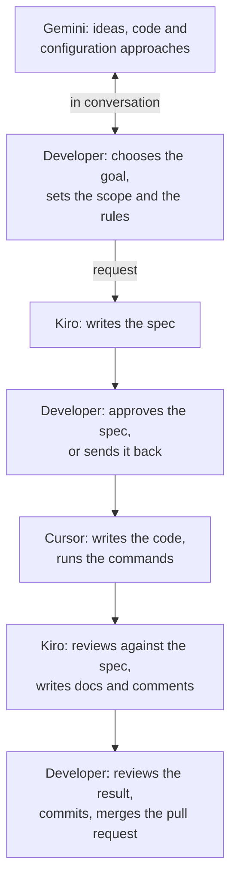

---
hide:
  - toc
---

# Design Manifest

This page explains how the project was built, then lists the key decisions behind it, grouped by phase. Each decision states what was chosen, why, and what was turned down. It is for anyone who wants to know who did what and why the project looks the way it does.

## AI-Driven Development

**The developer drove the project from start to finish, and AI tools augmented the work.** The developer chose the problem, set the scope and the rules for every phase, made each design and configuration decision, reviewed every result, and ran every git command. Three AI tools helped along the way, each with its own job:

- **Gemini,** in conversation with the developer, to shape the project idea and work through code and configuration approaches.
- **Kiro,** to turn the developer's requests into written specs, review the work against them, and write the docs and code comments.
- **Cursor,** to write the code a spec describes and run the commands.

No tool decided what the project is or does. A tool proposed, drafted, or built, and the developer accepted, changed, or rejected the result. The docs are written from the finished code, so they describe what exists and not what was planned.

### Who Does What?

- **The developer is in charge of every decision.**
    - **Chooses the goal and the scope:** the prediction task, the dataset, the model, the cloud services, and what each phase covers.
    - **Sets the rules:** the requirements and constraints each phase must meet, the key thresholds, and which files each tool may edit.
    - **Decides each design and configuration choice:** for example, the season split, the Docker layout, the AWS setup, and what the web app shows. Where a tool proposed options, the developer picked one, changed it, or turned it down.
    - **Approves or rejects every spec, and reviews every result.**
    - **Runs every git command** that changes the repository. Each phase has its own branch and pull request, and pull requests #1 to #9 are merged into `main`.
- **Gemini** was a working partner in conversation. With the developer, it helped generate and refine the project idea and its starting scope, and helped work through code and configuration approaches. The developer decided what to keep.
- **Kiro** is an AI agent in the Kiro IDE. It turns the developer's request into a written spec for Cursor. It reviews Cursor's work against the spec by reading the code, rerunning the tests, recomputing the numbers, and checking the live services. It writes all of `docs/` and the code comments, and it writes the pull request notes. Its git access is read-only.
- **Cursor** is an AI code editor. It implements each spec in `src/`, `tests/`, `frontend/`, and the config files, runs the commands, and fills in an implementation log from a template. It ends with a report of anything that differs from the spec, any choice the spec did not cover, and the real numbers beside the expected ones.

### How Does One Piece of Work Move Through the Tools?

1. **The developer asks.** A request states the goal, the limits, and what each tool may edit.
2. **Kiro writes the spec** in `specs/current/`. It lists what to build (the exact files, functions, messages, and settings), what must not change, the numbers to match, and when to stop and report.
3. **The developer approves the spec,** or sends it back with changes.
4. **Cursor builds it,** runs the tests after each step, and fills in the implementation log as it goes.
5. **Kiro reviews the result** against the spec and the repository. It rereads the code, reruns the tests, recomputes every number in the spec's "Numbers to Match", and checks the live services where the spec touches them.
6. **Kiro writes the docs** from the finished code. A number in the docs is recomputed from the data or the code before it is stated.
7. **The developer reviews and commits.** Fixes found in the review go into a new spec, and the loop repeats.
8. **Finished specs and logs move to `specs/archive/`.** `specs/` is a local working folder and is not committed.

### What Does a Spec Contain?

A spec is one Markdown file, named for its task, such as `specs/archive/phase-6-docker-spec.md` or `specs/archive/e2e-followup-spec.md`. Specs stay on the developer's computer and are not committed, so they are named here, not linked. It has these sections, in this order:

- **A summary of what the review found, or what the change is and why.** For example, the follow-up spec opens with the five problems the end-to-end report found and says what the spec does about them.
- **What Is Deliberately Not Changing.** The data, the model, the scores, and the files that must stay as they are.
- **Rules.** Which files Cursor may edit, where the log goes, and that no git command may change state.
- **Numbered steps.** Each step names the exact files, functions, text, and commands. Steps are grouped into parts when the work has two halves, such as Part A and Part B in the Docker spec.
- **Numbers to Match.** The exact test counts, scores, and sizes Cursor must reproduce.
- **Stop and Report If.** The conditions where Cursor must stop and report instead of changing the expected values.
- **Final Message.** What the last chat message from Cursor must cover.

### What Does the Implementation Log Contain?

Cursor copies `specs/current/cursor-implementation-template.md` to `specs/current/cursor-implementation.md` and fills it in as it works. The template has nine sections:

- **Spec Followed**
- **What Was Done**
- **Deviations From the Spec**
- **Decisions the Spec Did Not Cover**
- **Numbers: Expected and Actual**
- **Commands Run**
- **Files Created, Changed, or Deleted**
- **Not Done**
- **Questions for the Developer**

### What Is a Verification-Only Round?

A spec can ask Cursor for a report only, with no changes to the project. `specs/archive/e2e-verification-spec.md` is one: Cursor made a clean copy of the project, ran the pipeline, the make commands, the web build, and the live checks, and wrote what it found to `specs/archive/e2e-verification-report.md`. A second spec, `specs/archive/e2e-followup-spec.md`, then made the fixes the report called for and ran the checks the report could not run.

### How Is a Comment-Only Pass Checked?

Kiro runs comment-only passes across the code, sometimes split across several helper agents working in parallel. It proves that a pass changed no code by comparing parse trees of the files before and after. For Python it uses the `ast` module, and for the web app it uses a TypeScript parser. Every docs change is also checked with a strict MkDocs build.

### Why Does This Split Work?

The developer keeps control because every piece of work passes through them twice: once as a spec to approve, and once as a result to review. A written spec with numbers to match makes the build checkable, and a separate reviewer finds problems the builder would not.

## Problem Definition

### Why Binary Classification and Not Regression?

**The choice:** the model answers one yes-or-no question for each game: did the home team win? The answer is 1 (home win) or 0 (away win), stored in the column `home_win`. The model also gives the chance that the answer is 1. The alternative was regression, which predicts a number, such as the home team's point margin (home score minus away score).

**Why classification fits this project**

- **The question is who wins, not by how much.** The web app shows a predicted winner and a win probability. A classifier produces both directly. A logistic regression outputs a probability between 0 and 1, and the pick is that probability compared with 0.5.
- **A margin model needs an extra step to produce a probability.** Regression would give an expected margin such as "home by 3.2 points". To show "58% chance the home team wins", that margin has to be converted using an assumption about how far real margins stray from the prediction. That assumption would have to be estimated and checked, and it is one more place to be wrong. The classifier avoids it.
- **Margins are noisy, and big margins are a poor guide to who wins.** In the 1,759 games kept, the margin has an average of +1.56 and a standard deviation of 14.19 points, and ranges from -45 to +50. Games decided by 3 points or fewer are 429 (24.4%), and by 7 or fewer are 860 (48.9%). Games decided by 14 or more are 605 (34.4%). A regression fit on margins gives these blowouts a large pull on the fit, although a 35-point win says no more about who won than a 1-point win does.
- **The result is easy to judge.** A classifier is scored by how often the pick is right, shown next to the rule "always pick the home team" (see the next section). A margin model is scored by an average error in points. Always predicting the average margin is off by 11.04 points on average, and a reader has no easy way to say whether 10 points of error is good.
- **It matches the data.** A game ends with a winner or, rarely, a tie. The 6 tied games have no yes-or-no answer, so they are removed. This is covered in the [Phase 1 Implementation](./phase-1/implementation.md#what-is-the-prediction-task).

**What the choice gives up**

- **The size of the win.** A 1-point win and a 30-point win both count as 1 in the answer column. The model cannot say how close a game will be.
- **The margin is not ignored.** It enters through the second input: each team's point margin per game in earlier weeks of the season. The model uses margin as evidence about team strength, and only the final answer is win or lose.

**What was and was not tested**

- No regression model was trained or compared. The choice is made on design grounds above, not on a measured score. A regression comparison would also need a second set of scores and a conversion step, which this project does not build.

**What would change the choice**

- If the web app needed to show an expected score or an expected margin of victory, regression (or a regression alongside the classifier) would be the right tool.

### Why Accuracy With a Baseline, and Log Loss as a Check?

- **Accuracy is the headline score.** It is the share of games where the pick matches the result.
- **It is always shown next to a baseline,** the score of always picking the home team, which is the share of games the home team won (52.93% of the 1,759 kept games). A model only adds something if it beats that.
- **Log loss supports it.** It scores the probabilities and not just the picks, so it checks that "70%" means about 7 wins in 10. The web app shows a probability, which accuracy alone cannot vouch for. It is reported for validation and test games only, because the model is fitted by pushing it down on the training games.
- **Reported whatever it is.** The score is not tuned, and a poor score would still be stated.
- Details: [Phase 2 Part 2](./phase-2/implementation-part-2.md#step-5-score-the-model).

## Phase 1: Data Pipeline

Phase 1 fetches the games file, cleans it, and stores it in S3. See the [Phase 1 Brief](./phase-1/brief.md) and the [Phase 1 Implementation](./phase-1/implementation.md).

- **The nflverse games file,** regular season only, 2020 through week 10 of 2026. That stays within the past decade and uses the most recent data. Week 10 of 2026 is the last week where every game has a score.
- **Ties are removed (6 games),** rather than counted as an away win or half a win, because the question has exactly two answers.
- **The cleaned table goes to a private S3 bucket, and every later step downloads it back.** Training always starts from the S3 copy, never from a local file, so every run uses the shared version of the data. The raw file stays on the developer machine.
- **The bucket is created manually, not by code.** A script that creates AWS resources adds risk for no benefit.
- Details: [Phase 1 Implementation](./phase-1/implementation.md#which-choices-were-made).

## Phase 2: Features, Training, and Tracking

Phase 2 builds the two inputs, trains the model, and records each run. See the [Phase 2 Brief](./phase-2/brief.md), [Part 1](./phase-2/implementation-part-1.md), and [Part 2](./phase-2/implementation-part-2.md).

### Inputs and the Split

- **Two raw per-game inputs, not ranks.** They are the home team's win percentage minus the away team's, and the home team's point margin per game minus the away team's. Both use only earlier weeks of the same season, so a game's own result is never an input. A team with no games counts as 0.5 and 0.0, so week 1 gives 0 for both.
- **Why raw values.** Ranks drop the size of a gap (a +14 team and a +2 team can be neighbors), create ties in early weeks, and change when unrelated teams win. Raw values keep the gap, need no tie rule, and read directly ("+7.3 points per game better").
- **The scores were similar,** so the reason is clarity and not accuracy. Logistic regression with ranks got 169 of 271 validation games right (62.36%, log loss 0.6345) and 92 of 149 test games (61.74%). With raw inputs it got 171 of 271 (63.10%, log loss 0.6451) and 88 of 149 (59.06%).
- **Per game, not season totals,** so a team that has played more games, for example after a bye, is not favored.
- **The split is by season, not at random.** Training is 2020 to 2024 (1,339 games), validation is 2025 (271), and test is 2026 weeks 1 to 10 (149). A random split would put later games in training, and the model would be scored on games played before some of the games it learned from. The 2025 score is the one to report, and the test games never fit anything.
- Details: [Phase 2 Part 1](./phase-2/implementation-part-1.md).

### Model Choice

- **Logistic regression only, with no model comparison.** Turned down: a random forest as a second candidate, and XGBoost. One simple model is enough, the two inputs are simple, and an earlier test had the forest and logistic regression within a game or two of each other. Fixing the model type means the 2025 validation season is used only to report the score, so it is never used to choose between models.
- **A standardizing step is kept and saved with the model as one pipeline,** so the API cannot skip it. The two inputs are on different scales: win percentage differences run from -1 to 1, and point margin differences run about -49 to 39.
- Details: [Phase 2 Part 2](./phase-2/implementation-part-2.md#step-4-fit-the-scaler-and-the-model).

### Tracking and Reproducibility

- **MLflow records every run,** with its settings, scores, and files, so any run can be traced and compared.
- **The MLflow records stay local, and a readable log of every run is committed.** `mlflow.db`, `mlartifacts/`, and `models/` are not committed. The database is a binary file that changes on every run, and it and the logged model record the artifact folder as a full path on one machine, so a clone could not open them. One command recreates all three with identical scores. So that the logging can be read without running anything, training also writes [`mlflow-reference/`](https://github.com/jconnors23/510-m3-nfl-prediction-analytics/tree/main/mlflow-reference): each run's id, git commit, 15 parameters, 8 metrics, config copy and plot, and the logged model's text files, with the newest run in `latest-run/`, earlier runs in `previous-runs/`, `run-history.md` listing them all, and pictures of the MLflow screen. Each training run moves the last run into `previous-runs/`, so the folder grows into a lasting log. The history is built from these committed folders, not from `mlflow.db`, so it reads the same in any clone. The export leaves out the user name and every absolute path. Turned down: committing `mlflow.db` and `mlartifacts/` as they are, which would publish one computer's paths and user name and still not open in a clone.
- **A small readable file, `results/run-summary.json`, is committed.** It holds the settings, the data fingerprint, the scores, and the learned weights. It has no run ID, timestamp, git commit, or machine path, because each of those changes on every run and would show a change in git when nothing real changed.
- **The model is stored twice in each run, on purpose.** The plain `model.joblib` is the working copy the API loads, and it carries the input names, version, and training seasons. The MLflow-format copy lets MLflow's own screen and loader open the model. MLflow's format alone was not enough: in MLflow 3 it is not in the run's file list, and it does not carry those facts.
- **Every run records the scikit-learn version and a fingerprint of the data file,** so a run can be traced to the exact library and data it used.
- **Settings live in one file, `config/config.yaml`,** and package versions are pinned. Changing a run means editing the file, not the code.
- **scipy is pinned in `requirements.txt` too,** at the same 1.18.1 as the Lambda list. scikit-learn's solver uses scipy while fitting, so an unpinned scipy could fit slightly different weights on another machine.
- Details: [Phase 2 Part 2](./phase-2/implementation-part-2.md#step-6-record-the-run-in-mlflow) and [How Do I Reproduce the Result From a Clean Checkout?](./phase-2/development-guide.md#how-do-i-reproduce-the-result-from-a-clean-checkout).

## Phase 3: Local Prediction API

Phase 3 builds the FastAPI service and runs it on the developer machine. See the [Phase 3 Brief](./phase-3/brief.md) and the [Phase 3 Implementation](./phase-3/implementation.md).

- **FastAPI, not Flask.** The input checks (missing field, extra field, wrong type, out-of-range number) come from one request definition, and the test page at `/docs` needs no extra code. FastAPI also works with the Mangum adapter that Lambda needs. Flask would need a different adapter.
- **Strict input checks.** Unknown fields, numbers written as text, `NaN`, and out-of-range values are rejected with status 422 and an error that names the problem.
- **The API uses NumPy, not pandas.** The Lambda zip is 231.3 MB without `pandas` and 278.4 MB with it, against a 250 MB limit. See the [Phase 4 Implementation, Step 3](./phase-4/implementation.md#step-3-measure-the-package-size).
- **The model loads once, at start-up,** and the service refuses to start if the file is missing, unreadable, or built by a different scikit-learn version.
- **The pick rule is the scoring rule.** A probability above 0.5 is a home win, and exactly 0.5 is an away win.
- **The API is built and tested locally first,** with no Docker and no AWS.
- Details: [Phase 3 Implementation](./phase-3/implementation.md).

## Phase 4: AWS Deployment

Phase 4 puts the API on AWS. See the [Phase 4 Brief](./phase-4/brief.md) and the [Phase 4 Implementation](./phase-4/implementation.md).

- **AWS only:** S3, Lambda behind an API Gateway HTTP API, and CloudFront, all in `us-east-1`, where the data bucket already is. Turned down: Google Cloud and Azure.
- **The same FastAPI app runs locally and in Lambda, using Mangum.** Turned down: a separate, manually written Lambda function, which would repeat the input checks and the model call in a second place. See [What Is Mangum?](./phase-4/implementation.md#what-is-mangum).
- **Lambda runs from a zip file.** A container image in a private ECR repository is the fallback, used only if the zip goes over Lambda's size limit. The measured size fits.
- **The deployed model is checked on every game.** All 1,759 games were sent through the public API and compared with the local model: every pick and every probability matched, and the accuracy from the deployed answers equals the run summary. The zip's hash equals the hash Lambda stores for the function, so Lambda runs the file built here. See [Step 10](./phase-4/implementation.md#step-10-check-the-deployed-model-against-the-local-model).
- **Accuracy is the only priority for the deployment.** Latency and cost are not concerns for this project. The Lambda function's memory is 1769 MB, and it may be changed if that helps, but it is not a priority.
- **CORS is set on the gateway only,** with two origins allowed: the CloudFront address `https://d1nubiunzfwm0q.cloudfront.net` and the local Vite address `http://localhost:5173`.
- **The API is public, with no key, no request limit, and no firewall for now.** A key in a browser app would be visible to every visitor, so it would not protect the API. Protection can be added later if it is needed.
- **The API's AWS deployment is a set of written steps,** with no workflow file for it. Only the docs site and the web app are published by workflows.

## Phase 5: Web App and Hosting

Phase 5 builds the web app and hosts it on CloudFront. See the [Phase 5 Brief](./phase-5/brief.md) and the [Phase 5 Implementation](./phase-5/implementation-part-1.md). The questions that were open during the phase are settled in its [Decisions Made](./phase-5/brief.md#decisions-made).

- **The browser does the subtraction, and the API is unchanged.** The page ships each team's standings in a committed file and sends the API the same two numbers as before. The page subtracts two teams' values from that file (home minus away), and everything checked in Phase 4 stays valid. Turned down: an API that takes two team names, which would change the deployed function and its zip, and need the Phase 4 checks to be run again. See [Who Works Out Each Number?](./phase-5/implementation-part-1.md#who-works-out-each-number).
- **The web app's fonts are bundled into the build,** from the `@fontsource-variable` npm packages, and served from CloudFront. Turned down: loading them from Google Fonts, which would be the page's only outside request. The docs site does load Oswald from Google Fonts, because it has no such rule.
- **The web app and the docs site share two themes,** light and dark, built from white, black, purple, orange, gold, silver, and amber, with every text pair at least 4.5 to 1 contrast. Both start in the reader's system setting, and both have a toggle. The web app does not save the choice, because it uses no local storage. The docs site's theme (Material) does save it.
- **The site's predictions use the API unchanged.** Games by Week and Custom Matchup work out every game's two inputs in the browser, from standings in a committed season file, so the prediction function and its zip did not change. Turned down: a route that takes a game id, which would put the schedule into the Lambda zip and need the Phase 4 checks run again.
- **The web app has its own private bucket,** `510-m3-nfl-web-app`, read only by its CloudFront distribution. It is separate from the data bucket, so the data bucket's settings are not touched. Turned down: putting the site in the data bucket, which would mix public page files with the private data and change that bucket's settings.
- **The front-end is a small Vite web app, hosted as static files on CloudFront.** The page runs in the visitor's browser, calls the live API with `fetch`, and shows the answer. The built files sit in a private S3 bucket behind CloudFront, and the Vite development server is for local work only. The other options that were considered:
    - **Streamlit and Gradio** run a Python server of their own. That is a second server to deploy and keep running, and it could load the model itself and skip the live API. A static page can only get its answer from the API, so the API stays the one place the model runs.
    - **Streamlit Community Cloud, Hugging Face Spaces, and Vercel** are free and quick to set up. Each would put the front-end with a second provider, apart from the data, the API, and the logs. CloudFront keeps everything in one AWS account, at the cost of more setup: a bucket, an access control, a distribution, and a CORS entry.
    - **S3's own website hosting** serves only HTTP and needs a public bucket. A private bucket behind CloudFront gives HTTPS and keeps the bucket closed.
- **The web app reads one snapshot of the standings,** taken after 2026 week 10, which is the same standing the model would use for a week 11 game.
- **The profiles file keeps every digit,** so the browser's subtraction gives exactly the number Python gives, and the deployed model sees the same inputs the local model does.

## Phase 6: Docker

Phase 6 adds one Dockerfile with a `train` target and a `serve` target. See the [Phase 6 Brief](./phase-6/brief.md#decisions-made) for the full list of Docker choices and the [Phase 6 Implementation](./phase-6/implementation.md).

- **Docker comes after the API, AWS, and the web app (Phase 6),** with one Dockerfile and two targets, `train` and `serve`. Nothing before it needs an image. The README and the final review (Phase 7) come after it, because they describe and check the finished project. Turned down: building Docker in Phase 3, which would put a packaging step ahead of the web app without unblocking anything.
- **One Dockerfile, not two.** The `train` and `serve` targets live in one file, so the install steps, the Python version, and the package pins are written once. Turned down: two Dockerfiles, which would repeat the install steps and let the two drift apart.
- **The serve image trains its own model while it is built,** so it works from a fresh copy of the repository, where `models/` does not exist. Turned down: mounting `models/` from the laptop. The other Docker choices are in the [Phase 6 Brief](./phase-6/brief.md#decisions-made).

## Phase 7: Review

Phase 7 is the README and the final review. See the [Phase 7 Brief](./phase-7/brief.md).

- **The README and the review are one phase, Phase 7,** not two. Both read the finished project and neither adds code, and the review's clean rebuild follows the README, so writing and checking it go together.

## Extras

Extras is work that belongs to no one phase. Each phase's pages then describe only that phase's work.

### Make Commands

- **The Makefile has nine commands:** `train`, `pytest`, `web-test`, `start`, `start-web`, `start-web-ml`, `docs`, `docker-train`, and `docker-serve`. Commands that are run rarely, such as rebuilding the data files, stay as the plain commands in the Development Guides. See [Makefile](./extras/development/makefile.md).

### GitHub Workflows

There are four workflows. The docs workflow is in [Docs Site](#docs-site), and the other three are below. See [GitHub Workflows](./extras/development/github-workflows.md).

- **GitHub Actions redeploys the web app with a short-lived AWS sign-in.** The workflow `deploy-web-app.yml` runs on a change under `frontend/` on `main`, and signs in to AWS through GitHub's OpenID Connect provider, as a role that only `main` of this repository can use. The role can only upload files to the web app bucket and invalidate its distribution. Turned down: an IAM user's access key saved as a GitHub secret, which never expires and would work from any branch or fork that got hold of it. See [How Does a Change Reach the Live Web App?](./extras/development/github-workflows.md#how-does-a-change-reach-the-live-web-app).
- **A third workflow runs the Python tests on every pull request,** with no secrets and no AWS access. It runs `make pytest` before any model exists, so it expects 93 passed and 2 skipped. Turned down: training in the workflow, which would add a run to `mlflow-reference/` on every pull request. See [How Are the Python Tests Run?](./extras/development/github-workflows.md#how-are-the-python-tests-run).
- **A fourth workflow runs the web app's tests and build on each pull request that changes `frontend/`,** also with no secrets and no AWS access. Before it, the web tests ran only in Deploy Web App, after the change had reached `main`. Turned down: running it on every pull request, which would spend a runner on changes that cannot affect the web app. See [How Are the Web App's Tests Run on a Pull Request?](./extras/development/github-workflows.md#how-are-the-web-apps-tests-run-on-a-pull-request).

### Feedback Form

- **Feedback goes to a DynamoDB table, through its own small function.** One item per message, written by `src/api/feedback_handler.py` on the route `POST /feedback`. That route alone has a request limit (1 a second, bursts of 5), because it writes. Turned down: an S3 bucket, which would store one file per message and give no simple way to count or list them. Also turned down: a feedback route in the prediction function, which would change the zip that every prediction runs.
- See [Feedback Path](./extras/features/feedback-path.md).

### Confusion Matrix Picture

- See [Confusion Matrix](./extras/features/confusion-matrix.md).

### MLflow Run History

- The choices behind the run history are in [Tracking and Reproducibility](#tracking-and-reproducibility). The history itself is [`run-history.md`](https://github.com/jconnors23/510-m3-nfl-prediction-analytics/blob/main/mlflow-reference/run-history.md).

### Docs Site

- **The docs are published with GitHub Pages,** built by MkDocs with the Material theme from `mkdocs.yml`, which is committed. A GitHub Actions workflow (`.github/workflows/deploy-docs.yml`) builds the site in strict mode and publishes it whenever a change to the docs reaches `main`. Turned down: keeping the site local only. Publishing needs no extra service, and the README can link to the live pages.
- **A phase starts with a brief,** and gets its implementation page and guides once it is built.
- **Work that belongs to no one phase has its own Extras section:** the [make commands](./extras/development/makefile.md), the [GitHub workflows](./extras/development/github-workflows.md), the [feedback form](./extras/features/feedback-path.md), and the [confusion-matrix picture](./extras/features/confusion-matrix.md). Each phase's pages then describe only that phase's work.
- **The original brief and requirements are kept unchanged** in `docs/implementation/requirements/`, next to the requirements map.
