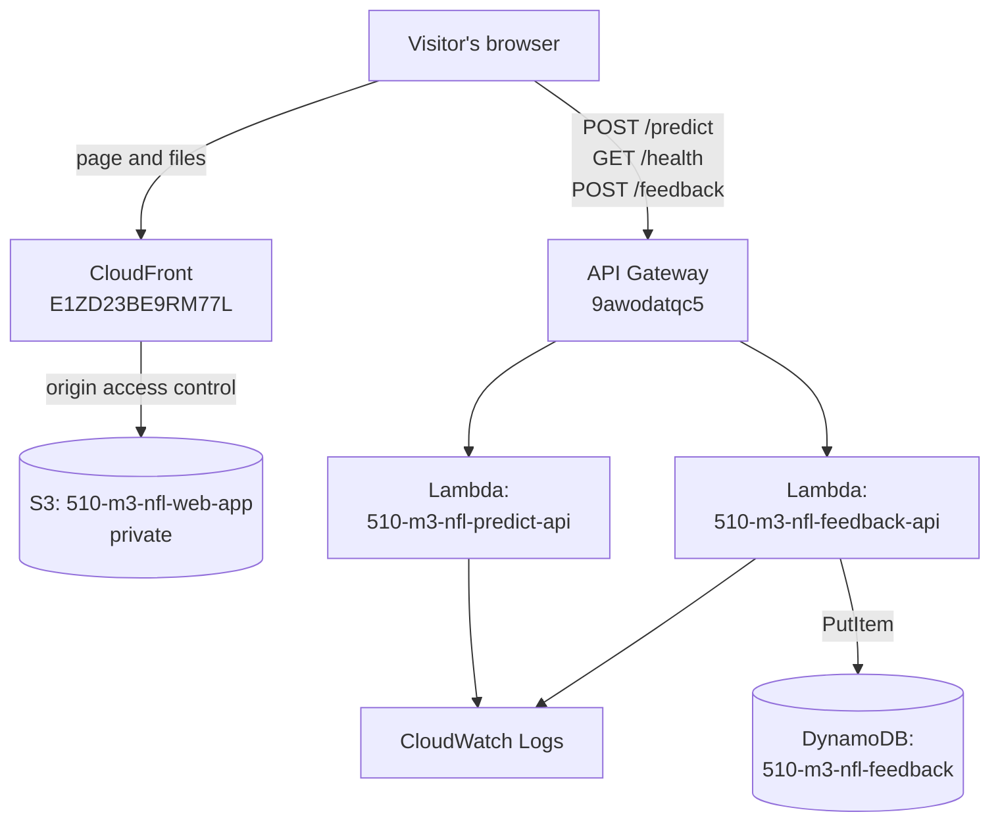
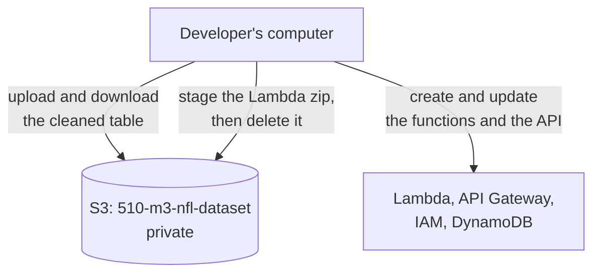
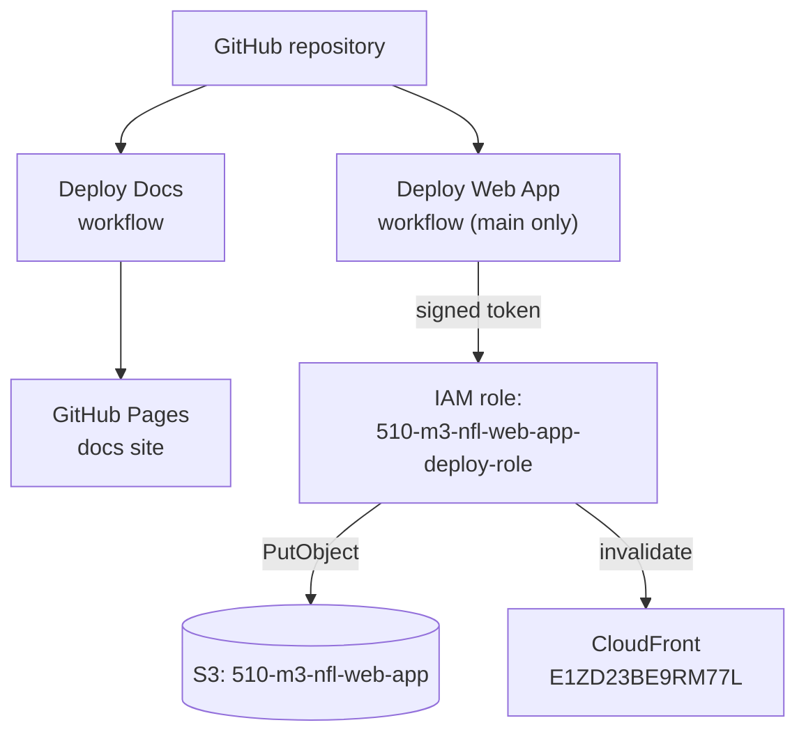

---
hide:
  - toc
---

# Cloud Architecture

This page lists every cloud resource the project uses, with its exact name and settings, and shows how they connect. Most are on AWS in the region `us-east-1`. The docs site is on GitHub Pages, which is not AWS. The commands that create each resource are in [Deploy the API](../../phase-4/deployment-guide.md) and [Deploy the Web App](../../phase-5/deployment-guide.md), which this page links to and does not copy.

## How Does Everything Connect?

The cloud resources are used from three places: a visitor's browser, which loads the web app and calls the API; the developer's computer, which uploads the data and deploys the API; and GitHub, which deploys the web app and publishes the docs site. Each diagram below shows one of them. The sections after the diagrams give each resource's exact settings.

### What Does a Visitor's Browser Reach?

### What Does the Developer's Computer Reach?

### What Does GitHub Reach?

The Test Python and Test Web App workflows also run on the repository, but they reach no cloud resource.

The browser talks to two separate front doors: CloudFront for the page, and API Gateway for predictions and feedback. See [Frontend and Backend Connection](./frontend-backend-connection.md).

## Which Settings Apply to Every Resource?

- **Region:** `us-east-1`. CloudFront is global, but its commands still pass this region.
- **Tag:** `project=510-m3` on every resource that supports tags.
- **Names:** lowercase words joined by hyphens, starting `510-m3-nfl-`, then what the thing is. The exceptions are ids that AWS assigns, such as the API id `9awodatqc5` and the distribution id `E1ZD23BE9RM77L`.
- **Account number:** never written in the docs. Role addresses use `<account-id>` in its place.

## What Is in the Data Bucket?

**`510-m3-nfl-dataset`** is a private S3 bucket. It was created manually in Phase 1.

- **Holds:** one object, `data/processed/nfl_matchups_2020_2026.csv` (63,908 bytes), the cleaned game table. It also briefly holds the Lambda zip under the key `deploy/510-m3-nfl-predict-api.zip`. The zip is over the console's 50 MB direct-upload limit, so it is staged here and deleted after the function is created or updated.
- **Settings:** all four public-access blocks on, AES-256 encryption, versioning off.
- **Read by:** the developer's computer, with the developer's own AWS sign-in, through `python -m src.data.download_from_s3`. No Lambda function reads it, and the prediction function's role has no access to it.
- **More:** [How Is the Cloud Storage Set Up?](../../phase-1/index.md#how-is-the-cloud-storage-set-up).

## What Runs the Predictions?

**The Lambda function `510-m3-nfl-predict-api`** answers `POST /predict` and `GET /health`. The [ML Workflow](./ml-workflow.md) page shows how its model is made.

| Setting | Value |
| :--- | :--- |
| Package type | Zip file (not a container image) |
| Architecture | `arm64` |
| Runtime | Python 3.13 |
| Handler | `src.api.lambda_handler.handler` |
| Memory | 1769 MB |
| Timeout | 10 seconds |
| Environment variable | `JOBLIB_MULTIPROCESSING=0`, which stops a harmless joblib warning about multiprocessing, because Lambda does not provide it |
| Zip contents | `src/`, `config/`, `models/model.joblib`, and the packages in `requirements-serve.txt` |

- **Mangum** is the small library inside the function that turns API Gateway's event into a request the FastAPI app understands, and turns the answer back. See [What Is Mangum?](../../phase-4/index.md#what-is-mangum).
- **The role `510-m3-nfl-predict-api-role`** is trusted by `lambda.amazonaws.com`. Its only permission is the AWS-managed policy `AWSLambdaBasicExecutionRole`, which allows `logs:CreateLogGroup`, `logs:CreateLogStream`, and `logs:PutLogEvents`. It has no inline policy and no access to either S3 bucket.
- **Commands:** [Build the Zip](../../phase-4/deployment-guide.md#build-the-zip), [Create the Role](../../phase-4/deployment-guide.md#create-the-role), and [Stage the Zip and Create the Function](../../phase-4/deployment-guide.md#stage-the-zip-and-create-the-function).

## What Saves the Feedback?

The Feedback tab sends its message to a function of its own, so the prediction function and its zip stay unchanged. Details are in the feedback route section of [Frontend and Backend Connection](./frontend-backend-connection.md#how-does-the-feedback-route-fit-in).

- **The Lambda function `510-m3-nfl-feedback-api`:** Python 3.13 on `arm64`, 256 MB, a 5-second timeout, handler `src.api.feedback_handler.handler`. The zip holds one file, `src/api/feedback_handler.py`, and uses the `boto3` that Lambda provides. The environment variable `FEEDBACK_TABLE=510-m3-nfl-feedback` names the table.
- **The role `510-m3-nfl-feedback-api-role`:** the same trust and the same log-writing policy as the prediction role, plus one inline policy, `510-m3-nfl-feedback-write`. That policy allows only `dynamodb:PutItem`, and only on the table `510-m3-nfl-feedback`.
- **The DynamoDB table `510-m3-nfl-feedback`:** key `feedback_id` (text), billed per request, encrypted with the default AWS key. One item is saved for each submission.
- **Commands:** [Add the Feedback Route](../../phase-5/deployment-guide.md#add-the-feedback-route).

## What Is the Public Address of the API?

**The API Gateway HTTP API `510-m3-nfl-predict-http-api`** has the id `9awodatqc5` and the address `https://9awodatqc5.execute-api.us-east-1.amazonaws.com`. It uses the `$default` stage.

| Route | Sent to | Limit |
| :--- | :--- | :--- |
| `POST /predict` | `510-m3-nfl-predict-api` | none |
| `GET /health` | `510-m3-nfl-predict-api` | none |
| `POST /feedback` | `510-m3-nfl-feedback-api` | 1 request a second, bursts of 5 |

- **Only `/feedback` is throttled.** It writes to a table. The prediction routes only read, and have no limit.
- **CORS** (the browser's check of which page addresses may call the API) allows two origins: `http://localhost:5173`, the local dev server, and `https://d1nubiunzfwm0q.cloudfront.net`, the live web app. It allows the methods `POST`, `GET`, and `OPTIONS`, the header `content-type`, and a preflight cache of 300 seconds. The setting replaces itself as a whole, so a change must list both origins. The exact answers are in [The Preflight](../../phase-5/index.md#the-preflight).
- **Commands:** [Create the HTTP API](../../phase-4/deployment-guide.md#create-the-http-api) and [Add the CloudFront Address to the API's CORS List](../../phase-5/deployment-guide.md#add-the-cloudfront-address-to-the-apis-cors-list).

## Where Do the Logs Go?

**CloudWatch Logs** keeps each function's output in its own log group: `/aws/lambda/510-m3-nfl-predict-api` and `/aws/lambda/510-m3-nfl-feedback-api`. Both groups keep logs for 14 days. The setup steps are in [Stage the Zip and Create the Function](../../phase-4/deployment-guide.md#stage-the-zip-and-create-the-function) and [Add the Feedback Route](../../phase-5/deployment-guide.md#add-the-feedback-route).

## How Is the Web App Hosted?

- **The bucket `510-m3-nfl-web-app`:** private, with all four public-access blocks on, AES-256 encryption, and ownership `BucketOwnerEnforced`. It holds the files of the production build (`frontend/dist/`): `index.html`, the hashed script and style files, and the fonts. Older hashed files stay, so a visitor who loaded the previous page a moment earlier still gets the files it names.
- **The origin access control `510-m3-nfl-web-app-oac`:** makes CloudFront sign each request to the bucket (signing protocol `sigv4`, behavior `always`). Its id is `E2S63K0CTCQG24`.
- **The bucket policy:** lets the CloudFront service read files only when the request comes from the distribution `E1ZD23BE9RM77L`. A policy that names one distribution is not public.
- **The CloudFront distribution `E1ZD23BE9RM77L`:** the address is `https://d1nubiunzfwm0q.cloudfront.net`. The default file is `index.html`, plain `http` is redirected to `https`, only `GET` and `HEAD` are allowed, responses are compressed, and the certificate is CloudFront's default one. The cache policy is AWS's `Managed-CachingOptimized`, which follows each file's `Cache-Control` header.
- **Commands:** [Create the Bucket](../../phase-5/deployment-guide.md#create-the-bucket), [Create CloudFront](../../phase-5/deployment-guide.md#create-cloudfront), and [Let Only This Distribution Read the Bucket](../../phase-5/deployment-guide.md#let-only-this-distribution-read-the-bucket).

## How Does GitHub Deploy the Web App?

No AWS key is stored in GitHub. The workflow `deploy-web-app.yml` asks GitHub for a signed token, and AWS trades it for short-lived credentials. How the workflow runs is on [How Does a Change Reach the Live Web App?](../development/github-workflows.md#how-does-a-change-reach-the-live-web-app).

- **The OpenID Connect sign-in provider:** `token.actions.githubusercontent.com`, registered in the AWS account, so AWS can check GitHub's tokens.
- **The deploy role `510-m3-nfl-web-app-deploy-role`:** sessions last at most an hour. It has no attached policies and one inline policy, `510-m3-nfl-web-app-deploy`:
    - `s3:PutObject` on `510-m3-nfl-web-app/*` only.
    - `cloudfront:CreateInvalidation` and `cloudfront:GetInvalidation` on the distribution `E1ZD23BE9RM77L` only.
- **Who may use it:** the role trusts the token only when its audience is `sts.amazonaws.com` and its subject is the `main` branch of this repository, `repo:jconnors23@59714706/510-m3-nfl-prediction-analytics@1458181148:ref:refs/heads/main`. GitHub adds the owner's id and the repository's id after each name. A run on another branch, a pull request, or a fork fails at the sign-in step.
- **Commands:** [Let GitHub Actions Deploy](../../phase-5/deployment-guide.md#let-github-actions-deploy).

## What Is Published Outside AWS?

**GitHub Pages** serves this docs site at `https://jconnors23.github.io/510-m3-nfl-prediction-analytics/`. The workflow `deploy-docs.yml` builds it with `mkdocs build --strict` when a change to `docs/` or `mkdocs.yml` reaches `main`. It uses GitHub's own Pages permissions and no AWS account. See [How Are the Docs Published?](../development/github-workflows.md#how-are-the-docs-published).

## Who Can Reach What?

**Public:**

- **The web app** at `https://d1nubiunzfwm0q.cloudfront.net`. Anyone can load it.
- **The API** at `https://9awodatqc5.execute-api.us-east-1.amazonaws.com`. It needs no sign-in. CORS only tells browsers which pages may call it. It does not stop other programs, so `/feedback` has its request limit.
- **The docs site** on GitHub Pages.

**Private:**

- **`510-m3-nfl-dataset`:** only the developer's own AWS sign-in.
- **`510-m3-nfl-web-app`:** only the CloudFront distribution `E1ZD23BE9RM77L`, for reading, and the deploy role, for writing. Direct S3 addresses return status 403.
- **`510-m3-nfl-feedback`:** only the feedback function's role can write to it, and only with `PutItem`. Reading the saved messages needs the developer's own sign-in.

**What each role can do:**

| Role | Used by | Can do |
| :--- | :--- | :--- |
| `510-m3-nfl-predict-api-role` | Prediction Lambda function | Write its own logs |
| `510-m3-nfl-feedback-api-role` | Feedback Lambda function | Write its own logs, and `dynamodb:PutItem` on `510-m3-nfl-feedback` |
| `510-m3-nfl-web-app-deploy-role` | The GitHub workflow, from `main` only | `s3:PutObject` on `510-m3-nfl-web-app/*`, and `cloudfront:CreateInvalidation` and `cloudfront:GetInvalidation` on `E1ZD23BE9RM77L`. It cannot delete, list, or change settings. |

Nothing in GitHub can reach the Lambda functions. The model and API are deployed manually, as described in [What Is Not Automated?](../development/github-workflows.md#what-is-not-automated).
