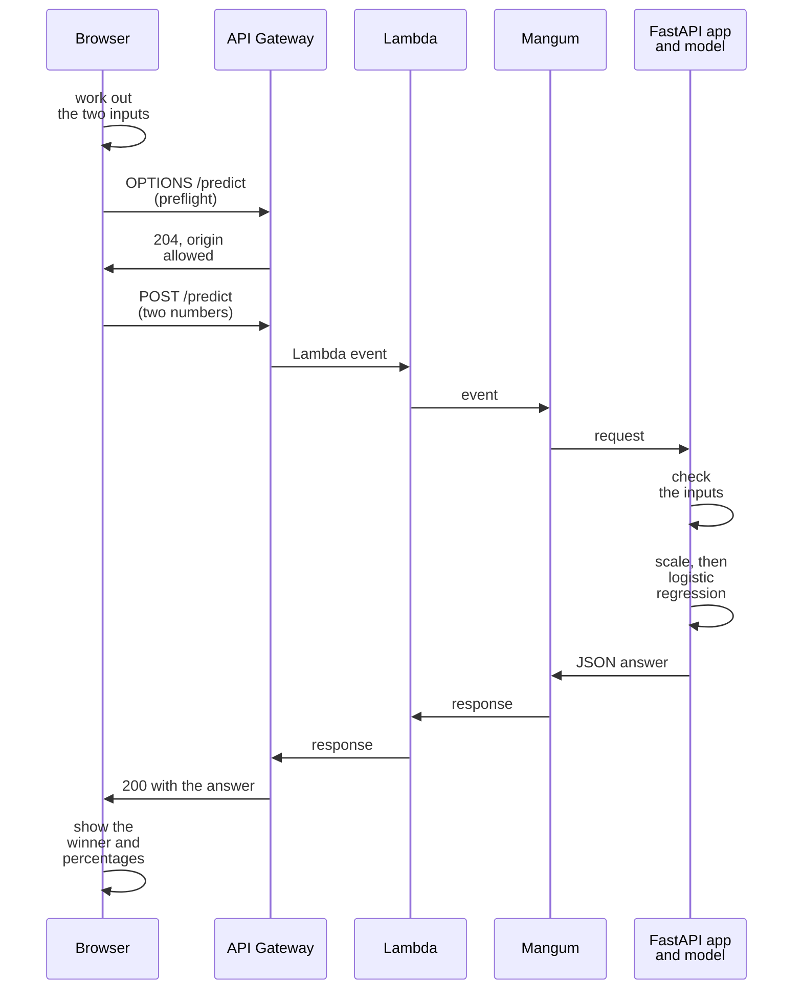
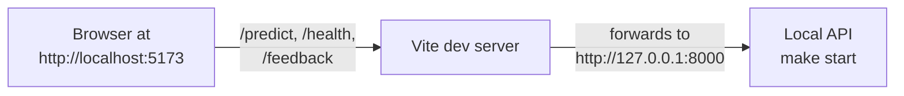
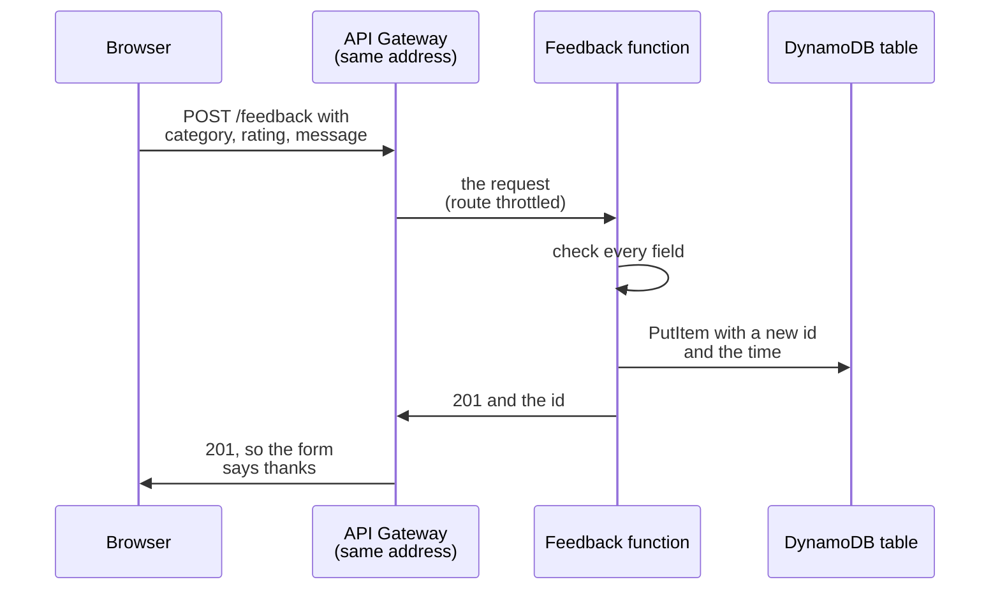

---
hide:
  - toc
---

# Frontend and Backend Connection

This page follows one click from the browser to the prediction API and back. It covers what the browser loads, how a prediction travels, how the page chooses the API address, how local development differs from the live site, and what the page shows when a call fails. The exact request and answer formats are in [Phase 5, Implementation Part 1](../../phase-5/index.md#implementation-part-1), and the AWS resources are on [Cloud Architecture](./cloud-architecture.md).

## What Does the Browser Load?

The page is a static site: the browser fetches files from CloudFront and runs them. The server does no work for the page itself.

- **From `https://d1nubiunzfwm0q.cloudfront.net`:** `index.html`, one hashed script file, one hashed style file, and the fonts. CloudFront reads them from the private bucket `510-m3-nfl-web-app`.
- **Two data files travel inside the script.** `frontend/src/App.tsx` imports [`team-profiles.json`](https://github.com/jconnors23/510-m3-nfl-prediction-analytics/blob/main/frontend/src/data/team-profiles.json) and [`season-2026.json`](https://github.com/jconnors23/510-m3-nfl-prediction-analytics/blob/main/frontend/src/data/season-2026.json), and the build packs them into that file. The browser makes no request for them while the page runs.
- **Who writes them:** `python -m src.profiles` writes `team-profiles.json`, and `python -m src.season` writes `season-2026.json`. Both read the downloaded game table, and both files are committed. The page therefore shows the standings as of week 10 of 2026 until someone rebuilds the files and deploys again. See [How Do I Rebuild the Profiles File?](../../phase-5/index.md#how-do-i-rebuild-the-profiles-file).
- **What the files hold:** each team's wins, games, points, and per-game values, and every 2026 game with the standings before each week. The browser needs no model and no data download to fill the pickers.

## How Does a Prediction Travel?

The browser works out the two inputs itself, from the committed standings, and sends only those two numbers. See [Who Works Out Each Number?](../../phase-5/index.md#who-works-out-each-number).

- **The browser sends `POST {base address}/predict`** with the header `Content-Type: application/json` and nothing else it sets itself. The call is cut off after **15 seconds** (`timeoutMs: 15000` in `frontend/src/App.tsx`).
- **API Gateway applies CORS.** The page and the API have different addresses, so the browser first asks with an `OPTIONS` request. The API's list allows `https://d1nubiunzfwm0q.cloudfront.net` and `http://localhost:5173`. An address not on the list gets status 204 with no `access-control-*` headers, and the browser then refuses to send the `POST`.
- **Lambda runs Mangum and the FastAPI app.** The same app runs on a laptop under uvicorn. See [What Is Mangum?](../../phase-4/index.md#what-is-mangum).
- **The browser checks the answer** before showing it (`isPredictResponse` in `frontend/src/api.ts`). The label must match the prediction, and the probability must be a number from 0 to 1.
- **The exact request body and answer,** with worked examples, are in [What Does the Browser Send?](../../phase-5/index.md#what-does-the-browser-send).

## How Is the API Address Chosen?

The address is a build-time setting, `VITE_API_BASE_URL`, read once when the page loads.

| Where the page runs | File | Value | Result |
| :--- | :--- | :--- | :--- |
| Live site (production build) | `frontend/.env.production` | `https://9awodatqc5.execute-api.us-east-1.amazonaws.com` | The page calls the live API. |
| Dev server | `frontend/.env.development` | empty | The page calls its own address, and Vite forwards the call. |

- **`readApiBaseUrl`** in `frontend/src/config.ts` removes a trailing slash, because the callers add `/predict` themselves.
- **In a production build, an empty address stops the page.** The function throws "VITE_API_BASE_URL is not set." A production page has no dev server to forward calls, so an empty address would call the site's own host. The build itself still finishes, and the error appears when the page loads. The page then shows "This page is not configured: VITE_API_BASE_URL is not set."
- **A production address must start with `https://`.** The page is served over https, so a plain `http` address would be blocked as mixed content.
- **No secret goes in these files.** The value is written into the built script, and anyone can read it.
- **To point the app at another API,** see [How Do I Point the App at a Different API?](../../phase-5/index.md#how-do-i-point-the-app-at-a-different-api).

## How Does Local Development Differ?

- **The Vite dev server forwards three paths** (`/predict`, `/health`, and `/feedback`) to `http://127.0.0.1:8000`, set by `server.proxy` in [`frontend/vite.config.ts`](https://github.com/jconnors23/510-m3-nfl-prediction-analytics/blob/main/frontend/vite.config.ts). The environment variable `API_PROXY_TARGET` changes that address for one run.
- **The browser sees only its own address,** so it makes no cross-origin call, sends no preflight, and CORS does not apply.
- **The port is fixed at 5173** (`strictPort`), because the live API's CORS list allows only that local address.
- **The local API has no `/feedback` route.** Sending the form from the dev server gets status 404. The route exists only on AWS.
- **To use the live API from the dev server,** set `VITE_API_BASE_URL` to the live address for that run. The preflight then applies, and `http://localhost:5173` is on the list. See [Step 3: Try the Live API From the Dev Server (Optional)](../../phase-5/index.md#step-3-try-the-live-api-from-the-dev-server-optional).
- **Commands for both programs:** [Makefile](../development/makefile.md).

## What Does the Page Show When a Call Fails?

`predict` in `frontend/src/api.ts` never throws. Every outcome comes back as a value, and `failureText` in `frontend/src/App.tsx` turns each failure into one sentence.

| Outcome (`kind`) | When it happens | Text shown |
| :--- | :--- | :--- |
| `http-error`, status 422 | The API rejected the numbers. | "The API rejected the request (status 422): " followed by the API's message |
| `http-error`, status below 500 (not 422) | Any other client-side status, such as 404 | "Unexpected answer from the API (status 404)." with the real status |
| `http-error`, status 500 or above | The API or the gateway failed. | "The API had a problem (status 502)." with the real status |
| `unreachable` | The network call failed, or the caller cancelled it. | "Could not reach the API." |
| `timeout` | No answer within 15 seconds. | "The API took too long to answer." |
| `unexpected-body` | Status 200, but the body is not a valid answer. | "The API answered with something unexpected." |

- **Only status 200 is a prediction.** Any other status is read as an error, with the message taken from `detail` or `message` in the body when there is one.
- **Verified:** with the local API stopped, the Vite dev server returns status 502 for `/predict`, and the page shows "The API had a problem (status 502)."
- **A newer click cancels an older call.** The older call is reported as `unreachable`, and the page drops that answer.

## How Does the Feedback Route Fit In?

The Feedback tab sends each visitor's message to `POST /feedback` on the same API, and a small Lambda function of its own saves it in a DynamoDB table. The prediction function is not touched. The form was built with the five-tab site in [Phase 5, Implementation Part 2](../../phase-5/index.md#implementation-part-2), and it is an extra feature, not an assignment requirement. It is live at [https://d1nubiunzfwm0q.cloudfront.net/#feedback](https://d1nubiunzfwm0q.cloudfront.net/#feedback), and the AWS commands that created it are in [Add the Feedback Route](../../phase-5/deployment-guide.md#add-the-feedback-route).

### What Does the Form Ask For?

- **Category:** General, Predictions, The site, or Something is broken.
- **Rating (optional):** 1 to 5.
- **Message (required):** 10 to 1,000 characters.
- **No personal details are asked for,** and the form says not to include any. Nothing identifies the visitor: no name, email, address, or cookie.
- **After sending:** "Thanks. Your feedback was saved." A failure shows a readable message, as the predictions do.
- **An invisible field catches simple spam bots.** People cannot see it, so only a bot fills it. A submission that fills it gets the same thanks message, but nothing is saved.

### Why Does It Need Its Own Route?

- **A browser cannot write to S3 or DynamoDB without AWS credentials,** and no credentials can be put in a public page. So the form sends its message to the API, and a function on AWS writes it.
- **A separate function, not a new route in the prediction function.** Adding a route there would change the zip that every prediction runs. The prediction function's code fingerprint (`CodeSha256`) is the same before and after.
- **DynamoDB, not S3.** S3 would store one file per message, with no simple way to count or list them.

### How Does the Feedback Reach the Table?

#### The Request and the Answer

- **Request:** `POST {VITE_API_BASE_URL}/feedback`, `Content-Type: application/json`, and a body with exactly these keys:
    - `category`: one of `general`, `predictions`, `site`, `broken`.
    - `rating`: a whole number from 1 to 5, or `null`.
    - `message`: text, 10 to 1,000 characters after trimming spaces.
    - `website`: the invisible field. It must be an empty string.
- **Answer when saved:** status 201 and `{"status":"received","feedback_id":"<id>"}`.
- **Answer when a field is wrong:** status 422 and `{"detail":"<what is wrong>"}`, such as "The message must be 10 to 1,000 characters."
- **A body over 4,096 bytes, or one that is not JSON:** status 400.
- **The invisible field filled in:** status 201 with the same answer, and nothing is saved.
- **CORS:** the API's origin list, covered earlier on this page, applies to this route too, so it needed no change.

#### What Is Saved

One item per submission, in the table `510-m3-nfl-feedback`:

- `feedback_id`: a random UUID made by the function. It is the table's key.
- `submitted_at`: the time in UTC, such as `2026-11-23T14:05:09Z`.
- `category`, `rating` (left out when `null`), and `message`, as sent.

Nothing else is saved: no address, no browser details, and no cookie.

### What Was Created on AWS?

Three resources were added: the DynamoDB table `510-m3-nfl-feedback`, the Lambda function `510-m3-nfl-feedback-api` with its role, and the route `POST /feedback` on the existing HTTP API, with its own integration and its own permission to call the new function. The route has a request limit of 1 request a second, with bursts of up to 5, because it writes to a table. Their exact settings (memory, timeout, role policy, log retention) are in [What Saves the Feedback?](./cloud-architecture.md#what-saves-the-feedback) and [What Is the Public Address of the API?](./cloud-architecture.md#what-is-the-public-address-of-the-api) on Cloud Architecture.

### Where Is the Code?

- **`src/api/feedback_handler.py`:** the Lambda function. It checks every field, then saves one item.
- **`tests/test_feedback.py`:** 9 tests, using a stand-in for DynamoDB, so no AWS account is needed.
- **`frontend/src/feedback.ts`:** the same field checks in the browser, and the `fetch` call, which never throws, like `predict`.
- **`frontend/src/App.tsx`:** the Feedback tab.

### What Was Checked?

- One test submission was saved, read back, and deleted. The table then held 0 items.
- A filled invisible field saved nothing.
- A 5-character message got 422 with "The message must be 10 to 1,000 characters." In the browser, the same message shows the length message and sends nothing.
- A preflight from the CloudFront address got 204.
- The stage's only route limit is `POST /feedback`, and the function's role can only write logs and call `dynamodb:PutItem` on this one table.
- The prediction function's code fingerprint is `IU5bJH9pTL+rF/uEXMUAp+Eo/mik2abfaSasBXPOgbk=` before and after.

To read the saved messages, see [Read the Feedback](../../phase-5/deployment-guide.md#read-the-feedback).
