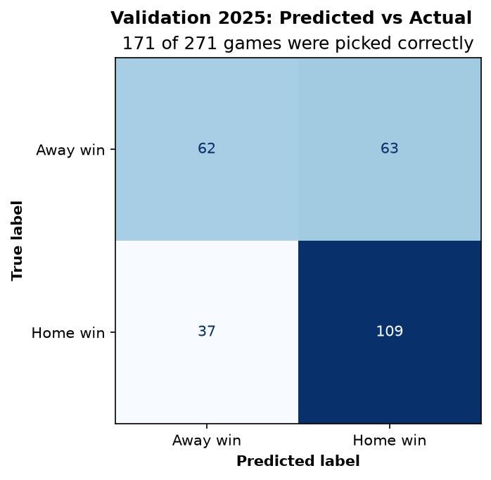
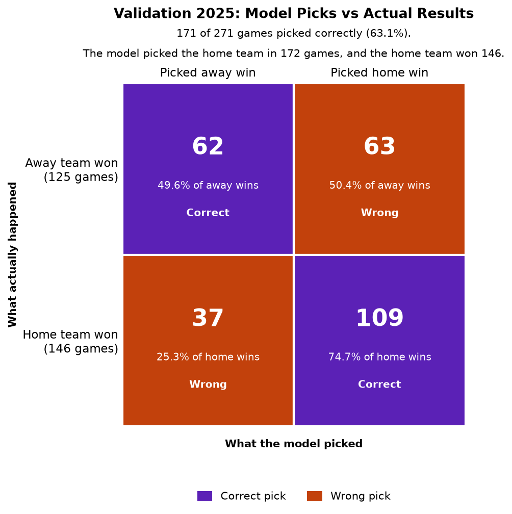

---
hide:
  - toc
---

# The Confusion-Matrix Picture

Every training run stores one picture in MLflow: the model's picks against the real results for the 2025 validation games. Phase 2 drew it with scikit-learn's standard drawing, which is hard to read for anyone outside machine learning. It was redrawn later, with the same data, the same file name (`confusion_matrix_validation.png`), and the same place in each run. The scores and the model did not change. The table the picture shows, and why validation is the season scored, are in [What Does the Confusion Matrix Show?](../phase-2/implementation-part-2.md#what-does-the-confusion-matrix-show).

**Status: Built.** The first run with the new picture is `cf80ea42`, in `mlflow-reference/latest-run/`.

## What Was Hard to Read in the First Version?

{ width="360" }

- **The color showed the size of the count, not whether the pick was right.** The wrong-pick cell with 63 games was shaded darker than the wrong-pick cell with 37, and almost as dark as the correct-pick cell with 62. Nothing in the picture said which cells were correct.
- **The axis names were machine-learning terms.** "True label" and "Predicted label" mean "what actually happened" and "what the model picked", but the picture did not say so.
- **Only raw counts were shown.** The reader had to work out that the model got 109 of 146 home wins right (74.7%) but only 62 of 125 away wins (49.6%).
- **The main pattern was not stated.** The model picks the home team in 172 of 271 games, while home teams won 146.

## What Does the New Picture Show?

{ width="520" }

- **Color means right or wrong.** Correct-pick cells are purple (`#5b21b6`) and wrong-pick cells are orange (`#c2410c`), the site's link and action colors. Both carry white text, at contrast ratios of 9.0 to 1 and 5.2 to 1, above the 4.5 to 1 minimum for text.
- **Each cell gives three things:** the count in large bold type, the share of that row, and the word "Correct" or "Wrong".
- **Each row's share uses that row's games.** "49.6% of away wins" means 62 of the 125 games the away team won.
- **Plain, bold axis names:** "What actually happened" down the side, and "What the model picked" under the grid. The column labels ("Picked away win", "Picked home win") sit above the grid, and each row label carries its game count.
- **The title block** is three lines of figure text: the title, the accuracy ("171 of 271 games picked correctly (63.1%)."), and the home-pick pattern ("The model picked the home team in 172 games, and the home team won 146.").
- **A legend** under the grid names the two colors.
- **Every number comes from the data,** never typed in: the season, the counts, the shares, the correct total, and the home picks.

## How Is It Drawn?

- **`confusion_cell_labels(matrix)`** in `src/model/evaluate.py` returns each cell's count, share, and verdict as text. A row with no games gets the share "no games". It reads nothing and draws nothing, so the wording is tested without opening the image.
- **`plot_confusion_matrix(pipeline, group, path)`** counts the picks with the same 0.5 rule as the scores, draws the four cells as rectangles, writes the text from `confusion_cell_labels`, and saves the picture at 150 dots per inch. It is 1004 by 1008 pixels and 87,311 bytes.
- **The two colors** are set once, as `CORRECT_COLOR` and `WRONG_COLOR`.
- **Tests in `tests/test_evaluate.py`:** `test_cell_labels_give_counts_row_shares_and_right_or_wrong` checks all four cells for the real validation counts, and `test_cell_labels_handle_a_row_with_no_games` checks the empty-row case. The existing test that the picture is a non-empty PNG drawn without a window still passes.

## What Stayed the Same?

- **The scores and the model.** `results/run-summary.json` and `models/model.joblib` kept their bytes after the next `make train`.
- **The pictures in earlier runs.** The folders under `mlflow-reference/previous-runs/` record what each run produced, so they keep the first version.
- **Run folders are now larger.** A run with the new picture adds about 95 KB to `mlflow-reference/`, against about 40 KB before, because the new picture is 87 KB.
