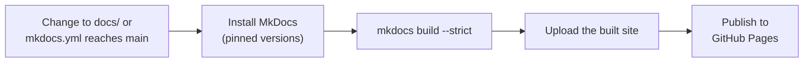
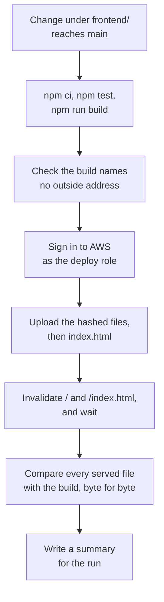

---
hide:
  - toc
---

# Make Commands and GitHub Workflows

The `Makefile` gives short names to the commands used most while working on the project, and two GitHub Actions workflows publish the docs site and the web app when a change reaches `main`. Neither belongs to one phase: the make commands cover Phases 2 to 6, and the workflows publish the output of every phase. This page lists each command and explains what each workflow does.

## Which Make Commands Are There?

Run every command from the project folder. Python commands use `.venv/bin/python`, which can be changed with `PYTHON=...`, for example `make pytest PYTHON=python3.13`.

- **`make train`:** trains the model, logs the run to MLflow, and adds the run to the committed log in `mlflow-reference/`. See [How Do I Do a Training Run?](../phase-2/development-guide.md#how-do-i-do-a-training-run).
- **`make pytest`:** runs every Python test.
- **`make web-test`:** runs the web app's tests.
- **`make start`:** starts the FastAPI prediction service at `http://127.0.0.1:8000`.
- **`make start-web`:** starts the web app's dev server at `http://localhost:5173`. It forwards `/predict` and `/health` to the service from `make start`.
- **`make start-web-ml`:** starts the MLflow screen at `http://127.0.0.1:5001`, with every run in your local `mlflow.db`. Run `make train` once first, so the database exists.
- **`make docs`:** previews the docs site at `http://127.0.0.1:8001`.
- **`make docker-train`:** builds the Docker `train` image and runs one training inside it. See the [Phase 6 Development Guide](../phase-6/development-guide.md).
- **`make docker-serve`:** builds the Docker `serve` image and starts the API inside it at `http://127.0.0.1:8000`. See the [Phase 6 Development Guide](../phase-6/development-guide.md).

### Which Ports Do They Use?

- **8000:** `make start` and `make docker-serve`. Only one of the two can run at a time.
- **5173:** `make start-web`. The port is fixed, because the live API's CORS list allows only this local address.
- **5001:** `make start-web-ml`. MLflow's default, 5000, is often held by macOS Control Center.
- **8001:** `make docs`, so the docs preview does not take the API's port. A plain `mkdocs serve` uses 8000 and blocks `make start`.

### What Do the Commands Need?

- **`make docs` uses the `mkdocs` on your PATH,** because MkDocs is not one of the project's Python packages. Install it once with `pip install mkdocs==1.6.1 mkdocs-material==9.7.7 pymdown-extensions==12.0.1`, the versions the docs workflow uses.
- **The two Docker commands need Docker Desktop running.**
- **Left out on purpose:** commands that are run rarely stay as plain commands in their phase's guide. These are rebuilding the data files (`python -m src.profiles`, `python -m src.season`) and the web app's production build (`npm run build` in `frontend/`).

## How Are the Docs Published?

The workflow `.github/workflows/deploy-docs.yml` builds this site and publishes it to GitHub Pages at `https://jconnors23.github.io/510-m3-nfl-prediction-analytics/`.

- **When it runs:** a push to `main` that changes `docs/`, `mkdocs.yml`, or the workflow file itself. It can also be started by hand from the repository's Actions tab.
- **A broken link stops it.** The strict build fails on a broken link or section link, so a bad page never reaches the published site.
- **The same versions as on a laptop:** Python 3.13, `mkdocs==1.6.1`, `mkdocs-material==9.7.7`, and `pymdown-extensions==12.0.1`.
- **No commit is made.** The built site is uploaded and published by GitHub Pages' own actions, so the Actions bot never becomes an author in the repository.
- **One run at a time.** A newer run waits for the one already running.
- **Permissions:** read the repository, write to Pages, and ask for the token that the Pages deploy action needs. Nothing else.

## How Does a Change Reach the Live Web App?

The workflow `.github/workflows/deploy-web-app.yml` redeploys the web app when a change under `frontend/` reaches `main`. It can also be started by hand from the repository's Actions tab. Its first run, on the merge of `phase-five` into `main`, passed.

- **A failed test or check stops the run before anything is uploaded.** On GitHub, the two every-game checks' expected files do not exist, so those tests are skipped, and the run expects **60 passed and 2 skipped**.
- **The build may name only known addresses:** the API, and the fixed `www.w3.org`, `react.dev`, `github.com`, and `jconnors23.github.io` strings. Any other address stops the run.
- **No AWS key is stored in GitHub.** The run asks GitHub for a signed token that names the repository and the branch. AWS checks it against the GitHub sign-in provider (OpenID Connect) and trades it for the deploy role's credentials, which last at most an hour.
- **Only `main` of this repository can use the role.** The role trusts the token only when it names `repo:jconnors23/510-m3-nfl-prediction-analytics:ref:refs/heads/main`. A run on another branch, a pull request, or a fork fails at the sign-in step.
- **The role can do two things:** upload files into the web app bucket (`s3:PutObject`), and create and read invalidations on this one distribution. It cannot delete, list, or change settings, and it has no access to the data bucket, the Lambda functions, the API, or any other distribution.
- **The role's address is the repository secret `AWS_WEB_APP_DEPLOY_ROLE_ARN`.** It is a secret only because it holds the account number.
- **One run at a time.** A second run waits for the first, so two uploads never overlap.
- **A summary on every run.** The summary step runs even when an earlier step failed, and writes `not checked` for a step that did not run, so a failed run still says how far it got.
- **The same steps as by hand.** The upload, the cache settings, and the invalidation are the ones in [Redeploy After a Change](../phase-5/deployment-guide.md#redeploy-after-a-change). The commands that created the sign-in provider and the role are in [Let GitHub Actions Deploy](../phase-5/deployment-guide.md#let-github-actions-deploy).

## What Is Not Automated?

- **The Python model and API.** Training, the Lambda zip, and the function update are run by hand, following the [Phase 4 Deployment Guide](../phase-4/deployment-guide.md). Nothing in GitHub can reach the Lambda functions.
- **The Docker images.** They are built and run on a laptop only, and are not pushed anywhere.
- **The Python tests.** No workflow runs `pytest`. They run on a laptop with `make pytest`, and inside the Docker images.
