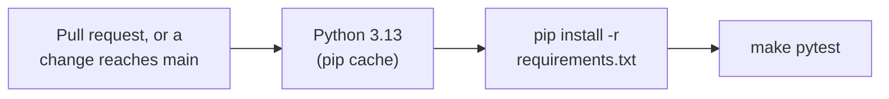
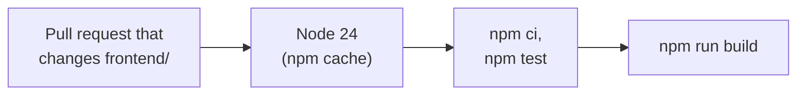
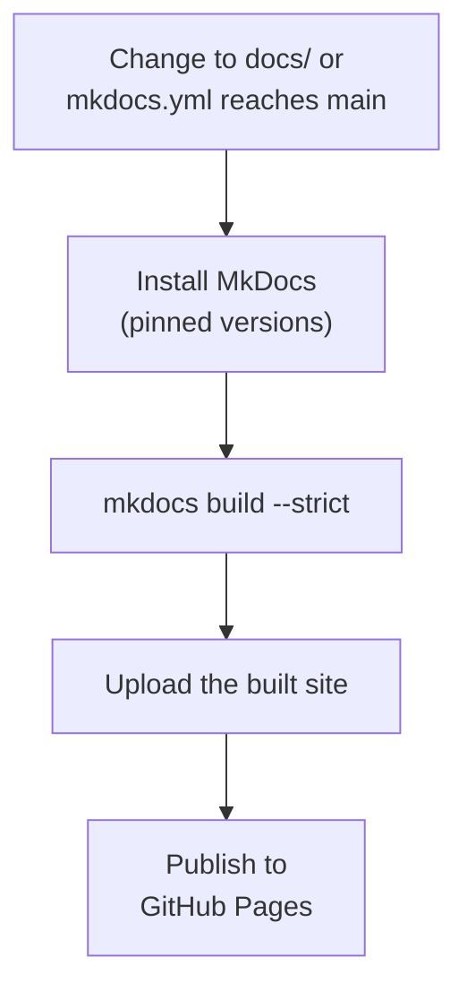
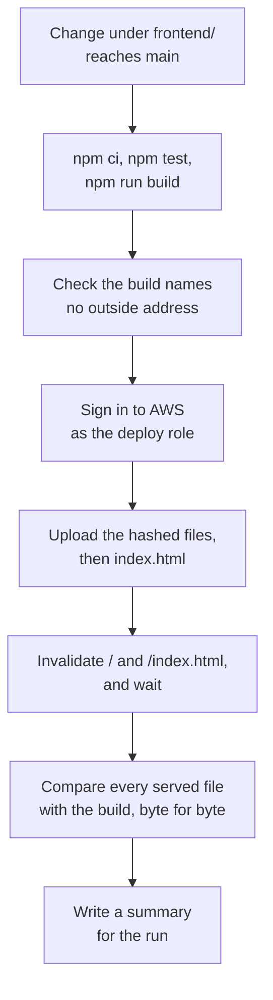

---
hide:
  - toc
---

# GitHub Workflows

Four GitHub Actions workflows run on this repository. `test-python.yml` runs every Python test on each pull request, and `test-web.yml` runs the web app's tests and build on each pull request that changes the web app. When a change reaches `main`, `deploy-docs.yml` builds and publishes this docs site, and `deploy-web-app.yml` tests, builds, and publishes the web app. This page explains what each workflow does, when it runs, and what it is allowed to do. The commands used on a laptop are on [Makefile](./makefile.md).

## How Are the Python Tests Run?

The workflow `.github/workflows/test-python.yml` runs `make pytest`, the same command as on a laptop, on a fresh GitHub runner.

- **When it runs:** on every pull request, on every push to `main`, and manually from the repository's Actions tab.
- **Expected: 93 passed, 2 skipped.** The runner has no trained model, because `models/` is not committed, so the last test in `tests/test_api.py` and the last in `tests/test_lambda_handler.py` are skipped.
- **The same pins as everywhere else:** Python 3.13 and `requirements.txt`. The pip download cache is keyed on `requirements.txt`, so a changed pin installs fresh packages.
- **No secrets and no AWS.** Its only permission is to read the repository. The tests use made-up data and stand-ins for S3, DynamoDB, and the model.
- **It does not block a merge by itself.** GitHub shows its result on the pull request. Making it a required check is a repository setting.

## How Are the Web App's Tests Run on a Pull Request?

The workflow `.github/workflows/test-web.yml` runs the web app's tests and its production build on a fresh GitHub runner, before the change reaches `main`.

- **When it runs:** on a pull request that changes `frontend/` or the workflow file itself, and manually from the repository's Actions tab. A pull request that changes only Python or docs does not start it.
- **Expected: 63 passed, 2 skipped.** The two every-game parity tests need expected files that the scripts in `scripts/checks/` write with a trained model, and the runner has neither.
- **The build is a check too.** `npm run build` runs the TypeScript compiler first, so a type error fails the pull request.
- **No secrets and no AWS.** Its only permission is to read the repository, and it deploys nothing. Deploy Web App runs the same tests again when the change reaches `main`.
- **It does not block a merge by itself,** the same as Test Python.

## How Are the Docs Published?

The workflow `.github/workflows/deploy-docs.yml` builds this site and publishes it to GitHub Pages at `https://jconnors23.github.io/510-m3-nfl-prediction-analytics/`.

- **When it runs:** a push to `main` that changes `docs/`, `mkdocs.yml`, or the workflow file itself. It can also be started manually from the repository's Actions tab.
- **A broken link stops it.** The strict build fails on a broken link or section link, so a bad page never reaches the published site.
- **The same versions as on a laptop:** Python 3.13, `mkdocs==1.6.1`, `mkdocs-material==9.7.7`, and `pymdown-extensions==12.0.1`.
- **No commit is made.** The built site is uploaded and published by GitHub Pages' own actions, so the Actions bot never becomes an author in the repository.
- **One run at a time.** A newer run waits for the one already running.
- **Permissions:** read the repository, write to Pages, and ask for the token that the Pages deploy action needs. Nothing else.

## How Does a Change Reach the Live Web App?

The workflow `.github/workflows/deploy-web-app.yml` redeploys the web app when a change under `frontend/` reaches `main`. It can also be started manually from the repository's Actions tab. Its first run, on the merge of `phase-five` into `main`, passed.

- **A failed test or check stops the run before anything is uploaded.** The runner has no `build/` expected files, so the two parity tests skip and the run expects **63 passed and 2 skipped**.
- **The build may name only known addresses:** the API, and the fixed `www.w3.org`, `react.dev`, `github.com`, and `jconnors23.github.io` strings. Any other address stops the run.
- **No AWS key is stored in GitHub.** The run asks GitHub for a signed token that names the repository and the branch. AWS checks it against the GitHub sign-in provider (OpenID Connect) and trades it for the deploy role's credentials, which last at most an hour.
- **Only `main` of this repository can use the role.** A run on another branch, a pull request, or a fork fails at the sign-in step. The exact token subject is on [How Does GitHub Deploy the Web App?](../architecture/cloud-architecture.md#how-does-github-deploy-the-web-app).
- **The role can do two things:** upload files into the web app bucket (`s3:PutObject`), and create and read invalidations on this one distribution. It cannot delete, list, or change settings, and it has no access to the data bucket, the Lambda functions, the API, or any other distribution.
- **The role's address is the repository secret `AWS_WEB_APP_DEPLOY_ROLE_ARN`.** It is a secret only because it holds the account number.
- **One run at a time.** A second run waits for the first, so two uploads never overlap.
- **A summary on every run.** The summary step runs even when an earlier step failed, and writes `not checked` for a step that did not run, so a failed run still says how far it got.
- **The same steps as a manual redeploy.** The upload, the cache settings, and the invalidation are the ones in [Redeploy After a Change](../../phase-5/deployment-guide.md#redeploy-after-a-change). The commands that created the sign-in provider and the role are in [Let GitHub Actions Deploy](../../phase-5/deployment-guide.md#let-github-actions-deploy).

## What Is Not Automated?

- **The Python model and API.** Training, the Lambda zip, and the function update are run manually, following [Deploy the API](../../phase-4/deployment-guide.md). Nothing in GitHub can reach the Lambda functions.
- **The Docker images.** They are built and run on a laptop only, and are not pushed anywhere.
- **Training.** No workflow trains the model or adds a run to `mlflow-reference/`. That is `make train`, run by the developer and committed.
