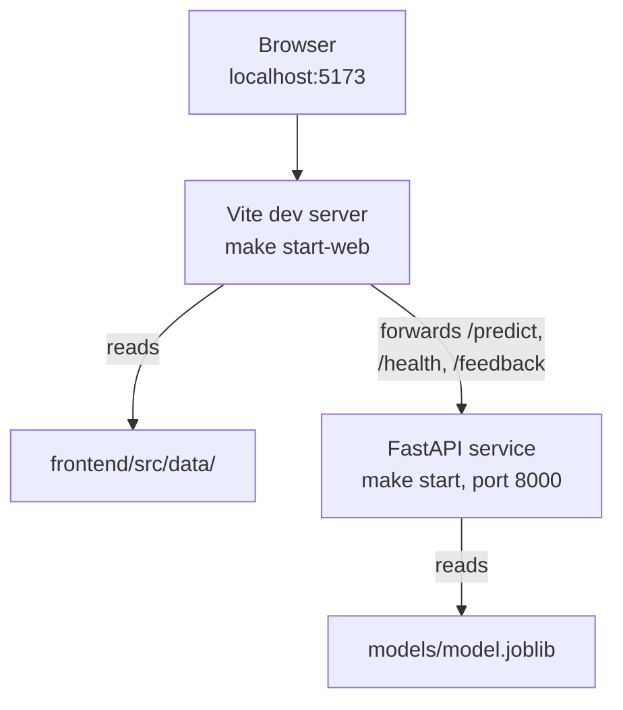
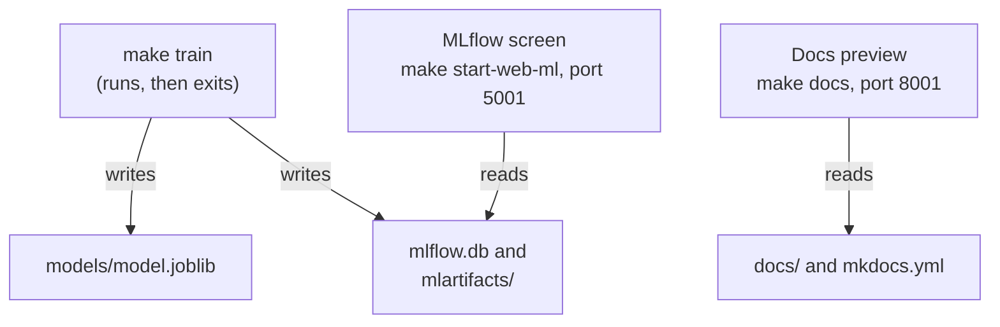
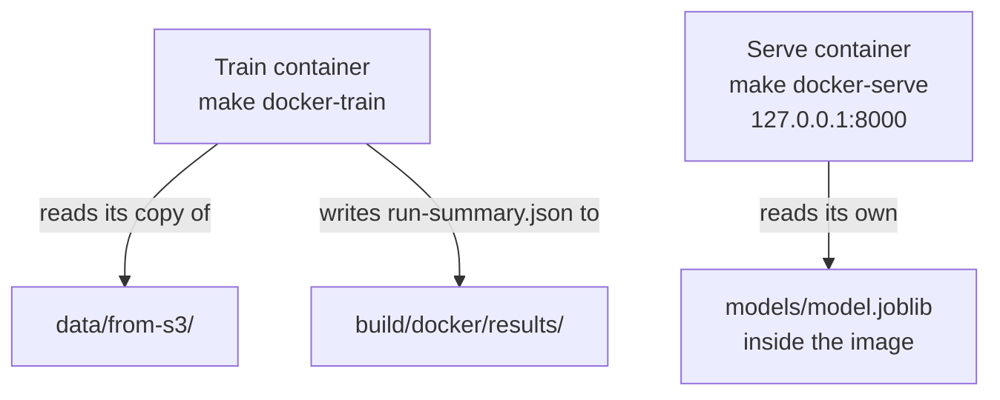

---
hide:
  - toc
---

# Running Locally

This page shows everything that can run on a laptop while working on the project, which port each piece uses, and which files each one reads. It also gives a short walk-through for each kind of work: the model, the API, the web app, the docs, and the Docker images. Use it to decide which pieces to start for a task. [Makefile](./makefile.md) owns the detail of each command, so this page links to it and does not repeat it.

## How Do the Local Pieces Fit Together?

Each box is a program that runs on the laptop. Arrows show which program calls which, and which files each one reads. The ports are the addresses a browser or `curl` uses.

### The Web App and the API



### Training, MLflow, and the Docs



### The Docker Containers



- **`make start` and `make docker-serve` both use port 8000.** Run only one of them at a time.
- **The production preview calls the live API,** not the local one, so its page can only check that the built files load. See [How Do I Build and Preview the Site?](../../phase-5/development-guide.md#how-do-i-build-and-preview-the-site).
- **`make train` is not a running program.** It writes `models/model.joblib`, `mlflow.db`, and `mlartifacts/`, then exits. Both the API and the MLflow screen read what it wrote.

## Which Port Does Each Piece Use?

| Piece | Command | Port | Reads | Can run with `make start`? |
| :--- | :--- | :--- | :--- | :--- |
| FastAPI service | `make start` | 8000 | `models/model.joblib` | Is `make start` |
| Vite dev server | `make start-web` | 5173 | `frontend/src/`, `frontend/src/data/` | Yes, and it needs it for predictions |
| MLflow screen | `make start-web-ml` | 5001 | `mlflow.db` | Yes |
| Docs preview | `make docs` | 8001 | `docs/`, `mkdocs.yml` | Yes |
| Docker serve container | `make docker-serve` | 8000 | its own model, trained inside the image | No, same port |
| Docker train container | `make docker-train` | none | its own copy of `data/from-s3/` | Yes |
| Production preview | `npm run preview` | 4173 | `frontend/dist/` | Yes |

## What Must Be Set Up First?

Create the Python environment, install the web app's packages, and install MkDocs once. The steps are in [What Must Be Set Up First?](./makefile.md#what-must-be-set-up-first). Docker Desktop must be running for the two Docker commands only.

The versions of every tool are on the [Tooling Guide](./tooling-guide.md).

## Which Ports Clash?

- **Port 8000** is the only clash between commands in this project. The FastAPI service (`make start`) and the Docker serve container (`make docker-serve`) both use it, so stop one before starting the other.
- **Port 5173** is fixed. If another program holds it, Vite stops with `Port 5173 is already in use` and does not move. The live API's CORS list allows only that address.
- **Ports 5001 and 8001** were chosen to avoid defaults that clash. macOS Control Center often holds MLflow's default, 5000, and MkDocs' default, 8000, is the API's port.
- **To see what holds a port,** run this and read the program name in the output:

```bash
lsof -i :8000
```

## How Do I Work on the Model?

Use this when changing a setting, the split, an input, or the data. [Phase 2 Development Guide](../../phase-2/development-guide.md) has the detail.

1. Edit `config/config.yaml`, or the code under `src/model/`.
2. Train the model:

```bash
make train
```

3. Open the MLflow screen to compare this run with earlier ones:

```bash
make start-web-ml
```

4. Run the Python tests:

```bash
make pytest
```

5. Commit the changed files in `results/` and `mlflow-reference/` with the code. See [What Is Kept in Git After a Retrain?](../../phase-2/development-guide.md#what-is-kept-in-git-after-a-retrain).

## How Do I Work on the API?

Use this when changing a route, a rule, or what a response holds. [Phase 3 Development Guide](../../phase-3/development-guide.md) has the detail.

1. Train the model once, if `models/model.joblib` does not exist:

```bash
make train
```

2. Start the service:

```bash
make start
```

3. In another terminal, check that it answers:

```bash
curl http://127.0.0.1:8000/health
```

4. Send the worked example, which should return a home win probability of 0.3296:

```bash
curl -X POST http://127.0.0.1:8000/predict -H "Content-Type: application/json" -d '{"win_pct_differential": -0.5, "point_diff_per_game_differential": -18.0}'
```

5. To restart the service on every code change, see [How Do I Restart the Service on Every Change?](../../phase-3/development-guide.md#how-do-i-restart-the-service-on-every-change).
6. Run the Python tests:

```bash
make pytest
```

## How Do I Work on the Web App?

Use this when changing the page, the tabs, or the matchup code. [Phase 5 Development Guide](../../phase-5/development-guide.md) has the detail.

1. Start the local API in one terminal:

```bash
make start
```

2. Start the dev server in a second terminal:

```bash
make start-web
```

3. Open `http://localhost:5173`. The page reloads each time a file in `frontend/src/` is saved.
4. Run the web tests:

```bash
make web-test
```

5. Before finishing, check that the production build compiles. Run it inside `frontend/`:

```bash
npm run build
```

The Feedback tab does not work against the local API, which has no `/feedback` route. See [make start-web](./makefile.md#make-start-web).

## How Do I Work on the Docs?

Use this when editing a page under `docs/`. [Phase 6 Development Guide](../../phase-6/development-guide.md) covers the Docker side, and the docs workflow is in [GitHub Workflows](./github-workflows.md#how-are-the-docs-published).

1. Start the preview:

```bash
make docs
```

2. Open `http://127.0.0.1:8001/510-m3-nfl-prediction-analytics/`. The page reloads on each save.
3. The preview prints a broken link as a warning and keeps running. Before committing, run the same strict build the docs workflow runs:

```bash
mkdocs build --strict
```

## How Do I Check the Container?

Use this to confirm the packaged project trains and answers the same as the local one. [Phase 6 Development Guide](../../phase-6/development-guide.md) has the detail. Start Docker Desktop first.

1. Train inside a container:

```bash
make docker-train
```

2. Compare its summary with the local one. No output means the two files are identical:

```bash
diff build/docker/results/run-summary.json results/run-summary.json
```

3. Stop `make start` if it is running, because the next step uses port 8000. Then start the serve container:

```bash
make docker-serve
```

4. In another terminal, send the worked example. The answer should match the local API's:

```bash
curl -X POST http://127.0.0.1:8000/predict -H "Content-Type: application/json" -d '{"win_pct_differential": -0.5, "point_diff_per_game_differential": -18.0}'
```

5. Press Ctrl+C in the serve terminal. The container is removed when it stops.
6. To run the tests inside the images, see [Where Do the Tests Run?](./testing-guide.md#where-do-the-tests-run).
