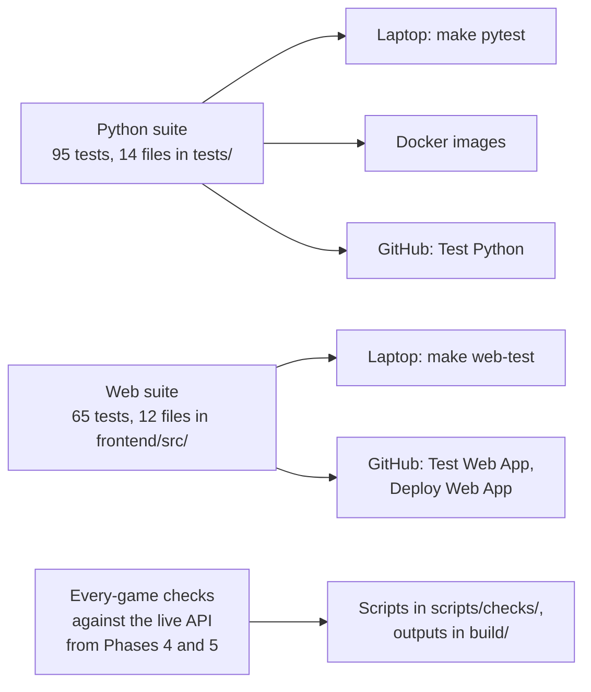

---
hide:
  - toc
---

# Testing Guide

This page lists every automated check in the project and how to run it. There are two test suites, **95 Python tests** and **65 web app tests**, and a few larger checks that send every game to the live API. It also explains where each suite runs and how to add a test. The make commands that run the suites are described in [Makefile](./makefile.md).

## Which Checks Exist?



No test needs an AWS account, credentials, or the internet. Each one uses made-up data, a temporary folder, or a stand-in for the real thing (a replacement object that gives fixed answers).

## What Does the Python Suite Cover?

The suite is run with `make pytest`, which runs `.venv/bin/python -m pytest` with the settings in `pytest.ini`. It holds **95 tests in 14 files**. The counts below come from `grep "^def test_"` on each file.

| File | Tests | What it covers and what it uses in place of the real thing |
| :--- | :--- | :--- |
| `tests/test_api.py` | 17 | The local prediction service: answers, field order, rejected input, health, start-up failures. A made-up model in a temporary folder and FastAPI's test client, so no server starts. |
| `tests/test_clean.py` | 2 | The cleaning rules: ties, playoff games, and out-of-window seasons are dropped. A few made-up games held in memory. |
| `tests/test_download_from_s3.py` | 2 | The S3 download keeps the old file when S3 fails. A `Mock` S3 client and a temporary folder. |
| `tests/test_evaluate.py` | 6 | Accuracy, log loss, and the confusion-matrix image. A stand-in object that returns fixed probabilities, and made-up games. |
| `tests/test_export_mlflow.py` | 10 | The readable copy of an MLflow run, the run history, and the rule that no user name or absolute path leaks. Small runs logged into a temporary MLflow database. |
| `tests/test_features.py` | 7 | The two inputs, checked against values worked out manually. Four made-up teams over three weeks. |
| `tests/test_feedback.py` | 9 | The feedback function: valid saves, refusals, size limits, storage error. A small `Table` class that records what would be saved, and made-up API Gateway events. |
| `tests/test_fetch_raw.py` | 3 | The games-file download. `requests.get` replaced with a stand-in, and a temporary folder. |
| `tests/test_lambda_handler.py` | 6 | The AWS Lambda entry point and the rule that it does not import pandas. Made-up events and a model fitted in a temporary folder. |
| `tests/test_profiles.py` | 8 | The team profiles file the web app imports. The downloaded games table, recounted with plain sums, and a stand-in for the file swap. |
| `tests/test_season.py` | 8 | The 2026 season file. The raw schedule and the downloaded games table, plus tiny made-up tables for the error cases. |
| `tests/test_split.py` | 5 | The split of games by season. Made-up rows and settings in memory, plus one read of `config/config.yaml`. |
| `tests/test_train.py` | 11 | Fitting, saving, and logging a run. Random games from a fixed seed, and every file under a temporary folder. |
| `tests/test_upload.py` | 1 | The S3 upload stops when the object size differs. A `Mock` S3 client and a temporary folder. |

The 14 counts sum to 17 + 2 + 2 + 6 + 10 + 7 + 9 + 3 + 6 + 8 + 8 + 5 + 11 + 1 = **95**.

### Which Two Tests Skip Without a Model?

- **`test_real_model_worked_example`** is the last test in `tests/test_api.py`.
- **`test_real_handler_worked_example`** is the last test in `tests/test_lambda_handler.py`.

Both load the real `models/model.joblib` and check the worked example, which gives a home win probability of 0.3296. That file is git-ignored, so a fresh copy of the repository has none, and the tests are skipped with the reason `models/model.joblib is not on disk`. Run `make train` once and they run. With a model the run reports **95 passed**. Without one it reports **93 passed and 2 skipped**.

Some tests in `tests/test_profiles.py` and `tests/test_season.py` are also marked to skip when the downloaded table `data/from-s3/nfl_matchups_2020_2026.csv` or `data/raw/games.csv` is missing. Both files are committed, so those tests run on a fresh copy.

## What Does the Web Suite Cover?

The suite is run with `make web-test`, which runs `npm test` (`vitest run`) inside `frontend/`. It holds **65 tests in 12 files**. The counts below come from counting the `it(` calls in each file.

| File | Tests | What it covers and what it uses in place of the real thing |
| :--- | :--- | :--- |
| `frontend/src/api.test.ts` | 8 | The call to `/predict` and the check of its answer. `fetch` replaced through `vi.stubGlobal`. |
| `frontend/src/App.test.tsx` | 16 | The whole page, driven the way a visitor would use it. `fetch` faked, the real committed JSON data, and jsdom (a browser stand-in that runs in Node). |
| `frontend/src/config.test.ts` | 4 | The reading of the API address setting. Plain arguments, no stand-in needed. |
| `frontend/src/feedback.test.ts` | 3 | The feedback form's check and the call to `/feedback`. `fetch` replaced through `vi.stubGlobal`. |
| `frontend/src/matchup.test.ts` | 14 | The matchup math: the two inputs, sign flips, refused values, the chance display, and the sign and team shown for each input. The real `team-profiles.json`. |
| `frontend/src/matchups.parity.test.ts` | 1 | The browser's inputs for every ordered pair of teams against Python's. Skips without its expected file. |
| `frontend/src/Picker.test.tsx` | 3 | The team picker with the mouse, the keyboard, and screen-reader roles. Made-up options and jsdom. |
| `frontend/src/profiles.test.ts` | 2 | The shape of `team-profiles.json`: 32 sorted teams and the two blocks. The real committed file. |
| `frontend/src/schedule.test.ts` | 9 | Week labels, kickoff times, game labels, result lines, and the request for a game. The real `season-2026.json` and `team-profiles.json`, and two made-up answers. |
| `frontend/src/season.parity.test.ts` | 1 | The browser's inputs for every 2026 game against Python's. Skips without its expected file. |
| `frontend/src/tabs.test.ts` | 1 | Which tab opens for each address hash. The hash text passed in as an argument. |
| `frontend/src/teamStats.test.ts` | 3 | The Team Stats table rows, sorting, and number format. The real season and profile files. |

The 12 counts sum to 8 + 16 + 4 + 3 + 14 + 1 + 3 + 2 + 9 + 1 + 1 + 3 = **65**.

### Which Two Tests Skip Without Their Expected Files?

The two parity tests compare numbers computed in the browser's code with numbers computed by Python, using `toBe`, so the two 64-bit numbers must be identical.

- **`matchups.parity.test.ts`** reads `build/expected-matchups.json`.
- **`season.parity.test.ts`** reads `build/expected-season.json`.

Each skips when its file is missing. A skipped test shows as skipped in the run, never as passed. The result is **65 passed** when both files exist and **63 passed and 2 skipped** when they do not.

When they run, the tests also write `build/js-bodies.json` (every ordered pair's request text) and `build/season-bodies.json` (every 2026 game's request text). The live-API scripts read these files to send exactly what the browser would send.

### How Are the Expected Files Made?

Two committed Python scripts in `scripts/checks/` write them into the git-ignored `build/` folder, creating the folder if needed. Both need `models/model.joblib`, so run `make train` first on a fresh copy.

- **`scripts/checks/matchups_expected.py`** loads `models/model.joblib` and the downloaded games table, takes the standings before week 11, and for each of the 992 ordered pairs of teams works out the two inputs and the model's probability. It does not read `team-profiles.json`, so the check does not compare that file with itself. It prints `pairs: 992`.
- **`scripts/checks/season_expected.py`** builds the season with the project's own `build_season`, works out the same two inputs and probability for each of the 272 games of 2026, and writes them in the season file's order. For the 149 finished games with a winner it also stops if the inputs differ from `build_model_table`'s. Its standings come from `build_season`, not from the browser's committed `season-2026.json`, so a difference between the two would fail the test. The tests in `tests/test_season.py` check the season file itself.

The steps to run them are in [How Do I Check Every Matchup?](../../phase-5/development-guide.md#how-do-i-check-every-matchup).

## Where Do the Tests Run?

| Where | Command | Python result | Web result |
| :--- | :--- | :--- | :--- |
| Laptop | `make pytest`, `make web-test` | 95 passed with a trained model | 65 passed with the two expected files in `build/` |
| Docker train image | `docker run --rm 510-m3-nfl-train python -m pytest` | 93 passed, 2 skipped | not run |
| Docker serve image | `docker run --rm 510-m3-nfl-serve python -m pytest` | 95 passed | not run |
| GitHub, Test Python workflow | `make pytest PYTHON=python` | 93 passed, 2 skipped | not run |
| GitHub, Test Web App workflow | `npm test` | not run | 63 passed, 2 skipped |
| GitHub, Deploy Web App workflow | `npm test` | not run | 63 passed, 2 skipped |

- **The train image** has no saved model until a container trains, so the two model tests skip. The **serve image** trains one while it is built, so all 95 run. See [Run the Tests in the Container](../../phase-6/development-guide.md#run-the-tests-in-the-container) and [Run the Tests in the Serve Image](../../phase-6/development-guide.md#run-the-tests-in-the-serve-image).
- **The Test Python workflow** runs on each pull request, and on each change that reaches `main`. The runner has no model, so 2 tests skip.
- **The Test Web App workflow** runs `npm ci`, `npm test`, and `npm run build` on each pull request that changes `frontend/`, so a failing test or type error shows on the pull request before the merge.
- **The Deploy Web App workflow** runs `npm ci`, `npm test`, and `npm run build` before it uploads anything, so a failing test stops the deploy. The runner has no `build/` expected files, so 2 tests skip.

How the workflows are set up is in [GitHub Workflows](./github-workflows.md).

## Which Larger Checks Were Run Against the Live API?

These checks send many requests to the deployed API and compare each answer with the local model. They use the committed scripts in `scripts/checks/`, which write their results to the git-ignored `build/` folder. Repeat them after a change to the model, the API, or the data. The results are in the phase pages linked below. The scripts are `parity_check.py` (every game, Phase 4), `matchups_live.py` (every ordered pair of teams, Phase 5), and `season_live.py` (every 2026 game, Phase 5). The last two read the expected files made by `matchups_expected.py` and `season_expected.py`.

- **Every game in Phase 4.** All 1,759 games in the model table, checked in [Step 10: Check the Deployed Model Against the Local Model](../../phase-4/implementation.md#step-10-check-the-deployed-model-against-the-local-model).
- **Every matchup in Phase 5.** All 992 ordered pairs of teams, described in [The Every-Matchup Check Against the Live API](../../phase-5/implementation-part-1.md#the-every-matchup-check-against-the-live-api), with the steps in [How Do I Check Every Matchup?](../../phase-5/development-guide.md#how-do-i-check-every-matchup).
- **Every 2026 game in Phase 5.** All 272 games, with the results in [What Was Checked?](../../phase-5/implementation-part-2.md#what-was-checked).

## How Do I Run One Test File or One Test?

For the Python suite, name the file, or the file and the test with `::`:

```bash
.venv/bin/python -m pytest tests/test_features.py
```

```bash
.venv/bin/python -m pytest tests/test_features.py::test_week_1_differentials_are_zero
```

To select by words in the name, use `-k`:

```bash
.venv/bin/python -m pytest -k "worked_example"
```

For the web suite, run these inside `frontend/`. Name the file, and add `-t` with part of the test's name to run one test. The other tests in the file show as skipped, which is expected.

```bash
npx vitest run src/matchup.test.ts
```

```bash
npx vitest run src/matchup.test.ts -t "flips both signs"
```

## How Do I Add a Test?

1. **Pick the file.** Python tests go in `tests/test_<module>.py`, named for the code they test. Web tests go next to the code in `frontend/src/<name>.test.ts`, or `.test.tsx` when they render a component. Vitest finds any file that matches `src/**/*.test.{ts,tsx}`.
2. **Name the test for the behavior.** A Python test is `def test_...` at the top level of the file, with a one-line docstring. A web test is `it("...", ...)`.
3. **Copy the stand-in pattern of the nearest file.**
    - **AWS (S3 or DynamoDB):** use a `Mock` client, as in `tests/test_upload.py`, or a small class that records calls, as `Table` does in `tests/test_feedback.py`. Pass it in, or set it with `monkeypatch.setattr`.
    - **The internet:** replace `requests.get` with `monkeypatch.setattr`, as in `tests/test_fetch_raw.py`.
    - **Files:** write to pytest's `tmp_path` folder, and never to the project's folders.
    - **The model:** fit a small one on made-up games in a temporary folder, as in `tests/test_api.py`. Only a test that needs the real model should read `models/model.joblib`, and it must carry the `skipif` that `test_real_model_worked_example` has.
    - **The web app's network calls:** replace `fetch` with `vi.stubGlobal("fetch", ...)`, and remove it at the end of the test, as `frontend/src/api.test.ts` does.
    - **A component:** start the file with the line `// @vitest-environment jsdom`, as `App.test.tsx` and `Picker.test.tsx` do. Without it the file runs in the default `node` environment and has no page to draw into.
4. **Run the test alone,** then the whole suite.
5. **Update the counts.** A new test changes the numbers on this page and in [Makefile](./makefile.md#make-pytest), so update both.
