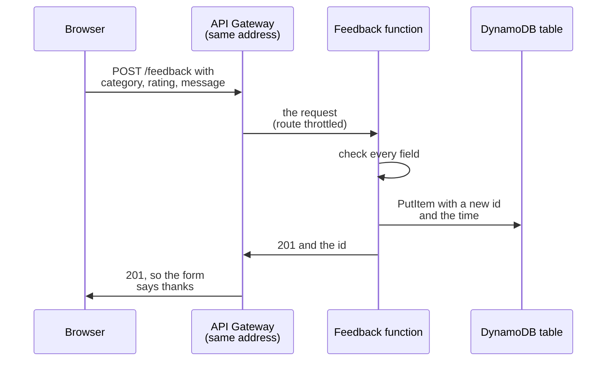

---
hide:
  - toc
---

# Feedback Path

The web app's Feedback tab lets a visitor send a short message about the site or its predictions. Each message is saved in a DynamoDB table by a small AWS Lambda function of its own, on the route `POST /feedback` of the same API address the predictions use. The prediction function is not touched. The form was built with the five-tab site in [Phase 5 Part 2](../../phase-5/implementation-part-2.md), and it is not one of the assignment's requirements, so it is kept here.

**Status: Built and live** at [https://d1nubiunzfwm0q.cloudfront.net/#feedback](https://d1nubiunzfwm0q.cloudfront.net/#feedback). The AWS commands that created it are in [Add the Feedback Route](../../phase-5/deployment-guide.md#add-the-feedback-route).

## What Does the Form Ask For?

- **Category:** General, Predictions, The site, or Something is broken.
- **Rating (optional):** 1 to 5.
- **Message (required):** 10 to 1,000 characters.
- **No personal details are asked for,** and the form says not to include any. Nothing identifies the visitor: no name, email, address, or cookie.
- **After sending:** "Thanks. Your feedback was saved." A failure shows a readable message, as the predictions do.
- **An invisible field catches simple spam bots.** People cannot see it, so only a bot fills it. A submission that fills it gets the same thanks message, but nothing is saved.

## Why Does It Need Its Own Route?

- **A browser cannot write to S3 or DynamoDB without AWS credentials,** and no credentials can be put in a public page. So the form sends its message to the API, and a function on AWS writes it.
- **A separate function, not a new route in the prediction function.** Adding a route there would change the zip that every prediction runs. The prediction function's code fingerprint (`CodeSha256`) is the same before and after.
- **DynamoDB, not S3.** S3 would store one file per message, with no simple way to count or list them.

## How Does the Feedback Reach the Table?

### The Request and the Answer

- **Request:** `POST {VITE_API_BASE_URL}/feedback`, `Content-Type: application/json`, and a body with exactly these keys:
    - `category`: one of `general`, `predictions`, `site`, `broken`.
    - `rating`: a whole number from 1 to 5, or `null`.
    - `message`: text, 10 to 1,000 characters after trimming spaces.
    - `website`: the invisible field. It must be an empty string.
- **Answer when saved:** status 201 and `{"status":"received","feedback_id":"<id>"}`.
- **Answer when a field is wrong:** status 422 and `{"detail":"<what is wrong>"}`, such as "The message must be 10 to 1,000 characters."
- **A body over 4,096 bytes, or one that is not JSON:** status 400.
- **The invisible field filled in:** status 201 with the same answer, and nothing is saved.
- **CORS:** the API's setting already allows `POST` with the `content-type` header from the CloudFront address, for every route.

### What Is Saved

One item per submission, in the table `510-m3-nfl-feedback`:

- `feedback_id`: a random UUID made by the function. It is the table's key.
- `submitted_at`: the time in UTC, such as `2026-11-23T14:05:09Z`.
- `category`, `rating` (left out when `null`), and `message`, as sent.

Nothing else is saved: no address, no browser details, and no cookie.

## What Was Created on AWS?

All in `us-east-1`, tagged `project=510-m3`, with names that follow the project's pattern.

- **The DynamoDB table `510-m3-nfl-feedback`:** key `feedback_id` (text), billed per request, encrypted with the default AWS key.
- **The function `510-m3-nfl-feedback-api`:** Python 3.13 on arm64. Its zip holds one file, `src/api/feedback_handler.py`, and uses the `boto3` that the Lambda runtime provides, so it adds no packages. The table name comes from the setting `FEEDBACK_TABLE`.
- **The role `510-m3-nfl-feedback-api-role`:** it can write logs and call `dynamodb:PutItem` on this one table, and nothing else.
- **The route `POST /feedback`** on the existing HTTP API `510-m3-nfl-predict-http-api`, with its own integration and its own permission to call the new function.
- **A request limit on that route only:** 1 request a second, with bursts of up to 5. The form writes to a table, so it has a limit. The prediction routes only read, and stay without one.
- **Log retention:** 14 days, as for the prediction function.

## Where Is the Code?

- **`src/api/feedback_handler.py`:** the Lambda function. It checks every field, then saves one item.
- **`tests/test_feedback.py`:** 9 tests, using a stand-in for DynamoDB, so no AWS account is needed.
- **`frontend/src/feedback.ts`:** the same field checks in the browser, and the `fetch` call, which never throws, like `predict`.
- **`frontend/src/App.tsx`:** the Feedback tab.
- **The local API has no `/feedback` route,** so sending the form from the dev server gets status 404. The route exists only on AWS.

## What Was Checked?

- One test submission was saved, read back, and deleted. The table then held 0 items.
- A filled invisible field saved nothing.
- A 5-character message got 422 with "The message must be 10 to 1,000 characters." In the browser, the same message shows the length message and sends nothing.
- A preflight from the CloudFront address got 204.
- The stage's only route limit is `POST /feedback` (1 a second, bursts of 5).
- The function's role can only write logs and call `dynamodb:PutItem` on this one table.
- The prediction function's code fingerprint is `IU5bJH9pTL+rF/uEXMUAp+Eo/mik2abfaSasBXPOgbk=` before and after.

To read the saved messages, see [Read the Feedback](../../phase-5/deployment-guide.md#read-the-feedback).
