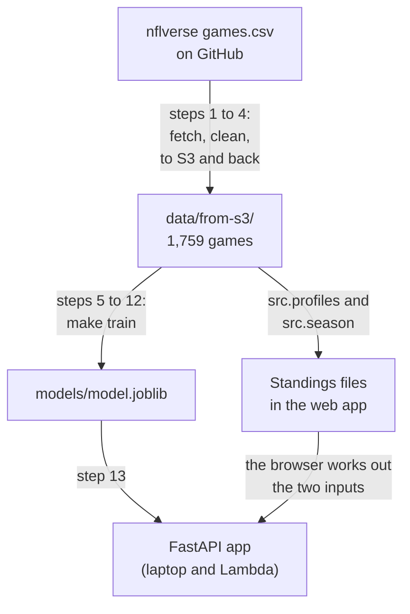
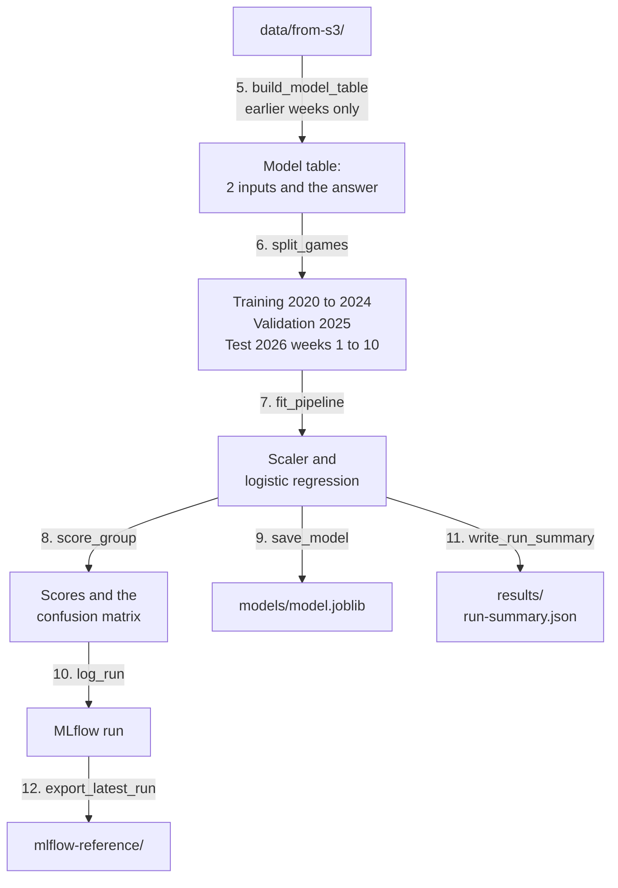

---
hide:
  - toc
---

# ML Workflow

This page walks through the machine learning path from the raw game file to a prediction served by the API. Each stage lists its command, the code that does the work, what it reads, what it writes, and the page that explains it in full. It is a map. The phase pages own the detail, so this page gives each stage in a line or two and links onward. It is for a reader who wants to see the whole path before reading any one phase.

## What Does the Whole Path Look Like?

The path has three stages: the data pipeline (steps 1 to 4), one training run (steps 5 to 12), and serving (step 13).

### What Happens in One Training Run?

One command, `python -m src.model.train` (`make train`), runs steps 5 to 12.

## Step 1: Fetch the Raw File

- **Command:** `python -m src.data.fetch_raw`
- **Code:** `fetch_raw(url, dest)` in [`src/data/fetch_raw.py`](https://github.com/jconnors23/510-m3-nfl-prediction-analytics/blob/main/src/data/fetch_raw.py), called by `main()`.
- **Reads:** the public nflverse file at `https://raw.githubusercontent.com/nflverse/nfldata/master/data/games.csv` (the address is `data.source_url` in `config/config.yaml`).
- **Writes:** `data/raw/games.csv`, unchanged. It had 7,548 rows and 46 columns when downloaded.
- **Full explanation:** [Phase 1 Implementation, Step 1](../phase-1/implementation.md#step-1-fetch-the-raw-data-and-save-it). To run it, see [Step 1: Fetch the Raw Data](../phase-1/development-guide.md#step-1-fetch-the-raw-data).

## Step 2: Clean the Raw File

- **Command:** `python -m src.data.clean`
- **Code:** `clean_games(raw, start_season, end_season, test_through_week)` in [`src/data/clean.py`](https://github.com/jconnors23/510-m3-nfl-prediction-analytics/blob/main/src/data/clean.py), called by `main()`.
- **Reads:** `data/raw/games.csv`.
- **Writes:** `data/processed/nfl_matchups_2020_2026.csv`, the **1,759** regular-season games from 2020 through week 10 of 2026 that have a winner, with 7 columns (`game_id`, `season`, `week`, `home_team`, `away_team`, `home_score`, `away_score`). Cleaning only removes rows and columns. It never edits a value.
- **Full explanation:** [Phase 1 Implementation, Step 2](../phase-1/implementation.md#step-2-clean-the-raw-data-and-save-the-cleaned-table). To run it, see [Step 2: Clean the Raw Data](../phase-1/development-guide.md#step-2-clean-the-raw-data).

## Step 3: Upload the Cleaned Table to S3

- **Command:** `python -m src.data.upload_to_s3`
- **Code:** `upload(config, client=None)` in [`src/data/upload_to_s3.py`](https://github.com/jconnors23/510-m3-nfl-prediction-analytics/blob/main/src/data/upload_to_s3.py).
- **Reads:** `data/processed/nfl_matchups_2020_2026.csv`.
- **Writes:** the object `data/processed/nfl_matchups_2020_2026.csv` in the private bucket `510-m3-nfl-dataset`.
- **Full explanation:** [Phase 1 Implementation, Step 3](../phase-1/implementation.md#step-3-upload-the-cleaned-table-to-s3). The bucket is described on [Cloud Architecture](./cloud-architecture.md#what-is-in-the-data-bucket).

## Step 4: Download the Table Back From S3

- **Command:** `python -m src.data.download_from_s3`
- **Code:** `download(config, client=None)` in [`src/data/download_from_s3.py`](https://github.com/jconnors23/510-m3-nfl-prediction-analytics/blob/main/src/data/download_from_s3.py).
- **Reads:** the object in the bucket.
- **Writes:** `data/from-s3/nfl_matchups_2020_2026.csv`. Every later step reads this copy, so the project's numbers come from the stored table and not from the live nflverse file. The copy is committed, so a fresh clone can train without AWS.
- **Full explanation:** [Phase 1 Implementation, Step 4](../phase-1/implementation.md#step-4-download-the-cleaned-table-from-s3-and-save-it).

## Step 5: Build the Two Inputs From Earlier Weeks Only

- **Command:** `python -m src.model.features` prints a check. Training builds the same table itself.
- **Code:** `build_model_table(games)` and `standings_before_week(...)` in [`src/model/features.py`](https://github.com/jconnors23/510-m3-nfl-prediction-analytics/blob/main/src/model/features.py). `check_model_table` stops the run if an input is blank or a week-1 value is not 0.
- **Reads:** `data/from-s3/nfl_matchups_2020_2026.csv`, through `load_games`.
- **Writes:** nothing on disk. It builds one row per game in memory: `win_pct_differential` and `point_diff_per_game_differential` (the home team's value minus the away team's, counting only games from earlier weeks of the same season), and `home_win`, the answer. A game's own score is never an input. In week 1 both inputs are 0.
- **Full explanation:** [Phase 2 Part 1, Step 1: Feature Engineering](../phase-2/implementation-part-1.md#step-1-feature-engineering).

## Step 6: Split the Games by Season

- **Code:** `split_games(table, config)` in `src/model/features.py`, with the seasons from `split_seasons(config)` in `src/config.py`. The settings are `split.train_end_season: 2024` and `split.validation_season: 2025` in `config/config.yaml`. The test season is `window.end_season`, 2026.
- **Reads:** the model table from Step 5.
- **Writes:** nothing on disk. Three groups, each a whole range of seasons, so no game is scored by a model that trained on later games:

| Group | Seasons | Games |
| :--- | :--- | :--- |
| Training | 2020 to 2024 | 1,339 |
| Validation | 2025 | 271 |
| Test | 2026, weeks 1 to 10 | 149 |

- **Full explanation:** [Phase 2 Part 1, Step 2: Split the Games by Season](../phase-2/implementation-part-1.md#step-2-split-the-games-by-season).

## Step 7: Fit the Scaler and the Logistic Regression

- **Command:** `make train`, which runs `MLFLOW_DISABLE_AGENT_HINT=1 .venv/bin/python -m src.model.train`. It carries out Steps 5 to 12 in one run and takes under a minute. See [make train](./makefile.md#make-train).
- **Code:** `build_pipeline(config)` and `fit_pipeline(config, training)` in [`src/model/train.py`](https://github.com/jconnors23/510-m3-nfl-prediction-analytics/blob/main/src/model/train.py). The pipeline is a `StandardScaler`, which puts both inputs on one scale, followed by a `LogisticRegression` (`C: 1.0`, `solver: lbfgs`, `max_iter: 1000`).
- **Reads:** the training group only. Validation and test games are never fitted on.
- **Writes:** nothing yet, the fitted pipeline is in memory.
- **Full explanation:** [Phase 2 Part 2, Step 4: Fit the Scaler and the Model](../phase-2/implementation-part-2.md#step-4-fit-the-scaler-and-the-model).

## Step 8: Score the Model

- **Code:** `score_group(pipeline, group)` and `plot_confusion_matrix(pipeline, group, path)` in [`src/model/evaluate.py`](https://github.com/jconnors23/510-m3-nfl-prediction-analytics/blob/main/src/model/evaluate.py). `main()` in `train.py` scores all three groups with the one fitted pipeline.
- **Reads:** the three groups and the fitted pipeline.
- **Writes:** the scores, printed and stored in later steps, and the confusion matrix picture for the validation season, `confusion_matrix_validation.png`. The picture is drawn in a temporary folder that is deleted afterward, and a copy goes into the MLflow run.
- **The scores:**
    - **Accuracy against the always-home baseline,** which is the share of games the home team won: validation **63.10%** (171 of 271) against 53.87%, and test **59.06%** (88 of 149) against 47.65%.
    - **Log loss** for validation and test, where lower is better and 0.6931 is the score of saying 50-50 on every game.
- **Full explanation:** [Phase 2 Part 2, Step 5: Score the Model](../phase-2/implementation-part-2.md#step-5-score-the-model). The picture is explained on [Confusion Matrix](./confusion-matrix.md).

## Step 9: Save the Model File

- **Code:** `save_model(pipeline, config, start_season, train_end_season)` in `src/model/train.py`.
- **Reads:** the fitted pipeline.
- **Writes:** `models/model.joblib` (git-ignored). It is one dictionary that holds the pipeline, the input names, the model version, the scikit-learn version, and the training seasons.
- **Full explanation:** [Phase 2 Part 2, Step 7: Save the Final Pipeline](../phase-2/implementation-part-2.md#step-7-save-the-final-pipeline).

## Step 10: Record the Run in MLflow

- **Code:** `log_run(config, scores, files, pipeline)` in `src/model/train.py`.
- **Reads:** the scores, the saved model file, the picture, and `config/config.yaml`.
- **Writes:** one run in the experiment `nfl-pregame-winner-v1`, in `mlflow.db` and `mlartifacts/` (both git-ignored):
    - **15 parameters:** the model version, random seed, `C`, solver, `max_iter`, input names, the four season settings, the three group sizes, the scikit-learn version, and the SHA-256 fingerprint of the data file.
    - **8 metrics:** train, validation, and test accuracy, validation and test log loss, and the three always-home baselines.
    - **3 files:** the model file, the picture, and the config file.
    - **The logged model:** MLflow's own copy of the pipeline, named `pipeline-mlflow-format`. No project code loads it.
- **To browse it:** `make start-web-ml`, at `http://127.0.0.1:5001`.
- **Full explanation:** [Phase 2 Part 2, Step 6: Record the Run in MLflow](../phase-2/implementation-part-2.md#step-6-record-the-run-in-mlflow).

## Step 11: Write the Run Summary

- **Code:** `write_run_summary(config, scores, pipeline)` in `src/model/train.py`.
- **Writes:** `results/run-summary.json`, which is committed. It holds the settings, the scores, and the learned weights. Its bytes change only when the settings, the data, or the scores change.
- **Full explanation:** [What Is the Run Summary File?](../phase-2/implementation-part-2.md#what-is-the-run-summary-file).

## Step 12: Write the Readable Copy

- **Code:** `export_latest_run(config)` in [`src/model/export_mlflow.py`](https://github.com/jconnors23/510-m3-nfl-prediction-analytics/blob/main/src/model/export_mlflow.py), called after the run has finished.
- **Reads:** the finished run from MLflow.
- **Writes:** [`mlflow-reference/`](https://github.com/jconnors23/510-m3-nfl-prediction-analytics/tree/main/mlflow-reference), which is committed. The last run moves into `previous-runs/`, the new run goes to `latest-run/` (`params.json`, `metrics.json`, `run.json`, `artifact-list.json`, `artifacts/`, `logged-model/`), and `run-history.md` and `run-history.json` gain a row. Another copy of the repository has no `mlflow.db`, so this folder is the record every copy shares.
- **Full explanation:** [How Is MLflow Kept Tidy?](../phase-2/implementation-part-2.md#how-is-mlflow-kept-tidy) and [How Do I Do a Training Run?](../phase-2/development-guide.md#how-do-i-do-a-training-run).

## Step 13: Serve the Model

- **Locally:** `make start`, which runs `.venv/bin/python -m uvicorn src.api.app:app --port 8000`.
- **Code:** `load_model(config)` and `create_app(config)` in [`src/api/app.py`](https://github.com/jconnors23/510-m3-nfl-prediction-analytics/blob/main/src/api/app.py). The service reads `models/model.joblib` once at start-up. It stops with a clear message if the file is missing, is not a dictionary, lacks one of its four keys, or was saved by a different scikit-learn version.
- **On AWS:** the Lambda zip carries `models/model.joblib` next to `src/` and `config/`. `build_handler` in [`src/api/lambda_handler.py`](https://github.com/jconnors23/510-m3-nfl-prediction-analytics/blob/main/src/api/lambda_handler.py) calls the same `load_model` once, on the first request, and wraps the app with Mangum. A new training run changes the file, so the zip has to be rebuilt and the function updated manually. See [Redeploy After a Change](../phase-4/deployment-guide.md#redeploy-after-a-change).
- **Who supplies the inputs:** the model needs two numbers per game. The web app works them out in the browser from the committed standings files, which `python -m src.profiles` and `python -m src.season` write from the same `data/from-s3/` table into `frontend/src/data/`. The model never sees a team name. See [Frontend and Backend Connection](./frontend-backend-connection.md).
- **Full explanation:** [Phase 3 Implementation](../phase-3/implementation.md) for the local API, [Phase 4 Implementation](../phase-4/implementation.md) for Lambda, and [Phase 5 Part 1](../phase-5/implementation-part-1.md) for the web app. The AWS resources are on [Cloud Architecture](./cloud-architecture.md#what-runs-the-predictions).

## Which Command Runs Which Step?

| Command | Steps | Writes |
| :--- | :--- | :--- |
| `python -m src.data.fetch_raw` | 1 | `data/raw/games.csv` |
| `python -m src.data.clean` | 2 | `data/processed/nfl_matchups_2020_2026.csv` |
| `python -m src.data.upload_to_s3` | 3 | the S3 object |
| `python -m src.data.download_from_s3` | 4 | `data/from-s3/nfl_matchups_2020_2026.csv` |
| `python -m src.model.features` | 5 and 6, as a check | nothing |
| `make train` | 5 to 12 | `models/model.joblib`, MLflow records, `results/run-summary.json`, `mlflow-reference/` |
| `python -m src.profiles` and `python -m src.season` | web app inputs | `frontend/src/data/team-profiles.json` and `season-2026.json` |
| `make start` | 13 | nothing |
