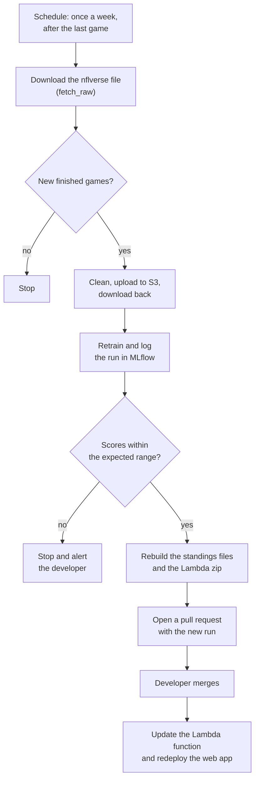

---
hide:
  - toc
---

# Future Considerations

This page lists next steps the project could take, none of which is built: a pipeline that brings in new results automatically, more inputs for the model, and an augmented data set that joins other data to the nflverse games file. Today the project is a fixed snapshot: the data stops at 2026 week 10, and every step from download to deploy is started manually.

## How Could New Results Flow In Automatically?

nflverse updates its games file as games finish, but the project stops at week 10: `test_through_week` in `config/config.yaml` is 10, and the committed games file (downloaded 2026-11-17) has no scores for week 11. An automated pipeline would run every step after each week's games, from the download to the live web app.

- **The schedule.** A scheduled GitHub Actions workflow (`on: schedule`), or Amazon EventBridge Scheduler starting the same steps on AWS. Tuesday morning, Eastern time, falls after the last game of a normal NFL week.
- **What changes in the code:**
    - The last week counted would come from the data (the last week in which every game has a score) instead of a fixed `test_through_week`.
    - The split would need a rule for a growing season: for example, the test season keeps growing week by week, and validation stays 2025.
    - `python -m src.profiles` and `python -m src.season` would run after each retrain, so the web app's standings match the new model.
- **New AWS access.** The workflow would need a role, signed in the same way as the [web app's deploy role](../development/github-workflows.md#how-does-a-change-reach-the-live-web-app), that can upload to the data bucket and update the prediction function. Nothing else.
- **Checks before anything goes live:**
    - the download passes the column check in `fetch_raw` and has at least as many finished games as before
    - every earlier game's score is unchanged, because nflverse sometimes corrects old rows
    - the new run's validation and test accuracy stay within a set range of the previous run
    - the full test suite passes
- **A person stays in the loop.** The workflow opens a pull request with the new `mlflow-reference/` run and `results/run-summary.json`, and the developer merges it before the API and the web app change. This keeps the rule that the developer runs every git command that changes the repository.
- **What it would cost.** Little: one workflow run a week, a few S3 uploads, and one Lambda update. The zip stays under the size limit, because only the model file changes.

## Which Inputs Could the Model Add?

The model uses two inputs. More inputs could help, as long as each one is known before kickoff and comes only from earlier games or the schedule. The raw nflverse file already holds several columns that cleaning drops today:

- **Rest days:** `home_rest` and `away_rest`, the days since each team's last game. A team coming off a short week, or a bye, may play differently.
- **Divisional games:** `div_game` marks games between teams in the same division, which play each other twice a season.
- **The playing conditions:** `roof`, `surface`, `temp`, and `wind`. Temperature and wind are blank for games under a closed roof, so a missing value needs a rule.
- **The starting quarterbacks:** `home_qb_id` and `away_qb_id`, to tell when a team's usual starter is out. This would need each quarterback's earlier games.

Inputs that would be worked out from earlier games:

- **Recent form:** the win percentage and point margin over a team's last 3 or 4 games, next to the season-long numbers.
- **Strength of schedule:** the average win percentage of the teams each side has played, since a 5-2 record against strong teams is different from one against weak teams.
- **Carry-over from last season** for early weeks. Today every week 1 game gets the same 53.64%, because both inputs are 0. A share of last season's numbers, fading out over the first few weeks, would give week 1 something to work with.

Each new input would also need:

- **A check that it cannot see the result,** like the current check that a week 1 game has both inputs at 0.
- **The same columns in three places:** the Python feature code, the API's request (`src/api/schemas.py`), and the web app's arithmetic. The Phase 5 parity checks, described in the [Testing Guide](../development/testing-guide.md), would need the new inputs added.
- **A fair comparison:** today's 63.10% validation accuracy on the same 2025 games, with the test season kept for the final check only.

A different model, such as gradient-boosted trees, becomes worth trying once there are enough inputs for it to find patterns a logistic regression cannot.

## How Could an Augmented Data Set Help?

Today the model trains on one file: the nflverse games file, which holds final scores and the schedule. An augmented data set would join more data to each game row, so the model could use facts the games file does not hold.

- **What could be joined:**
    - nflverse's other files: play-by-play, rosters, and weekly player statistics
    - injury reports and depth charts, to tell when key players are out
    - detailed weather for outdoor games, beyond the games file's `temp` and `wind`
- **Matching the data.** Each source names teams and games its own way. Every row would need to be matched to an nflverse `game_id` before it can join the training table, and a game that does not match should stop the build instead of being dropped without notice.
- **Known before kickoff.** Each joined value must be one that was published before the game started. An injury report updated after kickoff, for example, would give the model facts it could not have had before the game.
- **The license.** The project commits its data files and serves its numbers in a public web app, so every source must allow that. A source that does not would have to stay out of the repository and the web app.
- **Keys and secrets.** A source that needs an API key would keep it in AWS Secrets Manager or a GitHub repository secret, never in the code, the settings file, or the web app.
- **A fair comparison,** as with new inputs: today's 63.10% validation accuracy on the same 2025 games.
