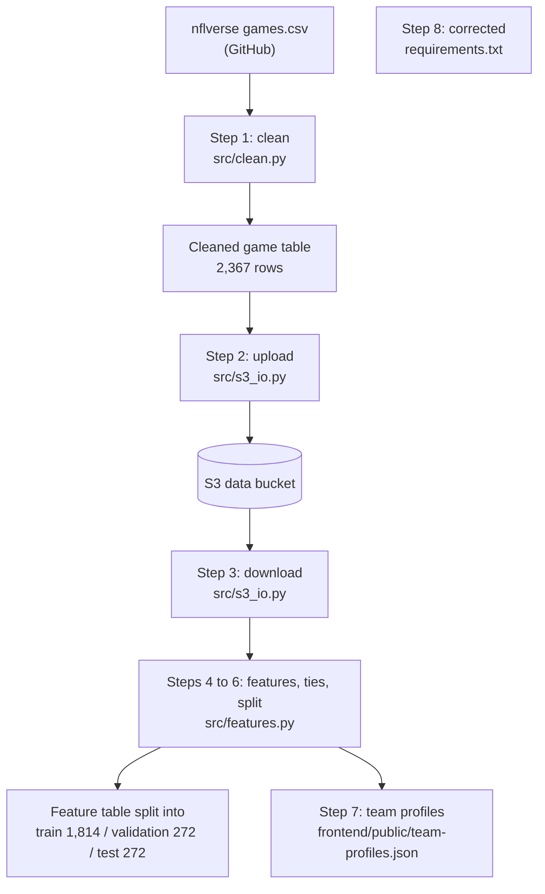

---
hide:
  - toc
---

# Phase 1: Data and Features

This phase takes the public NFL games file, cleans it, stores the cleaned copy in Amazon S3, and builds the three comparison features and the train, validation, and test split. Everything later in the project reads what this phase produces.

For the whole-system picture, see the [Architecture Overview](../index.md). This page owns the definitions of the data, the features, and the split.

## Phase Architecture

### Flow of Steps

### Inventory

| Item | Kind | Planned location | Built in | What it does |
| :--- | :--- | :--- | :--- | :--- |
| Cleaning step | Code | `src/clean.py` | Step 1 | Filters the source file, maps old team codes, and writes the cleaned game table. |
| Cleaned game table | Data | Local `data/` folder, then S3 | Steps 1 and 2 | One row per regular-season game from 2016 through 2024. |
| S3 data bucket | AWS resource | Private bucket, name chosen at setup | Step 2 | Holds the one copy of the cleaned table that every run reads. |
| Upload and download steps | Code | `src/s3_io.py` | Steps 2 and 3 | Move the cleaned table to and from S3. |
| Feature step | Code | `src/features.py` | Steps 4 to 6 | Builds the three features and the target, removes ties, and splits by season. |
| Feature table and split | Data, held in memory | Not stored | Steps 4 to 6 | The rows the model trains and is scored on. |
| Team profiles | Data file | `frontend/public/team-profiles.json` | Step 7 | One entry for each of the 32 teams, read by the web app. |
| Dependency list | Settings file | `requirements.txt` | Step 8 | Lists the libraries every later phase installs. |

## Which Requirements and Gaps Does It Cover?

- Requirement 1: names the dataset, the target, and the task. The metric is set in [Phase 2](./phase-2-training-and-tracking.md).
- Requirement 2: defines the S3 upload and the programmatic download.
- Requirement 3: defines ingestion, feature building, and the split. Training is in Phase 2.
- Dataset link: given below.
- S3 upload step: added below.
- Team profiles file for the web app: built below.
- Dependency list: corrected below.
- Tied games, week 1, the constant `home_advantage` feature, old team codes, and the bucket name: settled in the sections below.

## What Is the Source Data?

| Property | Value |
| :--- | :--- |
| Name | nflverse schedules and results, file `games.csv` |
| Link | `https://github.com/nflverse/nfldata/blob/master/data/games.csv` |
| Direct download | `https://raw.githubusercontent.com/nflverse/nfldata/master/data/games.csv` |
| Size when checked | 7,548 data rows, one row per game since 1999, 46 columns |
| Rows kept | Regular-season games (`game_type` equal to `REG`) from seasons 2016 through 2024 |
| Task | Binary classification: did the home team win? |

### Data Facts Checked Against the File

These numbers were computed from the downloaded file. Counts after the cleaning rules below come from the same computation.

| Season | Regular-season games | Ties |
| :--- | :--- | :--- |
| 2016 | 256 | 2 |
| 2017 | 256 | 0 |
| 2018 | 256 | 2 |
| 2019 | 256 | 1 |
| 2020 | 256 | 1 |
| 2021 | 272 | 1 |
| 2022 | 271 | 2 |
| 2023 | 272 | 0 |
| 2024 | 272 | 0 |

- The 2022 season has **271** games, not 272, because one scheduled game was cancelled. The first design draft assumed 272 for every season from 2021 on.
- The nine ties are all in 2016 through 2022. No tie falls in the validation season (2023) or the test season (2024).
- No game in the kept rows is missing a score or a rest value. Rest days range from 4 to 17.
- Always picking the home team is correct **54.85%** of the time in the training seasons, **55.51%** in 2023, and **53.31%** in 2024, after ties are removed. These are the baseline scores the model must be compared against in Phase 2.

## Step 1: Clean the Source File

!!! abstract "Purpose"
    **Goal:** Turn the downloaded nflverse file into one small table that holds only what this project uses: regular-season games from 2016 through 2024, with 10 columns.

    **Why:** The downloaded file holds 7,548 games going back to 1999 and has 46 columns. Most of those columns (betting odds, stadium details, player IDs) are not used by the model. The file also writes two teams under two different codes: the Raiders appear as `OAK` and as `LV`, and the Chargers appear as `SD` and as `LAC`.

    **If skipped:** The code that later adds up each team's wins and points would treat `OAK` and `LV` as two different teams. The Raiders' record would be split in two, and every number built from it would be wrong.

The cleaning step runs on the developer machine and writes one file, the cleaned game table.

| Rule | Reason |
| :--- | :--- |
| Keep only `REG` games from 2016 through 2024. | Matches the study window. |
| Map old team codes to current ones: `OAK` becomes `LV` and `SD` becomes `LAC`. | The file uses 34 team codes for 2016 through 2024. Mapping gives the 32 current teams. The Rams code `LA` is already current, and `STL` does not appear in this window. |
| Keep only the columns listed in the table below. | Betting lines, quarterback names, and stadium details are not features of this system. |
| Stop with an error if any kept row has a missing score, rest value, or team code. | A silent gap would change features without warning. |

### Cleaned Game Table Columns

| Column | Type | How it is built | Empty? | What it means |
| :--- | :--- | :--- | :--- | :--- |
| `game_id` | text | Copied from the source. Example: `2024_01_BAL_KC`. | No | One identifier per game. |
| `season` | integer | Copied. | No | Season year. |
| `week` | integer | Copied. | No | Week of the regular season, 1 to 18. |
| `gameday` | date | Copied. | No | Calendar date of the game. |
| `home_team` | text | Copied, then old codes mapped. | No | Current team code of the home team. |
| `away_team` | text | Copied, then old codes mapped. | No | Current team code of the away team. |
| `home_score` | integer | Copied. | No | Final points scored by the home team. |
| `away_score` | integer | Copied. | No | Final points scored by the away team. |
| `home_rest` | integer | Copied. | No | Days since the home team's previous game, as given by the source. |
| `away_rest` | integer | Copied. | No | Days since the away team's previous game, as given by the source. |

## Step 2: Upload the Cleaned Table to S3

!!! abstract "Purpose"
    **Goal:** Copy the cleaned table to a private Amazon S3 bucket.

    **Why:** The assignment requires the training pipeline to get its data from cloud storage. One stored copy also means every run, on any computer, reads exactly the same data.

    **If skipped:** The pipeline would have to read a file saved on one person's laptop. That breaks the assignment requirement, and nobody else could repeat the results.

| Item | Design |
| :--- | :--- |
| Location | One private S3 bucket. The planned key is `data/processed/nfl_matchups_2016_2024.csv`, kept from the first design draft. |
| Bucket name | S3 bucket names are unique across all of AWS, so the placeholder in the first draft may already be taken. The real name is chosen when the bucket is created. It is stored in `config.yaml` and is never written into code. |
| Bucket settings | Block all public access. Turn on default encryption. |
| Who can write | The developer's AWS credentials only. Permissions are described in [Phase 4](./phase-4-aws-deployment.md#step-2-define-the-permissions). |
| Upload | A command-line step in `src/s3_io.py` that uploads the cleaned file and prints the object location. This is the step the first draft omitted. |
| Overwrites | Re-running the upload replaces the object. The cleaning step is deterministic, so the same input produces the same file. |

## Step 3: Download the Table From S3

!!! abstract "Purpose"
    **Goal:** Write the code that fetches the cleaned table from S3 at the start of every training run.

    **Why:** Every run must begin from the S3 copy. It must not begin from a file someone saved by hand.

    **If skipped:** A run could silently use an old or edited local file. Two people running the same code could then get different results and not know why.

The training pipeline always starts from the S3 copy, never from a local file the developer produced by hand.

| Item | Design |
| :--- | :--- |
| Download | A function in `src/s3_io.py` that reads the bucket and key from `config.yaml` and saves the file to a local cache folder. |
| Credentials | Read from the standard AWS credential chain (environment variables or a named profile). They are never stored in the repository or the image. |
| Cache | If the cached file exists, the step still re-downloads unless a setting says otherwise, so a run never uses a stale file by accident. |
| Failure | A missing bucket, missing key, or missing credentials stops the run with a message that names which one failed. |

The first draft listed both `data/s3_download.py` and `src/data_loader.py`. This design uses one module, `src/s3_io.py`, for both directions.

## Step 4: Build the Features

!!! abstract "Purpose"
    **Goal:** Turn each game into three numbers plus the answer. The three numbers are the difference in point differential per game, the difference in win percentage, and the difference in rest days. Each difference is the home team's value minus the away team's value. The answer is whether the home team won.

    **Why:** The model can only work with numbers, and these three describe how the two teams compare before kickoff. Each number must be calculated only from games played in earlier weeks of the same season.

    **If skipped:** If a number used the game being predicted, or any later game, the model would see the answer in advance. Its test scores would then look better than its performance on real upcoming games.

Each game becomes one row. Every feature uses only games from **earlier weeks of the same season**. A feature that used a game from the same week or later would be future information. That mistake is called leakage, and it would make the model look better in testing than it can be when used for real.

### How Are Season-to-Date Numbers Defined?

Both teams in a game get numbers from all of their games in earlier weeks of that season.

| Measure | Definition |
| :--- | :--- |
| Point differential per game | Total points scored minus total points allowed, divided by games played so far. |
| Win percentage | Wins divided by games played so far, where a tie counts as half a win. |

Totals are divided by games played so the number means the same thing in week 3 and week 15. Ties count in a team's history even though tied games are not used as training rows. Histories restart at the start of each season.

### What Happens in Week 1?

No team has played yet in week 1, so both point differential and win percentage have no value. The proposed rule is to give both teams the same neutral starting values: a point differential of 0 and a win percentage of 0.5. The week 1 feature differences then equal 0, and only rest days differ.

!!! note "Confirm: week 1 and early-season weeks"
    The alternative is to start each season from the previous season's final numbers. This design does not do that, because 2016 has no previous season in the data and teams change a lot between seasons. Early weeks rest on few games: week 2 uses one game per team. This is a stated limitation, not something the features correct for.

### Feature and Target Reference

| Column | Type | How it is built | Empty? | What it means |
| :--- | :--- | :--- | :--- | :--- |
| `point_diff_differential` | float | Home team's season-to-date point differential per game minus the away team's. | No | Positive when the home team has outscored opponents by more per game. |
| `win_pct_differential` | float | Home team's season-to-date win percentage minus the away team's. | No | Between -1 and 1. Positive when the home team has won a larger share of its games. |
| `rest_differential` | integer | `home_rest` minus `away_rest`. | No | Positive when the home team had more days of rest. Observed range in the 2016 to 2024 games is -8 to 8. |
| `home_win` | integer | 1 if `home_score` is greater than `away_score`, otherwise 0. | No | The target. Tied games have no row here. |
| `game_id`, `season`, `week`, `home_team`, `away_team` | mixed | Carried over from the cleaned table. | No | Identify each row. They are not model inputs. |

### Should the Constant `home_advantage` Feature Stay?

The first draft listed a fourth feature, `home_advantage`, that equals 1 in every row. A column that never changes cannot help a model tell games apart. In logistic regression, the intercept already represents the average home edge. The system purpose names three comparisons, not four.

!!! note "Confirm: drop `home_advantage`"
    This design drops it, so the model has three inputs and the API request has three fields. If the fourth field is kept for compatibility with the first draft, Phase 3 must accept it and ignore it.

## Step 5: Handle Tied Games

!!! abstract "Purpose"
    **Goal:** Remove the 9 tied games from the rows used for training and scoring. Ties still count as half a win in each team's season record.

    **Why:** The answer column says whether the home team won, as 1 for yes or 0 for no. A tie has no winner and no loser, so neither value is correct for it.

    **If skipped:** Storing a tie as 0 would label it an away win. The model would learn from 9 games with a wrong answer attached.

Tied games have no winner, so the target is undefined. This design removes them as rows before the split, so no tie is labeled as an away win. Ties still count as half a win in the season-to-date numbers of the teams that played them.

!!! note "Confirm: exclude ties"
    The first draft allowed "excluded or mapped to 0". Mapping to 0 would teach the model that a tie is an away win. Exclusion changes the training row count from 1,823 games to **1,814** rows. The validation and test seasons keep all 272 games each.

## Step 6: Split Games by Season

!!! abstract "Purpose"
    **Goal:** Divide the games into three groups by date: 2016 through 2022 for training (1,814 games), 2023 for validation (272 games), and 2024 for testing (272 games).

    **Why:** The model is meant to predict games that have not happened yet. Training on earlier seasons and scoring on a later season copies that situation.

    **If skipped:** A random split would put games from 2024 into the training group while scoring on games from earlier years. The model would have learned from the future, and its score would not be trustworthy.

The split follows calendar order, so the model is always tested on seasons it has not seen and that come after its training data.

| Split | Seasons | Rows after removing ties |
| :--- | :--- | :--- |
| Training | 2016 through 2022 | 1,814 |
| Validation | 2023 | 272 |
| Test | 2024 | 272 |

The scaler that standardizes the features is fit on the training rows only. The same fitted scaler is then applied to the validation and test rows. [Phase 2](./phase-2-training-and-tracking.md#step-3-fit-the-scaler-and-model) owns the scaler.

## Step 7: Build the Team Profiles File

!!! abstract "Purpose"
    **Goal:** Create a file with each of the 32 teams' point differential per game and win percentage as of the end of the 2024 season.

    **Why:** The web app runs in a browser, which cannot read S3 or the games table. When a user picks two teams, the app needs each team's numbers to work out the point differential difference and the win percentage difference that the API requires.

    **If skipped:** The app would have no numbers to send. A user's team choices could not be turned into a prediction request.

The web app has no AWS access and no copy of the games table. It needs each team's numbers in a small file it can read.

| Item | Design |
| :--- | :--- |
| Content | One entry per current team: team code, display name, season-to-date point differential per game, win percentage, and games played, as of the last game in the data (2024, week 18). |
| Built by | `src/features.py`, from the same definitions as Step 4, so the web app and the model measure the same things. |
| Stored in | `frontend/public/team-profiles.json`, committed to the repository because it is small. The Vite build copies it unchanged into the published site, so the browser can fetch it. |
| Format | JSON, so the browser can read it directly without a CSV parser. |
| Entries | 32 |

The numbers are full-season 2024 values, while the model was trained on values from partway through a season. [Phase 5](./phase-5-front-end-and-documentation.md#step-2-look-up-team-profiles) owns the explanation of that difference.

## Step 8: Correct the Dependency List

!!! abstract "Purpose"
    **Goal:** Edit `requirements.txt` so it lists the Python libraries this project uses on AWS: remove `google-cloud-storage` and `streamlit`, and add `boto3` and `mangum`.

    **Why:** The current file was written before the project chose AWS and a Vite web app, so it lists libraries that nothing uses and leaves out libraries that later phases need.

    **If skipped:** A fresh install would fail on the first line that imports `boto3`, because the S3 upload and download code needs it and the file does not list it.

The current `requirements.txt` was written before AWS was chosen. It lists `google-cloud-storage` and `streamlit`, and does not list `boto3` or `mangum`.

| Change | Reason |
| :--- | :--- |
| Remove `google-cloud-storage` | The project uses AWS only. |
| Remove `streamlit` | The web app is now a Vite project with its own `package.json`. |
| Add `boto3` | Reads and writes S3. |
| Add `mangum` | Lets Lambda run the FastAPI app. Needed from Phase 3. |
| Record exact versions | Keeps every run on the same library versions. The serving image in Phase 3 must use the same scikit-learn version as training, because a saved model may not load under a different one. |

## How Is This Phase Checked?

| Check | Pass condition |
| :--- | :--- |
| Row counts | The cleaned table has **2,367** rows, the sum of the season counts in the table above. After the 9 ties are removed, training, validation, and test have 1,814, 272, and 272 rows (2,358 in total). |
| Team codes | The cleaned table has exactly 32 distinct team codes, and none are `OAK` or `SD`. |
| Download works | The download step fetches the object from S3 and its row count matches the cleaned file. |
| No future information | Changing the scores of games in week k or later leaves every feature in weeks up to k unchanged. |
| Scaler fit | The scaler's saved mean and spread match the training rows only. |
| Profiles file | `team-profiles.json` has 32 entries and no empty values. |

The cleaned table total is 256 × 5 + 272 + 271 + 272 + 272 = 2,367. If the real count differs when the file is built, the source file has changed since this page was written.

## What Can Go Wrong?

| Problem | Effect | How it shows up |
| :--- | :--- | :--- |
| The source file changes after this guide was written | Row counts differ from this page. | The row-count check fails. Recompute the tables in this phase. |
| Credentials missing or expired | Upload and download fail. | The error names the credential problem. |
| Bucket name already taken | Bucket creation fails. | Pick another name and update `config.yaml`. |
| A feature uses the current week | The model scores higher than it should. | The future-information check fails. |

## Commit and Pull Request Plan

A sensible grouping into commits:

1. Corrected dependency list.
2. Cleaning step and its checks.
3. S3 upload and download steps.
4. Feature step, split, and the future-information check.
5. Team profiles file.

## What Does Phase 2 Need From This Phase?

The S3 object, the download step, the feature step with its split, and a dependency list that installs cleanly.
