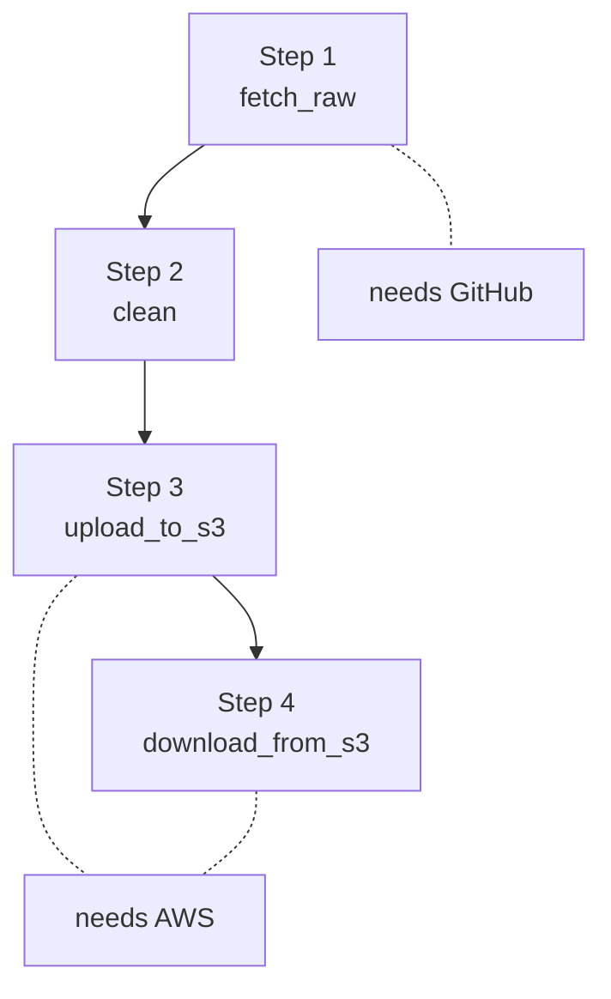

---
hide:
  - toc
---

# Phase 1 Development Guide

This guide shows how to run the Phase 1 data pipeline on your own computer, how to change it, and how the cloud storage it uses is set up. The reasons behind each step and the numbers are on the [Implementation](./implementation.md) page.

## What Is Needed First?

- **Python 3.13 and the project's virtual environment.** From the project folder:

```bash
python3.13 -m venv .venv
```

```bash
source .venv/bin/activate
```

```bash
pip install -r requirements.txt
```

- **A network connection to GitHub** for Step 1, and **to AWS** for Steps 3 and 4.
- **AWS CLI version 2 and credentials on the machine** for Steps 3 and 4. See [How Are AWS Credentials Found?](#how-are-aws-credentials-found).
- **Nothing else.** A fresh checkout already holds all three data files (`data/raw/games.csv`, `data/processed/nfl_matchups_2020_2026.csv`, and `data/from-s3/nfl_matchups_2020_2026.csv`), so the later phases run without repeating Phase 1.

## How Do I Run It Locally?



Run every command from the project folder. Each step reads the file the step before it wrote.

1. **`python -m src.data.fetch_raw`** reads the nflverse `games.csv` on GitHub and writes `data/raw/games.csv`.
2. **`python -m src.data.clean`** reads `data/raw/games.csv` and writes `data/processed/nfl_matchups_2020_2026.csv`.
3. **`python -m src.data.upload_to_s3`** reads `data/processed/nfl_matchups_2020_2026.csv` and writes the object `data/processed/nfl_matchups_2020_2026.csv` in the bucket.
4. **`python -m src.data.download_from_s3`** reads the object in the bucket and writes `data/from-s3/nfl_matchups_2020_2026.csv`.

Steps 1 to 3 run once, when the data changes. Anyone who only trains starts at Step 4, or skips it, because the downloaded table is already in the checkout.

### Step 1: Fetch the Raw Data

```bash
python -m src.data.fetch_raw
```

It prints the source address, the time of the download, the row count (`rows: 7548` when this guide was written), and `saved: data/raw/games.csv`. The file is saved only after it passes its checks. nflverse can correct old scores, so a new download can differ from the committed file. Review the change in git before keeping it.

### Step 2: Clean the Raw Data

```bash
python -m src.data.clean
```

It reads only the saved raw file and never goes to the internet. It prints the row count after each rule, the games per season, and `saved: data/processed/nfl_matchups_2020_2026.csv`. The final table has **1,759 rows and 7 columns**. The rules and their counts are on the [Implementation](./implementation.md#which-rules-run-and-in-what-order) page.

### Step 3: Upload the Cleaned Table to S3

```bash
python -m src.data.upload_to_s3
```

It uploads the file, asks S3 for the object's size, and compares it with the local file. It prints `uploaded 63908 bytes to s3://510-m3-nfl-dataset/data/processed/nfl_matchups_2020_2026.csv`. A size difference stops the step.

### Step 4: Download the Cleaned Table From S3

```bash
python -m src.data.download_from_s3
```

It always downloads again and never reuses an earlier local copy. It prints `rows: 1759` and `saved: data/from-s3/nfl_matchups_2020_2026.csv`. Every later phase reads this copy.

## How Do I Develop It?

### Where Is Each Piece?

- **The four steps:** `src/data/fetch_raw.py`, `clean.py`, `upload_to_s3.py`, `download_from_s3.py`.
- **Reading the settings:** `src/config.py`, which reads `config/config.yaml`.
- **Every path, address, bucket, and season:** the `data` and `window` blocks of `config/config.yaml`.
- **Tests:** `tests/test_fetch_raw.py` (3 tests), `tests/test_clean.py` (2), `tests/test_upload.py` (1), and `tests/test_download_from_s3.py` (2).

Nothing is hard-coded in the scripts. To change a path, the bucket, or the seasons, edit `config/config.yaml` and leave the code alone.

### How Do I Run the Tests?

```bash
python -m pytest tests/test_fetch_raw.py tests/test_clean.py tests/test_upload.py tests/test_download_from_s3.py
```

Expected: **8 passed**. The tests use made-up data, a stand-in for the download, and a stand-in S3 client, so they need no internet and no AWS account. The whole project's 95 tests (14 files) run with `make pytest`: 93 pass and 2 skip until `models/model.joblib` exists.

### How Do I Change Which Games Are Used?

1. Edit the `window` block in `config/config.yaml`: `start_season`, `end_season`, and `test_through_week` (the last week of the last season that has scores).
2. Run Step 2 to rebuild the cleaned table. It stops if the result does not hold exactly 32 team codes.
3. Run Step 3 to upload the new table, then Step 4 to download it back.
4. Check the `split` block of `config/config.yaml` still fits the new seasons (see [Phase 2](../phase-2/development-guide.md#how-do-i-change-the-split)), and retrain.

Raising `test_through_week` only matters once nflverse has scores for those weeks. Until then the cleaned table does not change.

### How Do I Change a Cleaning Rule?

1. Edit `clean_games` in `src/data/clean.py`. The rules run in a fixed order, and the order matters: the week cut runs before the missing-score check, because unplayed games have blank scores.
2. Add or change a test in `tests/test_clean.py`.
3. Run the tests above, then Step 2, and read the row count after each rule.
4. If the table changed, run Steps 3 and 4 so the cloud copy and the downloaded copy match.

### What Do the Scripts Always Do?

- **Write to a `.partial` file and rename it** after the checks pass, so a failed run never replaces a good file.
- **Print a short message** for problems they expect.
- **Keep credentials out of the project.** No key is written in any file.

## How Is the Cloud Storage Set Up?

Phase 1 has no server to deploy. Its cloud part is one private S3 bucket that holds the cleaned table.

### What Exists Today?

These settings were read from AWS with read-only commands when this guide was written.

- **Bucket:** `510-m3-nfl-dataset`, in `us-east-1`.
- **Public access:** all four public-access blocks are on (`BlockPublicAcls`, `IgnorePublicAcls`, `BlockPublicPolicy`, and `RestrictPublicBuckets`).
- **Encryption:** AES-256, which S3 applies to new objects by default.
- **Versioning:** not turned on.
- **Contents:** one object, `data/processed/nfl_matchups_2020_2026.csv`, of 63,908 bytes.

To read the same settings yourself, run these three commands:

```bash
aws s3api get-public-access-block --bucket 510-m3-nfl-dataset --region us-east-1
```

```bash
aws s3api get-bucket-encryption --bucket 510-m3-nfl-dataset --region us-east-1
```

```bash
aws s3api list-objects-v2 --bucket 510-m3-nfl-dataset --region us-east-1
```

### How Would I Create It in Another Account?

The bucket was created manually, and there is no script for it. Bucket names are unique across all of AWS, so another account needs its own name. These two commands create a private bucket like this one. They were written from the AWS CLI's parameter lists and **were not run**, because the bucket already exists.

```bash
aws s3api create-bucket --bucket <your-bucket-name> --region us-east-1
```

```bash
aws s3api put-public-access-block --bucket <your-bucket-name> --public-access-block-configuration BlockPublicAcls=true,IgnorePublicAcls=true,BlockPublicPolicy=true,RestrictPublicBuckets=true
```

Then set `data.s3_bucket` in `config/config.yaml` to the new name, and run Steps 3 and 4. Encryption needs no command, because S3 encrypts new objects with AES-256 by default. A bucket outside `us-east-1` also needs `--create-bucket-configuration LocationConstraint=<region>`, and `data.aws_region` set to match.

### How Are AWS Credentials Found?

The scripts call `boto3.client("s3", region_name=...)` and do not pass a key. boto3 looks in the standard places: environment variables, then the `~/.aws` files. To set them up once, run `aws configure`, and to check which account the commands will use, run:

```bash
aws sts get-caller-identity
```

- **Step 3 calls** `upload_file` and `head_object` on the one object.
- **Step 4 calls** `download_file` on the same object.
- The identity therefore needs permission to write and read that one key, and nothing else in the project needs AWS access until Phase 4.
