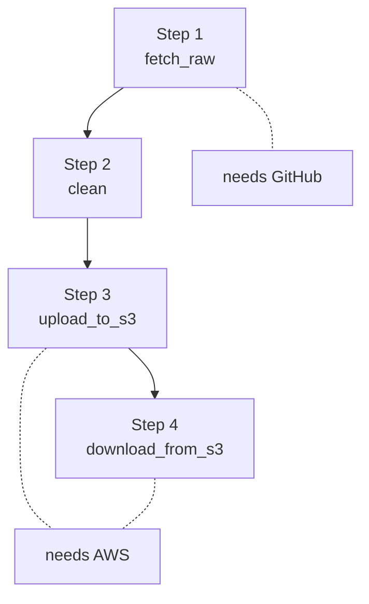
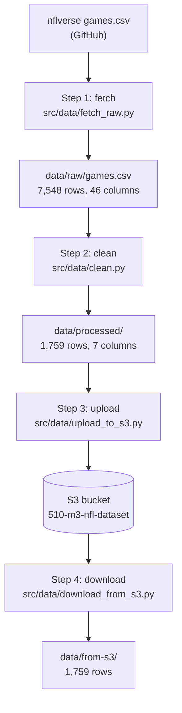

---
hide:
  - toc
---

# Phase 1: Data Pipeline

!!! success "Delivered in Pull Request #1"
    **[Pull request #1 (`phase_one`)](https://github.com/jconnors23/510-m3-nfl-prediction-analytics/pull/1)** merged the data pipeline: the nflverse download, cleaning, the S3 upload and download, and their tests into `main`. Its **Files changed** tab shows everything this phase delivered.

**Status: Built and tested.** Steps 1 to 4 are done, and the 8 Phase 1 tests pass.

Phase 1 gets the data into the cloud and back. It downloads a public file of NFL game results, cleans it, keeps the cleaned copy in Amazon S3, and downloads that copy so every later step starts from the S3 version. It builds no features and trains nothing. Those start in [Phase 2](../phase-2/index.md).

## Steps in Order

- [x] **Step 1. Fetch the raw data and save it.** `src/data/fetch_raw.py` saves the nflverse file unchanged as `data/raw/games.csv`.
- [x] **Step 2. Clean it and save the cleaned table.** `src/data/clean.py` writes `data/processed/nfl_matchups_2020_2026.csv`.
- [x] **Step 3. Upload the cleaned table to S3.** `src/data/upload_to_s3.py`, into the private bucket created manually.
- [x] **Step 4. Download it from S3 and save a local copy.** `src/data/download_from_s3.py` writes `data/from-s3/nfl_matchups_2020_2026.csv`.

## Results

- **Games kept:** 1,759, from the 2020 season through week 10 of 2026.
- **Cleaned table:** 7 columns, 63,908 bytes.
- **Cloud copy:** one object of the same size in a private S3 bucket.
- **Tests:** all 8 pass, using made-up data, a stand-in for the download, and a fake S3 client. None call AWS or the internet.

## Development Guide

This section shows how to run the data pipeline on your own computer, how to change it, and how its cloud storage is set up.

### What Is Needed First?

- **Python 3.13 and the project's virtual environment.** From the project folder:

```bash
python3.13 -m venv .venv
```

```bash
source .venv/bin/activate
```

```bash
pip install -r requirements.txt
```

- **A network connection to GitHub** for Step 1, and **to AWS** for Steps 3 and 4.
- **AWS CLI version 2 and credentials on the machine** for Steps 3 and 4. See [How Are AWS Credentials Found?](#how-are-aws-credentials-found).
- **Nothing else.** A fresh checkout already holds all three data files (`data/raw/games.csv`, `data/processed/nfl_matchups_2020_2026.csv`, and `data/from-s3/nfl_matchups_2020_2026.csv`), so the later phases run without repeating Phase 1.

### How Do I Run It Locally?



Run every command from the project folder. Each step reads the file the step before it wrote.

1. **`python -m src.data.fetch_raw`** reads the nflverse `games.csv` on GitHub and writes `data/raw/games.csv`.
2. **`python -m src.data.clean`** reads `data/raw/games.csv` and writes `data/processed/nfl_matchups_2020_2026.csv`.
3. **`python -m src.data.upload_to_s3`** reads `data/processed/nfl_matchups_2020_2026.csv` and writes the object `data/processed/nfl_matchups_2020_2026.csv` in the bucket.
4. **`python -m src.data.download_from_s3`** reads the object in the bucket and writes `data/from-s3/nfl_matchups_2020_2026.csv`.

Steps 1 to 3 run once, when the data changes. Anyone who only trains starts at Step 4, or skips it, because the downloaded table is already in the checkout.

#### Step 1: Fetch the Raw Data

```bash
python -m src.data.fetch_raw
```

It prints the source address, the time of the download, the row count (`rows: 7548` for the file described in [What Is the Source Data?](#what-is-the-source-data)), and `saved: data/raw/games.csv`. The file is saved only after it passes its checks. nflverse can correct old scores, so a new download can differ from the committed file. Review the change in git before keeping it.

#### Step 2: Clean the Raw Data

```bash
python -m src.data.clean
```

It reads only the saved raw file and never goes to the internet. It prints the row count after each rule, the games per season, and `saved: data/processed/nfl_matchups_2020_2026.csv`. The final table has **1,759 rows and 7 columns**. The rules and their counts are in [Which Rules Run, and in What Order?](#which-rules-run-and-in-what-order), below.

#### Step 3: Upload the Cleaned Table to S3

```bash
python -m src.data.upload_to_s3
```

It uploads the file, asks S3 for the object's size, and compares it with the local file. It prints `uploaded 63908 bytes to s3://510-m3-nfl-dataset/data/processed/nfl_matchups_2020_2026.csv`. A size difference stops the step.

#### Step 4: Download the Cleaned Table From S3

```bash
python -m src.data.download_from_s3
```

It always downloads again and never reuses an earlier local copy. It prints `rows: 1759` and `saved: data/from-s3/nfl_matchups_2020_2026.csv`. Every later phase reads this copy.

### How Do I Develop It?

#### Where Is Each Piece?

- **The four steps:** `src/data/fetch_raw.py`, `clean.py`, `upload_to_s3.py`, `download_from_s3.py`.
- **Reading the settings:** `src/config.py`, which reads `config/config.yaml`.
- **Every path, address, bucket, and season:** the `data` and `window` blocks of `config/config.yaml`.
- **Tests:** `tests/test_fetch_raw.py` (3 tests), `tests/test_clean.py` (2), `tests/test_upload.py` (1), and `tests/test_download_from_s3.py` (2).

Nothing is hard-coded in the scripts. To change a path, the bucket, or the seasons, edit `config/config.yaml` and leave the code alone.

#### How Do I Run the Tests?

```bash
python -m pytest tests/test_fetch_raw.py tests/test_clean.py tests/test_upload.py tests/test_download_from_s3.py
```

Expected: **8 passed**. The tests use made-up data, a stand-in for the download, and a stand-in S3 client, so they need no internet and no AWS account. The whole project's 95 tests (14 files) run with `make pytest`: 93 pass and 2 skip until `models/model.joblib` exists.

#### How Do I Change Which Games Are Used?

1. Edit the `window` block in `config/config.yaml`: `start_season`, `end_season`, and `test_through_week` (the last week of the last season that has scores).
2. Run Step 2 to rebuild the cleaned table. It stops if the result does not hold exactly 32 team codes.
3. Run Step 3 to upload the new table, then Step 4 to download it back.
4. Check the `split` block of `config/config.yaml` still fits the new seasons (see [Phase 2](../phase-2/index.md#how-do-i-change-the-split)), and retrain.

Raising `test_through_week` only matters once nflverse has scores for those weeks. Until then the cleaned table does not change.

#### How Do I Change a Cleaning Rule?

1. Edit `clean_games` in `src/data/clean.py`. The rules run in a fixed order, and the order matters: the week cut runs before the missing-score check, because unplayed games have blank scores.
2. Add or change a test in `tests/test_clean.py`.
3. Run the tests above, then Step 2, and read the row count after each rule.
4. If the table changed, run Steps 3 and 4 so the cloud copy and the downloaded copy match.

#### What Do the Scripts Always Do?

- **Write to a `.partial` file and rename it** after the checks pass, so a failed run never replaces a good file.
- **Print a short message** for problems they expect.
- **Keep credentials out of the project.** No key is written in any file.

### How Is the Cloud Storage Set Up?

Phase 1 has no server to deploy. Its cloud part is one private S3 bucket that holds the cleaned table.

#### What Exists Today?

These settings were read from AWS with read-only commands when this section was written.

- **Bucket:** `510-m3-nfl-dataset`, in `us-east-1`.
- **Public access:** all four public-access blocks are on (`BlockPublicAcls`, `IgnorePublicAcls`, `BlockPublicPolicy`, and `RestrictPublicBuckets`).
- **Encryption:** AES-256, which S3 applies to new objects by default.
- **Versioning:** not turned on.
- **Contents:** one object, `data/processed/nfl_matchups_2020_2026.csv`, of 63,908 bytes.

To read the same settings yourself, run these three commands:

```bash
aws s3api get-public-access-block --bucket 510-m3-nfl-dataset --region us-east-1
```

```bash
aws s3api get-bucket-encryption --bucket 510-m3-nfl-dataset --region us-east-1
```

```bash
aws s3api list-objects-v2 --bucket 510-m3-nfl-dataset --region us-east-1
```

#### How Would I Create It in Another Account?

The bucket was created manually, and there is no script for it. Bucket names are unique across all of AWS, so another account needs its own name. These two commands create a private bucket like this one. They were written from the AWS CLI's parameter lists and **were not run**, because the bucket already exists.

```bash
aws s3api create-bucket --bucket <your-bucket-name> --region us-east-1
```

```bash
aws s3api put-public-access-block --bucket <your-bucket-name> --public-access-block-configuration BlockPublicAcls=true,IgnorePublicAcls=true,BlockPublicPolicy=true,RestrictPublicBuckets=true
```

Then set `data.s3_bucket` in `config/config.yaml` to the new name, and run Steps 3 and 4. Encryption needs no command, because S3 encrypts new objects with AES-256 by default. A bucket outside `us-east-1` also needs `--create-bucket-configuration LocationConstraint=<region>`, and `data.aws_region` set to match.

#### How Are AWS Credentials Found?

The scripts call `boto3.client("s3", region_name=...)` and do not pass a key. boto3 looks in the standard places: environment variables, then the `~/.aws` files. To set them up once, run `aws configure`, and to check which account the commands will use, run:

```bash
aws sts get-caller-identity
```

- **Step 3 calls** `upload_file` and `head_object` on the one object.
- **Step 4 calls** `download_file` on the same object.
- The identity therefore needs permission to write and read that one key, and nothing else in the project needs AWS access until Phase 4.

## Implementation

The steps below explain how each part of the data pipeline works, what it creates, and why.

### How Does the Data Flow?



### What Is the Source Data?

- **Dataset:** nflverse `games.csv` ([link](https://github.com/nflverse/nfldata/blob/master/data/games.csv)), downloaded from `https://raw.githubusercontent.com/nflverse/nfldata/master/data/games.csv`.
- **Size when downloaded (2026-11-17):** 7,548 rows and 46 columns. Each row is one game, from the 1999 season through the 2026 schedule.
- **Why this window:** the project uses 2020 through 2026 week 10. That stays within the past decade and uses the most recent data. Week 10 of 2026 is the last week where every game has a score in the file.

### What Is the Run Environment?

This is the one place the environment is stated. Other pages refer to it.

- **Language:** Python 3.13 (the local virtual environment uses 3.13.14). The Lambda function in Phase 4 and the Docker image in Phase 6 must use the same minor version.
- **Python packages:** installed from `requirements.txt`, pinned to exact versions.
- **AWS:** an account, AWS CLI version 2, and credentials configured on the machine. Steps 3 and 4 need them.
- **Network:** access to GitHub (Step 1) and S3 (Steps 3 and 4).
- **Other tools:** Node.js with npm for the Phase 5 web app, and Docker Desktop for the Phase 6 images.
- **Docs:** MkDocs with the Material theme, kept out of the project dependency files.

### What Is the Prediction Task?

The first design choice is classification or regression. It is made in Phase 1 because it decides which rows are usable.

- **Supervised learning:** the model learns from past games where the answer is known, then predicts games where it is not.
- **Classification** predicts one of a fixed set of labels. **Regression** predicts a number on a scale, such as a score margin.
- **This project uses binary classification** (two labels): did the home team win? The answer is 1 (home win) or 0 (away win). That answer is the target, in a column called `home_win`.
- **Why not regression:** the web app shows a predicted winner and a win probability. A classifier gives both directly. A margin model would need an extra step to turn a margin into a probability. The full reasoning, with the numbers, is in [Design Manifest](../design-manifest.md#why-binary-classification-and-not-regression).
- **What the task needs from the data:**
    - Exactly two outcomes. A tie has neither, so the 6 tied games are removed.
    - Both final scores. `home_win` is 1 when `home_score` is greater than `away_score`. It is built in Phase 2, so the saved table holds only facts from the source file.
    - A finished game for every row. Unplayed games have no answer and are removed.
- **Home-win rate:** home teams won 931 of the 1,759 kept games, or **52.93%**. Always picking the home team is therefore the baseline the model must beat.

### Step 1: Fetch the Raw Data and Save It

!!! abstract "Purpose"
    **Goal:** Download `games.csv` and save an unchanged copy as `data/raw/games.csv`.

    **Why:** nflverse updates this file as games are played and can correct old scores, so a saved copy gives cleaning a fixed input.

    **If skipped:** Two cleaning runs on different days could produce different tables.

`src/data/fetch_raw.py` downloads with `requests` into a temporary `.partial` file. It checks the HTTP status, that the file has at least one row, and that the eight columns cleaning reads are present (`game_id`, `season`, `game_type`, `week`, `home_team`, `away_team`, `home_score`, `away_score`). Only then does it rename the file, so a failed download never replaces a good copy.

### Step 2: Clean the Raw Data and Save the Cleaned Table

!!! abstract "Purpose"
    **Goal:** Read the raw file and save `data/processed/nfl_matchups_2020_2026.csv` with only the 1,759 games that should be used and the 7 columns later steps need.

    **Why:** The raw file holds playoff games, 21 seasons (1999 to 2019) the project does not use, 122 games not played yet, 6 tied games, and 39 columns the project does not use.

    **If skipped:** Playoff and unplayed games would reach the model, and tied games would have no correct answer.

Run it with `python -m src.data.clean`. The script reads only the saved raw file and never goes to the internet, so the same raw file always gives the same output.

#### Which Columns Are Kept?

The raw file has 46 columns. Cleaning keeps 7 and drops 39.

- **Kept:** `game_id`, `season`, `week`, `home_team`, `away_team`, `home_score`, and `away_score`.
- **Used to filter, then dropped:** `game_type`. It holds `REG` (7,239 games), `WC` (120), `DIV` (108), `CON` (54), and `SB` (27).
- **Dropped, because season and week already say when a game was played:** `gameday`, `weekday`, and `gametime`.
- **Dropped, because the kept scores already hold them:** `result` (home minus away score), `total` (the two scores added), and `overtime`.
- **Dropped as outside team results:** venue columns (`location`, `roof`, `surface`, `temp`, `wind`, `stadium_id`, `stadium`), eight pre-game market columns (columns 25 to 32 of the raw file), and people (quarterbacks, coaches, referee).
- **Dropped for now:** `away_rest`, `home_rest`, and `div_game`. Rest days are not a model input in this project.
- **Dropped as identifiers from other data sources:** `old_game_id`, `gsis`, `nfl_detail_id`, `pfr`, `pff`, `espn`, and `ftn`.

#### Which Rules Run, and in What Order?

The script prints the row count after each rule, so a reader can see where every removed game went.

- **Start:** 7,548 rows, the whole raw file.
- **Rule 1, regular season only (`game_type` is `REG`):** 7,239 rows left, 309 removed. Playoff games are played under different conditions and give some teams extra games, so they stay out of every team's record.
- **Rule 2, seasons 2020 to 2026:** 1,887 rows left, 5,352 removed. These are the 1999 to 2019 seasons. The seasons 2020 to 2026 have 256, 272, 271, 272, 272, 272, and 272 games.
- **Rule 3, cut 2026 after week 10:** 1,765 rows left, 122 removed. Weeks 11 to 18 of 2026 have no scores yet.
- **Rule 4, remove tied games:** 1,759 rows left, 6 removed. A tie has no winner. The tied games are `2020_03_CIN_PHI`, `2021_10_DET_PIT`, `2022_01_IND_HOU`, `2022_13_WAS_NYG`, `2025_04_GB_DAL`, and `2026_05_NYG_WAS`. Each removed tie leaves a one-game gap in the records of the two teams involved.

Rule 3 runs before the missing-score check on purpose. Unplayed games have blank scores, and checking first would stop the step on those 122 rows. After the week cut, a blank score in a game that should have one is a real problem.

The week cut is `window.test_through_week` (10) in `config/config.yaml`, applied to the `window.end_season` season (2026). If nflverse scores week 11 later, the cleaned table does not change until that number is raised.

#### What Stops the Step?

- **No raw file:** `data/raw/games.csv` is missing or empty. The step ends with a short message, not a traceback. The fix is to run Step 1.
- **Blank score or team:** after rule 3, any game is missing a score, home team, or away team. The message gives the count and the first five game ids.
- **Wrong number of teams:** the table does not hold exactly 32 team codes, which would mean a code changed or the window moved.

#### What Does the Saved Table Look Like?

- `game_id`: the unique game name (season, week, away team, home team), such as `2020_01_ARI_SF`. No id repeats.
- `season` and `week`: whole numbers. Weeks run 1 to 18, and 2026 stops at week 10.
- `home_team` and `away_team`: team codes, such as `SF` and `ARI`. 32 different codes appear.
- `home_score` and `away_score`: final points as whole numbers, 0 to 70 for home teams and 0 to 59 for away teams. The raw file stores them as decimals (`20.0`) because blank scores exist in it. After the checks none are blank.
- **Example first row:** `2020_01_ARI_SF,2020,1,SF,ARI,20,24`.
- **Order:** rows are sorted by `season`, `week`, and `game_id`, so the saved file is identical every run.
- **Values are never edited.** Cleaning only removes rows and columns. Neutral-site games, such as international games, stay in with the home label the schedule gives them.
- **Size:** 1,759 rows and 63,908 bytes. Rows by season are 255 (2020), 271 (2021), 269 (2022), 272 (2023), 272 (2024), 271 (2025), and 149 (2026, weeks 1 to 10). 2022 has one fewer game than the other full seasons because one game was cancelled.

### Step 3: How the Upload to S3 Works

!!! abstract "Purpose"
    **Goal:** Copy the cleaned table to a private S3 bucket.

    **Why:** The pipeline reads its data from cloud storage, and one shared copy keeps every run on the same data.

    **If skipped:** The pipeline would depend on a file on one laptop.

The bucket is `510-m3-nfl-dataset` in `us-east-1`, and the object key is `data/processed/nfl_matchups_2020_2026.csv`. Both come from `config.yaml`. Only the cleaned table is uploaded.

- **The bucket was created manually,** in the AWS console, with all four public-access blocks on. No script creates it. S3 encrypts new objects with AES-256 by default.
- `src/data/upload_to_s3.py` uploads the file, then asks S3 for the object's size and compares it with the local file (63,908 bytes). A difference stops the step.
- A failed AWS call (missing credentials, a wrong bucket name, or no permission) ends the step with boto3's own error message and no traceback.

### Step 4: Download the Cleaned Table From S3 and Save It

!!! abstract "Purpose"
    **Goal:** Download the cleaned table and save it as `data/from-s3/nfl_matchups_2020_2026.csv`.

    **Why:** Every later run must start from the S3 copy and not from a file someone saved manually.

    **If skipped:** A run could use an old or edited local file without anyone knowing.

`src/data/download_from_s3.py` downloads into a temporary `.partial` file and renames it when the download finishes, so a failed download never replaces a good local copy. It always downloads again, never reuses an earlier local copy, and prints the row count (1,759). Credentials come from the standard AWS credential chain and are never stored in the repository. Step 2 already checked the table, so this step does not check it again.

### What Does Phase 1 Create?

- **Code:** `src/config.py` reads `config/config.yaml`, so no script hard-codes a season, path, or bucket. The four steps live in `src/data/`, one file per step, in run order: `fetch_raw.py`, `clean.py`, `upload_to_s3.py`, and `download_from_s3.py`. Later phases add their own folders next to it.
- **Run commands:** `python -m src.data.fetch_raw`, `python -m src.data.clean`, `python -m src.data.upload_to_s3`, and `python -m src.data.download_from_s3`.
- **Settings:** `config/config.yaml` has a `data` block (source address, the three file paths, bucket, S3 key, region) and a `window` block (`start_season` 2020, `end_season` 2026, `test_through_week` 10).
- **Other files:** `requirements.txt` (exact versions), `pytest.ini`, and tests in `tests/test_fetch_raw.py`, `tests/test_clean.py`, `tests/test_upload.py`, and `tests/test_download_from_s3.py`. The fetch and download tests were added after Phase 1.
- **Local data files:** `data/raw/games.csv` (7,548 rows, 46 columns), `data/processed/nfl_matchups_2020_2026.csv` (1,759 rows, 7 columns), and `data/from-s3/nfl_matchups_2020_2026.csv` (identical to the cleaned table).
- **In AWS:** the bucket `510-m3-nfl-dataset` in `us-east-1`. It is private, has all four public-access blocks on, uses AES-256 encryption, and holds one object (63,908 bytes).

### Which Choices Were Made?

- **Only the cleaned table goes to S3.** The raw file stays on the developer machine, because only the cleaned data needs to be in the cloud.
- **Training always starts from the S3 copy.** The download step fetches again and never reuses an earlier local copy.
- **AWS only.** Turned down: Google Cloud and Azure.
- **Two small S3 scripts:** upload (checks the object size) and download. Each ends with a short message on an AWS error. Turned down: a shared file that sorted AWS errors into named causes. boto3's own messages already say the same thing.
- **The bucket is created manually, not by code.** Turned down: a setup script. A script that creates AWS resources adds risk for no benefit.
- **Binary classification, not regression.** Turned down: predicting the score margin. See [Why Binary Classification and Not Regression?](../design-manifest.md#why-binary-classification-and-not-regression).
- **Ties are removed (6 games).** Turned down: labeling a tie as an away win, and counting a tie as half a win.
- **Playoffs and unplayed games are removed,** and the week cap is a setting, not a code edit.
- **Dependencies are pinned to exact versions.**
- **No notebooks.** They would repeat what the scripts and this documentation say.
