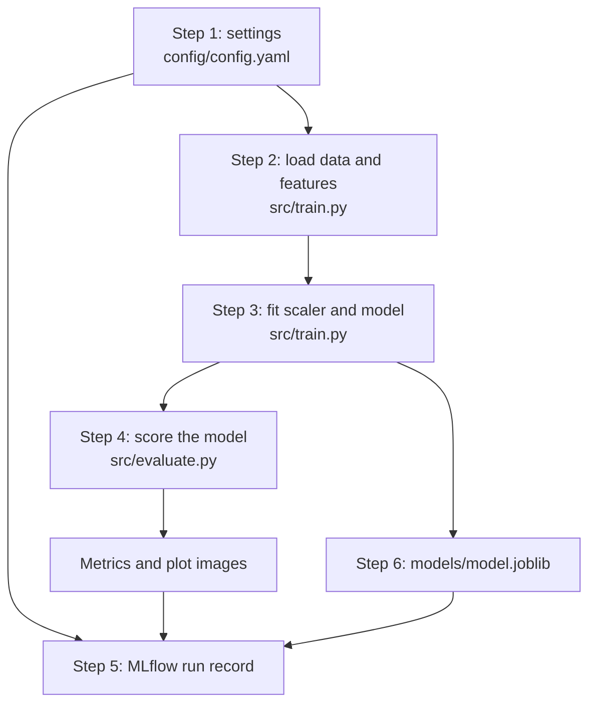

---
hide:
  - toc
---

# Phase 2: Training and Tracking

This phase turns the features from [Phase 1](./phase-1-data-and-features.md) into a trained model, scores it, and records the run in MLflow. One command trains the model using only the settings in `config.yaml`.

This page owns the settings file, the model choice, the scoring rules, and the MLflow contents.

## Phase Architecture

### Flow of Steps

### Inventory

| Item | Kind | Planned location | Built in | What it does |
| :--- | :--- | :--- | :--- | :--- |
| Settings file | Settings file | `config/config.yaml` | Step 1 | Holds every adjustable value for a run. |
| Training command | Code | `src/train.py` | Steps 2 and 3 | Loads data, fits the scaler and model, and starts the scoring and recording. |
| Scoring module | Code | `src/evaluate.py` | Step 4 | Computes the scores and draws the confusion matrix and ROC curve. |
| MLflow run record | Run record | Local `mlruns/` folder or database file, not committed | Step 5 | Stores parameters, metrics, and artifacts for each run. |
| Plot images | Images | Stored inside the MLflow run | Step 4 | Show the test-season confusion matrix and ROC curve. |
| Saved pipeline | Model file | `models/model.joblib`, not committed | Step 6 | The scaler and model together, ready for Phase 3. |

## Which Requirements and Gaps Does It Cover?

- Requirement 1: sets the evaluation metric and the baseline to compare against.
- Requirement 3: covers model training, evaluation, and control through `config.yaml`.
- Requirement 4: defines what MLflow records.
- Scaler: saved together with the model as one object.
- Validation season: sets its role.
- MLflow results: decides where run results are kept.

## Step 1: Define the Settings File

!!! abstract "Purpose"
    **Goal:** Define one file, `config/config.yaml`, that holds every value someone might change, such as the seasons used for each split, the model type, and the random seed.

    **Why:** The assignment requires runs to be controlled by a settings file. Keeping all values in one place also lets MLflow record exactly which values each run used.

    **If skipped:** Values would be typed directly into the code. Changing one would mean editing code, and no record would show which values produced a given score.

Every adjustable value lives in `config/config.yaml`. Changing a run means editing this file and not the code. The table lists the settings the file will hold and the starting values taken from the first design draft. No file is created by this guide.

| Group | Setting | Starting value | What it controls |
| :--- | :--- | :--- | :--- |
| `data` | S3 bucket name | chosen at setup | Where the cleaned table is stored. |
| `data` | S3 key | `data/processed/nfl_matchups_2016_2024.csv` | Which object to download. |
| `data` | AWS region | chosen in [Phase 4](./phase-4-aws-deployment.md#step-1-choose-the-aws-region) | Which region holds the bucket. |
| `data` | Local cache folder | `data/raw/` | Where the download is saved. |
| `split` | Training seasons | 2016 through 2022 | Rows used to fit the model. |
| `split` | Validation season | 2023 | Rows used to compare model types. |
| `split` | Test season | 2024 | Rows used for the final score. |
| `model` | Model type | `LogisticRegression` | Which model to fit. Allowed: `LogisticRegression`, `RandomForestClassifier`. |
| `model` | Logistic regression `C` | 1.0 | Regularization strength. |
| `model` | Logistic regression solver | `lbfgs` | Fitting method. |
| `model` | Logistic regression `max_iter` | 1000 | Fitting iteration limit. |
| `model` | Random seed | 42 | Makes repeated runs give the same result. |
| `model` | Model version label | `v1.0` | Returned by the API in Phase 3. |
| `tracking` | Experiment name | `nfl-pregame-winner-v1` | Groups runs in MLflow. |
| `tracking` | Tracking location | local folder `mlruns` | Where run records are written. |

Random forest settings (number of trees, maximum depth) are added to the `model` group if that model type is compared. XGBoost, named in the first draft, is dropped from the allowed list so the serving image in Phase 3 stays small. Adding it later is a change to one setting and one dependency.

## Step 2: Load the Data and Features

!!! abstract "Purpose"
    **Goal:** Make the training command call the Phase 1 download, feature, and split steps and use their results unchanged.

    **Why:** Phase 1 already defines how each feature is calculated. The training code and the web app must both follow that one definition.

    **If skipped:** If the rules were copied into the training code, the two copies could drift apart. The model would then train on numbers calculated differently from the numbers the web app sends.

The training command downloads the cleaned table through the Phase 1 download step, builds features with the Phase 1 feature step, and splits by the seasons in `config.yaml`. It does not redefine any of those. If a setting for a season range would leave a split empty, the command stops with a message that names the split.

## Step 3: Fit the Scaler and Model

!!! abstract "Purpose"
    **Goal:** Rescale the three features onto the same scale using only the training games, train the model on the rescaled values, and save the scaler and the model together as one object.

    **Why:** The three features have very different ranges. The rest-day difference runs from -8 to 8 in the 2016 to 2024 data, while the win percentage difference runs from -1 to 1. Logistic regression works better when its inputs share a scale. The API must also apply exactly the same rescaling to every request it receives.

    **If skipped:** A feature with larger numbers would count for more only because of its units. If the scaler were saved as a separate file, the API could skip it by mistake and return wrong predictions.

The scaler standardizes each feature to a mean of 0 and a spread of 1, using the training rows only. The model then fits on the scaled training rows.

| Item | Design |
| :--- | :--- |
| Saved object | One scikit-learn pipeline that holds the scaler and the model together. The API in [Phase 3](./phase-3-api-and-docker.md#step-2-load-the-model-at-start-up) loads this one file, so it cannot apply the model without the scaler. |
| Feature order | The saved file records the three feature names in order. The API checks its input against this list. |
| Training rows | Training seasons only. The model is not refit on training plus validation rows, so the validation score stays honest. |
| Repeatability | The random seed is set from `config.yaml`. Running the command twice with the same settings and data gives the same scores. |

## Step 4: Score the Model

!!! abstract "Purpose"
    **Goal:** Calculate the model's accuracy on the training, validation, and test games. Next to each, show the accuracy of always picking the home team: 54.85%, 55.51%, and 53.31%.

    **Why:** An accuracy number alone does not show whether a model is good. Picking the home team every time already gets about 55% of games right, so the model has to beat that to add anything.

    **If skipped:** A test accuracy of 55% could look reasonable while matching the simplest possible rule.

The metric for the project is **accuracy**: the share of games where the predicted winner matches the real winner.

| Score | Computed on | Role |
| :--- | :--- | :--- |
| Accuracy | Training, validation, and test rows | Main metric. |
| Home-team baseline accuracy | Training, validation, and test rows | The score from always picking the home team: 54.85%, 55.51%, and 53.31% (computed in [Phase 1](./phase-1-data-and-features.md#data-facts-checked-against-the-file)). |
| Log loss | Test rows | Measures how good the probabilities are, not just the pick. |
| ROC-AUC | Test rows | Measures how well the model ranks winners above losers. Diagnostic only. |
| Confusion matrix and ROC curve images | Test rows | Saved as image files. |

### How Is the Validation Season Used?

The validation season is used to choose between model types. The training command is run once per candidate model type, and the candidate with the higher validation accuracy is kept. If the two are equal, logistic regression is kept because it is simpler to explain. The test season is scored by every run, but its scores are never used to choose anything.

!!! note "Confirm: validation season chooses the model type"
    The alternative is to report the validation score without using it. That wastes a season of data and leaves the model type to be picked without evidence.

The assignment states that accuracy is not graded, so a score close to the baseline is acceptable. The requirement is that the process is clean and repeatable. The README in Phase 5 reports the baseline next to the model score so a reader can see whether the model adds anything.

## Step 5: Record the Run in MLflow

!!! abstract "Purpose"
    **Goal:** Save each run's settings, scores, and files (the model, two plot images, and a copy of `config.yaml`) to MLflow.

    **Why:** The assignment requires experiment tracking. A saved record also lets you compare the logistic regression run with the random forest run and see which settings gave which score.

    **If skipped:** After changing a setting, you could not tell which earlier run used which values. Choosing a model type using the validation scores would become guesswork.

One training command is one MLflow run.

| Recorded item | Contents |
| :--- | :--- |
| Parameters | Model type, model settings, random seed, training seasons, validation season, test season, model version label, feature names. |
| Metrics | Training, validation, and test accuracy; test log loss; test ROC-AUC; the three baseline accuracies. |
| Artifacts | The saved pipeline file, the confusion matrix image, the ROC curve image, and a copy of `config.yaml`. |

### Where Are Run Results Kept?

The run record is written to a local folder on the developer machine and is not committed. The README in Phase 5 holds a results table copied from the final run, which is the permanent record in the repository.

!!! note "Check the MLflow storage option when building"
    The installed MLflow version is 3.18.0. If its plain local folder option prints a deprecation notice, use a local database file as the tracking location instead. The `tracking` setting in `config.yaml` is the only thing that changes.

## Step 6: Write the Model to Disk

!!! abstract "Purpose"
    **Goal:** Save the trained scaler-and-model object as `models/model.joblib`.

    **Why:** Phase 3 builds the API's Docker image by copying this file into it. The image cannot be built without the file.

    **If skipped:** The API would have no model to load, so it could not answer any prediction request.

After the run, the pipeline file is written to `models/model.joblib`. This path is ignored by git. Phase 3 decides how the file reaches the serving image.

## How Is This Phase Checked?

| Check | Pass condition |
| :--- | :--- |
| One command | A single training command runs from a clean checkout with only `config.yaml` and AWS credentials. |
| Settings drive the run | Changing the model type in `config.yaml` changes the run without any code edit. |
| Repeatable | Two runs with the same settings give identical scores. |
| Scaler isolation | The scaler's saved mean equals the mean of the training rows, not of all rows. |
| Run record complete | The MLflow run lists every parameter, metric, and artifact in Step 5. |
| Baseline recorded | The three baseline accuracies appear in the run and match the Phase 1 numbers. |

## What Can Go Wrong?

| Problem | Effect | How it shows up |
| :--- | :--- | :--- |
| Scaler fit on all rows | Validation and test scores look slightly better than they should. | The scaler isolation check fails. |
| Test score used to choose settings | The reported test score is too optimistic. | Only the validation score appears in the selection step. |
| Saved model and API use different scikit-learn versions | The API cannot load the model. | The load check in Phase 3 fails at start-up. |
| Missing AWS credentials | The download step stops the run. | The error names the credential problem. |

## Commit and Pull Request Plan

A sensible grouping into commits:

1. Settings file and the code that reads it.
2. Scaler and model fitting with the saved pipeline file.
3. Scoring, baselines, and plot images.
4. MLflow recording.
5. Comparison of the two model types and the chosen setting.

## What Does Phase 3 Need From This Phase?

The saved pipeline file `models/model.joblib`, the list of feature names in order, the model version label, and the pinned library versions used to build the file.
