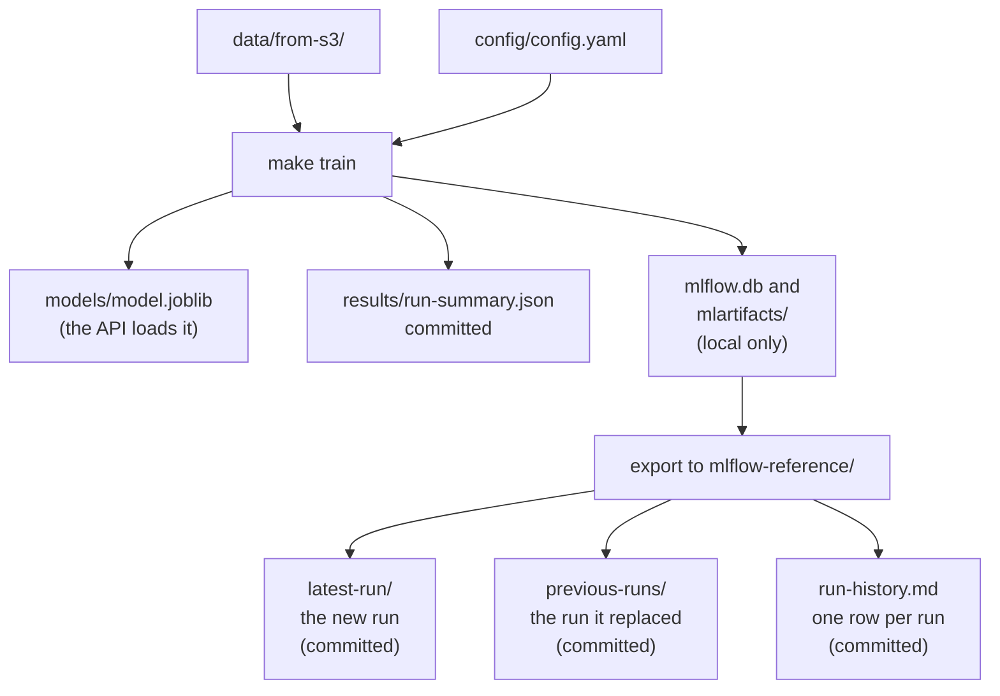
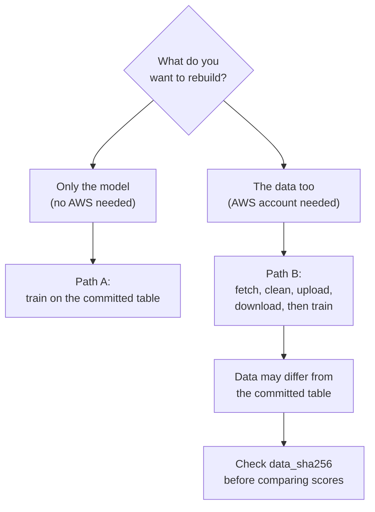

---
hide:
  - toc
---

# Phase 2 Development Guide

This guide shows how to train the model on your own computer, what each output file holds, how to rebuild the result from a clean checkout and confirm it matches the committed one, and how to change the model, the split, or the inputs. The reasons and the numbers are on the [Part 1](./implementation-part-1.md) and [Part 2](./implementation-part-2.md) pages.

## What Is Needed First?

- **The project's virtual environment with the pinned packages.** The setup commands are in the [Phase 1 guide](../phase-1/development-guide.md#what-is-needed-first). Python 3.13 is required.
- **The downloaded table** `data/from-s3/nfl_matchups_2020_2026.csv`. A fresh checkout already has it. If it is missing, run `python -m src.data.download_from_s3` (this needs AWS credentials).
- **No AWS account for training.** Training reads the local copy of the table and writes only to your machine.

## How Do I Do a Training Run?

One command does a whole training run: `make train`, from the project folder. It needs no AWS account and no internet connection.



What one run does, in order:

1. **Fits the model** on the 2020 to 2024 games, and scores the training, validation, and test groups.
2. **Saves the model** to `models/model.joblib`, the file the API loads.
3. **Writes `results/run-summary.json`,** a short readable record of the settings, data fingerprint, scores, and learned weights.
4. **Logs the run to MLflow** in the local `mlflow.db` and `mlartifacts/`: 15 parameters, 8 metrics, 3 files, and an MLflow-format copy of the model.
5. **Updates `mlflow-reference/`.** The last run moves into `previous-runs/`, the new run is written to `latest-run/`, and `run-history.md` gains a row. This is the committed log of every training run. See [`mlflow-reference/mlflow-logging-reference.md`](https://github.com/jconnors23/510-m3-nfl-prediction-analytics/blob/main/mlflow-reference/mlflow-logging-reference.md).

The steps below run it, read the results, and say what to commit.

### Step 1: Check the Inputs (Optional)

```bash
python -m src.model.features
```

It builds the two inputs for every game, splits the games by season, and prints the size and home win share of each group, the range of each input, and a check that every week-1 value is 0:

```text
training: 1339 rows, home win share 53.32%
validation: 271 rows, home win share 53.87%
test: 149 rows, home win share 47.65%
win_pct_differential: min -1.0, max 1.0
point_diff_per_game_differential: min -49.0, max 39.0
week 1 differentials are all 0
```

It writes no file.

### Step 2: Train the Model

```bash
make train
```

`make train` runs `python -m src.model.train`, with MLflow's unrelated hint line turned off. It takes a few seconds and prints nine lines:

```text
training: 820 of 1339 correct (61.24%), always-home 53.32%
validation: 171 of 271 correct (63.10%), always-home 53.87%
test: 88 of 149 correct (59.06%), always-home 47.65%
validation log loss 0.6451
test log loss 0.6815
saved: models/model.joblib
summary: results/run-summary.json
MLflow run: LogisticRegression-v1.0
saved: mlflow-reference/latest-run
```

- **The first three lines are the scores.** Each shows correct picks out of games, and the always-pick-home baseline to beat. The validation score (63.10%) is the one used to judge the model, because the model never trained on those games.
- **The same settings and data give the same scores.** Running `make train` again prints the same nine lines, and `results/run-summary.json` stays byte for byte the same.
- **Every run is still a new MLflow run.** It gets a new run id and time, so `mlflow-reference/` changes on every run, even when the scores do not.

### Step 3: Read the Run History

Open `mlflow-reference/run-history.md`. It lists every training run, newest first: its start time, run id, git commit, validation and test accuracy, validation log loss, and a link to its folder. A run's folder holds its settings (`params.json`), its scores (`metrics.json`), its id and commit (`run.json`), the config it used, and its confusion-matrix picture.

- **To compare two runs,** read their rows, or open each run's `params.json` and `metrics.json`. A different `data_sha256` in `params.json` means the run used different data.
- **The history is built from the committed folders,** so it reads the same in any copy of the repository, with no MLflow install.
- **Runs from before the history began** are added once with `python -m src.model.export_mlflow --backfill`. Running it again adds nothing.
- **To rewrite `latest-run/` without training,** run `python -m src.model.export_mlflow`. Running it on the same run changes nothing in `previous-runs/`.

### Step 4: Read What the Run Recorded

- **`results/run-summary.json`** is a small readable record of the latest run: the settings, the data fingerprint, the scores, and the learned weights. It is committed to git. See [What Is the Run Summary File?](./implementation-part-2.md#what-is-the-run-summary-file).
- **The MLflow screen** shows every run, with its 15 settings, 8 scores, 3 files, and the logged model:

```bash
make start-web-ml
```

Open `http://127.0.0.1:5001` and choose the experiment `nfl-pregame-winner-v1`. The command runs `mlflow ui` on port 5001, because macOS Control Center often holds MLflow's default port, 5000. It also hides a hint line MLflow prints about tracing code. Press `Ctrl+C` to stop the screen. The screen lists every run in your local `mlflow.db`, which can include runs that were never committed.

- **The files** are explained in [What Is Each File Type?](#what-is-each-file-type), below.

### Step 5: Commit the Run

A training run changes these committed files. Commit them together, so the code, the result, and the log of the run stay in step:

- `results/run-summary.json`, which changes only when the settings, the data, or the scores change.
- Everything under `mlflow-reference/`: the new `latest-run/`, the run it moved into `previous-runs/`, and both history files.

`models/`, `mlflow.db`, and `mlartifacts/` are ignored, so `git status` never lists them. If the model changed, also rebuild the web app's data with `python -m src.profiles` and `python -m src.season`, and redeploy the API, as the step list in [How Do I Add or Change an Input?](#how-do-i-add-or-change-an-input) says.

## What Does a Training Run Create?

The diagram in [How Do I Do a Training Run?](#how-do-i-do-a-training-run) shows every output. They look similar but hold different things. Three are committed to git: `results/run-summary.json`, `config/config.yaml` (the input), and `mlflow-reference/`.

### What Is Each File Type?

| Output | Format | What it holds | Who reads it | In git? | Same on every rerun? |
| :--- | :--- | :--- | :--- | :--- | :--- |
| `models/model.joblib` | Python object saved with joblib | The fitted scaler and logistic regression, plus the input names, model version, scikit-learn version, and training seasons | The Phase 3 API | No | Same predictions. The bytes are not compared. |
| `mlflow.db` | SQLite database (one file) | A table of runs: each run's 15 settings, 8 scores, tags, and the paths of its files. It holds no model and no images. | MLflow and its web page | No | No. Each rerun adds a row with a new run id and time. |
| `mlartifacts/` | Folder of ordinary files | The files each run saved: a copy of `model.joblib`, the confusion-matrix image, a copy of `config.yaml`, and the MLflow-format model | MLflow and its web page, or a person opening the folder | No | No. Each rerun adds a new subfolder. |
| `results/run-summary.json` | Plain JSON text | The settings, data fingerprint, scores, and learned weights of the latest run | A person, or git when comparing runs | Yes | Yes, byte for byte, when data, settings, and packages match |
| `config/config.yaml` | Plain YAML text | Every setting | The code, and a person | Yes | Not an output. It is the input. |
| `mlflow-reference/` | Folder of JSON, YAML, Markdown, and PNG files | A readable log of every training run: the newest in `latest-run/`, earlier ones in `previous-runs/`, and `run-history.md` listing them all | A person, with no MLflow install | Yes | No. Each run adds a folder and a history row. |

### Reading the Differences

- **`model.joblib` is the model itself.** It is the only file the API needs. It does not say how well the model scored.
- **`mlflow.db` is the logbook.** It records what each run used and scored, and it points to the run's files. It holds numbers and text only. If you delete it, the model and files stay, but MLflow can no longer list the runs.
- **`mlartifacts/` is the shelf of files.** The logbook (`mlflow.db`) says which run a file belongs to, and `mlartifacts/` holds the file. The two are only useful together, so keep or delete them as a pair.
- **`run-summary.json` is the committed receipt.** It repeats the key facts of the latest run in a form git can compare line by line. The database and the shelf cannot be compared that way, because they are binary or hold run ids and times.
- **`mlflow-reference/` is the committed logbook.** It is a readable copy of what the logbook and the shelf hold for every run, with no absolute paths and no user name, so the MLflow logging can be read in any copy of the repository.

### What Is Inside `mlartifacts/`?

```text
mlartifacts/
  <run id>/artifacts/            files in the run's own file list
    model/model.joblib             copy of the working model
    plots/confusion_matrix_validation.png
    config/config.yaml             copy of the settings used
  models/m-<id>/artifacts/       the MLflow-format model (a logged model)
    MLmodel                        description of the model
    model.skops                    the model, in skops format
    conda.yaml, python_env.yaml    the environment it needs
    requirements.txt               the packages it needs
```

- **Two copies of the model.** `model.joblib` is plain and carries the extra facts the API checks. The MLflow-format copy lets MLflow's own tools load the model in one call. Both come from the same fitted model. See [Why Is the Model Stored Twice?](./implementation-part-2.md#why-is-the-model-stored-twice).
- **`joblib` and `skops` are two ways to write a model to disk.** joblib is the general way and works on any Python object. skops is the format MLflow's scikit-learn support uses.
- **Where the settings go.** `config/config.yaml` is the input. The copy under `mlartifacts/` is a snapshot of what was used for that run.
- **Why they are not committed.** The database is binary and changes on every run, it records an absolute path on one machine, and one command rebuilds both. See [Design Manifest](../design-manifest.md).
- **What is committed in their place.** [`mlflow-reference/`](https://github.com/jconnors23/510-m3-nfl-prediction-analytics/tree/main/mlflow-reference) holds a readable copy of every run: its settings, scores, plot, and the logged model's text files, with no absolute paths. See [Step 3: Read the Run History](#step-3-read-the-run-history).
- **Terms.** The [Glossary](../extras/glossary.md) defines artifact, artifact store, logged model, and SQLite.

## How Do I Reproduce the Result From a Clean Checkout?

**Short answer:** starting from a clean checkout, one command (`python -m src.model.train`) rebuilds the model, the MLflow records, and `results/run-summary.json`, and the summary file comes out byte for byte identical to the committed one. The check is described in [What Was Checked?](#what-was-checked).

### What Makes a Rerun Give the Same Result?

- **The data:** The cleaned table is committed in `data/`. Its SHA-256 fingerprint is logged on every run. See [Phase 1 Implementation](../phase-1/implementation.md).
- **The settings:** Every value is in `config/config.yaml`. The code holds no model settings. See [Part 1](./implementation-part-1.md).
- **The packages:** `requirements.txt` pins every package to an exact version. Python 3.13 is required. See [Phase 1 Implementation](../phase-1/implementation.md#what-is-the-run-environment).
- **The randomness:** `model.random_seed` is 42. The solver (`lbfgs`) uses no randomness, so two fits match either way. See [Part 2](./implementation-part-2.md#step-4-fit-the-scaler-and-the-model).
- **The record of the result:** `results/run-summary.json` has no run id, timestamp, or machine paths, and its decimals are rounded to 6 places. See [Part 2](./implementation-part-2.md#what-is-the-run-summary-file).

### Which Path Applies?

The training command reads `data/from-s3/nfl_matchups_2020_2026.csv`. The folder `data/` is committed, so a fresh checkout already has that file. Pick the path that matches what you want to prove.



- **Path A (recommended for a first check).** Needs Python 3.13 and the pinned packages. It needs no AWS account and no internet after the install.
- **Path B (full rebuild).** Needs an AWS account, AWS CLI version 2, credentials on the machine, and internet access to GitHub and S3. See the [run environment](../phase-1/implementation.md#what-is-the-run-environment).
- **Heads up for Path B.** Its first step downloads the current nflverse file, and nflverse can correct old scores or add games. A new download can produce a different table, and so different scores. The `data_sha256` value tells you whether the table matches the committed one.

### Path A: Train on the Committed Table

1. **Create the environment** with the [Phase 1 setup commands](../phase-1/development-guide.md#what-is-needed-first).
2. **Run the tests.** They use made-up data and a stand-in S3 client, so they need no internet and no AWS account.

    ```bash
    python -m pytest
    ```

    Expected on a clean checkout: **93 passed and 2 skipped**. The two skipped tests use the saved model, which a clean checkout does not have yet. After training, the same command gives **95 passed**.

3. **Train** with `make train`. It prints the nine lines shown in [Step 2: Train the Model](#step-2-train-the-model).
4. **Confirm nothing changed.** Training overwrites `results/run-summary.json`. If the rebuild matches, git shows no change to that file.

    ```bash
    git status --short results/run-summary.json
    ```

    No output means the file is identical to the committed one. A change means the data, the settings, or a package version is different. Compare `data_sha256` and `scikit_learn_version` in the file first.

    ```bash
    git diff results/run-summary.json
    ```

### Path B: Rebuild the Data First

Run these in order, then continue with steps 2 to 4 of Path A. Each step is explained in the [Phase 1 Implementation](../phase-1/implementation.md).

```bash
python -m src.data.fetch_raw
```

```bash
python -m src.data.clean
```

```bash
python -m src.data.upload_to_s3
```

```bash
python -m src.data.download_from_s3
```

### What Was Checked?

- A copy of the project with only `config/`, `data/`, `src/`, `tests/`, `results/`, `pytest.ini`, and the committed profiles file, and no `mlflow.db`, `mlartifacts/`, or `models/`. The tests gave 59 passed and 2 skipped. `python -m src.model.train` printed the eight lines above and **rewrote `results/run-summary.json` identically to the committed one** (checked with `cmp`). The tests then gave 61 passed.
- The earlier real run was repeated and gave identical scores. See [Part 2](./implementation-part-2.md).
- Both checks ran on one Mac, with Python 3.13.14 and the pinned packages.

## How Do I Develop It?

### Where Is Each Piece?

- **The two inputs and the split by season:** `src/model/features.py`.
- **Fitting, saving, the run summary, and MLflow logging:** `src/model/train.py`.
- **Accuracy, log loss, and the confusion-matrix plot:** `src/model/evaluate.py`.
- **The seasons and the split rules:** `src/config.py` (`season_window`, `split_seasons`).
- **Every setting:** `config/config.yaml` (the `window`, `split`, `model`, and `tracking` blocks).
- **Tests:** `tests/test_features.py` (7), `test_split.py` (5), `test_evaluate.py` (4), `test_train.py` (11).

### How Do I Run the Tests?

```bash
python -m pytest tests/test_features.py tests/test_split.py tests/test_evaluate.py tests/test_train.py
```

Expected: **27 passed**. The tests use made-up games, and every file they write goes in a temporary folder. They point MLflow at a temporary database, so they never touch your `mlflow.db`.

### How Do I Change a Model Setting?

1. Edit the `model` block in `config/config.yaml`.
2. Run `python -m src.model.train`.
3. Compare the new run with the earlier one in the MLflow screen, and read the change in `results/run-summary.json`.

- **`model.logistic_regression.C`:** How strongly the weights are held near zero. A smaller number holds them tighter.
- **`model.logistic_regression.solver`:** The method that finds the weights.
- **`model.logistic_regression.max_iter`:** The most steps the solver may take.
- **`model.random_seed`:** The starting number for any random choice. The `lbfgs` solver uses none, so this only protects a random step added later.
- **`model.version`:** The label saved with the model and shown by the API. Change it when you want a new model to be told apart from the old one.

Change one setting at a time, so a change in the scores has one cause. A new `model.version` is a new label only. It does not retrain anything by itself.

### How Do I Change the Split?

The split has three settings. Training runs from `window.start_season` to `split.train_end_season`, validation is `split.validation_season`, and the test season is `window.end_season`.

1. Edit the `split` block (and the `window` block if the data window moves).
2. Run `python -m src.model.features` to see the new group sizes.
3. Run `python -m src.model.train`.

`split_seasons` in `src/config.py` stops the command with a message unless the order holds: the first training season is not after the last, the validation season is after the last training season, and the validation season is before the test season. This keeps every group later than the one before it, so the model is never scored on games played before games it learned from.

### How Do I Add or Change an Input?

An input is one column the model sees. The names are shared with the API, so a change reaches further than this phase.

1. **Build the column** in `build_model_table` in `src/model/features.py`, and add its name to `MODEL_COLUMNS` and to `INPUT_COLUMNS`, in the order the model should see it. Use only games from earlier weeks of the same season, and keep the week-1 check in `check_model_table` true.
2. **Update the tests** in `tests/test_features.py`.
3. **Retrain** with `python -m src.model.train`. The saved model records the input names in order.
4. **Update the API.** The request fields in `src/api/schemas.py` must be exactly the names in `INPUT_COLUMNS`. At start-up the API compares the two and refuses to start if they differ. See [Phase 3](../phase-3/development-guide.md#how-do-i-develop-it).
5. **Rebuild and redeploy the Lambda function,** because the zip holds the model and the API code. See [Phase 4](../phase-4/deployment-guide.md#redeploy-after-a-change).
6. **Update anything that sends the inputs,** such as the Phase 5 web app and its profiles file (`python -m src.profiles`).

### What Is Kept in Git After a Retrain?

- **Committed:** `results/run-summary.json`. It is stable, so git shows a change only when the settings, data, or scores really changed.
- **Committed:** `mlflow-reference/latest-run/`, the readable copy of the newest MLflow run. Training rewrites it, so git shows a change on every retrain, because the run id and times are new.
- **Not committed:** `models/`, `mlflow.db`, and `mlartifacts/`. One command rebuilds all three.

## How Does the Model Reach AWS?

Phase 2 has nothing to deploy. The trained model stays on your machine as `models/model.joblib`. It reaches AWS when the Phase 4 zip is built, which copies that one file in. The scikit-learn version saved inside it must equal the version in the zip, or the service refuses to start. The steps are in the [Phase 4 Deployment Guide](../phase-4/deployment-guide.md#build-the-zip).
