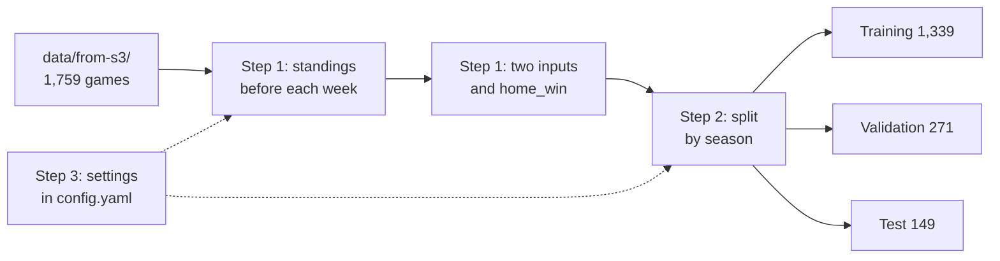

---
hide:
  - toc
---

# Phase 2 Implementation, Part 1: Steps 1 to 3

This page explains how the first three Phase 2 steps work: feature engineering (the two model inputs), the split by season, and the new settings. [Part 2](./implementation-part-2.md) covers training, scoring, MLflow, and saving the model. For the short version, see the [Brief](./brief.md).

**Status: built and tested.** The code is in `src/model/features.py`, with the new setting reader in `src/config.py`. Every number below was recomputed from the downloaded table (`data/from-s3/nfl_matchups_2020_2026.csv`, 1,759 rows) with this code, and from a second, independent calculation that matched it row for row.

## How Does the Data Flow?



## Step 1: Feature Engineering

!!! abstract "Purpose"
    **Goal:** Turn each game into two numbers the model can learn from, plus the answer it should predict. Building input numbers (features) from raw columns is called feature engineering.

    **Why:** The model cannot read team names. It needs numbers that say how the home team compares with the away team going into the game.

    **If skipped:** There would be nothing to train on.

### Which Functions Do the Work?

All of these are in `src/model/features.py`. Everything is built in memory on each run, and no new data file is saved.

- `load_games(config)` reads the downloaded table, and stops with a message to run the download step first if the file is missing.
- `standings_before_week(games, season, week, teams)` returns one row per team, counting only earlier weeks of that season.
- `build_model_table(games)` returns one row per game with the two inputs and the answer.
- `check_model_table(table)` stops the run if an input is blank or any week-1 input is not exactly 0.
- `split_games(table, config)` is Step 2.

### What Is Counted Before Each Game?

- **Earlier weeks of the same season only.** For a game in week 7 of 2025, each team's numbers come from its games in weeks 1 to 6 of 2025. Games in week 7 itself are never counted, so a game cannot be described by its own result or by another result from the same week.
- **Numbers start over every season.** A team's 2024 results are not used in 2025.
- **Win percentage:** wins divided by games played so far.
- **Point margin per game:** points scored minus points allowed so far, divided by games played so far.
- **A team with no games yet** counts as win percentage 0.5 and point margin 0.0. This happens for every team in week 1.
- **Per game, not season totals.** Teams have played different numbers of games by mid-season because of bye weeks. Before week 8 of 2025, 23 teams had played 7 games, 8 teams had played 6, and 1 team had played 5. A season total would favor the teams that had played more games.
- **Tied games are not in the table.** Phase 1 removed them, so two teams in a removed game show one fewer game.

### What Do the Standings Look Like?

Standings before week 7 of 2025 for a few teams. Twenty-five teams had played 6 games, six had played 5, and Green Bay had played 4.

| team | games | wins | win_pct | point_diff_per_game |
| :--- | :--- | :--- | :--- | :--- |
| IND | 6 | 5 | 0.8333 | 13.0 |
| TB | 6 | 5 | 0.8333 | 2.3333 |
| PIT | 5 | 4 | 0.8 | 2.4 |
| GB | 4 | 3 | 0.75 | 7.25 |
| NE | 6 | 4 | 0.6667 | 5.0 |
| TEN | 6 | 1 | 0.1667 | -13.0 |
| CLE | 6 | 1 | 0.1667 | -10.6667 |
| NYJ | 6 | 0 | 0.0 | -7.8333 |

Before week 1 the same table has every team at `games` 0, `wins` 0, `win_pct` 0.5, and `point_diff_per_game` 0.0.

### How Are the Standings Built?

```python
def standings_before_week(games, season, week, teams):
    """One row per team from games played earlier in this season."""
    # Same-week games are left out, so a result cannot describe itself or the other game that week.
    earlier = games.loc[(games["season"] == season) & (games["week"] < week)]
    rows = []
    for team in teams:
        home = earlier.loc[earlier["home_team"] == team]
        away = earlier.loc[earlier["away_team"] == team]
        played = len(home) + len(away)
        # No games yet would make a percentage undefined. 0.5 and 0 leave week 1 as a tie.
        if played == 0:
            wins = 0
            win_pct = 0.5
            margin = 0.0
        else:
            wins = int((home["home_score"] > home["away_score"]).sum()) + int(
                (away["away_score"] > away["home_score"]).sum()
            )
            scored = float(home["home_score"].sum() + away["away_score"].sum())
            allowed = float(home["away_score"].sum() + away["home_score"].sum())
            # Divide by games played, not a season total, because bye weeks leave teams on different game counts.
            win_pct = wins / played
            margin = (scored - allowed) / played
        rows.append({"team": team, "games": played, "wins": wins,
                     "win_pct": float(win_pct), "point_diff_per_game": float(margin)})
    return pd.DataFrame(rows)
```

A game counts for both teams. The home team's points scored are `home_score`, and the away team's are `away_score`.

### What Does Each Game Become?

| Column | Type | What it means | Example (`2025_07_NE_TEN`) |
| :--- | :--- | :--- | :--- |
| `game_id` | text | Season, week, away team, home team | `2025_07_NE_TEN` |
| `season` | whole number | Season year | 2025 |
| `week` | whole number | Week of the regular season | 7 |
| `home_team` | text | Home team code | `TEN` |
| `away_team` | text | Away team code | `NE` |
| `win_pct_differential` | decimal | Home win percentage minus away win percentage | -0.5 |
| `point_diff_per_game_differential` | decimal | Home margin per game minus away margin per game | -18.0 |
| `home_win` | whole number | 1 if `home_score` is greater than `away_score`, otherwise 0 | 0 |

- A **positive** differential means the home team looks stronger. A **negative** one means the away team does.
- `home_win` is the answer the model learns to predict. It is the only column that uses the current game's result, and it is never an input.
- The model uses only the two differential columns. The other columns identify the game.
- Rows are sorted by `season`, `week`, and `game_id`.

```python
def build_model_table(games):
    """One row per game, with the two pre-game differentials and the home-win answer."""
    teams = sorted(set(games["home_team"]) | set(games["away_team"]))
    rows = []
    for (season, week), week_games in games.groupby(["season", "week"], sort=False):
        # Once per week, then reused for every game in that week.
        standings = standings_before_week(games, int(season), int(week), teams).set_index("team")
        for game in week_games.itertuples(index=False):
            home = standings.loc[game.home_team]
            away = standings.loc[game.away_team]
            rows.append({
                "game_id": game.game_id,
                "season": int(game.season),
                "week": int(game.week),
                "home_team": game.home_team,
                "away_team": game.away_team,
                "win_pct_differential": float(home["win_pct"] - away["win_pct"]),
                "point_diff_per_game_differential": float(
                    home["point_diff_per_game"] - away["point_diff_per_game"]
                ),
                "home_win": int(game.home_score > game.away_score),
            })
    table = pd.DataFrame(rows, columns=MODEL_COLUMNS)
    return table.sort_values(["season", "week", "game_id"]).reset_index(drop=True)
```

### What Do Real Rows Look Like?

The first two rows are from week 1 of 2025, and the rest are from week 7.

| game_id | home_team | away_team | win_pct_differential | point_diff_per_game_differential | home_win |
| :--- | :--- | :--- | :--- | :--- | :--- |
| 2025_01_ARI_NO | NO | ARI | 0.0 | 0.0 | 0 |
| 2025_01_BAL_BUF | BUF | BAL | 0.0 | 0.0 | 1 |
| 2025_07_ATL_SF | SF | ATL | 0.0667 | -0.5 | 1 |
| 2025_07_CAR_NYJ | NYJ | CAR | -0.5 | -5.5 | 0 |
| 2025_07_LV_KC | KC | LV | 0.1667 | 12.8333 | 1 |
| 2025_07_NE_TEN | TEN | NE | -0.5 | -18.0 | 0 |
| 2025_07_PIT_CIN | CIN | PIT | -0.4667 | -15.7333 | 1 |

The last row shows that the inputs do not decide a game. Pittsburgh looked stronger on both numbers, and Cincinnati still won at home.

### What Is a Worked Example?

Game `2025_07_NE_TEN` is New England at Tennessee in week 7 of 2025. From the standings table above:

- Tennessee (home) had played 6 games, won 1, and had a point margin of -78, so its win percentage was 0.1667 and its margin per game was -13.0.
- New England (away) had played 6 games, won 4, and had a point margin of +30, so its win percentage was 0.6667 and its margin per game was +5.0.
- The two inputs are 0.1667 - 0.6667 = **-0.5** and -13.0 - 5.0 = **-18.0**. Both are negative, so the away team looks stronger.
- Tennessee lost, so `home_win` is 0.

### What Is a Small Example Worked by Hand?

Four teams (A, B, C, D) play two games each week for three weeks. This is the league the tests use.

| game | week | home | away | score |
| :--- | :--- | :--- | :--- | :--- |
| w1a | 1 | A | B | 30 to 0 |
| w1b | 1 | C | D | 10 to 7 |
| w2a | 2 | A | C | 14 to 10 |
| w2b | 2 | B | D | 21 to 3 |
| w3a | 3 | A | D | 17 to 14 |
| w3b | 3 | C | B | 28 to 7 |

Standings before week 3 (after two games each):

| team | games | wins | win_pct | point_diff_per_game |
| :--- | :--- | :--- | :--- | :--- |
| A | 2 | 2 | 1.0 | 17.0 |
| B | 2 | 1 | 0.5 | -6.0 |
| C | 2 | 1 | 0.5 | -0.5 |
| D | 2 | 0 | 0.0 | -10.5 |

The inputs for each game:

| game | win_pct_differential | point_diff_per_game_differential | home_win |
| :--- | :--- | :--- | :--- |
| w1a, w1b | 0.0 | 0.0 | 1 |
| w2a | 0.0 | 27.0 | 1 |
| w2b | 0.0 | -27.0 | 1 |
| w3a | 1.0 | 27.5 | 1 |
| w3b | 0.0 | 5.5 | 1 |

For `w3a`, A is at home against D. The win percentage input is 1.0 - 0.0 = 1.0, and the margin input is 17.0 - (-10.5) = 27.5.

### How Do the Inputs Behave?

- **Ranges across all 1,759 games:** `win_pct_differential` runs from -1.0 to 1.0, and `point_diff_per_game_differential` runs from -49.0 to 39.0. Neither has a blank value.
- **All games:** `win_pct_differential` has an average of -0.0045 and a spread (standard deviation) of 0.3598. `point_diff_per_game_differential` has an average of -0.2317 and a spread of 10.1942.
- **Training games only:** the averages are -0.0004 and -0.1762, and the spreads are 0.3476 and 10.1117. Part 2 uses these when it standardizes the inputs.
- **The two inputs overlap.** Their correlation in the training games is 0.78, because teams that win more tend to have better margins. Logistic regression handles this.
- **The scales differ by about 30 times,** which is why Part 2 standardizes the inputs before the model sees them.
- **When both inputs agree, the home team usually follows them.** In 574 games both inputs are positive, and the home team won 69.51% of them. In 604 games both are negative, and the home team won 36.92%. In 196 games the two inputs point opposite ways, and 115 games have both inputs at 0 (111 in week 1 and 4 later).

### What Happens in Week 1?

- Before week 1 no team has played, so every team counts as 0.5 and 0.0, and **both inputs are exactly 0 for all 111 week-1 games** (79 training, 16 validation, 16 test).
- The model cannot tell those games apart, so it will pick the home team in all of them.
- Week 1 games are kept in the data like every other week.

### How Is the Week-1 Rule Enforced?

```python
def check_model_table(table):
    """Stop if a model input is blank or a week-1 differential is not zero."""
    if table[INPUT_COLUMNS].isna().any().any():
        raise ValueError("a model input is blank")
    week_one = table.loc[table["week"] == 1, INPUT_COLUMNS]
    if (week_one != 0).any().any():
        raise ValueError("a week-1 differential is not 0")
```

If a number used the current or a later week, week 1 would not be exactly 0 and the run would stop here.

### Run It

```bash
python -m src.model.features
```

Output:

```text
training: 1339 rows, home win share 53.32%
validation: 271 rows, home win share 53.87%
test: 149 rows, home win share 47.65%
win_pct_differential: min -1.0, max 1.0
point_diff_per_game_differential: min -49.0, max 39.0
week 1 differentials are all 0
```

## Step 2: Split the Games by Season

!!! abstract "Purpose"
    **Goal:** Split the games into training, validation, and test groups by season.

    **Why:** The model must predict games that have not happened yet. It learns from earlier seasons, is scored on a later finished season, and is also shown the season in progress.

    **If skipped:** A random split would train on later games and score on earlier ones, and the scores could not be trusted.

### Which Games Go in Each Group?

| Group | Seasons | Games | Weeks | Home wins | Home win share |
| :--- | :--- | :--- | :--- | :--- | :--- |
| Training | 2020 to 2024 | 1,339 | 1 to 18 | 714 | 53.32% |
| Validation | 2025 | 271 | 1 to 18 | 146 | 53.87% |
| Test | 2026 | 149 | 1 to 10 | 71 | 47.65% |

- **Training** is the only group the model is fit on.
- **Validation** is the last finished season. It is never used to fit the model, and it gives the score to report.
- **Test** is the season in progress, cut to the weeks that have scores. It is never used to fit the model. With only 149 games, its accuracy can move by about 4 points either way by chance.
- **Always picking the home team** is the baseline in the last column. The model has to beat it to add anything.
- **Week 1 games:** 79 are in training, 16 in validation, and 16 in test.
- **Games by season:** 255 (2020), 271 (2021), 269 (2022), 272 (2023), 272 (2024), 271 (2025), and 149 (2026). A full season has 272 games. 2020 had 256 (its last week was week 17), and 2022 had 271 because one game was cancelled. Each season then loses its tied games: one each in 2020, 2021, and 2025, two in 2022, and one in 2026.
- **Why by season, not at random:** each season stands on its own, because the numbers start over each year. Splitting whole seasons also keeps every game in a group from using results that came after the games in the next group.

### How Are the Seasons Chosen?

The test season and the week cap come from the existing `window` block, and only two seasons are new in `split`, so no season is written in two places.

```python
def split_seasons(config):
    """First training season, last training season, validation season, and test season."""
    start_season, test_season, _test_week = season_window(config)
    train_end_season = int(config["split"]["train_end_season"])
    validation_season = int(config["split"]["validation_season"])
    if start_season > train_end_season:
        raise ValueError(
            f"first training season {start_season} is after last training season {train_end_season}"
        )
    if train_end_season >= validation_season:
        raise ValueError(
            f"validation season {validation_season} is not after last training season {train_end_season}"
        )
    if validation_season >= test_season:
        raise ValueError(
            f"validation season {validation_season} is not before test season {test_season}"
        )
    return start_season, train_end_season, validation_season, test_season
```

With the real settings this returns `(2020, 2024, 2025, 2026)`. A season order that would score the model on a season it already trained on is rejected with a message.

### How Is the Table Split?

```python
def split_games(table, config):
    """Training, validation, and test tables, one season range each."""
    start_season, train_end_season, validation_season, test_season = split_seasons(config)
    groups = {
        "training": table.loc[table["season"].between(start_season, train_end_season)].copy(),
        "validation": table.loc[table["season"] == validation_season].copy(),
        "test": table.loc[table["season"] == test_season].copy(),
    }
    for name, group in groups.items():
        if group.empty:
            raise ValueError(f"{name} has no rows")
    game_ids = [set(group["game_id"]) for group in groups.values()]
    combined = set.union(*game_ids)
    # A season that falls in a gap, or a game id that lands in two groups, would make the sizes disagree.
    if sum(len(ids) for ids in game_ids) != len(combined) or len(combined) != len(table):
        raise ValueError("every game must be in exactly one split group")
    return groups
```

- An empty group stops the run with a message that names the group, such as `validation has no rows`.
- Every game must land in exactly one group, so the three sizes always add up to 1,759.

## Step 3: Add the Model and Tracking Settings

!!! abstract "Purpose"
    **Goal:** Put every new tunable value for Phase 2 into `config/config.yaml`.

    **Why:** Changing a run should mean editing the settings file, not the code.

    **If skipped:** Seasons, model values, and file names would be written inside the code.

Three new blocks sit below the existing `data` and `window` blocks. Those two blocks did not change.

```yaml
# How the games are split by season. Training starts at window.start_season (2020) and stops
# at train_end_season. The validation season is the finished season after it, and its score is
# the one to report. The test season is window.end_season, so that year is not written here
# a second time. The model is fit on the training seasons only.
split:
  train_end_season: 2024
  validation_season: 2025

# The model and how it is saved.
model:
  # A label for this trained model. It is saved inside the model file and in the MLflow run.
  version: v1.0
  # A starting number for any random choice, so a rerun gives the same result. The solver
  # below does not use randomness, so two fits match either way. The seed is kept so a random
  # step added later stays repeatable.
  random_seed: 42
  # Where the trained model is saved.
  output_path: models/model.joblib
  # Logistic regression: the model gives each input a weight, adds them up, and turns the
  # total into a chance (0 to 1) that the home team wins.
  logistic_regression:
    # How strongly the weights are held close to zero, to stop the model from memorizing the
    # training games. A smaller number holds them tighter. 1.0 is the usual starting point.
    C: 1.0
    # The method that finds the best weights. "lbfgs" repeatedly nudges the weights to lower
    # the model's errors until they stop improving. It suits a small table like this one.
    solver: lbfgs
    # The most nudges the solver may make before it gives up. The solver finishes in about 6
    # here, so 1000 leaves a wide safety margin.
    max_iter: 1000

# MLflow, the tool that records every training run so runs can be compared later.
tracking:
  # The name that groups every run of this project.
  experiment_name: nfl-pregame-winner-v1
  # The database file where MLflow keeps each run's settings and scores.
  database_path: mlflow.db
  # The folder where MLflow keeps each run's files (the model, the plot, a copy of this file).
  artifact_folder: mlartifacts
  # A small readable summary of the latest run (settings, data fingerprint, scores, and the
  # learned weights). It is committed to git. MLflow keeps the full history of runs.
  summary_path: results/run-summary.json
```

### What Does Each Setting Do?

- **`split.train_end_season`:** the last training season (2024). Training starts at `window.start_season` (2020).
- **`split.validation_season`:** the validation season (2025). The test season is `window.end_season` (2026), and `window.test_through_week` (10) is already applied by cleaning.
- **`model.version`:** a label for the trained model (`v1.0`). It is saved with the model and shown by the API later.
- **`model.random_seed`:** the starting number for any random choice (42). The `lbfgs` solver does not use randomness, so two fits give the same result either way. The seed is kept so any later random step stays repeatable.
- **`model.output_path`:** where the trained model is saved (`models/model.joblib`).
- **`model.logistic_regression.C`:** regularization strength (1.0). A smaller value pulls the weights toward zero more strongly. This is scikit-learn's default.
- **`model.logistic_regression.solver`:** the method that finds the weights (`lbfgs`).
- **`model.logistic_regression.max_iter`:** the most steps the solver may take (1000), set high enough that it always finishes.
- **`tracking.experiment_name`:** the MLflow group that holds every run (`nfl-pregame-winner-v1`).
- **`tracking.database_path`:** the database file that holds the run record (`mlflow.db`).
- **`tracking.artifact_folder`:** the folder that holds each run's files (`mlartifacts`).
- **`tracking.summary_path`:** where each run writes its readable summary (`results/run-summary.json`). See [What Is the Run Summary File?](./implementation-part-2.md#what-is-the-run-summary-file).

### Where Does MLflow Keep Its Records?

- **A database file.** MLflow stores each run's settings and scores in a local database file, `mlflow.db`. It is a single file, it needs no server, and it is not committed to git.
- **A folder of files.** Each run's files (the model, the plot, and a copy of the settings) go in `mlartifacts/`, in a subfolder for each run.
- **The tracking address.** The only place the database type shows up is the address MLflow requires, which starts with `sqlite:///` followed by the full path of `mlflow.db`.
