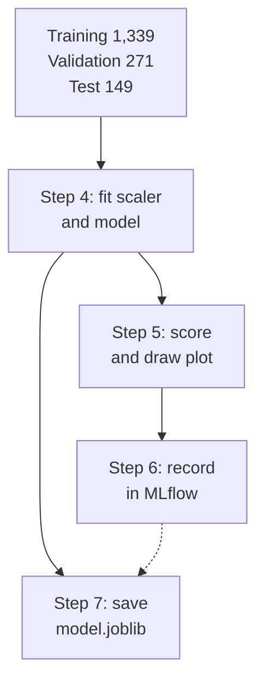

---
hide:
  - toc
---

# Phase 2 Implementation, Part 2: Steps 4 to 7

This page explains how the last four Phase 2 steps work: fitting the model, scoring it, recording the run in MLflow, and saving the trained model. [Part 1](./implementation-part-1.md) covers the inputs, the split, and the settings. For the short version, see the [Brief](./brief.md).

**Status: built and tested.** The code is in `src/model/train.py` and `src/model/evaluate.py`. Every number below comes from the real run of `python -m src.model.train` on the downloaded table. The command was run twice and gave identical scores, and the 29 tests for this phase pass (in `tests/test_features.py`, `test_split.py`, `test_evaluate.py`, and `test_train.py`).

## How Does the Data Flow?



### Which Files Were Added?

- `src/model/train.py` holds the command, the fit, the saved file, the run summary file, and the MLflow logging.
- `src/model/evaluate.py` holds the scores and the plot. It has no MLflow code and reads no files.
- `tests/test_train.py` and `tests/test_evaluate.py` hold the tests. They use made-up data, and every file they write goes in a temporary folder.
- `requirements.txt` gains `matplotlib==3.11.2` and `joblib==1.6.0`. Both were already installed, because MLflow and scikit-learn bring them in, but the project pins them.
- `.gitignore` gains `models/`, `mlflow.db`, and `mlartifacts/`.
- `results/run-summary.json` is a small readable record of the latest run. It is created by training and committed to git.

The command reads the table that Phase 1 downloaded, so run the download step first.

## Step 4: Fit the Scaler and the Model

!!! abstract "Purpose"
    **Goal:** Learn the model from the training games, and keep the scaler and the model together as one object.

    **Why:** The two inputs are on very different scales (about 0.35 versus about 10). Standardizing them first lets the model weigh them fairly, and keeping both in one object means the API cannot apply the model without the scaler.

    **If skipped:** There would be no model to score or serve.

### How Is the Pipeline Built?

```python
def build_pipeline(config: dict):
    """A scaler and a logistic regression, with every setting taken from the config file."""
    logistic = config["model"]["logistic_regression"]
    return make_pipeline(
        StandardScaler(),
        LogisticRegression(
            C=logistic["C"],
            solver=logistic["solver"],
            max_iter=logistic["max_iter"],
            random_state=config["model"]["random_seed"],
        ),
    )


def fit_pipeline(config: dict, training):
    """Fit the scaler and the model on the training games only."""
    pipeline = build_pipeline(config)
    # Validation and test games stay out of this call, so their results cannot move the weights.
    pipeline.fit(training[INPUT_COLUMNS], training["home_win"])
    return pipeline
```

- **Training rows only.** The scaler's averages and spreads, and the model's weights, come from the 1,339 training games. Validation and test games never touch the fit.
- **Named columns.** The inputs are passed as a table with the two column names, not as a bare array, so the order of the inputs is fixed and the API can rely on it.
- **Every value comes from `config.yaml`.** Nothing about the model is written in the code.

### What Does the Fit Learn?

- **The scaler** learns one average and one spread for each input, from the training games:
    - `win_pct_differential`: average -0.0004, spread 0.3476
    - `point_diff_per_game_differential`: average -0.1762, spread 10.1117
- **The model** learns one weight for each standardized input, plus an intercept:
    - weight for `win_pct_differential`: 0.2138
    - weight for `point_diff_per_game_differential`: 0.3081
    - intercept: 0.1403
    - The solver finished in 6 steps (the limit is 1000).
- **Reading the weights:** both are positive, so a stronger home team on either input raises the home win probability. The margin input has the larger weight.
- **Reading the intercept:** it is positive, which is the home-field edge. With both inputs at 0, the home win probability is 0.5364. Home teams won 53.32% of the training games.
- **Repeatable:** a second fit with the same settings gives identical probabilities.

### What Is a Worked Example?

Game `2025_07_NE_TEN` has inputs -0.5 and -18.0. The scaler turns them into standardized values, and the model adds them up:

- Standardized win percentage input: (-0.5 - (-0.0004)) / 0.3476 = about -1.44.
- Standardized margin input: (-18.0 - (-0.1762)) / 10.1117 = about -1.76.
- Weighted sum: 0.1403 + 0.2138 x (-1.44) + 0.3081 x (-1.76) = about -0.71.
- The logistic function turns -0.71 into a probability of about 0.33.

The model's own output for this game is **0.3296**, a 33% chance that Tennessee wins. That is below 0.5, so the prediction is an away win. New England won, so it is correct.

## Step 5: Score the Model

!!! abstract "Purpose"
    **Goal:** Measure how often the model picks the winner, and compare it with the always-pick-home baseline.

    **Why:** A score on its own means little. Beating a simple rule shows the inputs add something.

    **If skipped:** There would be no result to report.

### How Is a Game Scored?

- The model gives a home win probability for each game. A probability **above 0.5** is a pick for the home team, and anything else is a pick for the away team.
- **Two scores** are used, and each answers a different question:
    - **Accuracy:** how often is the pick right?
    - **Log loss:** are the percentages the model gives believable?
- **Baseline** is the score of always picking the home team, which is the share of games the home team won.
- **Safeguard:** log loss is always given the labels `[0, 1]`, so a group with only one outcome does not raise an error.

```python
def score_group(pipeline, group) -> dict:
    """Accuracy, the always-home baseline, and log loss for one group."""
    # Keep the column names so the pipeline applies the inputs in the saved order.
    probability = pipeline.predict_proba(group[INPUT_COLUMNS])[:, 1]
    # Exactly 0.5 is an away pick. Only a higher probability picks the home team.
    picked_home = (probability > 0.5).astype(int)
    home_win = group["home_win"].to_numpy()
    games = int(len(group))
    correct = int((picked_home == home_win).sum())
    return {
        "games": games,
        "correct": correct,
        "accuracy": correct / games,
        "baseline": float((home_win == 1).mean()),
        "log_loss": float(log_loss(home_win, probability, labels=[0, 1])),
    }
```

### What Is Accuracy?

Accuracy is the share of games where the model's pick matches the real result. It is the headline number the project reports, and it is shown next to the baseline so a reader can see whether the model adds anything.

| Group | Games | Correct | Accuracy | Always pick home |
| :--- | :--- | :--- | :--- | :--- |
| Training | 1,339 | 820 | 61.24% | 53.32% |
| Validation | 271 | 171 | 63.10% | 53.87% |
| Test | 149 | 88 | 59.06% | 47.65% |

- **The model beats the baseline in every group:** by 7.9 points on training, 9.2 on validation, and 11.4 on test.
- **The validation score is the one to report.** It is a finished season the model never saw.
- **The test score is noisy.** With 149 games, accuracy can move by about 4 points either way by chance. The test baseline is low (47.65%) because home teams won fewer than half of those games.
- **The score is reported whatever it is,** even if it is poor.
- **What accuracy cannot see:** a pick of "home team, 51% chance" and a pick of "home team, 90% chance" count the same. Log loss looks at what accuracy ignores.

### What Is Log Loss?

**Short answer: a high log loss is bad, and a low one is good.** It works like a golf score. It is a penalty, so lower is better.

**In plain words:** for every game, the model gives a percentage chance that the home team wins. After the game, look at how much chance the model had given to what really happened. If it gave the real result a high chance, the penalty is small. If it gave the real result a low chance, the penalty is large. Log loss is the average penalty over all the games.

- **A high log loss** means the model was often surprised. It kept giving low chances to things that then happened, usually by being sure of itself and wrong.
- **A low log loss** means the model was rarely surprised, so its percentages matched what happened.

**How to read the number**

- **0** is the best possible, and it would mean the model gave 100% to every real result. It never happens in practice.
- **0.6931** is what a model that knows nothing scores. It is the penalty for saying "50-50" about every game.
- **Above 0.6931** is worse than knowing nothing, because the model is confidently wrong too often.
- **Between 0 and 0.6931** means the model has learned something. Football games are hard to predict, so a model that is honest about its uncertainty stays fairly close to 0.69.
- **This model:** 0.6451 on validation and 0.6815 on the test set. Both are below 0.6931, so it has learned something. The test number is only a little below, which fits a small set of 149 games.

**How the penalty works.** It depends on how much chance the model gave to what actually happened. Say the home team won:

- The model said 90%: penalty **0.11** (small).
- The model said 70%: penalty **0.36**.
- The model said 50%: penalty **0.69**.
- The model said 30%: penalty **1.20**.
- The model said 10%: penalty **2.30** (large).

**Why accuracy is not enough.** Two models can pick the same winners and still score very differently. Say both pick the home team in three games, and the home team wins two and loses one. Both have the same accuracy, 2 of 3.

- **Model A** says 60% each time. Its penalties are 0.51, 0.51, and 0.92, so its log loss is **0.646**.
- **Model B** says 95% each time. Its penalties are 0.05, 0.05, and 3.00, so its log loss is **1.033**.

Model B is worse because the one game it lost cost a huge penalty. Log loss rewards a model for saying "50-50" when it does not know, and for saving high percentages for games where it has a reason.

**Why it matters here.** The web app shows a win probability, not only a pick. Log loss is the check that those percentages mean something, which accuracy cannot tell you.

**Does the model's confidence mean anything?** Yes.

- In 2025, the model gave one team at least a 65% chance in 66 games, and it picked the winner in 75.76% of them. In the other 205 games, where it was less sure, it was right 59.02% of the time.
- In the test set, it was at least 65% sure in 43 games and right in 62.79%, against 57.55% in the other 106.

**A game that hurt.** In 2025, `2025_03_GB_CLE`, the model gave Cleveland (home) only a 23.1% chance, and Cleveland won. That one game had a penalty of 1.46, the largest in the validation season. In the test set, `2026_02_JAX_DEN` was the largest at 1.99, with Denver given a 13.7% chance.

**Why it is not logged for the training games.** Logistic regression is fitted by pushing this very number down on the training games. A low training log loss is expected and says little. Only games the model never saw are a fair check.

| Group | Model | Always 50% | Always the home win rate |
| :--- | :--- | :--- | :--- |
| Validation | 0.6451 | 0.6931 | 0.6902 |
| Test | 0.6815 | 0.6931 | 0.6985 |

"Always the home win rate" means saying 53.32% (the training share) for every game. The model is lower, which is better, than both on both groups.

### How Do the Two Scores Fit Together?

- **Accuracy** is the headline: how often the model picks the winner, next to the always-pick-home baseline.
- **Log loss** supports it: it checks that the probabilities the web app will show are believable.
- **Both are reported for validation and test, and only accuracy for training.**

### What Does the Confusion Matrix Show?

Validation 2025, with the actual result down the side and the model's pick across the top:

| Actual result | Picked away win | Picked home win |
| :--- | :--- | :--- |
| Away team won (125 games) | 62 | 63 |
| Home team won (146 games) | 37 | 109 |

The model picks the home team in 172 of 271 games (63.5%), more often than home teams actually win (53.87%). The 171 correct picks are the 62 and the 109.

### Which Plot Is Drawn?

One image, `confusion_matrix_validation.png`, is drawn for the validation season by `plot_confusion_matrix` in `src/model/evaluate.py`. It uses matplotlib's non-window drawing mode (`Agg`), so no window opens. It is saved to a temporary folder, stored in the MLflow run, and then removed, so no image is left in the project.

The picture shows the table above, with correct picks in purple, wrong picks in orange, and each cell's share of its row. The picture and how to read it are on [Confusion Matrix](../extras/features/confusion-matrix.md).

## Step 6: Record the Run in MLflow

!!! abstract "Purpose"
    **Goal:** Save the settings, scores, and files of every training run, so runs can be compared and traced.

    **Why:** Each run's settings, scores, and files (the saved model and the plot) are recorded, so any run can be compared and traced later.

    **If skipped:** There would be no record of which settings produced which scores.

### How Is MLflow Set Up?

This is the first half of `log_run` in `src/model/train.py`. It also takes the fitted pipeline, which it stores in MLflow's own model format (see below).

```python
def log_run(config: dict, scores: dict, files: dict, pipeline) -> str:
    """Record one run's settings, scores, and files, and return the run name."""
    database = resolve_path(config["tracking"]["database_path"])
    artifacts = resolve_path(config["tracking"]["artifact_folder"])
    # MLflow keeps its records in a local database file. The address is "sqlite://" plus the
    # full path (which starts with "/"), so it has four slashes in a row.
    mlflow.set_tracking_uri(f"sqlite:///{database}")
    experiment_name = config["tracking"]["experiment_name"]
    # An experiment is the named group that holds every run. Its file folder can only be set
    # when it is created, so create it once and let later runs join it.
    if mlflow.get_experiment_by_name(experiment_name) is None:
        artifacts.mkdir(parents=True, exist_ok=True)
        mlflow.create_experiment(experiment_name, artifact_location=artifacts.as_uri())
    mlflow.set_experiment(experiment_name)
```

- The run record goes in the database file `mlflow.db`, and each run's files go under `mlartifacts/<run id>/artifacts/`.
- Run again, and a new run is added to the same experiment. Two runs with the same settings and data give the same scores, and only the run ids differ.

### What Is Logged for Each Run?

This is the second half of `log_run`.

```python
    start_season, train_end_season, validation_season, test_season = split_seasons(config)
    model = config["model"]
    logistic = model["logistic_regression"]
    run_name = f"LogisticRegression-{model['version']}"
    # A run that fails partway is closed by `with` and marked as failed, so it is never left open.
    with mlflow.start_run(run_name=run_name):
        # MLflow keeps every parameter as text. Scores below are numbers, so they can be charted.
        mlflow.log_params(
            {
                "model_version": model["version"],
                "random_seed": model["random_seed"],
                "C": logistic["C"],
                "solver": logistic["solver"],
                "max_iter": logistic["max_iter"],
                "feature_names": ",".join(INPUT_COLUMNS),
                "train_start_season": start_season,
                "train_end_season": train_end_season,
                "validation_season": validation_season,
                "test_season": test_season,
                "n_train": scores["training"]["games"],
                "n_validation": scores["validation"]["games"],
                "n_test": scores["test"]["games"],
                "scikit_learn_version": sklearn.__version__,
                "data_sha256": file_fingerprint(data_file(config, "from_s3_path")),
            }
        )
        mlflow.log_metrics({...})  # the 8 scores listed below
        mlflow.log_artifact(str(files["model"]), artifact_path="model")
        mlflow.log_artifact(str(files["plot"]), artifact_path="plots")
        mlflow.log_artifact(str(files["config"]), artifact_path="config")
        mlflow.sklearn.log_model(pipeline, name=MLFLOW_MODEL_NAME)
    return run_name
```

- **Run name:** `LogisticRegression-v1.0`, the model type and the version label.
- **Settings (parameters), 15 in all:** `model_version`, `random_seed`, `C`, `solver`, `max_iter`, `feature_names`, `train_start_season`, `train_end_season`, `validation_season`, `test_season`, `n_train` (1339), `n_validation` (271), `n_test` (149), `scikit_learn_version` (1.9.1), and `data_sha256`.
- **`data_sha256`:** a fingerprint of the downloaded table, worked out from every byte of the file by `file_fingerprint`. If one byte of the data changes, the code changes, so two runs with the same fingerprint used the same data. For the current table it is `7219e8a8672b900af9facbb54d8a28f9f2a34df9ede3b8385a735768082517fb`.
- **Scores (metrics), 8 in all, stored as fractions:** `train_accuracy`, `validation_accuracy`, `test_accuracy`, `validation_log_loss`, `test_log_loss`, `baseline_train`, `baseline_validation`, and `baseline_test`. Training log loss is left out, because the model is fit by pushing that number down.
- **Files (artifacts), 3 in all:** `model/model.joblib`, `plots/confusion_matrix_validation.png`, and `config/config.yaml`, a copy of the settings used.
- **Logged model, 1:** an MLflow-format copy of the pipeline, named `pipeline-mlflow-format`. See the next section.
- **Automatic tags:** MLflow also records the git commit, branch, and repository address on every run.
- **Read back from the real run:** the one recorded run shows 15 parameters, 8 metrics, the 3 files, and 1 logged model.

### Why Is the Model Stored Twice?

Each run keeps the trained pipeline in two forms, for two different readers.

- **`model/model.joblib` is the working copy.** It is a plain file in the run's file list. It is what the API will load, and it carries the input names, the model version, the scikit-learn version, and the training seasons.
- **The MLflow-format copy** lets MLflow's own screen and loader open the model with one call (`mlflow.sklearn.load_model`). No project code loads it. Only its test does.
- **Where the MLflow copy lives:** MLflow 3 records it as a separate logged model linked to the run, not in the run's file list. Its files are in `mlartifacts/models/m-<id>/artifacts/`: `MLmodel` (the description), `model.skops` (the model, about 25 KB), `conda.yaml`, `python_env.yaml`, and `requirements.txt` (the packages it needs).
- **Same model:** both copies come from the same fitted pipeline in the same call, so they cannot disagree. The MLflow copy reloads with identical probabilities.

### How Is MLflow Kept Tidy?

- **Quiet start-up.** MLflow prints a hint about its tracing helper when it is imported. This project does not use tracing, so `train.py` sets `MLFLOW_DISABLE_AGENT_HINT` before the import and the command prints nothing extra.
- **No leftovers from tests.** The tests point MLflow at a temporary database and artifact folder, and each test puts the earlier tracking address back afterward, so no test affects the next one or writes into the project.
- **Two silenced warnings.** MLflow's own code triggers two deprecation warnings (a SQLAlchemy option that SQLAlchemy plans to remove, and an event-loop message). `pytest.ini` silences those two, because they come from inside MLflow and not from this project.
- **Where records are kept.** See [Where Does MLflow Keep Its Records?](./implementation-part-1.md#where-does-mlflow-keep-its-records).

To browse the recorded runs, start the MLflow viewer and open the address it prints:

```bash
mlflow ui --backend-store-uri sqlite:///mlflow.db
```

## Step 7: Save the Final Pipeline

!!! abstract "Purpose"
    **Goal:** Write the trained pipeline to `models/model.joblib`, with the facts the API needs to load it safely.

    **Why:** Phase 3 serves this file. It must load on its own and say which model it is.

    **If skipped:** The API would have nothing to serve.

### What Is Saved?

One Python dictionary, written with `joblib.dump`:

- `pipeline`: the fitted scaler and model.
- `feature_names`: the two input column names, in order.
- `model_version`: the `model.version` setting (`v1.0`).
- `scikit_learn_version`: the installed version at training time (1.9.1). The API compares it with its own, because a saved model may fail to load, or answer differently, under another version.
- `train_start_season` and `train_end_season`: 2020 and 2024.

```python
def save_model(pipeline, config: dict, start_season: int, train_end_season: int) -> Path:
    """Write the fitted pipeline beside the facts needed to load it later."""
    output = resolve_path(config["model"]["output_path"])
    output.parent.mkdir(parents=True, exist_ok=True)
    bundle = {
        "pipeline": pipeline,
        "feature_names": INPUT_COLUMNS,
        "model_version": config["model"]["version"],
        "scikit_learn_version": sklearn.__version__,
        "train_start_season": int(start_season),
        "train_end_season": int(train_end_season),
    }
    # Write beside the real file and swap only after the write finishes, so a failed run
    # cannot leave a half-written model in place of a good one.
    partial = output.with_name(output.name + ".partial")
    try:
        joblib.dump(bundle, partial)
        os.replace(partial, output)
    except Exception:
        partial.unlink(missing_ok=True)
        raise
    return output
```

- **Size:** 1,902 bytes, so it is small enough to copy into the Docker image.
- **Round trip:** the saved file loads with the six keys above, and a fresh fit gives the same probabilities as the loaded pipeline.
- **A failed save keeps the old file.** If the write fails, the half-written `.partial` file is removed and the earlier model is left as it was.
- **The file extension** `.joblib` is a convention. joblib writes to any file name.
- **Local only:** `models/`, `mlflow.db`, and `mlartifacts/` are in `.gitignore`, so the saved model and the MLflow records are not committed. `results/run-summary.json` is committed, and it is the readable record of the latest run.

### What Is the Run Summary File?

Each training run also writes `results/run-summary.json`, a small readable record of the run. A reader can open it without MLflow and without loading the saved model.

- **What it holds:** the settings, the scikit-learn version, the data file and its fingerprint, the scores for each group, and the values the model learned.
- **Learned values:** the scaler's averages and spreads, the two weights, and the intercept. They let a reader check a prediction manually: standardize each input with the average and spread, multiply by its weight, add the intercept, and pass the total through the logistic function.
- **Committed to git.** The file is overwritten on every run, so it always describes the latest run, and MLflow keeps the full history on your machine.
- **Stable on purpose.** It has no run ID, no timestamp, no git commit, and no machine paths, because each of those changes on every run or commit. Decimals are rounded to 6 places. A rerun with the same settings and data writes the identical bytes, so the file shows a change in git only when something real changed.
- **Written safely.** It is written to a `.partial` file and swapped into place, like the model file.

```python
    # Rounding to six places keeps this file identical when the run itself did not change.
    text = json.dumps(summary, indent=2) + "\n"
    output = resolve_path(config["tracking"]["summary_path"])
    output.parent.mkdir(parents=True, exist_ok=True)
    partial = output.with_name(output.name + ".partial")
    try:
        partial.write_text(text, encoding="utf-8")
        os.replace(partial, output)
    except Exception:
        partial.unlink(missing_ok=True)
        raise
```

The file from the real run, 1,174 bytes:

```json
{
  "model_version": "v1.0",
  "model_type": "LogisticRegression",
  "random_seed": 42,
  "C": 1.0,
  "solver": "lbfgs",
  "max_iter": 1000,
  "scikit_learn_version": "1.9.1",
  "inputs": [
    "win_pct_differential",
    "point_diff_per_game_differential"
  ],
  "train_start_season": 2020,
  "train_end_season": 2024,
  "validation_season": 2025,
  "test_season": 2026,
  "data_file": "data/from-s3/nfl_matchups_2020_2026.csv",
  "data_sha256": "7219e8a8672b900af9facbb54d8a28f9f2a34df9ede3b8385a735768082517fb",
  "scores": {
    "training": {
      "games": 1339,
      "correct": 820,
      "accuracy": 0.612397,
      "baseline": 0.533234
    },
    "validation": {
      "games": 271,
      "correct": 171,
      "accuracy": 0.630996,
      "baseline": 0.538745,
      "log_loss": 0.64507
    },
    "test": {
      "games": 149,
      "correct": 88,
      "accuracy": 0.590604,
      "baseline": 0.47651,
      "log_loss": 0.681518
    }
  },
  "learned": {
    "scaler_mean": [
      -0.000438,
      -0.176192
    ],
    "scaler_scale": [
      0.347597,
      10.111656
    ],
    "weights": [
      0.213767,
      0.30814
    ],
    "intercept": 0.140264
  }
}
```

### Run It

```bash
python -m src.model.train
```

Output (the second run printed the same lines). The last line comes from the export to `mlflow-reference/` described in the [Development Guide](./development-guide.md#how-do-i-do-a-training-run):

```text
training: 820 of 1339 correct (61.24%), always-home 53.32%
validation: 171 of 271 correct (63.10%), always-home 53.87%
test: 88 of 149 correct (59.06%), always-home 47.65%
validation log loss 0.6451
test log loss 0.6815
saved: models/model.joblib
summary: results/run-summary.json
MLflow run: LogisticRegression-v1.0
saved: mlflow-reference/latest-run
```
