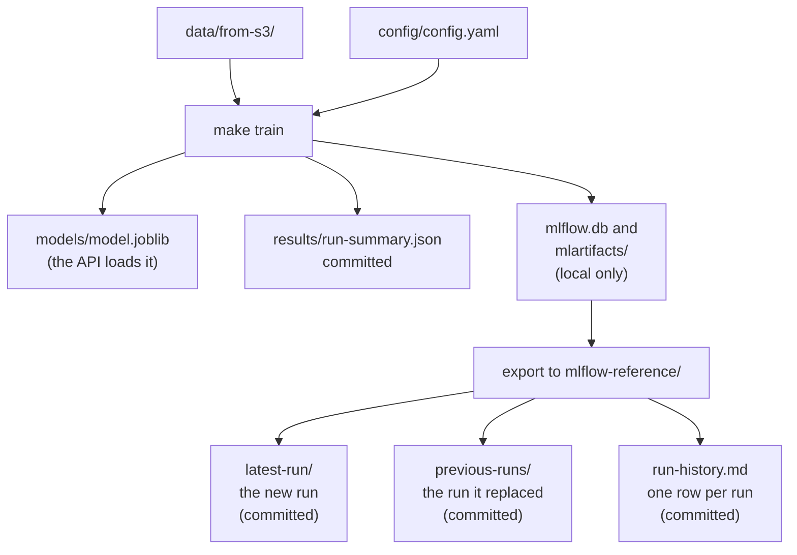
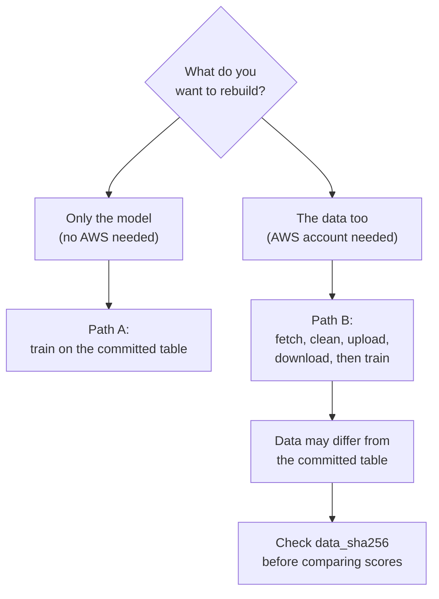
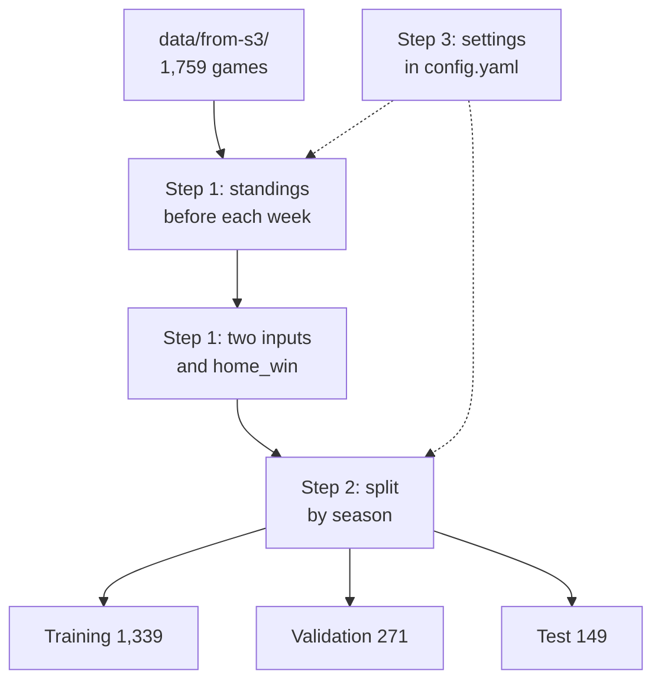
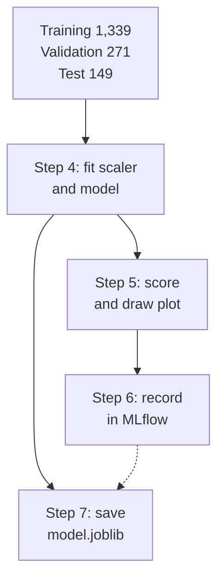
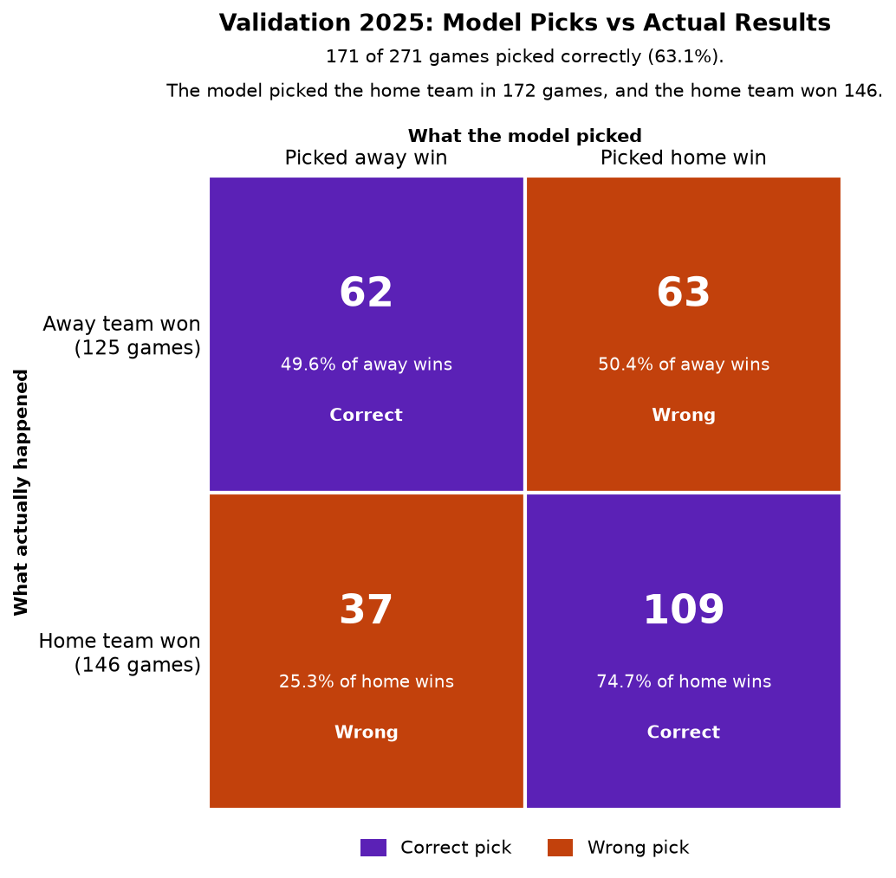

---
hide:
  - toc
---

# Phase 2: Features, Training, and Tracking

!!! success "Delivered in Pull Request #2"
    **[Pull request #2 (`phase-two`)](https://github.com/jconnors23/510-m3-nfl-prediction-analytics/pull/2)** merged the two model inputs, the split by season, training, scoring, and MLflow tracking into `main`. Its **Files changed** tab shows everything this phase delivered.

**Status: Built and tested.** All 7 steps are done. The phase had 29 passing tests when it was built.

**Needs first:** Phase 1, which is built. Its output is the downloaded table `data/from-s3/nfl_matchups_2020_2026.csv`.

Phase 2 turns the cleaned games into two inputs per game, trains the model, and keeps a record of every run. It fits a logistic regression on the 2020 to 2024 games, scores it on the 2025 season and on the 2026 test games, and saves the settings, scores, and files of each run in MLflow.

## Steps in Order

- [x] **Step 1. Feature engineering:** build the two inputs in `src/model/features.py`: home minus away win percentage, and home minus away point margin per game, both from earlier weeks of the same season.
- [x] **Step 2. Split the games by season.** Training 2020 to 2024, validation 2025, test 2026 weeks 1 to 10.
- [x] **Step 3. Add the model and tracking settings** to `config/config.yaml`.
- [x] **Step 4. Fit the scaler and the model** on the training seasons only. Save both as one scikit-learn pipeline.
- [x] **Step 5. Score the model.** Accuracy on the training, validation, and test games, next to the baseline. Also log loss and one plot.
- [x] **Step 6. Record the run in MLflow:** settings, scores, and files, plus an MLflow-format copy of the model.
- [x] **Step 7. Save the final pipeline** as `models/model.joblib`, write the readable run summary `results/run-summary.json`, and add `models/`, `mlflow.db`, and `mlartifacts/` to `.gitignore`.

## Key Details

- **Inputs:** a team with no games yet counts as win percentage 0.5 and margin 0.0, so week 1 gives 0 for both inputs. Reasons for raw values over ranks are in [Design Manifest](../design-manifest.md#inputs-and-the-split).
- **Split:** training is 1,339 games, validation is 271, and test is 149. The test games never fit anything. With only 149 of them, their accuracy can move by about 4 points by chance.
- **Baseline:** always picking the home team scores 53.32% on training, 53.87% on 2025, and 47.65% on the test games. The model must beat this.
- **One saved object:** the scaler and the model travel together in one pipeline, so the API cannot apply the model without the scaler. The scaler learns its averages from training rows only.
- **Tracking:** a local database file `mlflow.db`, with run files in `mlartifacts/`. Each run records 15 parameters (including the scikit-learn version and a fingerprint of the data file), 8 scores, 3 files, and an MLflow-format copy of the model.
- **Readable record:** each run also writes `results/run-summary.json`, which is committed to git and stays identical when the settings and data do not change.
- **Logistic regression only.** There is no model comparison. Random forest and XGBoost are left out to keep the model simple to explain and the serving image small.

## What Was Created

- **Settings:** new `split`, `model`, and `tracking` blocks in `config/config.yaml`, including `tracking.summary_path`.
- **Code:** `src/model/features.py`, `src/model/train.py`, and `src/model/evaluate.py`, next to the Phase 1 folder `src/data/`, with tests in `tests/`. Packages `matplotlib` and `joblib` are pinned in `requirements.txt`.
- **Committed:** `results/run-summary.json`.
- **Local only, not committed:** `mlflow.db`, the `mlartifacts/` folder, and `models/model.joblib`. A readable log of every run is committed in [`mlflow-reference/`](https://github.com/jconnors23/510-m3-nfl-prediction-analytics/tree/main/mlflow-reference), added in Phase 5.

## Development Guide

This section shows how to train the model on your own computer, what each output file holds, how to rebuild the result from a clean checkout, and how to change the model, the split, or the inputs.

### What Is Needed First?

- **The project's virtual environment with the pinned packages.** The setup commands are in the [Phase 1 guide](../phase-1/index.md#what-is-needed-first). Python 3.13 is required.
- **The downloaded table** `data/from-s3/nfl_matchups_2020_2026.csv`. A fresh checkout already has it. If it is missing, run `python -m src.data.download_from_s3` (this needs AWS credentials).
- **No AWS account for training.** Training reads the local copy of the table and writes only to your machine.

### How Do I Do a Training Run?

One command does a whole training run: `make train`, from the project folder. It needs no AWS account and no internet connection.



What one run does, in order:

1. **Fits the model** on the 2020 to 2024 games, and scores the training, validation, and test groups.
2. **Saves the model** to `models/model.joblib`, the file the API loads.
3. **Writes `results/run-summary.json`,** a short readable record of the settings, data fingerprint, scores, and learned weights.
4. **Logs the run to MLflow** in the local `mlflow.db` and `mlartifacts/`: 15 parameters, 8 metrics, 3 files, and an MLflow-format copy of the model.
5. **Updates `mlflow-reference/`.** The last run moves into `previous-runs/`, the new run is written to `latest-run/`, and `run-history.md` gains a row. This is the committed log of every training run. See [`mlflow-reference/mlflow-logging-reference.md`](https://github.com/jconnors23/510-m3-nfl-prediction-analytics/blob/main/mlflow-reference/mlflow-logging-reference.md).

The steps below run it, read the results, and say what to commit.

#### Step 1: Check the Inputs (Optional)

```bash
python -m src.model.features
```

It builds the two inputs for every game, splits the games by season, and prints the size and home win share of each group, the range of each input, and a check that every week-1 value is 0. It writes no file. The six lines it prints are shown under [Run It](#run-it) in Part 1.

#### Step 2: Train the Model

```bash
make train
```

`make train` runs `python -m src.model.train`. It takes a few seconds and prints nine lines:

```text
training: 820 of 1339 correct (61.24%), always-home 53.32%
validation: 171 of 271 correct (63.10%), always-home 53.87%
test: 88 of 149 correct (59.06%), always-home 47.65%
validation log loss 0.6451
test log loss 0.6815
saved: models/model.joblib
summary: results/run-summary.json
MLflow run: LogisticRegression-v1.0
saved: mlflow-reference/latest-run
```

- **The first three lines are the scores.** Each shows correct picks out of games, and the always-pick-home baseline to beat. The validation score (63.10%) is the one used to judge the model, because the model never trained on those games.
- **The same settings and data give the same scores.** Running `make train` again prints the same nine lines, and `results/run-summary.json` stays byte for byte the same.
- **Every run is still a new MLflow run.** It gets a new run id and time, so `mlflow-reference/` changes on every run, even when the scores do not.

#### Step 3: Read the Run History

Open `mlflow-reference/run-history.md`. It lists every training run, newest first: its start time, run id, git commit, validation and test accuracy, validation log loss, and a link to its folder. A run's folder holds its settings (`params.json`), its scores (`metrics.json`), its id and commit (`run.json`), the config it used, and its confusion-matrix picture.

- **To compare two runs,** read their rows, or open each run's `params.json` and `metrics.json`. A different `data_sha256` in `params.json` means the run used different data.
- **The history is built from the committed folders,** so it reads the same in any copy of the repository, with no MLflow install.
- **Runs from before the history began** are added once with `python -m src.model.export_mlflow --backfill`. Running it again adds nothing.
- **To rewrite `latest-run/` without training,** run `python -m src.model.export_mlflow`. Running it on the same run changes nothing in `previous-runs/`.

#### Step 4: Read What the Run Recorded

- **`results/run-summary.json`** is a small readable record of the latest run: the settings, the data fingerprint, the scores, and the learned weights. It is committed to git. See [What Is the Run Summary File?](#what-is-the-run-summary-file).
- **The MLflow screen** shows every run, with its 15 settings, 8 scores, 3 files, and the logged model:

```bash
make start-web-ml
```

Open `http://127.0.0.1:5001` and choose the experiment `nfl-pregame-winner-v1`. The command runs `mlflow ui` on port 5001, because macOS Control Center often holds MLflow's default port, 5000. Press `Ctrl+C` to stop the screen. The screen lists every run in your local `mlflow.db`, which can include runs that were never committed.

- **The files** are explained in [What Is Each File Type?](#what-is-each-file-type), below.

#### Step 5: Commit the Run

A training run changes these committed files. Commit them together, so the code, the result, and the log of the run stay in step:

- `results/run-summary.json`, which changes only when the settings, the data, or the scores change.
- Everything under `mlflow-reference/`: the new `latest-run/`, the run it moved into `previous-runs/`, and both history files.

`models/`, `mlflow.db`, and `mlartifacts/` are ignored, so `git status` never lists them. If the model changed, also rebuild the web app's data with `python -m src.profiles` and `python -m src.season`, and redeploy the API, as the step list in [How Do I Add or Change an Input?](#how-do-i-add-or-change-an-input) says.

### What Does a Training Run Create?

The diagram in [How Do I Do a Training Run?](#how-do-i-do-a-training-run) shows every output. They look similar but hold different things. Three are committed to git: `results/run-summary.json`, `config/config.yaml` (the input), and `mlflow-reference/`.

#### What Is Each File Type?

| Output | Format | What it holds | Who reads it | In git? | Same on every rerun? |
| :--- | :--- | :--- | :--- | :--- | :--- |
| `models/model.joblib` | Python object saved with joblib | The fitted scaler and logistic regression, plus the input names, model version, scikit-learn version, and training seasons | The Phase 3 API | No | Same predictions. The bytes are not compared. |
| `mlflow.db` | SQLite database (one file) | A table of runs: each run's 15 settings, 8 scores, tags, and the paths of its files. It holds no model and no images. | MLflow and its web page | No | No. Each rerun adds a row with a new run id and time. |
| `mlartifacts/` | Folder of ordinary files | The files each run saved: a copy of `model.joblib`, the confusion-matrix image, a copy of `config.yaml`, and the MLflow-format model | MLflow and its web page, or a person opening the folder | No | No. Each rerun adds a new subfolder. |
| `results/run-summary.json` | Plain JSON text | The settings, data fingerprint, scores, and learned weights of the latest run | A person, or git when comparing runs | Yes | Yes, byte for byte, when data, settings, and packages match |
| `config/config.yaml` | Plain YAML text | Every setting | The code, and a person | Yes | Not an output. It is the input. |
| `mlflow-reference/` | Folder of JSON, YAML, Markdown, and PNG files | A readable log of every training run: the newest in `latest-run/`, earlier ones in `previous-runs/`, and `run-history.md` listing them all | A person, with no MLflow install | Yes | No. Each run adds a folder and a history row. |

#### Reading the Differences

- **`model.joblib` is the model itself.** It is the only file the API needs. It does not record how well the model scored.
- **`mlflow.db` is the logbook.** It records what each run used and scored, and it points to the run's files. If you delete it, the model and files stay, but MLflow can no longer list the runs.
- **`mlartifacts/` is the shelf of files.** The database says which run a file belongs to, and this folder holds the file. Keep or delete the two as a pair.
- **`run-summary.json` is the committed receipt.** It repeats the key facts of the latest run in text that git can compare line by line.
- **`mlflow-reference/` is the committed logbook.** It is a readable copy of what the database and the folder hold for every run, with no absolute paths or user name.

#### What Is Inside `mlartifacts/`?

```text
mlartifacts/
  <run id>/artifacts/            files in the run's own file list
    model/model.joblib             copy of the working model
    plots/confusion_matrix_validation.png
    config/config.yaml             copy of the settings used
  models/m-<id>/artifacts/       the MLflow-format model (a logged model)
    MLmodel                        description of the model
    model.skops                    the model, in skops format
    conda.yaml, python_env.yaml    the environment it needs
    requirements.txt               the packages it needs
```

- **Two copies of the model.** See [Why Is the Model Stored Twice?](#why-is-the-model-stored-twice). `joblib` is the general way to save a Python object, and `skops` is the format MLflow's scikit-learn support uses.
- **Settings copy.** `config/config.yaml` is the input. The copy under `mlartifacts/` is a snapshot of what that run used.
- **Why they are not committed.** The database is binary and changes on every run, it records an absolute path on one machine, and one command rebuilds both. See [Design Manifest](../design-manifest.md).
- **What is committed in their place.** [`mlflow-reference/`](https://github.com/jconnors23/510-m3-nfl-prediction-analytics/tree/main/mlflow-reference) holds a readable copy of every run: its settings, scores, plot, and the logged model's text files, with no absolute paths. See [Step 3: Read the Run History](#step-3-read-the-run-history).
- **Terms.** The [Glossary](../extras/glossary.md) defines artifact, artifact store, logged model, and SQLite.

### How Do I Reproduce the Result From a Clean Checkout?

**Short answer:** starting from a clean checkout, one command (`python -m src.model.train`) rebuilds the model, the MLflow records, and `results/run-summary.json`, and the summary file comes out byte for byte identical to the committed one. The check is described in [What Was Checked?](#what-was-checked).

#### What Makes a Rerun Give the Same Result?

- **The data:** The cleaned table is committed in `data/`. Its SHA-256 fingerprint is logged on every run. See [Phase 1 Implementation](../phase-1/index.md#implementation).
- **The settings:** Every value is in `config/config.yaml`. The code holds no model settings. See [Part 1](#implementation-part-1).
- **The packages:** `requirements.txt` pins every package to an exact version. Python 3.13 is required. See [Phase 1 Implementation](../phase-1/index.md#what-is-the-run-environment).
- **The randomness:** `model.random_seed` is 42, and the solver (`lbfgs`) is not random. See [Part 2](#step-4-fit-the-scaler-and-the-model).
- **The record of the result:** `results/run-summary.json` has no run id, timestamp, or machine paths, and its decimals are rounded to 6 places. See [Part 2](#what-is-the-run-summary-file).

#### Which Path Applies?

The training command reads `data/from-s3/nfl_matchups_2020_2026.csv`. The folder `data/` is committed, so a fresh checkout already has that file. Pick the path that matches what you want to prove.



- **Path A (recommended for a first check).** Needs Python 3.13 and the pinned packages. It needs no AWS account and no internet after the install.
- **Path B (full rebuild).** Needs an AWS account, AWS CLI version 2, credentials on the machine, and internet access to GitHub and S3. See the [run environment](../phase-1/index.md#what-is-the-run-environment).
- **Heads up for Path B.** Its first step downloads the current nflverse file, and nflverse can correct old scores or add games. A new download can produce a different table, and so different scores. The `data_sha256` value tells you whether the table matches the committed one.

#### Path A: Train on the Committed Table

1. **Create the environment** with the [Phase 1 setup commands](../phase-1/index.md#what-is-needed-first).
2. **Run the tests.** They use made-up data and a stand-in S3 client, so they need no internet and no AWS account.

    ```bash
    python -m pytest
    ```

    Expected on a clean checkout: **93 passed and 2 skipped**. The two skipped tests use the saved model, which a clean checkout does not have yet. After training, the same command gives **95 passed**.

3. **Train** with `make train`. It prints the nine lines shown in [Step 2: Train the Model](#step-2-train-the-model).
4. **Confirm nothing changed.** Training overwrites `results/run-summary.json`. If the rebuild matches, git shows no change to that file.

    ```bash
    git status --short results/run-summary.json
    ```

    No output means the file is identical to the committed one. A change means the data, the settings, or a package version is different. Compare `data_sha256` and `scikit_learn_version` in the file first.

    ```bash
    git diff results/run-summary.json
    ```

#### Path B: Rebuild the Data First

Run these in order, then continue with steps 2 to 4 of Path A. Each step is explained in the [Phase 1 Implementation](../phase-1/index.md#implementation).

```bash
python -m src.data.fetch_raw
```

```bash
python -m src.data.clean
```

```bash
python -m src.data.upload_to_s3
```

```bash
python -m src.data.download_from_s3
```

#### What Was Checked?

- When Phase 2 was built (before the later phases added their tests), it was checked in a copy of the project with only `config/`, `data/`, `src/`, `tests/`, `results/`, `pytest.ini`, and the committed profiles file, and no `mlflow.db`, `mlartifacts/`, or `models/`. The tests gave 59 passed and 2 skipped. `python -m src.model.train` printed the score lines and **rewrote `results/run-summary.json` identically to the committed one** (checked with `cmp`). The tests then gave 61 passed.
- The earlier real run was repeated and gave identical scores. See [Part 2](#implementation-part-2).
- Both checks ran on one Mac, with Python 3.13.14 and the pinned packages.

### How Do I Develop It?

#### Where Is Each Piece?

- **The two inputs and the split by season:** `src/model/features.py`.
- **Fitting, saving, the run summary, and MLflow logging:** `src/model/train.py`.
- **Accuracy, log loss, and the confusion-matrix plot:** `src/model/evaluate.py`.
- **The seasons and the split rules:** `src/config.py` (`season_window`, `split_seasons`).
- **Every setting:** `config/config.yaml` (the `window`, `split`, `model`, and `tracking` blocks).
- **Tests:** `tests/test_features.py` (7), `test_split.py` (5), `test_evaluate.py` (6), `test_train.py` (11). Together they are the 29 tests that passed when this phase was built. The whole project now has 95 tests in 14 files.

#### How Do I Run the Tests?

```bash
python -m pytest tests/test_features.py tests/test_split.py tests/test_evaluate.py tests/test_train.py
```

Expected: **29 passed**. The tests use made-up games, and every file they write goes in a temporary folder. They point MLflow at a temporary database, so they never touch your `mlflow.db`.

#### How Do I Change a Model Setting?

1. Edit the `model` block in `config/config.yaml`.
2. Run `python -m src.model.train`.
3. Compare the new run with the earlier one in the MLflow screen, and read the change in `results/run-summary.json`.

- **`model.logistic_regression.C`:** How strongly the weights are held near zero. A smaller number holds them tighter.
- **`model.logistic_regression.solver`:** The method that finds the weights.
- **`model.logistic_regression.max_iter`:** The most steps the solver may take.
- **`model.random_seed`:** The starting number for any random choice. The `lbfgs` solver is not random, so this only matters for a random step added later.
- **`model.version`:** The label saved with the model and shown by the API. Changing it only relabels the model. It does not retrain anything.

Change one setting at a time, so a change in the scores has one cause.

#### How Do I Change the Split?

The split has three settings. Training runs from `window.start_season` to `split.train_end_season`, validation is `split.validation_season`, and the test season is `window.end_season`.

1. Edit the `split` block (and the `window` block if the data window moves).
2. Run `python -m src.model.features` to see the new group sizes.
3. Run `python -m src.model.train`.

`split_seasons` in `src/config.py` stops the command with a message unless the order holds: the first training season is not after the last, the validation season is after the last training season, and the validation season is before the test season. This way the model is never scored on games played before games it learned from.

#### How Do I Add or Change an Input?

An input is one column the model sees. The names are shared with the API, so a change reaches further than this phase.

1. **Build the column** in `build_model_table` in `src/model/features.py`, and add its name to `MODEL_COLUMNS` and to `INPUT_COLUMNS`, in the order the model should see it. Use only games from earlier weeks of the same season, and keep the week-1 check in `check_model_table` true.
2. **Update the tests** in `tests/test_features.py`.
3. **Retrain** with `python -m src.model.train`. The saved model records the input names in order.
4. **Update the API.** The request fields in `src/api/schemas.py` must be exactly the names in `INPUT_COLUMNS`. At start-up the API compares the two and refuses to start if they differ. See [Phase 3](../phase-3/index.md#how-do-i-develop-it).
5. **Rebuild and redeploy the Lambda function,** because the zip holds the model and the API code. See [Phase 4](../phase-4/deployment-guide.md#redeploy-after-a-change).
6. **Update anything that sends the inputs,** such as the Phase 5 web app and its profiles file (`python -m src.profiles`).

#### What Is Kept in Git After a Retrain?

- **Committed:** `results/run-summary.json`. It is stable, so git shows a change only when the settings, data, or scores really changed.
- **Committed:** `mlflow-reference/latest-run/`, the readable copy of the newest MLflow run. Training rewrites it, so git shows a change on every retrain, because the run id and times are new.
- **Not committed:** `models/`, `mlflow.db`, and `mlartifacts/`. One command rebuilds all three.

### How Does the Model Reach AWS?

Phase 2 has nothing to deploy. The trained model stays on your machine as `models/model.joblib`. It reaches AWS when the Phase 4 zip is built, which copies that one file in. The scikit-learn version saved inside it must equal the version in the zip, or the service refuses to start. The steps are in the [Phase 4 Deployment Guide](../phase-4/deployment-guide.md#build-the-zip).

## Implementation Part 1

Part 1 explains Steps 1 to 3: feature engineering (the two model inputs), the split by season, and the new settings. Part 2, further below, covers training, scoring, MLflow, and saving the model.

**Status: built and tested.** The code is in `src/model/features.py`, with the new setting reader in `src/config.py`. Every number below was recomputed from the downloaded table (`data/from-s3/nfl_matchups_2020_2026.csv`, 1,759 rows) with this code, and from a second, independent calculation that matched it row for row.

### How Does the Data Flow?



### Step 1: Feature Engineering

!!! abstract "Purpose"
    **Goal:** Turn each game into two numbers the model can learn from, plus the answer it should predict. Building input numbers (features) from raw columns is called feature engineering.

    **Why:** The model cannot read team names. It needs numbers that say how the home team compares with the away team going into the game.

    **If skipped:** There would be nothing to train on.

#### Which Functions Do the Work?

All of these are in `src/model/features.py`. Everything is built in memory on each run, and no new data file is saved.

- `load_games(config)` reads the downloaded table, and stops with a message to run the download step first if the file is missing.
- `standings_before_week(games, season, week, teams)` returns one row per team, counting only earlier weeks of that season.
- `build_model_table(games)` returns one row per game with the two inputs and the answer.
- `check_model_table(table)` stops the run if an input is blank or any week-1 input is not exactly 0.
- `split_games(table, config)` is Step 2.

#### What Is Counted Before Each Game?

- **Earlier weeks of the same season only.** For a game in week 7 of 2025, each team's numbers come from its games in weeks 1 to 6 of 2025. Games in week 7 itself are never counted, so a game cannot be described by its own result or by another result from the same week.
- **Numbers start over every season.** A team's 2024 results are not used in 2025.
- **Win percentage:** wins divided by games played so far.
- **Point margin per game:** points scored minus points allowed so far, divided by games played so far.
- **A team with no games yet** counts as win percentage 0.5 and point margin 0.0. This happens for every team in week 1.
- **Per game, not season totals.** Bye weeks leave teams on different game counts. Before week 8 of 2025, 23 teams had played 7 games, 8 had played 6, and 1 had played 5. A season total would favor teams with more games.
- **Tied games are not in the table.** Phase 1 removed them, so two teams in a removed game show one fewer game.

#### What Do the Standings Look Like?

Standings before week 7 of 2025 for a few teams. Twenty-five teams had played 6 games, six had played 5, and Green Bay had played 4.

| team | games | wins | win_pct | point_diff_per_game |
| :--- | :--- | :--- | :--- | :--- |
| IND | 6 | 5 | 0.8333 | 13.0 |
| TB | 6 | 5 | 0.8333 | 2.3333 |
| PIT | 5 | 4 | 0.8 | 2.4 |
| GB | 4 | 3 | 0.75 | 7.25 |
| NE | 6 | 4 | 0.6667 | 5.0 |
| TEN | 6 | 1 | 0.1667 | -13.0 |
| CLE | 6 | 1 | 0.1667 | -10.6667 |
| NYJ | 6 | 0 | 0.0 | -7.8333 |

Before week 1 the same table has every team at `games` 0, `wins` 0, `win_pct` 0.5, and `point_diff_per_game` 0.0.

#### How Are the Standings Built?

```python
def standings_before_week(games, season, week, teams):
    """One row per team from games played earlier in this season."""
    # Same-week games are left out, so a result cannot describe itself or the other game that week.
    earlier = games.loc[(games["season"] == season) & (games["week"] < week)]
    rows = []
    for team in teams:
        home = earlier.loc[earlier["home_team"] == team]
        away = earlier.loc[earlier["away_team"] == team]
        played = len(home) + len(away)
        # No games yet would make a percentage undefined. 0.5 and 0 leave week 1 as a tie.
        if played == 0:
            wins = 0
            win_pct = 0.5
            margin = 0.0
        else:
            wins = int((home["home_score"] > home["away_score"]).sum()) + int(
                (away["away_score"] > away["home_score"]).sum()
            )
            scored = float(home["home_score"].sum() + away["away_score"].sum())
            allowed = float(home["away_score"].sum() + away["home_score"].sum())
            # Divide by games played, not a season total, because bye weeks leave teams on different game counts.
            win_pct = wins / played
            margin = (scored - allowed) / played
        rows.append({"team": team, "games": played, "wins": wins,
                     "win_pct": float(win_pct), "point_diff_per_game": float(margin)})
    return pd.DataFrame(rows)
```

A game counts for both teams. The home team's points scored are `home_score`, and the away team's are `away_score`.

#### What Does Each Game Become?

| Column | Type | What it means | Example (`2025_07_NE_TEN`) |
| :--- | :--- | :--- | :--- |
| `game_id` | text | Season, week, away team, home team | `2025_07_NE_TEN` |
| `season` | whole number | Season year | 2025 |
| `week` | whole number | Week of the regular season | 7 |
| `home_team` | text | Home team code | `TEN` |
| `away_team` | text | Away team code | `NE` |
| `win_pct_differential` | decimal | Home win percentage minus away win percentage | -0.5 |
| `point_diff_per_game_differential` | decimal | Home margin per game minus away margin per game | -18.0 |
| `home_win` | whole number | 1 if `home_score` is greater than `away_score`, otherwise 0 | 0 |

- A **positive** differential means the home team looks stronger. A **negative** one means the away team does.
- `home_win` is the answer the model learns to predict. It is the only column that uses the current game's result, and it is never an input.
- The model uses only the two differential columns. The other columns identify the game.
- Rows are sorted by `season`, `week`, and `game_id`.

```python
def build_model_table(games):
    """One row per game, with the two pre-game differentials and the home-win answer."""
    teams = sorted(set(games["home_team"]) | set(games["away_team"]))
    rows = []
    for (season, week), week_games in games.groupby(["season", "week"], sort=False):
        # Once per week, then reused for every game in that week.
        standings = standings_before_week(games, int(season), int(week), teams).set_index("team")
        for game in week_games.itertuples(index=False):
            home = standings.loc[game.home_team]
            away = standings.loc[game.away_team]
            rows.append({
                "game_id": game.game_id,
                "season": int(game.season),
                "week": int(game.week),
                "home_team": game.home_team,
                "away_team": game.away_team,
                "win_pct_differential": float(home["win_pct"] - away["win_pct"]),
                "point_diff_per_game_differential": float(
                    home["point_diff_per_game"] - away["point_diff_per_game"]
                ),
                "home_win": int(game.home_score > game.away_score),
            })
    table = pd.DataFrame(rows, columns=MODEL_COLUMNS)
    return table.sort_values(["season", "week", "game_id"]).reset_index(drop=True)
```

#### What Do Real Rows Look Like?

The first two rows are from week 1 of 2025, and the rest are from week 7.

| game_id | home_team | away_team | win_pct_differential | point_diff_per_game_differential | home_win |
| :--- | :--- | :--- | :--- | :--- | :--- |
| 2025_01_ARI_NO | NO | ARI | 0.0 | 0.0 | 0 |
| 2025_01_BAL_BUF | BUF | BAL | 0.0 | 0.0 | 1 |
| 2025_07_ATL_SF | SF | ATL | 0.0667 | -0.5 | 1 |
| 2025_07_CAR_NYJ | NYJ | CAR | -0.5 | -5.5 | 0 |
| 2025_07_LV_KC | KC | LV | 0.1667 | 12.8333 | 1 |
| 2025_07_NE_TEN | TEN | NE | -0.5 | -18.0 | 0 |
| 2025_07_PIT_CIN | CIN | PIT | -0.4667 | -15.7333 | 1 |

The last row shows that the inputs do not decide a game. Pittsburgh looked stronger on both numbers, and Cincinnati still won at home.

#### What Is a Worked Example?

Game `2025_07_NE_TEN` is New England at Tennessee in week 7 of 2025. From the standings table above:

- Tennessee (home) had played 6 games, won 1, and had a point margin of -78, so its win percentage was 0.1667 and its margin per game was -13.0.
- New England (away) had played 6 games, won 4, and had a point margin of +30, so its win percentage was 0.6667 and its margin per game was +5.0.
- The two inputs are 0.1667 - 0.6667 = **-0.5** and -13.0 - 5.0 = **-18.0**. Both are negative, so the away team looks stronger.
- Tennessee lost, so `home_win` is 0.

#### What Is a Small Example Worked Out Manually?

Four teams (A, B, C, D) play two games each week for three weeks. This is the league the tests use.

| game | week | home | away | score |
| :--- | :--- | :--- | :--- | :--- |
| w1a | 1 | A | B | 30 to 0 |
| w1b | 1 | C | D | 10 to 7 |
| w2a | 2 | A | C | 14 to 10 |
| w2b | 2 | B | D | 21 to 3 |
| w3a | 3 | A | D | 17 to 14 |
| w3b | 3 | C | B | 28 to 7 |

Standings before week 3 (after two games each):

| team | games | wins | win_pct | point_diff_per_game |
| :--- | :--- | :--- | :--- | :--- |
| A | 2 | 2 | 1.0 | 17.0 |
| B | 2 | 1 | 0.5 | -6.0 |
| C | 2 | 1 | 0.5 | -0.5 |
| D | 2 | 0 | 0.0 | -10.5 |

The inputs for each game:

| game | win_pct_differential | point_diff_per_game_differential | home_win |
| :--- | :--- | :--- | :--- |
| w1a, w1b | 0.0 | 0.0 | 1 |
| w2a | 0.0 | 27.0 | 1 |
| w2b | 0.0 | -27.0 | 1 |
| w3a | 1.0 | 27.5 | 1 |
| w3b | 0.0 | 5.5 | 1 |

For `w3a`, A is at home against D. The win percentage input is 1.0 - 0.0 = 1.0, and the margin input is 17.0 - (-10.5) = 27.5.

#### How Do the Inputs Behave?

- **Ranges across all 1,759 games:** `win_pct_differential` runs from -1.0 to 1.0, and `point_diff_per_game_differential` runs from -49.0 to 39.0. Neither has a blank value.
- **All games:** `win_pct_differential` has an average of -0.0045 and a spread (standard deviation) of 0.3598. `point_diff_per_game_differential` has an average of -0.2317 and a spread of 10.1942.
- **Training games only:** the averages are -0.0004 and -0.1762, and the spreads are 0.3476 and 10.1117. Part 2 uses these when it standardizes the inputs.
- **The two inputs overlap.** Their correlation in the training games is 0.78, because teams that win more tend to have better margins. Logistic regression handles this.
- **The scales differ by about 30 times,** which is why Part 2 standardizes the inputs before the model sees them.
- **When both inputs agree, the home team usually follows them.** In 574 games both inputs are positive, and the home team won 69.51% of them. In 604 games both are negative, and the home team won 36.92%. In 196 games the two inputs point opposite ways, and 115 games have both inputs at 0 (111 in week 1 and 4 later).

#### What Happens in Week 1?

- Before week 1 no team has played, so every team counts as 0.5 and 0.0, and **both inputs are exactly 0 for all 111 week-1 games** (79 training, 16 validation, 16 test).
- The model cannot tell those games apart, so it will pick the home team in all of them.
- Week 1 games are kept in the data like every other week.

#### How Is the Week-1 Rule Enforced?

```python
def check_model_table(table):
    """Stop if a model input is blank or a week-1 differential is not zero."""
    if table[INPUT_COLUMNS].isna().any().any():
        raise ValueError("a model input is blank")
    week_one = table.loc[table["week"] == 1, INPUT_COLUMNS]
    if (week_one != 0).any().any():
        raise ValueError("a week-1 differential is not 0")
```

If a number used the current or a later week, week 1 would not be exactly 0 and the run would stop here.

#### Run It

```bash
python -m src.model.features
```

Output:

```text
training: 1339 rows, home win share 53.32%
validation: 271 rows, home win share 53.87%
test: 149 rows, home win share 47.65%
win_pct_differential: min -1.0, max 1.0
point_diff_per_game_differential: min -49.0, max 39.0
week 1 differentials are all 0
```

### Step 2: Split the Games by Season

!!! abstract "Purpose"
    **Goal:** Split the games into training, validation, and test groups by season.

    **Why:** The model must predict games that have not happened yet. It learns from earlier seasons, is scored on a later finished season, and is also shown the season in progress.

    **If skipped:** A random split would train on later games and score on earlier ones, and the scores could not be trusted.

#### Which Games Go in Each Group?

| Group | Seasons | Games | Weeks | Home wins | Home win share |
| :--- | :--- | :--- | :--- | :--- | :--- |
| Training | 2020 to 2024 | 1,339 | 1 to 18 | 714 | 53.32% |
| Validation | 2025 | 271 | 1 to 18 | 146 | 53.87% |
| Test | 2026 | 149 | 1 to 10 | 71 | 47.65% |

- **Training** is the only group the model is fit on.
- **Validation** is the last finished season. It is never used to fit the model, and it gives the score to report.
- **Test** is the season in progress, cut to the weeks that have scores. It is never used to fit the model. With only 149 games, its accuracy can move by about 4 points either way by chance.
- **Always picking the home team** is the baseline in the last column. The model has to beat it to add anything.
- **Week 1 games:** 79 are in training, 16 in validation, and 16 in test.
- **Games by season:** 255 (2020), 271 (2021), 269 (2022), 272 (2023), 272 (2024), 271 (2025), and 149 (2026). A full season has 272 games. 2020 had 256 (its last week was week 17), and 2022 had 271 because one game was cancelled. Each season then loses its tied games: one each in 2020, 2021, and 2025, two in 2022, and one in 2026.
- **Why by season, not at random:** the numbers start over each year, so each season stands on its own. Splitting whole seasons also means no group is trained on results that came after the games it is scored on.

#### How Are the Seasons Chosen?

The test season and the week cap come from the existing `window` block, and only two seasons are new in `split`, so no season is written in two places.

```python
def split_seasons(config):
    """First training season, last training season, validation season, and test season."""
    start_season, test_season, _test_week = season_window(config)
    train_end_season = int(config["split"]["train_end_season"])
    validation_season = int(config["split"]["validation_season"])
    if start_season > train_end_season:
        raise ValueError(
            f"first training season {start_season} is after last training season {train_end_season}"
        )
    if train_end_season >= validation_season:
        raise ValueError(
            f"validation season {validation_season} is not after last training season {train_end_season}"
        )
    if validation_season >= test_season:
        raise ValueError(
            f"validation season {validation_season} is not before test season {test_season}"
        )
    return start_season, train_end_season, validation_season, test_season
```

With the real settings this returns `(2020, 2024, 2025, 2026)`. A season order that would score the model on a season it already trained on is rejected with a message.

#### How Is the Table Split?

```python
def split_games(table, config):
    """Training, validation, and test tables, one season range each."""
    start_season, train_end_season, validation_season, test_season = split_seasons(config)
    groups = {
        "training": table.loc[table["season"].between(start_season, train_end_season)].copy(),
        "validation": table.loc[table["season"] == validation_season].copy(),
        "test": table.loc[table["season"] == test_season].copy(),
    }
    for name, group in groups.items():
        if group.empty:
            raise ValueError(f"{name} has no rows")
    game_ids = [set(group["game_id"]) for group in groups.values()]
    combined = set.union(*game_ids)
    # A season that falls in a gap, or a game id that lands in two groups, would make the sizes disagree.
    if sum(len(ids) for ids in game_ids) != len(combined) or len(combined) != len(table):
        raise ValueError("every game must be in exactly one split group")
    return groups
```

- An empty group stops the run with a message that names the group, such as `validation has no rows`.
- Every game must land in exactly one group, so the three sizes always add up to 1,759.

### Step 3: Add the Model and Tracking Settings

!!! abstract "Purpose"
    **Goal:** Put every new tunable value for Phase 2 into `config/config.yaml`.

    **Why:** Changing a run should mean editing the settings file, not the code.

    **If skipped:** Seasons, model values, and file names would be written inside the code.

Three new blocks sit below the existing `data` and `window` blocks. Those two blocks did not change.

```yaml
# How the games are split by season. Training starts at window.start_season (2020) and stops
# at train_end_season. The validation season is the finished season after it, and its score is
# the one to report. The test season is window.end_season, so that year is not written here
# a second time. The model is fit on the training seasons only.
split:
  train_end_season: 2024
  validation_season: 2025

# The model and how it is saved.
model:
  # A label for this trained model. It is saved inside the model file and in the MLflow run.
  version: v1.0
  # A starting number for any random choice, so a rerun gives the same result. The solver
  # below is not random, so the seed only matters for a random step added later.
  random_seed: 42
  # Where the trained model is saved.
  output_path: models/model.joblib
  # Logistic regression: the model gives each input a weight, adds them up, and turns the
  # total into a chance (0 to 1) that the home team wins.
  logistic_regression:
    # How strongly the weights are held close to zero, to stop the model from memorizing the
    # training games. A smaller number holds them tighter. 1.0 is the usual starting point.
    C: 1.0
    # The method that finds the best weights. "lbfgs" repeatedly nudges the weights to lower
    # the model's errors until they stop improving. It suits a small table like this one.
    solver: lbfgs
    # The most nudges the solver may make before it gives up. The solver finishes in about 6
    # here, so 1000 leaves a wide safety margin.
    max_iter: 1000

# MLflow, the tool that records every training run so runs can be compared later.
tracking:
  # The name that groups every run of this project.
  experiment_name: nfl-pregame-winner-v1
  # The database file where MLflow keeps each run's settings and scores.
  database_path: mlflow.db
  # The folder where MLflow keeps each run's files (the model, the plot, a copy of this file).
  artifact_folder: mlartifacts
  # A small readable summary of the latest run (settings, data fingerprint, scores, and the
  # learned weights). It is committed to git. MLflow keeps the full history of runs.
  summary_path: results/run-summary.json
```

#### What Does Each Setting Do?

- **`split.train_end_season`:** the last training season (2024). Training starts at `window.start_season` (2020).
- **`split.validation_season`:** the validation season (2025). The test season is `window.end_season` (2026), and `window.test_through_week` (10) is already applied by cleaning.
- **`model.version`:** a label for the trained model (`v1.0`). It is saved with the model and shown by the API later.
- **`model.random_seed`:** the starting number for any random choice (42). The `lbfgs` solver is not random, so the seed only matters for a random step added later.
- **`model.output_path`:** where the trained model is saved (`models/model.joblib`).
- **`model.logistic_regression.C`:** regularization strength (1.0). A smaller value pulls the weights toward zero more strongly. This is scikit-learn's default.
- **`model.logistic_regression.solver`:** the method that finds the weights (`lbfgs`).
- **`model.logistic_regression.max_iter`:** the most steps the solver may take (1000), set high enough that it always finishes.
- **`tracking.experiment_name`:** the MLflow group that holds every run (`nfl-pregame-winner-v1`).
- **`tracking.database_path`:** the database file that holds the run record (`mlflow.db`).
- **`tracking.artifact_folder`:** the folder that holds each run's files (`mlartifacts`).
- **`tracking.summary_path`:** where each run writes its readable summary (`results/run-summary.json`). See [What Is the Run Summary File?](#what-is-the-run-summary-file).

#### Where Does MLflow Keep Its Records?

- **A database file.** MLflow stores each run's settings and scores in a local database file, `mlflow.db`. It is a single file, it needs no server, and it is not committed to git.
- **A folder of files.** Each run's files (the model, the plot, and a copy of the settings) go in `mlartifacts/`, in a subfolder for each run.
- **The tracking address.** The only place the database type shows up is the address MLflow requires, which starts with `sqlite:///` followed by the full path of `mlflow.db`.

## Implementation Part 2

Part 2 explains Steps 4 to 7: fitting the model, scoring it, recording the run in MLflow, and saving the trained model. The inputs, the split, and the settings are in [Part 1](#implementation-part-1).

**Status: built and tested.** The code is in `src/model/train.py` and `src/model/evaluate.py`. Every number below comes from the real run of `python -m src.model.train` on the downloaded table. The command was run twice and gave identical scores. The tests for this phase are listed under [Where Is Each Piece?](#where-is-each-piece).

### How Does the Data Flow in Part 2?



#### Which Files Were Added?

- `src/model/train.py` holds the command, the fit, the saved file, the run summary file, and the MLflow logging.
- `src/model/evaluate.py` holds the scores and the plot. It has no MLflow code and reads no files.
- `tests/test_train.py` and `tests/test_evaluate.py` hold the tests. They use made-up data, and every file they write goes in a temporary folder.
- `requirements.txt` gains `matplotlib==3.11.2` and `joblib==1.6.0`. Both were already installed, because MLflow and scikit-learn bring them in, but the project pins them.
- `.gitignore` gains `models/`, `mlflow.db`, and `mlartifacts/`.
- `results/run-summary.json` is a small readable record of the latest run. It is created by training and committed to git.

The command reads the table that Phase 1 downloaded, so run the download step first.

### Step 4: Fit the Scaler and the Model

!!! abstract "Purpose"
    **Goal:** Learn the model from the training games, and keep the scaler and the model together as one object.

    **Why:** The two inputs are on very different scales (about 0.35 versus about 10). Standardizing them first lets the model weigh them fairly, and keeping both in one object means the API cannot apply the model without the scaler.

    **If skipped:** There would be no model to score or serve.

#### How Is the Pipeline Built?

```python
def build_pipeline(config: dict):
    """A scaler and a logistic regression, with every setting taken from the config file."""
    logistic = config["model"]["logistic_regression"]
    return make_pipeline(
        StandardScaler(),
        LogisticRegression(
            C=logistic["C"],
            solver=logistic["solver"],
            max_iter=logistic["max_iter"],
            random_state=config["model"]["random_seed"],
        ),
    )

def fit_pipeline(config: dict, training):
    """Fit the scaler and the model on the training games only."""
    pipeline = build_pipeline(config)
    # Validation and test games stay out of this call, so their results cannot move the weights.
    pipeline.fit(training[INPUT_COLUMNS], training["home_win"])
    return pipeline
```

- **Training rows only.** The scaler's averages and spreads, and the model's weights, come from the 1,339 training games. Validation and test games never touch the fit.
- **Named columns.** The inputs are passed as a table with the two column names, not as a bare array, so the input order is fixed.
- **Every value comes from `config.yaml`.**

#### What Does the Fit Learn?

- **The scaler** learns one average and one spread for each input, from the training games:
    - `win_pct_differential`: average -0.0004, spread 0.3476
    - `point_diff_per_game_differential`: average -0.1762, spread 10.1117
- **The model** learns one weight for each standardized input, plus an intercept:
    - weight for `win_pct_differential`: 0.2138
    - weight for `point_diff_per_game_differential`: 0.3081
    - intercept: 0.1403
    - The solver finished in 6 steps (the limit is 1000).
- **Reading the weights:** both are positive, so a stronger home team on either input raises the home win probability. The margin input has the larger weight.
- **Reading the intercept:** it is positive, which is the home-field edge. With both inputs at 0, the home win probability is 0.5364. Home teams won 53.32% of the training games.
- **Repeatable:** a second fit with the same settings gives identical probabilities.

#### What Does the Worked Example Score?

Game `2025_07_NE_TEN` has inputs -0.5 and -18.0. The scaler turns them into standardized values, and the model adds them up:

- Standardized win percentage input: (-0.5 - (-0.0004)) / 0.3476 = about -1.44.
- Standardized margin input: (-18.0 - (-0.1762)) / 10.1117 = about -1.76.
- Weighted sum: 0.1403 + 0.2138 x (-1.44) + 0.3081 x (-1.76) = about -0.71.
- The logistic function turns -0.71 into a probability of about 0.33.

The model's own output for this game is **0.3296**, a 33% chance that Tennessee wins. That is below 0.5, so the prediction is an away win. New England won, so it is correct.

### Step 5: Score the Model

!!! abstract "Purpose"
    **Goal:** Measure how often the model picks the winner, and compare it with the always-pick-home baseline.

    **Why:** A score on its own means little. Beating a simple rule shows the inputs add something.

    **If skipped:** There would be no result to report.

#### How Is a Game Scored?

- The model gives a home win probability for each game. A probability **above 0.5** is a pick for the home team, and anything else is a pick for the away team.
- **Two scores** are used, and each answers a different question:
    - **Accuracy:** how often is the pick right?
    - **Log loss:** are the percentages the model gives believable?
- **Baseline** is the score of always picking the home team, which is the share of games the home team won.
- **Safeguard:** log loss is always given the labels `[0, 1]`, so a group with only one outcome does not raise an error.

```python
def score_group(pipeline, group) -> dict:
    """Accuracy, the always-home baseline, and log loss for one group."""
    # Keep the column names so the pipeline applies the inputs in the saved order.
    probability = pipeline.predict_proba(group[INPUT_COLUMNS])[:, 1]
    # Exactly 0.5 is an away pick. Only a higher probability picks the home team.
    picked_home = (probability > 0.5).astype(int)
    home_win = group["home_win"].to_numpy()
    games = int(len(group))
    correct = int((picked_home == home_win).sum())
    return {
        "games": games,
        "correct": correct,
        "accuracy": correct / games,
        "baseline": float((home_win == 1).mean()),
        "log_loss": float(log_loss(home_win, probability, labels=[0, 1])),
    }
```

#### What Is Accuracy?

Accuracy is the share of games where the model's pick matches the real result. It is the project's headline number, shown next to the baseline.

| Group | Games | Correct | Accuracy | Always pick home |
| :--- | :--- | :--- | :--- | :--- |
| Training | 1,339 | 820 | 61.24% | 53.32% |
| Validation | 271 | 171 | 63.10% | 53.87% |
| Test | 149 | 88 | 59.06% | 47.65% |

- **The model beats the baseline in every group:** by 7.9 points on training, 9.2 on validation, and 11.4 on test.
- **The validation score is the one to report.** It is a finished season the model never saw.
- **The test score is noisy.** With 149 games, accuracy can move by about 4 points either way by chance. The test baseline is low (47.65%) because home teams won fewer than half of those games.
- **What accuracy cannot see:** a pick of "home team, 51% chance" and a pick of "home team, 90% chance" count the same. Log loss covers that.

#### What Is Log Loss?

**Lower is better.** For every game, the model gives a percentage chance that the home team wins. After the game, look at the chance the model gave to what really happened. A high chance gives a small penalty, and a low chance gives a large one. Log loss is the average penalty over all the games. A high value means the model was often confidently wrong.

**How to read the number**

- **0** is the best possible, and it would mean the model gave 100% to every real result. It never happens in practice.
- **0.6931** is what a model that knows nothing scores. It is the penalty for saying "50-50" about every game.
- **Above 0.6931** is worse than knowing nothing.
- **Between 0 and 0.6931** means the model has learned something. Football games are hard to predict, so good values stay fairly close to 0.69.
- **This model:** 0.6451 on validation and 0.6815 on the test set. Both are below 0.6931. The test value is only a little below, which fits a small set of 149 games.

**How the penalty works.** It depends on how much chance the model gave to what actually happened. Say the home team won:

- The model said 90%: penalty **0.11** (small).
- The model said 70%: penalty **0.36**.
- The model said 50%: penalty **0.69**.
- The model said 30%: penalty **1.20**.
- The model said 10%: penalty **2.30** (large).

**Why accuracy is not enough.** Two models can pick the same winners and still score very differently. Say both pick the home team in three games, and the home team wins two and loses one. Both have the same accuracy, 2 of 3.

- **Model A** says 60% each time. Its penalties are 0.51, 0.51, and 0.92, so its log loss is **0.646**.
- **Model B** says 95% each time. Its penalties are 0.05, 0.05, and 3.00, so its log loss is **1.033**.

Model B is worse because the one game it lost cost a huge penalty. The web app shows a win probability, not only a pick, so log loss is the check that those percentages mean something.

**Does the model's confidence mean anything?** Yes.

- In 2025, the model gave one team at least a 65% chance in 66 games, and it picked the winner in 75.76% of them. In the other 205 games, where it was less sure, it was right 59.02% of the time.
- In the test set, it was at least 65% sure in 43 games and right in 62.79%, against 57.55% in the other 106.

**A game that hurt.** In 2025, `2025_03_GB_CLE`, the model gave Cleveland (home) only a 23.1% chance, and Cleveland won. That one game had a penalty of 1.46, the largest in the validation season. In the test set, `2026_02_JAX_DEN` was the largest at 1.99, with Denver given a 13.7% chance.

**Why it is not logged for the training games.** Logistic regression is fitted by pushing this very number down on the training games. A low training log loss is expected and says little. Only games the model never saw are a fair check.

| Group | Model | Always 50% | Always the home win rate |
| :--- | :--- | :--- | :--- |
| Validation | 0.6451 | 0.6931 | 0.6902 |
| Test | 0.6815 | 0.6931 | 0.6985 |

"Always the home win rate" means saying 53.32% (the training share) for every game. The model is lower, which is better, than both on both groups.

#### How Do the Two Scores Fit Together?

Accuracy is the headline, and log loss checks that the probabilities the web app shows are believable. Both are reported for validation and test. Training gets accuracy only.

#### What Does the Confusion Matrix Show?

Validation 2025, with the actual result down the side and the model's pick across the top:

| Actual result | Picked away win | Picked home win |
| :--- | :--- | :--- |
| Away team won (125 games) | 62 | 63 |
| Home team won (146 games) | 37 | 109 |

The model picks the home team in 172 of 271 games (63.5%), more often than home teams actually win (53.87%). The 171 correct picks are the 62 and the 109.

{ width="520" }

#### How Do I Read the Confusion Matrix?

- **Color means right or wrong.** Correct-pick cells are purple (`#5b21b6`) and wrong-pick cells are orange (`#c2410c`), the site's link and action colors. Both carry white text, at contrast ratios of 9.0 to 1 and 5.2 to 1, above the 4.5 to 1 minimum for text.
- **Rows are what actually happened,** and columns are what the model picked. Each row label carries its game count.
- **Each cell gives three things:** the count in large bold type, the share of that row, and the word "Correct" or "Wrong".
- **Each row's share uses that row's games.** "49.6% of away wins" means 62 of the 125 games the away team won. The model got 74.7% of home wins right (109 of 146) but only 49.6% of away wins.
- **The title block** states the accuracy ("171 of 271 games picked correctly (63.1%).") and the main pattern, that the model picked the home team more often than home teams won.
- **The axis name "What the model picked"** sits above the grid, with the column labels, just under the title block.
- **A legend** just under the grid names the two colors.
- **Every number comes from the data,** never typed in: the season, the counts, the shares, the correct total, and the home picks.

#### How Is the Confusion Matrix Drawn?

- **`confusion_cell_labels(matrix)`** in `src/model/evaluate.py` returns each cell's count, share, and verdict as text. A row with no games gets the share "no games". It reads nothing and draws nothing, so the wording is tested without opening the image.
- **`plot_confusion_matrix(pipeline, group, path)`** counts the picks with the same 0.5 rule as the scores, draws the four cells as rectangles, writes the text from `confusion_cell_labels`, and saves the picture at 150 dots per inch. It is 1034 by 1014 pixels and 89,020 bytes. It uses matplotlib's non-window drawing mode (`Agg`), so no window opens.
- **The two colors** are set once, as `CORRECT_COLOR` and `WRONG_COLOR`.
- **Tests in `tests/test_evaluate.py`:** `test_cell_labels_give_counts_row_shares_and_right_or_wrong` checks all four cells for the real validation counts, `test_cell_labels_handle_a_row_with_no_games` checks the empty-row case, and `test_plot_writes_a_png_without_a_window` checks that the picture is a non-empty PNG.
- **The picture does not affect the model.** It is drawn after the model is fit, so the scores, `results/run-summary.json`, and `models/model.joblib` do not depend on it.

#### Which Plot Is Drawn?

One image, `confusion_matrix_validation.png`, is drawn for the validation season by `plot_confusion_matrix`. It is saved to a temporary folder, stored in the MLflow run, and then removed, so no image is left in the project.

### Step 6: Record the Run in MLflow

!!! abstract "Purpose"
    **Goal:** Save the settings, scores, and files of every training run, so runs can be compared and traced.

    **Why:** The record lets any later run be compared with an earlier one and traced back to its settings and data.

    **If skipped:** There would be no record of which settings produced which scores.

#### How Is MLflow Set Up?

This is the first half of `log_run` in `src/model/train.py`. It also takes the fitted pipeline, which it stores in MLflow's own model format (see below).

```python
def log_run(config: dict, scores: dict, files: dict, pipeline) -> str:
    """Record one run's settings, scores, and files, and return the run name."""
    database = resolve_path(config["tracking"]["database_path"])
    artifacts = resolve_path(config["tracking"]["artifact_folder"])
    # MLflow keeps its records in a local database file. The address is "sqlite://" plus the
    # full path (which starts with "/"), so it has four slashes in a row.
    mlflow.set_tracking_uri(f"sqlite:///{database}")
    experiment_name = config["tracking"]["experiment_name"]
    # An experiment is the named group that holds every run. Its file folder can only be set
    # when it is created, so create it once and let later runs join it.
    if mlflow.get_experiment_by_name(experiment_name) is None:
        artifacts.mkdir(parents=True, exist_ok=True)
        mlflow.create_experiment(experiment_name, artifact_location=artifacts.as_uri())
    mlflow.set_experiment(experiment_name)
```

- The run record goes in the database file `mlflow.db`, and each run's files go under `mlartifacts/<run id>/artifacts/`.
- Run again, and a new run is added to the same experiment. Two runs with the same settings and data give the same scores, and only the run ids differ.

#### What Is Logged for Each Run?

This is the second half of `log_run`.

```python
    start_season, train_end_season, validation_season, test_season = split_seasons(config)
    model = config["model"]
    logistic = model["logistic_regression"]
    run_name = f"LogisticRegression-{model['version']}"
    # A run that fails partway is closed by `with` and marked as failed, so it is never left open.
    with mlflow.start_run(run_name=run_name):
        # MLflow keeps every parameter as text. Scores below are numbers, so they can be charted.
        mlflow.log_params(
            {
                "model_version": model["version"],
                "random_seed": model["random_seed"],
                "C": logistic["C"],
                "solver": logistic["solver"],
                "max_iter": logistic["max_iter"],
                "feature_names": ",".join(INPUT_COLUMNS),
                "train_start_season": start_season,
                "train_end_season": train_end_season,
                "validation_season": validation_season,
                "test_season": test_season,
                "n_train": scores["training"]["games"],
                "n_validation": scores["validation"]["games"],
                "n_test": scores["test"]["games"],
                "scikit_learn_version": sklearn.__version__,
                "data_sha256": file_fingerprint(data_file(config, "from_s3_path")),
            }
        )
        mlflow.log_metrics({...})  # the 8 scores listed below
        mlflow.log_artifact(str(files["model"]), artifact_path="model")
        mlflow.log_artifact(str(files["plot"]), artifact_path="plots")
        mlflow.log_artifact(str(files["config"]), artifact_path="config")
        mlflow.sklearn.log_model(pipeline, name=MLFLOW_MODEL_NAME)
    return run_name
```

- **Run name:** `LogisticRegression-v1.0`, the model type and the version label.
- **Settings (parameters), 15 in all:** `model_version`, `random_seed`, `C`, `solver`, `max_iter`, `feature_names`, `train_start_season`, `train_end_season`, `validation_season`, `test_season`, `n_train` (1339), `n_validation` (271), `n_test` (149), `scikit_learn_version` (1.9.1), and `data_sha256`.
- **`data_sha256`:** a fingerprint of the downloaded table, worked out from every byte of the file by `file_fingerprint`. If one byte of the data changes, the code changes, so two runs with the same fingerprint used the same data. For the current table it is `7219e8a8672b900af9facbb54d8a28f9f2a34df9ede3b8385a735768082517fb`.
- **Scores (metrics), 8 in all, stored as fractions:** `train_accuracy`, `validation_accuracy`, `test_accuracy`, `validation_log_loss`, `test_log_loss`, `baseline_train`, `baseline_validation`, and `baseline_test`. Training log loss is left out, because the model is fit by pushing that number down.
- **Files (artifacts), 3 in all:** `model/model.joblib`, `plots/confusion_matrix_validation.png`, and `config/config.yaml`, a copy of the settings used.
- **Logged model, 1:** an MLflow-format copy of the pipeline, named `pipeline-mlflow-format`. See the next section.
- **Automatic tags:** MLflow also records the git commit, branch, and repository address on every run.
- **Read back from the real run:** the one recorded run shows 15 parameters, 8 metrics, the 3 files, and 1 logged model.

#### Why Is the Model Stored Twice?

Each run keeps the trained pipeline in two forms, for two different readers.

- **`model/model.joblib` is the working copy.** It is a plain file in the run's file list. It is what the API will load, and it carries the input names, the model version, the scikit-learn version, and the training seasons.
- **The MLflow-format copy** lets MLflow's own screen and loader open the model with one call (`mlflow.sklearn.load_model`). No project code loads it. Only its test does.
- **Where the MLflow copy lives:** MLflow 3 records it as a separate logged model linked to the run, not in the run's file list. Its files are in `mlartifacts/models/m-<id>/artifacts/`: `MLmodel` (the description), `model.skops` (the model, about 25 KB), `conda.yaml`, `python_env.yaml`, and `requirements.txt` (the packages it needs).
- **Same model:** both copies come from the same fitted pipeline in the same call, so they cannot disagree. The MLflow copy reloads with identical probabilities.

#### How Is MLflow Kept Tidy?

- **Quiet start-up.** MLflow prints a hint about its tracing helper when it is imported. This project does not use tracing, so `train.py` sets `MLFLOW_DISABLE_AGENT_HINT` before the import and the command prints nothing extra.
- **No leftovers from tests.** The tests point MLflow at a temporary database and artifact folder, and each test puts the earlier tracking address back afterward, so no test affects the next one or writes into the project.
- **Two silenced warnings.** MLflow's own code triggers two deprecation warnings (a SQLAlchemy option that SQLAlchemy plans to remove, and an event-loop message). `pytest.ini` silences those two, because they come from inside MLflow and not from this project.
- **Where records are kept.** See [Where Does MLflow Keep Its Records?](#where-does-mlflow-keep-its-records).

To browse the recorded runs, start the MLflow viewer and open the address it prints:

```bash
mlflow ui --backend-store-uri sqlite:///mlflow.db
```

### Step 7: Save the Final Pipeline

!!! abstract "Purpose"
    **Goal:** Write the trained pipeline to `models/model.joblib`, with the facts the API needs to load it safely.

    **Why:** Phase 3 serves this file. It must load on its own and say which model it is.

    **If skipped:** The API would have nothing to serve.

#### What Is Saved?

One Python dictionary, written with `joblib.dump`:

- `pipeline`: the fitted scaler and model.
- `feature_names`: the two input column names, in order.
- `model_version`: the `model.version` setting (`v1.0`).
- `scikit_learn_version`: the installed version at training time (1.9.1). The API compares it with its own, because a saved model may fail to load, or answer differently, under another version.
- `train_start_season` and `train_end_season`: 2020 and 2024.

```python
def save_model(pipeline, config: dict, start_season: int, train_end_season: int) -> Path:
    """Write the fitted pipeline beside the facts needed to load it later."""
    output = resolve_path(config["model"]["output_path"])
    output.parent.mkdir(parents=True, exist_ok=True)
    bundle = {
        "pipeline": pipeline,
        "feature_names": INPUT_COLUMNS,
        "model_version": config["model"]["version"],
        "scikit_learn_version": sklearn.__version__,
        "train_start_season": int(start_season),
        "train_end_season": int(train_end_season),
    }
    # Write beside the real file and swap only after the write finishes, so a failed run
    # cannot leave a half-written model in place of a good one.
    partial = output.with_name(output.name + ".partial")
    try:
        joblib.dump(bundle, partial)
        os.replace(partial, output)
    except Exception:
        partial.unlink(missing_ok=True)
        raise
    return output
```

- **Size:** 1,902 bytes, so it is small enough to copy into the Docker image.
- **Round trip:** the saved file loads with the six keys above, and a fresh fit gives the same probabilities as the loaded pipeline.
- **A failed save keeps the old file.** If the write fails, the half-written `.partial` file is removed and the earlier model is left as it was.
- **Local only:** `models/`, `mlflow.db`, and `mlartifacts/` are in `.gitignore`, so the saved model and the MLflow records are not committed. `results/run-summary.json` is committed, and it is the readable record of the latest run.

#### What Is the Run Summary File?

Each training run also writes `results/run-summary.json`, a small readable record of the run. A reader can open it without MLflow and without loading the saved model.

- **What it holds:** the settings, the scikit-learn version, the data file and its fingerprint, the scores for each group, and the values the model learned.
- **Learned values:** the scaler's averages and spreads, the two weights, and the intercept. They let a reader check a prediction: standardize each input with the average and spread, multiply by its weight, add the intercept, and pass the total through the logistic function.
- **Committed to git.** Each run overwrites it, so it describes the latest run, and MLflow keeps the full history on your machine.
- **Stable on purpose.** It has no run ID, timestamp, git commit, or machine path, because those change on every run. Decimals are rounded to 6 places. A rerun with the same settings and data writes identical bytes, so git shows a change only when something real changed.
- **Written safely.** It goes to a `.partial` file and is swapped into place, like the model file.

```python
    # Rounding to six places keeps this file identical when the run itself did not change.
    text = json.dumps(summary, indent=2) + "\n"
    output = resolve_path(config["tracking"]["summary_path"])
    output.parent.mkdir(parents=True, exist_ok=True)
    partial = output.with_name(output.name + ".partial")
    try:
        partial.write_text(text, encoding="utf-8")
        os.replace(partial, output)
    except Exception:
        partial.unlink(missing_ok=True)
        raise
```

The file from the real run, 1,174 bytes:

```json
{
  "model_version": "v1.0",
  "model_type": "LogisticRegression",
  "random_seed": 42,
  "C": 1.0,
  "solver": "lbfgs",
  "max_iter": 1000,
  "scikit_learn_version": "1.9.1",
  "inputs": [
    "win_pct_differential",
    "point_diff_per_game_differential"
  ],
  "train_start_season": 2020,
  "train_end_season": 2024,
  "validation_season": 2025,
  "test_season": 2026,
  "data_file": "data/from-s3/nfl_matchups_2020_2026.csv",
  "data_sha256": "7219e8a8672b900af9facbb54d8a28f9f2a34df9ede3b8385a735768082517fb",
  "scores": {
    "training": {
      "games": 1339,
      "correct": 820,
      "accuracy": 0.612397,
      "baseline": 0.533234
    },
    "validation": {
      "games": 271,
      "correct": 171,
      "accuracy": 0.630996,
      "baseline": 0.538745,
      "log_loss": 0.64507
    },
    "test": {
      "games": 149,
      "correct": 88,
      "accuracy": 0.590604,
      "baseline": 0.47651,
      "log_loss": 0.681518
    }
  },
  "learned": {
    "scaler_mean": [
      -0.000438,
      -0.176192
    ],
    "scaler_scale": [
      0.347597,
      10.111656
    ],
    "weights": [
      0.213767,
      0.30814
    ],
    "intercept": 0.140264
  }
}
```

#### Run the Training Command

```bash
python -m src.model.train
```

It prints the nine lines shown under [Step 2: Train the Model](#step-2-train-the-model). The second run printed the same lines. The last line comes from the export to `mlflow-reference/` described in [How Do I Do a Training Run?](#how-do-i-do-a-training-run).
