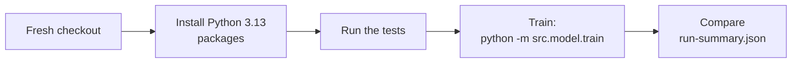
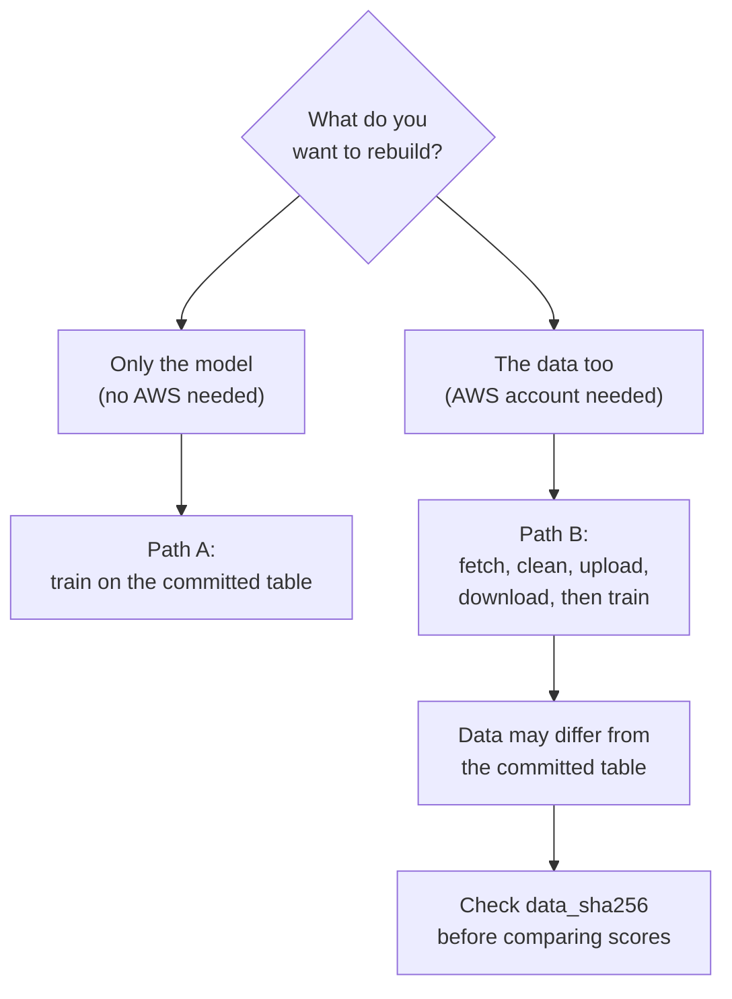
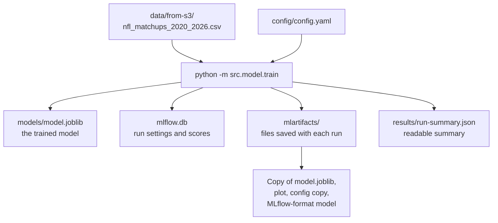

---
hide:
  - toc
---

# Reproducing the Pipeline End to End

This page shows a new reader how to rebuild the Phase 2 model from a fresh copy of the project and check that the result matches the committed one.

**Short answer:** yes. Starting from a clean checkout, one command (`python -m src.model.train`) rebuilds the model, the MLflow records, and `results/run-summary.json`. The summary file came out byte for byte identical to the committed one in a check on the author's machine (details in [What Was Checked?](#what-was-checked)).

## What Makes a Rerun Give the Same Result?

| Ingredient | How it is fixed | Where to read more |
| :--- | :--- | :--- |
| The data | The cleaned table is committed in `data/`. Its SHA-256 fingerprint is logged on every run. | [Phase 1 Implementation](../phase-1/implementation.md) |
| The settings | Every value is in `config/config.yaml`. The code holds no model settings. | [Part 1](./implementation-part-1.md) |
| The packages | `requirements.txt` pins every package to an exact version. Python 3.13 is required. | [Phase 1 Implementation](../phase-1/implementation.md#what-is-the-run-environment) |
| The randomness | `model.random_seed` is 42. The solver (`lbfgs`) uses no randomness, so two fits match either way. | [Part 2](./implementation-part-2.md#step-4-fit-the-scaler-and-the-model) |
| The record of the result | `results/run-summary.json` has no run id, timestamp, or machine paths, and its decimals are rounded to 6 places. | [Part 2](./implementation-part-2.md#what-is-the-run-summary-file) |

## How Does a Rebuild Flow?



## Which Path Applies?

The training command reads `data/from-s3/nfl_matchups_2020_2026.csv`. The folder `data/` is committed, so a fresh checkout already has that file. Pick the path that matches what you want to prove.



- **Path A (recommended for a first check).** Needs Python 3.13 and the pinned packages. It needs no AWS account and no internet after the install.
- **Path B (full rebuild).** Needs an AWS account, AWS CLI version 2, credentials on the machine, and internet access to GitHub and S3. See the [run environment](../phase-1/implementation.md#what-is-the-run-environment).
- **Heads up for Path B.** Step 1 downloads the current nflverse file, and nflverse can correct old scores or add games. A new download can produce a different table, and so different scores. The `data_sha256` value tells you whether the table matches the committed one.

## Path A: Train on the Committed Table

### Step 1: Create the Environment

```bash
python3.13 -m venv .venv
```

```bash
source .venv/bin/activate
```

```bash
pip install -r requirements.txt
```

### Step 2: Run the Tests

The tests use made-up data and a stand-in S3 client, so they need no internet and no AWS account.

```bash
pytest
```

Expected: **30 passed**.

### Step 3: Train

```bash
python -m src.model.train
```

Expected output, eight lines:

```text
training: 820 of 1339 correct (61.24%), always-home 53.32%
validation: 171 of 271 correct (63.10%), always-home 53.87%
test: 88 of 149 correct (59.06%), always-home 47.65%
validation log loss 0.6451
test log loss 0.6815
saved: models/model.joblib
summary: results/run-summary.json
MLflow run: LogisticRegression-v1.0
```

### Step 4: Confirm Nothing Changed

Training overwrites `results/run-summary.json`. If the rebuild matches, git shows no change to that file.

```bash
git status --short results/run-summary.json
```

No output means the file is identical to the committed one. A change means the data, the settings, or a package version is different. Compare `data_sha256` and `scikit_learn_version` in the file first.

```bash
git diff results/run-summary.json
```

## Path B: Rebuild the Data First

Run these in order, then continue with Steps 2 to 4 of Path A. Each step is explained in the [Phase 1 Implementation](../phase-1/implementation.md).

```bash
python -m src.data.fetch_raw
```

```bash
python -m src.data.clean
```

```bash
python -m src.data.upload_to_s3
```

```bash
python -m src.data.download_from_s3
```

## What Does a Training Run Create?

One training run reads the cleaned table and the settings file, and writes five kinds of output. They look similar but hold different things, and only one is committed to git.



## What Is Each File Type?

### Comparison

| Output | Format | What it holds | Who reads it | In git? | Same on every rerun? |
| :--- | :--- | :--- | :--- | :--- | :--- |
| `models/model.joblib` | Python object saved with joblib | The fitted scaler and logistic regression, plus the input names, model version, scikit-learn version, and training seasons | The Phase 3 API | No | Same predictions. The bytes are not compared. |
| `mlflow.db` | SQLite database (one file) | A table of runs: each run's 15 settings, 8 scores, tags, and the paths of its files. It holds no model and no images. | MLflow and its web page | No | No. Each rerun adds a row with a new run id and time. |
| `mlartifacts/` | Folder of ordinary files | The files each run saved: a copy of `model.joblib`, the confusion-matrix image, a copy of `config.yaml`, and the MLflow-format model | MLflow and its web page, or a person opening the folder | No | No. Each rerun adds a new subfolder. |
| `results/run-summary.json` | Plain JSON text | The settings, data fingerprint, scores, and learned weights of the latest run | A person, or git when comparing runs | Yes | Yes, byte for byte, when data, settings, and packages match |
| `config/config.yaml` | Plain YAML text | Every setting | The code, and a person | Yes | Not an output. It is the input. |

### Reading the Differences

- **`model.joblib` is the model itself.** It is the only file the API needs. It does not say how well the model scored.
- **`mlflow.db` is the logbook.** It records what each run used and scored, and it points to the run's files. It holds numbers and text only. If you delete it, the model and files stay, but MLflow can no longer list the runs.
- **`mlartifacts/` is the shelf of files.** The logbook (`mlflow.db`) says which run a file belongs to, and `mlartifacts/` holds the file. The two are only useful together, so keep or delete them as a pair.
- **`run-summary.json` is the committed receipt.** It repeats the key facts of the latest run in a form git can compare line by line. The database and the shelf cannot be compared that way, because they are binary or hold run ids and times.

### What Is Inside `mlartifacts/`?

```text
mlartifacts/
  <run id>/artifacts/            files in the run's own file list
    model/model.joblib             copy of the working model
    plots/confusion_matrix_validation.png
    config/config.yaml             copy of the settings used
  models/m-<id>/artifacts/       the MLflow-format model (a logged model)
    MLmodel                        description of the model
    model.skops                    the model, in skops format
    conda.yaml, python_env.yaml    the environment it needs
    requirements.txt               the packages it needs
```

- **Two copies of the model.** `model.joblib` is plain and carries the extra facts the API checks. The MLflow-format copy lets MLflow's own tools load the model in one call. Both come from the same fitted model. See [Why Is the Model Stored Twice?](./implementation-part-2.md#why-is-the-model-stored-twice).
- **`joblib` and `skops` are two ways to write a model to disk.** joblib is the general way and works on any Python object. skops is the format MLflow's scikit-learn support uses.
- **Where the settings go.** `config/config.yaml` is the input. The copy under `mlartifacts/` is a snapshot of what was used for that run.
- **Why they are not committed.** The database is binary and changes on every run, it records an absolute path on one machine, and one command rebuilds both. See [Decisions](../decisions.md).
- **Terms.** The [Glossary](../glossary.md) defines artifact, artifact store, logged model, and SQLite.

## What Was Checked?

- A copy of the project containing only `config/`, `data/`, `src/`, and `results/` (no `mlflow.db`, `mlartifacts/`, or `models/`), with `results/run-summary.json` deleted first. Running `python -m src.model.train` printed the eight lines above and **rewrote the summary file identically to the committed one** (`SUMMARY_IDENTICAL: True` from a byte comparison).
- The earlier real run was repeated and gave identical scores. See [Part 2](./implementation-part-2.md).

## What Is Not Guaranteed?

- **Other machines.** The check ran on one Mac with Python 3.13.14. A different operating system or processor could change a decimal beyond the 6th place, which rounding hides most of the time but not always.
- **Other package versions.** The pins make a match likely. A different scikit-learn can change the weights, and the summary file records `scikit_learn_version` so you can see it.
- **A fresh download.** See the Path B heads-up above.
- **The recorded git commit.** MLflow tags each run with the commit that was checked out at the time. It is not in the summary file, so it does not affect the comparison.
- **Phases 3 to 5.** This page covers the model only. The API, containers, and web app are planned in [Remaining Phases](../remaining-phases.md).
