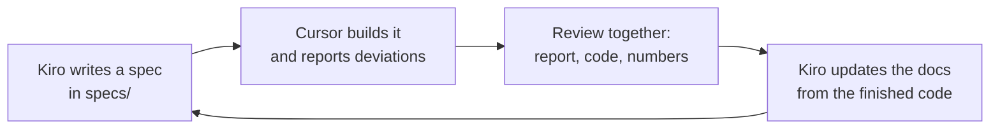

---
hide:
  - toc
---

# Phase 2 Synopsis: Features, Training, and Tracking

**Status: Planned, not started** (0 of 8 steps done).
**Needs first:** Phase 1, which is being rebuilt.

Phase 2 turns the cleaned games into two inputs per game, trains the model, and keeps a record of every run. It fits a logistic regression on the 2020 to 2024 games, scores it on the 2025 season and on the 2026 live games, and saves the settings, scores, and files of each run in MLflow.

## How Is the Work Handed Over?

Nothing is built without a spec. For each piece of work, Kiro writes a spec file in `specs/`, Cursor builds it and reports any deviations, then the developer reviews the report, the code, and the numbers together. Kiro then updates the docs from the finished code.

- **Written:** `specs/phase-1-rebuild-spec.md`, which undoes the old build and rebuilds Phase 1 from its docs.
- **Next:** a features spec (raw win percentage and point margin per game, replacing ranks), then a training spec (training command, scoring, saved model, and MLflow). Each is written after the one before it is reviewed, because it depends on the earlier numbers.

## Requirements This Phase Covers

Each requirement is copied word for word from the [Project Requirements](../../initial-requirements/requirements.md), followed by what Phase 2 does about it.

- ☐ **Name the target variable and the one evaluation metric used to judge the model.** The target `home_win` is named in Phase 1. Phase 2 sets the metric: accuracy, shown next to the always-pick-home baseline.
- ☐ **Use one simple model (for example logistic regression, random forest, or XGBoost).** Logistic regression. A random forest is the only other candidate.
- ◐ **The pipeline must cover, in order: data ingestion from S3, preprocessing and feature engineering, a train/validation/test split, model training, and evaluation.** Phase 1 builds ingestion. Phase 2 owns the features, the split, model training, and evaluation.
- ☐ **All tunable settings live in a `config.yaml` file (for example the split ratio and model parameters). Changing a run means editing that file, not the code.** Adds the split, model, and tracking settings to `config/config.yaml`.
- ☐ **Model accuracy is not graded. A poor score is acceptable; the requirement is a clean, repeatable process.** Two runs with the same settings and data give identical scores. The score is reported next to the baseline, whatever it is.
- ☐ **Use MLflow or Weights & Biases.** MLflow, stored in a local SQLite file.
- ☐ **Log each run's parameters and evaluation metrics.** Every run records its settings and its scores.
- ☐ **Log artifacts for reproducibility: at minimum the trained model, plus any plots produced.** Every run saves the trained pipeline, two plot images, and a copy of `config.yaml`.
- ☐ **MLflow or Weights & Biases logging wired into the pipeline.** The training command logs to MLflow by itself.
- ☐ **Code for preprocessing, training, serving, and deployment.** Adds the feature and training code: `src/features.py`, `src/train.py`, and `src/evaluate.py`.
- ☐ **Work done on branches merged through pull requests, with at least one pull request on record.** One branch and one pull request for Phases 1 and 2 together. The developer names the branch.

## Steps in Order

- [ ] **Step 1. Build the two inputs** in `src/features.py`: home minus away win percentage, and home minus away point margin per game, both from earlier weeks of the same season.
- [ ] **Step 2. Split the games by season.** Training 2020 to 2024, validation 2025, live 2026 weeks 1 to 10.
- [ ] **Step 3. Add the model and tracking settings** to `config/config.yaml`.
- [ ] **Step 4. Fit the scaler and the model** on the training seasons only. Save both as one scikit-learn pipeline.
- [ ] **Step 5. Score the model.** Accuracy on the training, validation, and live games, next to the baseline. Also log loss, ROC-AUC, and two plots.
- [ ] **Step 6. Record the run in MLflow:** settings, scores, and files.
- [ ] **Step 7. Compare the two model types.** Keep the one with the higher validation accuracy. On a tie, keep logistic regression.
- [ ] **Step 8. Save the final pipeline** as `models/model.joblib`, and add `models/`, `mlflow.db`, and `mlartifacts/` to `.gitignore`.

## Planned Details in Brief

- **Inputs:** a team with no games yet counts as win percentage 0.5 and margin 0.0, so week 1 gives 0 for both inputs. Reasons for raw values over ranks are in [Decisions](../decisions.md#model-inputs-decided-not-yet-built).
- **Split:** training is 1,339 games, validation is 271, and live is 149. The live games never fit or choose anything. With only 149 of them, their accuracy can move by about 4 points by chance.
- **Baseline:** always picking the home team scores 53.32% on training, 53.87% on 2025, and 47.65% on the live games. The model must beat this.
- **One saved object:** the scaler and the model travel together in one pipeline, so the API cannot apply the model without the scaler. The scaler learns its averages from training rows only.
- **Tracking:** a SQLite file `mlflow.db`, with run files in `mlartifacts/`. The installed MLflow 3.18.0 refuses the plain `mlruns` folder.
- **XGBoost is left out** to keep the serving image small.

## Open Decisions

- **How is the 2025 validation season used?** Proposed: it chooses the model type and also supplies the reported score, which makes that score slightly optimistic, though with two candidates the effect is small. Alternative: fix logistic regression and skip the choice, or choose using held-out seasons inside 2020 to 2024.
- **Should week 1 be dropped from the model table?** Not decided and not done. See [Open Decision: Start From Week 2](../decisions.md#open-decision-start-from-week-2-not-done).

## Done When

- [ ] One training command runs from a clean checkout with `config.yaml` and AWS credentials.
- [ ] Changing the model type in `config.yaml` changes the run with no code edit.
- [ ] Two runs with the same settings give identical scores.
- [ ] The scaler's saved average comes from the training rows only.
- [ ] The MLflow run lists the settings, the scores, and all three kinds of files.

## What Will Be Created

- **Settings:** new `split`, `model`, and `tracking` blocks in `config/config.yaml`.
- **Code:** `src/features.py`, `src/train.py`, and `src/evaluate.py`, with tests. Packages `matplotlib` and `joblib` are pinned in `requirements.txt`.
- **Local only, not committed:** `mlflow.db`, the `mlartifacts/` folder, and `models/model.joblib`.
