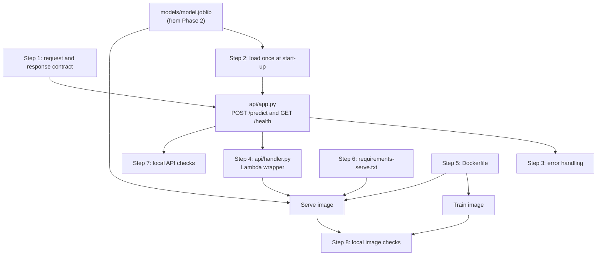

---
hide:
  - toc
---

# Phase 3: API and Docker

This phase wraps the trained model in a web API and packages the project in a Docker image. The API accepts three numbers and returns a predicted winner and a win probability. The Docker file builds two things: a training image and a serving image.

This page owns the request and response contract, the rules for loading the model, the image layout, and the local checks. The cloud deployment of the serving image is in [Phase 4](./phase-4-aws-deployment.md).

## Phase Architecture

### Flow of Steps

### Inventory

| Item | Kind | Planned location | Built in | What it does |
| :--- | :--- | :--- | :--- | :--- |
| Request and response contract | Specification | This page, Step 1 | Step 1 | Fixes the fields that the API, the web app, and the tests share. |
| FastAPI app | Code | `api/app.py` | Steps 1 to 3 | Answers `POST /predict` and `GET /health`, loads the model, and returns clear errors. |
| Lambda wrapper | Code | `api/handler.py` | Step 4 | Lets AWS Lambda pass gateway events to the app. |
| Dockerfile | Container recipe | `Dockerfile` | Step 5 | Builds a `train` image and a `serve` image from one file. |
| Image build exclusions | Settings file | `.dockerignore` | Step 5 | Keeps data, run records, and local folders out of the images. |
| Serving dependency list | Settings file | `requirements-serve.txt` | Step 6 | Lists only the libraries the API needs. |
| Local checks | Test steps | Run by the developer | Steps 7 and 8 | Prove that the app and both images behave as the contract says. |

## Which Requirements and Gaps Does It Cover?

- Requirement 5: a Dockerfile with entry points for training and serving that builds and runs locally.
- Requirement 6: a `/predict` route that takes JSON and returns JSON, tested locally.
- Scaling: the API loads the single saved pipeline, so scaling always happens.
- Probability field: defines what it measures.
- Dockerfile layout: chooses one file with two targets.
- Model file: decides where it lives.
- Local checks: lists them.
- Dependency lists: splits the full list from the serving list.

## Step 1: Define the Request and Response Contract

!!! abstract "Purpose"
    **Goal:** Write down the exact fields the API accepts (three numbers, each with an allowed range) and the exact fields it returns (`prediction`, `predicted_label`, `home_win_probability`, and `model_version`).

    **Why:** Three separate pieces use these fields: the API, the web app, and the tests. They only work together if all three follow one written definition.

    **If skipped:** The web app might send `rest_diff` while the API expects `rest_differential`. Every request would then fail with a 422 error.

### Request

The route is `POST /predict`. The body is JSON with three fields, matching the three features in [Phase 1](./phase-1-data-and-features.md#feature-and-target-reference).

| Field | Type | Allowed range | Meaning |
| :--- | :--- | :--- | :--- |
| `point_diff_differential` | number | -40 to 40 | Home team's point differential per game minus the away team's. |
| `win_pct_differential` | number | -1 to 1 | Home team's win percentage minus the away team's. |
| `rest_differential` | whole number | -14 to 14 | Home team's days of rest minus the away team's. |

The ranges are set wider than any value seen in the games file, so they reject mistakes such as a percentage sent as 62 instead of 0.62 without blocking real inputs. The rest-day difference in the 2016 to 2024 games runs from -8 to 8, so the allowed range of -14 to 14 leaves room on both sides.

The API rejects fields it does not know. A request that still sends `home_advantage` gets an error that names the field. This follows the proposal in Phase 1 to drop that feature.

### Response

| Field | Type | Meaning |
| :--- | :--- | :--- |
| `prediction` | whole number | 1 if the model picks the home team, 0 if it picks the away team. |
| `predicted_label` | text | `Home Win` or `Away Win`. |
| `home_win_probability` | number from 0 to 1 | The model's probability that the **home** team wins, rounded to three decimals. |
| `model_version` | text | The version label from `config.yaml`, for example `v1.0`. |

The prediction is 1 when `home_win_probability` is above 0.5, and 0 otherwise.

!!! note "Confirm: field name for the probability"
    The first draft called this field `win_probability`, which does not say whose win it measures. When the model picks the away team, a reader could take the value to be the away team's chance. This design names the field `home_win_probability` and leaves the web app to compute the picked team's chance (one minus the value when the away team is picked). Keeping the old name is possible but then needs a written rule that the value is always the home team's chance.

### Health Route

A second route, `GET /health`, returns the status and the model version. It lets [Phase 4](./phase-4-aws-deployment.md#step-5-check-the-live-endpoint) confirm that the deployed function loaded the model. It is not part of the assignment requirements and can be removed without affecting them.

## Step 2: Load the Model at Start-Up

!!! abstract "Purpose"
    **Goal:** Make the API read the model file once, when the API starts, and keep the loaded model in memory.

    **Why:** Reading and unpacking the file takes time, so doing it on every request would slow every answer. If the file is missing, the API should refuse to start. It should not run without a model.

    **If skipped:** Answers would be slower. Or the API could start without a model and then crash or answer wrongly on its first request.

| Item | Design |
| :--- | :--- |
| What loads | The one saved pipeline file from [Phase 2](./phase-2-training-and-tracking.md#step-3-fit-the-scaler-and-model). It holds the scaler and the model. |
| When | Once when the process starts, not on every request. In Lambda, this happens on a cold start and the loaded model is reused by later requests on the same instance. |
| Feature order | The API builds the model input in the feature order stored in the file, not in the order the JSON arrived. |
| Failure | If the file is missing or cannot be read, the process fails at start-up with a clear message. It does not start and answer wrong. |

## Step 3: Define Error Handling

!!! abstract "Purpose"
    **Goal:** Define what the API sends back when a request is bad: status 422 with a message that names the faulty field, and status 500 for a failure inside the API.

    **Why:** Anyone who knows the address can send anything, including missing fields or absurd values. A clear message tells the sender what to fix.

    **If skipped:** A bad request could crash the function, or the API could return a prediction for nonsense input such as a win percentage difference of 62.

| Situation | Response |
| :--- | :--- |
| A field is missing, has the wrong type, or is out of range | 422 with a message that names the field. |
| An unknown field is sent | 422 naming the field. |
| The body is not valid JSON | 422. |
| The model raises an error while predicting | 500 with a short message. Details go to the log, not to the caller. |

## Step 4: Wrap the App for Lambda

!!! abstract "Purpose"
    **Goal:** Add a small file, `api/handler.py`, that lets AWS Lambda run the FastAPI app.

    **Why:** Lambda does not send ordinary web requests. It sends event messages in its own format, which FastAPI cannot read. The Mangum library translates each event into a normal request.

    **If skipped:** The app would work on a laptop, but Lambda could not call it, so the deployed API would not work.

The FastAPI app is wrapped with Mangum in `api/handler.py`, so Lambda can pass API Gateway events to it. The wrapper contains no prediction logic. Running the app directly with a local server uses `api/app.py` without the wrapper.

## Step 5: Design the Docker Image

!!! abstract "Purpose"
    **Goal:** Write one Dockerfile with two build targets. The `train` target runs the training command. The `serve` target runs the API on Lambda.

    **Why:** The assignment requires a Dockerfile with entry points for both training and serving. The two jobs need different libraries and different starting images, so two targets in one file keep them together without mixing them.

    **If skipped:** There would be no repeatable way to run the project on another computer, and Phase 4 would have no image to deploy.

### One Dockerfile With Two Targets

The first draft said "multi-stage or entry-point" without choosing. Training and serving need different things, so this design uses one Dockerfile with two named build targets.

| Target | Base image | Installs | Entry point | Used for |
| :--- | :--- | :--- | :--- | :--- |
| `train` | A slim Python 3.13 image | `requirements.txt` (full list including MLflow and boto3) | The Phase 2 training command | Running the full pipeline in a container. |
| `serve` | The AWS Lambda Python 3.13 base image | `requirements-serve.txt` | The Lambda handler in `api/handler.py` | Local API tests and the Lambda deployment. |

!!! note "Confirm: one Dockerfile, two targets"
    The alternative is two Dockerfiles. One file keeps both jobs in one place, and the assignment asks for "a Dockerfile". The cost is that the two targets must be built with an explicit target name.

### What Goes Into the Serving Image?

The serving image copies `api/` and `models/model.joblib` at build time. The model file is not committed to git. A reader who clones the repository trains first, which writes the file, and then builds the serving image.

| Option for the model file | Chosen? | Reason |
| :--- | :--- | :--- |
| Copy into the image at build time | **Yes** | No permissions or network calls are needed at start-up. |
| Commit the file to git | No | A binary file ties the repository history to one trained model. |
| Download from S3 at start-up | No | Adds delay on every cold start and needs S3 read permission for the function. |

The build stops with an error if the model file is missing. A `.dockerignore` file keeps `data/`, `mlruns/`, `.venv/`, `site/`, and `local/` out of the build.

### How Do Training Containers Get AWS Credentials?

Credentials are passed when the container runs, through environment variables or a read-only mount of the AWS configuration folder. They are never copied into an image. The training container writes `models/model.joblib` to a folder mounted from the host, so the file is available for the serving build.

## Step 6: Choose Serving Dependencies

!!! abstract "Purpose"
    **Goal:** Create a second, shorter list of Python libraries, `requirements-serve.txt`, that holds only what the API uses.

    **Why:** The full list includes MLflow, `boto3`, and plotting libraries that the API never uses. A smaller image starts faster, and start-up time matters because the first request after an idle period waits while Lambda starts the image.

    **If skipped:** The serving image would be larger, and the first request after an idle period would be slower.

The full list from [Phase 1](./phase-1-data-and-features.md#step-8-correct-the-dependency-list) includes MLflow, boto3, and plotting libraries that the API never uses. The serving list holds only what the API needs: FastAPI, Pydantic, Mangum, scikit-learn, NumPy, SciPy, and joblib. This keeps the image smaller and the cold start shorter.

Heads up: the scikit-learn, NumPy, SciPy, and joblib versions in the serving list must equal the versions used for training. A model saved under one scikit-learn version may fail to load, or give different answers, under another.

## Step 7: Test the API Locally

!!! abstract "Purpose"
    **Goal:** Run the API on your own computer, without Docker or AWS, and send it requests that should succeed and requests that should fail.

    **Why:** A mistake found here takes minutes to fix. After deployment, the same mistake is harder to find because it sits inside Lambda and API Gateway.

    **If skipped:** Bugs would first appear in the deployed function, where logs are harder to read and each fix needs a new image build and upload.

This is the check the first draft left out. It runs the API directly, with no Docker and no AWS.

| Test | Pass condition |
| :--- | :--- |
| Valid request | `POST /predict` with a valid body returns 200 and all four response fields. |
| Matches training | For one 2024 test row, the API's probability equals the Phase 2 pipeline's probability for the same three numbers, within rounding to three decimals. |
| Direction | A request with all three numbers strongly positive gives a probability above 0.5. A request with all three strongly negative gives one below 0.5. |
| Missing field | Returns 422 naming the field. |
| Out-of-range value | Returns 422. |
| Unknown field | Returns 422. |
| Health route | Returns the model version. |

Requests are sent with `curl` or Postman.

## Step 8: Test the Images Locally

!!! abstract "Purpose"
    **Goal:** Build both Docker images, run them on your own computer, and repeat the Step 7 checks against the `serve` image.

    **Why:** The `serve` image adds the Lambda base image and the Mangum wrapper. Those can behave differently from the plain app tested in Step 7.

    **If skipped:** An image could fail to build, or answer differently from the plain app, and you would only find out after uploading it to AWS.

| Test | Pass condition |
| :--- | :--- |
| Training image builds | The `train` target builds. |
| Training image runs | Run with credentials and a mounted `models/` folder, it completes a training run and writes the model file. Scores match a run outside Docker. |
| Serving image builds | The `serve` target builds only when the model file exists. |
| Serving image answers | Run locally with the Lambda emulator that the base image includes. Requests are wrapped in a gateway-style event, because Mangum expects one. The same checks as Step 7 pass. |

## What Can Go Wrong?

| Problem | Effect | How it shows up |
| :--- | :--- | :--- |
| Different library versions in training and serving | Model fails to load or predicts differently. | The "matches training" check fails. |
| Model file missing at build | Image builds without a model. | The build stops with an error. |
| Image built for the wrong processor type | Lambda cannot start the function. | See the platform note in [Phase 4](./phase-4-aws-deployment.md#step-3-build-and-push-the-image). |
| Credentials baked into an image | A secret leaks to anyone with the image. | Review of build steps and image history. |

## Commit and Pull Request Plan

A sensible grouping into commits:

1. API app with the contract and error handling.
2. Local API checks.
3. Lambda wrapper.
4. Serving dependency list and `.dockerignore`.
5. Dockerfile with both targets, and the local image checks.

## What Does Phase 4 Need From This Phase?

A serving image that passes the local checks, the handler path, and the exact response contract, because [Phase 5](./phase-5-front-end-and-documentation.md) reads the same fields.
