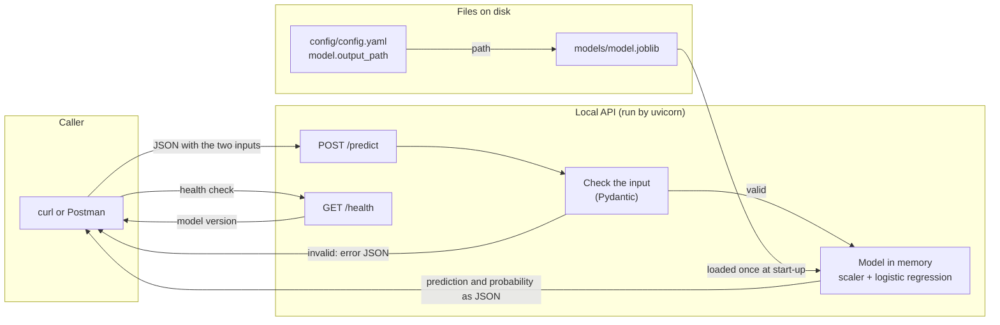

---
hide:
  - toc
---

# Phase 3 Brief: Local Prediction API

**Status: Built and tested.** All 7 steps are done, and `pytest` passes 47 tests (30 from earlier phases and 17 new).
**Needs first:** Phase 2, which is built. Its output is the saved model `models/model.joblib`. If that file is missing, run `python -m src.model.train` first.

Phase 3 wraps the trained model in a small web service that runs on your own computer. A person (or a program) sends the two model inputs as JSON, and the service returns the predicted winner and the home win probability as JSON. Nothing in this phase touches AWS or Docker. Those come later, starting with [Phase 4](../phase-4/brief.md).

To run it, activate the virtual environment and start the service. The [Implementation](./implementation.md#how-do-i-run-it-locally) page has the full run guide, with `curl` examples and the real output of each.

```bash
python -m uvicorn src.api.app:app --port 8000
```

## How Do the Pieces Fit Together?

Everything runs on one computer. The model file is read once when the service starts, and each request is then answered from memory.



## Steps in Order

- [x] **Step 1. Load the saved model once, when the service starts.** Read `models/model.joblib` (the path comes from `model.output_path` in `config/config.yaml`). Compare the scikit-learn version saved inside the file with the installed one, and stop with a clear message if they differ.
- [x] **Step 2. Define the request and the response.** The request holds two decimal numbers. The response holds the prediction and the probability.
- [x] **Step 3. Add the `POST /predict` route.** Put the two numbers in a NumPy array in the saved input order, and return the model's answer.
- [x] **Step 4. Add the `GET /health` route.** It reports that the service is up and which model version it loaded.
- [x] **Step 5. Reject bad input with a clear error.** A missing field, an extra field, a value that is not a number, or a number far outside the possible range returns status 422 with an error that names the problem.
- [x] **Step 6. Write tests** that call both routes with made-up data and no saved model file.
- [x] **Step 7. Run it locally and test it with `curl`.** Start the service with a one-line command, and send the worked example from the model page.

## Details in Brief

- **One route to predict.** `POST /predict` takes JSON like `{"win_pct_differential": -0.5, "point_diff_per_game_differential": -18.0}`. Both fields are required.
- **The response** has four fields:
    - `prediction`: 1 for a home win, 0 for an away win.
    - `predicted_label`: the same answer as text.
    - `home_win_probability`: the model's chance (0 to 1) that the home team wins.
    - `model_version`: the `model.version` setting saved in the file, for example `v1.0`.
- **The pick rule is the same as scoring.** A probability above 0.5 is a home win, and exactly 0.5 is an away win. See [Part 2](../phase-2/implementation-part-2.md#how-is-a-game-scored).
- **Worked example.** The inputs -0.5 and -18.0 (game `2025_07_NE_TEN`) return a home win probability of **0.3296** and the prediction 0, which matches the model's own output in [Part 2](../phase-2/implementation-part-2.md#what-is-a-worked-example).
- **Valid ranges:** win percentage difference from -1 to 1, which is the full possible range. Point margin difference from -100 to 100, which is a loose guard, because the real data runs about -49 to 39.
- **Unknown fields are rejected,** so a misspelled name fails loudly and is not ignored.
- **The scaler is inside the model file,** so the API sends raw inputs. The API never standardizes anything itself.
- **FastAPI, not Flask.** Both can serve this model. FastAPI does the input checks (missing field, extra field, wrong type, out-of-range number) from one request definition, and it gives a test page at `/docs` with no extra code. In Flask, those checks would be written by hand. FastAPI also pairs with the Mangum adapter already pinned for Lambda in Phase 4, while Flask would need a different adapter. Flask is a little shorter for a route with no checks, which is the one place it is simpler.
- **No cloud code yet.** The adapter that lets AWS Lambda run the same app (Mangum) is added in Phase 4. See [What Is Mangum?](../phase-4/implementation.md#what-is-mangum).
- **Built so Lambda can reuse it.** Phase 4 runs this same app in Lambda, so Phase 3 keeps four things true:
    - The app is one object named `app`, importable from the module `src/api/app.py`, with no code that reads the command line when it is imported.
    - The model loads in the app's start-up step through the `load_model` function, not inside a route. Phase 4 reuses `load_model` on Lambda and calls it once, on the first call.
    - Every file path goes through `resolve_path` in `src/config.py`, which finds the project folder from the code's own location. The Lambda zip keeps the same folder layout (`src/`, `config/`, `models/`), so the same paths work there.
    - Tests call the app in memory (FastAPI's test client), so they need no server and no network.
- **NumPy, not pandas, in the API.** The Lambda zip fits under its size limit only without `pandas` (231.3 MB without it, 278.4 MB with it). So the API files must not import `pandas`, directly or through `src/model/features.py`, which imports it. The API reads the input names from the saved model file, passes the two numbers to the model as a plain numpy array in that order, and silences the one expected scikit-learn warning about column names. A test reads the API files and checks that none of them imports `pandas`. See the [Phase 4 Implementation, Step 3](../phase-4/implementation.md#step-3-measure-the-package-size).
- **Packages:** [`fastapi`](https://fastapi.tiangolo.com/), [`uvicorn`](https://uvicorn.dev/), and [`pydantic`](https://docs.pydantic.dev/latest/) are already pinned in `requirements.txt`. `uvicorn` is the program that runs the service on your machine, and `pydantic` checks that each request has the right fields. See the [Glossary](../glossary.md#phase-3-local-prediction-api) for both.

## What Was Created

- **Code:** `src/api/app.py` and `src/api/schemas.py`, with 17 tests in `tests/test_api.py`.
- **Packages:** one new pinned line in `requirements.txt`, `httpx2`, used only by the tests.
- **Settings:** none new. The service reuses `model.output_path`. Host and port are given on the command line.
- **Nothing committed that is generated.** The saved model stays local, as in Phase 2.

## What Is Not in This Phase

- Docker, in [Phase 6](../remaining-phases.md#phase-6-docker).
- AWS Lambda, API Gateway, and CORS, in [Phase 4](../phase-4/brief.md).
- The web app, in [Phase 5](../remaining-phases.md#phase-5-web-app-and-hosting).

## Where to Read More

- [Phase 3 Implementation](./implementation.md) explains each step in detail: start-up, the request and response, the routes, the error cases, the tests, and the `curl` commands.
- [Phase 2 Implementation, Part 2](../phase-2/implementation-part-2.md) explains what is inside `models/model.joblib` and how the model scores a game.
- [Decisions](../decisions.md#the-api) lists the API choices already made.
