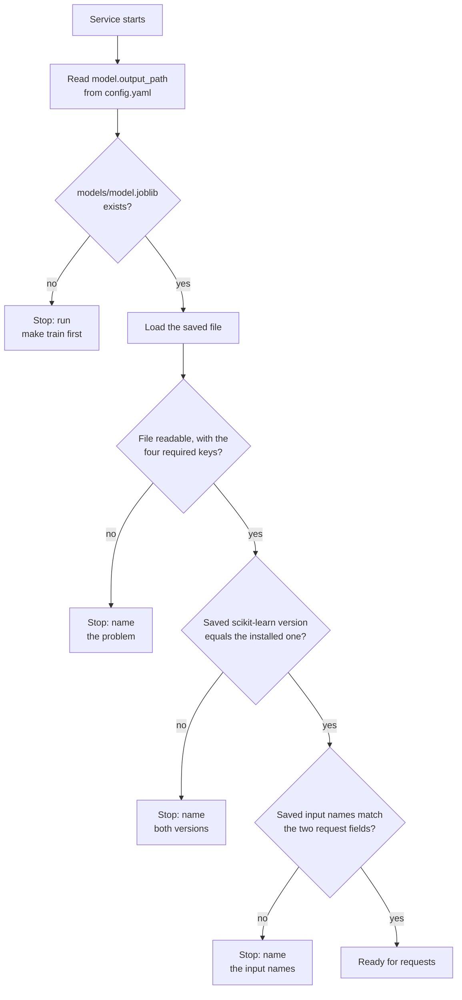
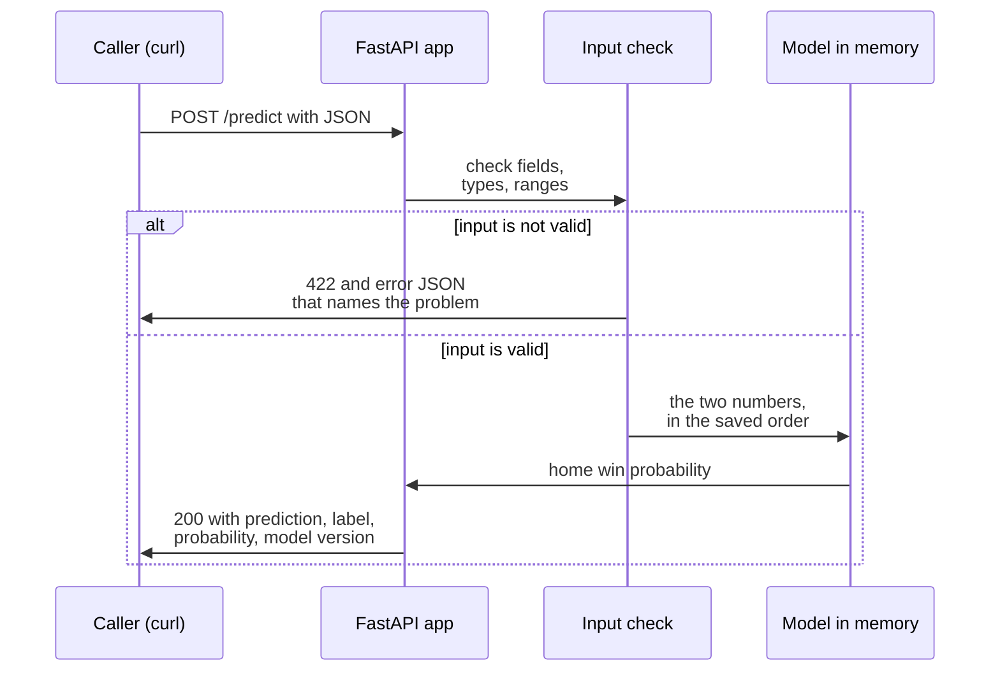
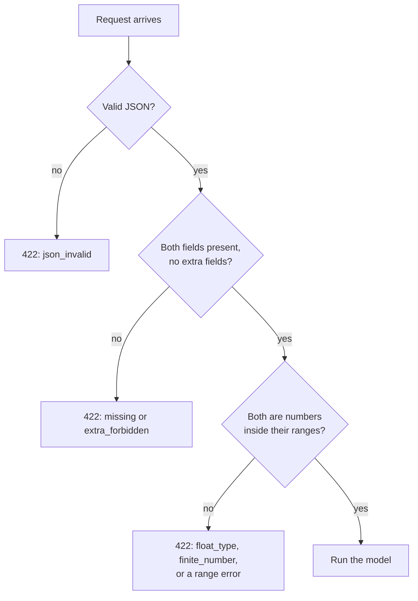

---
hide:
  - toc
---

# Phase 3 Implementation: Local Prediction API

This page explains how the Phase 3 service works, one step at a time, and why. The service takes two numbers about a game and returns the model's pick and the home team's chance of winning, as JSON. To run it, send it requests, or change it, see the [Development Guide](./development-guide.md). For the short version, see the [Brief](./brief.md).

**Status: built and tested.** The code is in `src/api/app.py` and `src/api/schemas.py`, and the tests are in `tests/test_api.py`. Every request and response in the guide was produced by the running service. The full test suite passes with 47 tests: the 30 from earlier phases and 17 new ones.

## How Does the Service Work?

### How Does It Start?

The model file is read once, in the app's start-up step, and kept in memory. Every request after that reuses it.



### How Is a Request Answered?



## Which Files Were Added?

- **`src/api/app.py`:** The `app` object, `create_app`, the start-up step (`load_model`), the 0.5 rule (`label_for`), and the two routes.
- **`src/api/schemas.py`:** The three JSON shapes: `PredictRequest`, `PredictResponse`, and `HealthResponse`.
- **`tests/test_api.py`:** 17 tests for both routes, the start-up checks, and the no-pandas rule.
- **`requirements.txt`:** One new pinned line, `httpx2==2.16.2`, used only by the tests.

- **No new settings.** The service reuses `model.output_path` from `config/config.yaml`. The host and port are given on the command line.
- **`httpx2` is test-only.** FastAPI's test client calls the app through it, and the installed Starlette asks for `httpx2` and prints a warning with the older `httpx`. It is not needed in the Lambda zip. It brought in two helper packages, `httpcore2` and `truststore`, which are left unpinned like the project's other indirect packages.
- **No `__init__.py` files,** matching the rest of the project.

## Step 1: Load the Saved Model at Start-Up

!!! abstract "Purpose"
    **Goal:** Read `models/model.joblib` once, check it, and keep it in memory.

    **Why:** Loading on every request would be slow, and a model saved by a different scikit-learn version may fail to load or answer differently. Failing at start-up is clearer than failing on the first request.

    **If skipped:** A missing or mismatched model would show up as an error in the middle of a request.

- **Where the path comes from:** `model.output_path` in `config/config.yaml`, turned into a full path with `resolve_path` from `src/config.py`. That function finds the project folder from the code's own location, so the same path works from any folder, and in the Lambda zip in Phase 4.
- **What is in the file:** a dictionary with `pipeline`, `feature_names`, `model_version`, `scikit_learn_version`, `train_start_season`, and `train_end_season`. See [Step 7 of Phase 2](../phase-2/implementation-part-2.md#what-is-saved).
- **Where the model lives:** in the app's start-up step (FastAPI's `lifespan`), stored on `app.state`. The routes read it from there. Importing `src/api/app.py` builds the app but does not read the file.
- **Why start-up and not import time:** the tests build the app without a real model file, and Lambda (in Phase 4) reuses the same `load_model` function. Mangum would run this start-up step on every request by default, so Phase 4 turns that off and calls `load_model` itself, once, on the first call. See [What Is Mangum?](../phase-4/implementation.md#what-is-mangum).
- **Checks, in this order:** the file exists, it loads, it holds the four keys the API needs (`pipeline`, `feature_names`, `model_version`, `scikit_learn_version`), the scikit-learn version matches, and the saved input names match the request fields.

If any check fails, the service refuses to start, and `uvicorn` prints a traceback that ends with one of these messages (the `RuntimeError` line):

- **The file is missing:** `No saved model at models/model.joblib. Run python -m src.model.train first.`.
- **The file cannot be read, or is not a dictionary, or lacks a key:** `Could not read the saved model at models/model.joblib: <reason>. Run python -m src.model.train to rebuild it.`.
- **Saved scikit-learn version differs:** `Saved model was built with scikit-learn <saved> but <installed> is installed. Retrain with python -m src.model.train, or install scikit-learn==<saved>.`.
- **The saved input names are not the two request fields:** `Could not read the saved model at models/model.joblib: input names [...] do not match the API fields.`.

The real output when the model file is missing ends like this, and the process exits with code 3:

```text
RuntimeError: No saved model at models/model.joblib. Run python -m src.model.train first.

ERROR:    Application startup failed. Exiting.
```

## Step 2: Define the Request and the Response

!!! abstract "Purpose"
    **Goal:** Describe the exact JSON the service accepts and returns, in one place.

    **Why:** One definition gives the input checks, the error messages, and the `/docs` test page together.

    **If skipped:** The checks would be written manually in each route.

The request, from `src/api/schemas.py`:

```python
class PredictRequest(BaseModel):
    """The two pre-game numbers. Extra fields are refused so a typo is not ignored."""

    model_config = ConfigDict(extra="forbid", strict=True)

    win_pct_differential: float = Field(ge=-1, le=1, allow_inf_nan=False, ...)
    # A loose guard, because the real data runs about -49 to 39.
    point_diff_per_game_differential: float = Field(ge=-100, le=100, allow_inf_nan=False, ...)
```

- **`extra="forbid"`** refuses unknown fields.
- **`strict=True`** refuses numbers written as text, and true or false, in place of numbers. Whole numbers such as `0` are still accepted.
- **`allow_inf_nan=False`** refuses `NaN` and infinity.
- **The field names match the model's input names** (`INPUT_COLUMNS` in `src/model/features.py`), but the API does not import that file. At start-up it checks that the names saved in the model file are the same as the two request fields.

The response has four fields (`prediction`, `predicted_label`, `home_win_probability`, `model_version`), described in [What Is in the Response?](./development-guide.md#what-is-in-the-response). The health response has three (`status`, `model_version`, `scikit_learn_version`).

## Step 3: Add the `POST /predict` Route

!!! abstract "Purpose"
    **Goal:** Turn a valid request into a prediction.

    **Why:** This is the route the web app calls.

    **If skipped:** There would be no way to ask the model a question.

```python
@app.post("/predict", response_model=PredictResponse, summary="Predict which team wins.")
def predict(request: PredictRequest) -> PredictResponse:
    """Score one game from the two numbers, in the order saved with the model."""
    saved = app.state.model
    row = np.array([[getattr(request, name) for name in saved["feature_names"]]], dtype=float)
    # The scaler was fitted on a table with column names, and this call passes a plain array
    # so the service does not import pandas. The probability is the same either way.
    with warnings.catch_warnings():
        warnings.filterwarnings("ignore", message=r"X does not have valid feature names", category=UserWarning)
        probability = float(saved["pipeline"].predict_proba(row)[0, 1])
    prediction, predicted_label = label_for(probability)
    return PredictResponse(
        prediction=prediction,
        predicted_label=predicted_label,
        home_win_probability=round(probability, 4),
        model_version=saved["model_version"],
    )
```

1. FastAPI checks the request against `PredictRequest` before the route code runs.
2. The route looks up each saved input name on the request and builds a numpy array with one row and two columns, **in the order of `feature_names` from the model file.** The order of the fields in the JSON does not matter.
3. The route calls `predict_proba` and takes the probability of class 1 (a home win).
4. `label_for` applies the 0.5 rule: above 0.5 is `(1, "home win")`, and anything else, including exactly 0.5, is `(0, "away win")`. It is applied to the unrounded probability.
5. The response rounds the probability to 4 places.

### Why Does the API Use NumPy Instead of pandas?

The API uses [NumPy](https://numpy.org/doc/stable/) only. It does not use [pandas](https://pandas.pydata.org/docs/), although training and cleaning do. The two numbers go to the model as a NumPy array and not as a pandas table (a DataFrame).

- **The Lambda zip fits only without `pandas`.** It is 231.3 MB without it and 278.4 MB with it, against a 250 MB limit. See the [Phase 4 Implementation, Step 3](../phase-4/implementation.md#step-3-measure-the-package-size).
- **`src/model/features.py` imports `pandas` at the top,** so no file in `src/api/` may import from it. The input names come from the model file instead.
- **One warning is expected.** The scaler was fitted on a table with column names, so a plain array makes scikit-learn warn that "X does not have valid feature names". The probability is the same. The route silences this one warning and no others.
- **The answer is unchanged.** With only NumPy installed, the inputs -0.5 and -18.0 give 0.3296, matching [Part 2](../phase-2/implementation-part-2.md#what-is-a-worked-example).

## Step 4: Add the `GET /health` Route

!!! abstract "Purpose"
    **Goal:** Report that the service is running and which model it loaded.

    **Why:** It is the quickest way to check a running service, and it shows which model version is answering.

    **If skipped:** A person could not tell a running service from a stopped one without sending a real prediction.

The response is `{"status":"ok","model_version":"v1.0","scikit_learn_version":"1.9.1"}`. The route reads only from memory. It does not open the file or call the model. The `scikit_learn_version` is the one saved in the model file, and start-up has already checked that it equals the installed one.

## Step 5: Reject Bad Input Clearly

!!! abstract "Purpose"
    **Goal:** Make every bad request return an error that names the problem, and never a prediction or a crash.

    **Why:** The web app and a person with `curl` both need to see what to fix.

    **If skipped:** A bad value could reach the model and return a meaningless probability.



The checks all come from the request definition in Step 2, and FastAPI answers a failed check with status 422. One piece of extra code was needed. When a value is `NaN`, the error body would contain a real `NaN`, which JSON cannot hold, and FastAPI crashed while writing the 422. The service has its own handler for these errors (`reject_invalid_request` in `src/api/app.py`) that replaces a non-finite number with the text `"NaN"` or `"Infinity"` and then sends the 422. Real examples are shown in [Error Examples](./development-guide.md#error-examples).

## Step 6: Run the Tests

!!! abstract "Purpose"
    **Goal:** Check both routes, the start-up checks, and the no-pandas rule, without a real saved model or the internet.

    **Why:** The tests keep the Lambda size result and the input rules from breaking later.

    **If skipped:** A change could pass unnoticed until the deployed function failed.

```bash
python -m pytest
```

Expected: **47 passed**, with no warnings, in about 11 seconds. Without `models/model.joblib`, test 17 is skipped instead, and 46 pass.

- **Made-up model.** A fixture fits a tiny pipeline on 40 made-up rows (fixed random seed), saves it in the same dictionary format that training writes, and points the service at it. The tests never touch `models/model.joblib`, except test 17.
- **In-memory calls.** FastAPI's test client calls the app without starting a server. It is used as a context manager (`with TestClient(app)`), because that is what runs the start-up step.

1. `test_prediction_matches_the_pipeline`: The probability from `/predict` equals the pipeline's own answer, rounded to 4 places.
2. `test_pick_rule`: `label_for` gives an away win for 0.0, 0.4999, and exactly 0.5, and a home win for 0.5001 and 1.0.
3. `test_response_fields`: The response has the four fields with the right types, and whole-number inputs are accepted.
4. `test_field_order_does_not_change_the_answer`: The same two values with the JSON fields in the opposite order give the same response.
5. `test_missing_field_is_rejected`: Status 422, and the error names the missing field.
6. `test_extra_field_is_rejected`: Status 422, and the error names the extra field.
7. `test_text_value_is_rejected`: Both `"abc"` and `"0.5"` give 422.
8. `test_out_of_range_value_is_rejected`: 1.5 and 500 are rejected and name the field, and the edge values 1 and -100 are accepted.
9. `test_not_a_number_is_rejected`: A body containing `NaN` gives 422.
10. `test_invalid_json_is_rejected`: A body that is not valid JSON gives 422.
11. `test_health`: Status 200, with the three expected fields.
12. `test_missing_model_file_stops_startup`: Start-up raises an error that says to run the training command.
13. `test_unreadable_model_file_stops_startup`: A file holding plain text stops start-up with "Could not read the saved model".
14. `test_version_mismatch_stops_startup`: A saved scikit-learn version of `0.0.0` stops start-up and names both versions.
15. `test_wrong_feature_names_stop_startup`: Saved input names that are not the two request fields stop start-up.
16. `test_api_files_do_not_import_pandas`: The API files are read as text and checked: none imports `pandas`, `mlflow`, `matplotlib`, or anything from `src/model/`. Checking `sys.modules` would not work, because scikit-learn loads `pandas` on its own when it is installed.
17. `test_real_model_worked_example`: With the real model, the inputs -0.5 and -18.0 return the exact response shown in [Example 1](./development-guide.md#example-1-a-game-where-the-away-team-is-stronger). Skipped if `models/model.joblib` does not exist.
