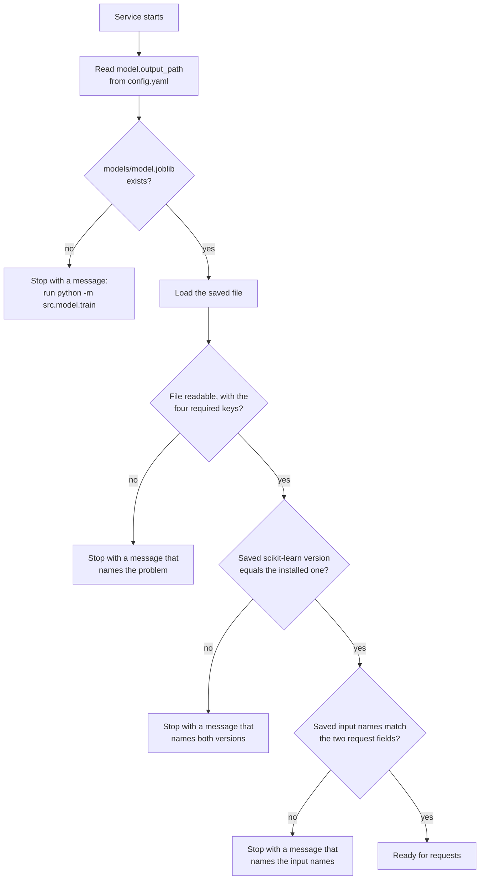
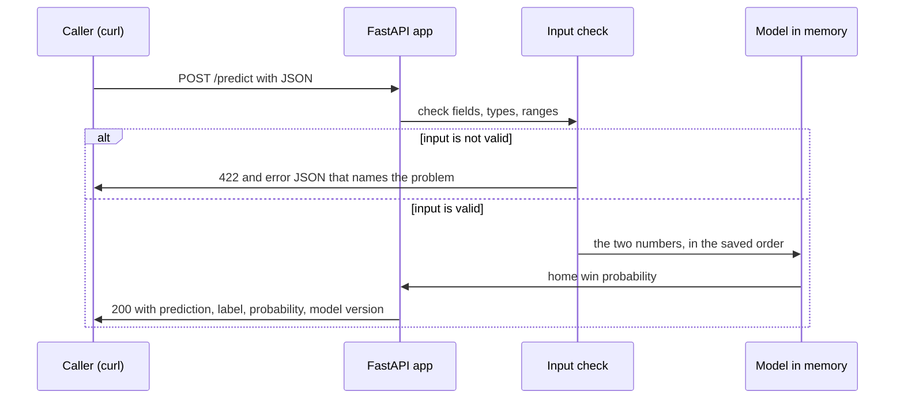
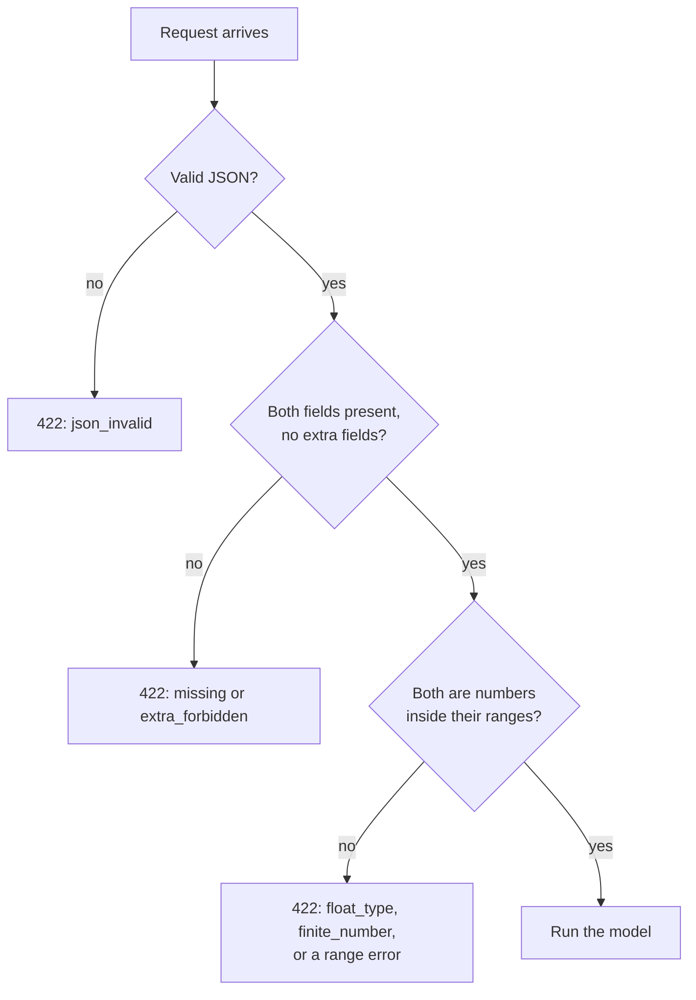

---
hide:
  - toc
---

# Phase 3 Implementation: Local Prediction API

This page explains how the Phase 3 service works and how to run it on your own computer. The service takes two numbers about a game and returns the model's pick and the home team's chance of winning, as JSON. For the short version, see the [Brief](./brief.md).

**Status: built and tested.** The code is in `src/api/app.py` and `src/api/schemas.py`, and the tests are in `tests/test_api.py`. Every request and response shown below was produced by the running service. The full test suite passes with 47 tests: the 30 from earlier phases and 17 new ones.

## How Do I Run It Locally?

### What Is Needed First?

| Need | How to check or get it |
| :--- | :--- |
| Python 3.13 and the project's virtual environment | See the [run environment](../phase-1/implementation.md#what-is-the-run-environment). |
| The pinned packages | `pip install -r requirements.txt` |
| The saved model `models/model.joblib` | `python -m src.model.train`. The file is not committed, so a fresh checkout needs this step. |

No AWS account, no internet connection, and no Docker are needed.

### Step 1: Open the Project and Activate the Environment

From the project folder, activate the virtual environment so that `python` is the project's Python:

```bash
source .venv/bin/activate
```

Install the packages if this is a new checkout:

```bash
pip install -r requirements.txt
```

Train the model if `models/model.joblib` does not exist:

```bash
python -m src.model.train
```

### Step 2: Start the Service

```bash
python -m uvicorn src.api.app:app --port 8000
```

[`uvicorn`](https://uvicorn.dev/) is the program that runs the service. See [What Is uvicorn?](#what-is-uvicorn) below. Starting it with `python -m` makes sure the one in the project's environment is used, even if the shell cannot find a bare `uvicorn` command.

When the service is ready, the terminal prints these lines and then waits:

```text
INFO:     Started server process [32104]
INFO:     Waiting for application startup.
INFO:     Application startup complete.
INFO:     Uvicorn running on http://127.0.0.1:8000 (Press CTRL+C to quit)
```

- **The terminal stays busy.** The service runs until you stop it. Open a second terminal for the `curl` commands below.
- **Only this computer can reach it.** The address `127.0.0.1` means "this machine", so nobody else on your network can connect.
- **Each request is logged** in that terminal, for example `POST /predict HTTP/1.1" 200 OK`.
- **Port already in use?** If the terminal says `address already in use`, another program owns port 8000. `mkdocs serve` uses port 8000 by default. Either stop that program, or start this service on another port, such as `--port 8001`, and use that port in every command below.

### Step 3: Check That It Is Running

In the second terminal:

```bash
curl http://127.0.0.1:8000/health
```

```json
{"status":"ok","model_version":"v1.0","scikit_learn_version":"1.9.1"}
```

### Step 4: Stop the Service

Press `Ctrl+C` in the terminal where it is running. It prints `Shutting down` and exits.

## How Do I Ask for a Prediction?

### What Are the Two Numbers?

The model uses two numbers, both measured **before** the game from the games already played earlier in the same season. Each one is the home team's value minus the away team's value.

| Field | How to work it out | Allowed range |
| :--- | :--- | :--- |
| `win_pct_differential` | Home team win percentage minus away team win percentage. A 6-2 team is 0.75, and a 4-4 team is 0.50, so the difference is 0.25. | -1 to 1 |
| `point_diff_per_game_differential` | Home team points scored minus points allowed per game, minus the same figure for the away team. A team that is +8.0 per game against a team that is -2.0 per game gives 10.0. | -100 to 100 |

- **A positive number favors the home team.**
- **Week 1:** no team has played yet, so both numbers are 0.
- **Whole numbers are fine,** for example `0` and `5`. Numbers written as text, such as `"0.5"`, are rejected.
- **The range for the second field is a loose guard.** The real data runs from about -49 to 39.
- The inputs are explained further in [Phase 2 Part 1](../phase-2/implementation-part-1.md).

### Example 1: A Game Where the Away Team Is Stronger

This is game `2025_07_NE_TEN`: the home team (Tennessee) is weaker on both numbers.

```bash
curl -X POST http://127.0.0.1:8000/predict -H "Content-Type: application/json" -d '{"win_pct_differential": -0.5, "point_diff_per_game_differential": -18.0}'
```

```json
{"prediction":0,"predicted_label":"away win","home_win_probability":0.3296,"model_version":"v1.0"}
```

The model gives the home team a **32.96%** chance, which is below 50%, so the pick is an away win. New England won this game, so the pick was correct. This is the same game worked by hand in [Part 2](../phase-2/implementation-part-2.md#what-is-a-worked-example).

What the pieces of the command mean:

| Part | What it does |
| :--- | :--- |
| `-X POST` | Sends a POST request, which is what `/predict` accepts. |
| `-H "Content-Type: application/json"` | Tells the service that the body is JSON. |
| `-d '{...}'` | The body: the two numbers, as JSON. Single quotes outside, double quotes inside. |
| `http://127.0.0.1:8000/predict` | This computer, port 8000, the `/predict` route. |

### Example 2: Two Evenly Matched Teams

```bash
curl -X POST http://127.0.0.1:8000/predict -H "Content-Type: application/json" -d '{"win_pct_differential": 0, "point_diff_per_game_differential": 0}'
```

```json
{"prediction":1,"predicted_label":"home win","home_win_probability":0.5364,"model_version":"v1.0"}
```

With no difference between the teams, the model still gives the home team a **53.64%** chance. This is the home-field edge the model learned. See [Part 2](../phase-2/implementation-part-2.md#what-does-the-fit-learn).

### Example 3: The Home Team Is Stronger

A home team that is 6-2 against a 4-4 away team (0.25), and +10.0 points per game better:

```bash
curl -X POST http://127.0.0.1:8000/predict -H "Content-Type: application/json" -d '{"win_pct_differential": 0.25, "point_diff_per_game_differential": 10.0}'
```

```json
{"prediction":1,"predicted_label":"home win","home_win_probability":0.6467,"model_version":"v1.0"}
```

The model gives the home team a **64.67%** chance, and the pick is a home win.

### Showing the Status Code

Add `-w` to print the HTTP status code after the body, and `-s` to hide curl's progress meter:

```bash
curl -s -w "\nHTTP %{http_code}\n" -X POST http://127.0.0.1:8000/predict -H "Content-Type: application/json" -d '{"win_pct_differential": -0.5, "point_diff_per_game_differential": -18.0}'
```

```text
{"prediction":0,"predicted_label":"away win","home_win_probability":0.3296,"model_version":"v1.0"}
HTTP 200
```

To print the JSON on several lines, pipe it through Python's formatter. This is one command with two parts, so it stays in one block:

```bash
curl -s -X POST http://127.0.0.1:8000/predict -H "Content-Type: application/json" -d '{"win_pct_differential": -0.5, "point_diff_per_game_differential": -18.0}' | python -m json.tool
```

### What Is in the Response?

| Field | Type | What it means |
| :--- | :--- | :--- |
| `prediction` | whole number, 1 or 0 | 1 is a home win and 0 is an away win. A probability above 0.5 gives 1, and exactly 0.5 gives 0, the same rule as scoring in [Part 2](../phase-2/implementation-part-2.md#how-is-a-game-scored). |
| `predicted_label` | text | The same pick in words: `home win` or `away win`. |
| `home_win_probability` | decimal number, 0 to 1 | The model's chance that the home team wins, rounded to 4 places. The pick is made from the unrounded value. |
| `model_version` | text | The `model.version` setting that was saved with the model (`v1.0`). |

## What Happens With Bad Input?

A request that fails a check gets status **422** and a JSON error that names the problem. The model is never called. Each example below was sent to the running service.

### Reading an Error

```json
{"detail":[{"type":"less_than_equal","loc":["body","win_pct_differential"],"msg":"Input should be less than or equal to 1","input":1.5,"ctx":{"le":1.0}}]}
```

| Part | What it tells you |
| :--- | :--- |
| `detail` | A list with one entry for each problem. A request with two problems has two entries. |
| `type` | A short code for the kind of problem. |
| `loc` | Where the problem is: `body`, then the field name. |
| `msg` | A plain sentence about the problem. |
| `input` | The value that was sent. |
| `ctx` | Extra detail, such as the limit that was exceeded. |

### Error Examples

**A value out of range, and a missing field.** This one request has two problems:

```bash
curl -s -w "\nHTTP %{http_code}\n" -X POST http://127.0.0.1:8000/predict -H "Content-Type: application/json" -d '{"win_pct_differential": 1.5}'
```

```text
{"detail":[{"type":"less_than_equal","loc":["body","win_pct_differential"],"msg":"Input should be less than or equal to 1","input":1.5,"ctx":{"le":1.0}},{"type":"missing","loc":["body","point_diff_per_game_differential"],"msg":"Field required","input":{"win_pct_differential":1.5}}]}
HTTP 422
```

**An extra field.** A misspelled or unknown name is refused, not ignored:

```bash
curl -s -w "\nHTTP %{http_code}\n" -X POST http://127.0.0.1:8000/predict -H "Content-Type: application/json" -d '{"win_pct_differential": 0.1, "point_diff_per_game_differential": 1.0, "week": 3}'
```

```text
{"detail":[{"type":"extra_forbidden","loc":["body","week"],"msg":"Extra inputs are not permitted","input":3}]}
HTTP 422
```

**A number written as text:**

```bash
curl -s -w "\nHTTP %{http_code}\n" -X POST http://127.0.0.1:8000/predict -H "Content-Type: application/json" -d '{"win_pct_differential": "0.5", "point_diff_per_game_differential": 1.0}'
```

```text
{"detail":[{"type":"float_type","loc":["body","win_pct_differential"],"msg":"Input should be a valid number","input":"0.5"}]}
HTTP 422
```

**Not a number (`NaN`):** standard JSON has no `NaN`, but some tools write it. It is refused:

```bash
curl -s -w "\nHTTP %{http_code}\n" -X POST http://127.0.0.1:8000/predict -H "Content-Type: application/json" -d '{"win_pct_differential": NaN, "point_diff_per_game_differential": 1.0}'
```

```text
{"detail":[{"type":"finite_number","loc":["body","win_pct_differential"],"msg":"Input should be a finite number","input":"NaN"}]}
HTTP 422
```

The `input` shows `"NaN"` as text. FastAPI cannot write a real `NaN` into a JSON response, so the service has its own error handler that swaps it for the string. See [Step 5](#step-5-reject-bad-input-clearly).

**A body that is not JSON:**

```bash
curl -s -w "\nHTTP %{http_code}\n" -X POST http://127.0.0.1:8000/predict -H "Content-Type: application/json" -d 'not json'
```

```text
{"detail":[{"type":"json_invalid","loc":["body",0],"msg":"JSON decode error","input":{},"ctx":{"error":"Expecting value"}}]}
HTTP 422
```

### Summary of Rejections

| Request problem | Status | `type` in the error |
| :--- | :--- | :--- |
| A field is missing | 422 | `missing` |
| An unknown field is added | 422 | `extra_forbidden` |
| A value is text, or a true/false | 422 | `float_type` |
| A value is outside its range | 422 | `less_than_equal` or `greater_than_equal` |
| A value is `NaN` or infinity | 422 | `finite_number` |
| The body is not valid JSON | 422 | `json_invalid` |

## How Can I Try It in a Browser?

FastAPI serves a test page, so no `curl` is needed. With the service running, open <http://127.0.0.1:8000/docs>.

1. Click `POST /predict` to open it.
2. Click **Try it out**.
3. Edit the JSON in the box. It starts with an example of the right shape.
4. Click **Execute**. The page shows the status code and the response body, and the `curl` command it sent.

The same page lists `GET /health`, and shows the field descriptions and the allowed ranges. The machine-readable description of the service is at <http://127.0.0.1:8000/openapi.json>. Both pages returned status 200.

## What Is uvicorn?

A FastAPI app is only a Python object. It does not listen for requests by itself, so something has to run it. [`uvicorn`](https://uvicorn.dev/) is that program (a web server). It opens a port on your computer, receives each HTTP request, passes it to the app, and sends the app's answer back to the caller. The two talk through [ASGI](https://asgi.readthedocs.io/en/latest/), the standard interface between Python web servers and web apps. See the [Glossary](../glossary.md#phase-3-local-prediction-api) for the short definition, and the [uvicorn documentation](https://uvicorn.dev/) for its options.

- **Only for the laptop.** `uvicorn` runs the service in Phase 3. On AWS Lambda there is no port to listen on, so it is not used there and is left out of the Lambda zip. Mangum takes its place. See [What Is Mangum?](../remaining-phases.md#what-is-mangum).
- **It is not part of the API's logic.** The routes, the input checks, and the model call are all in the FastAPI app. Swapping `uvicorn` for another server would not change an answer.

| Part of the command | What it means |
| :--- | :--- |
| `python -m uvicorn` | Run the `uvicorn` installed in the active environment. |
| `src.api.app:app` | Import the module `src/api/app.py` and run the object named `app` inside it. The part before the colon is the file, and the part after is the variable. |
| `--port 8000` | Listen on port 8000. With no `--host`, it listens only on this computer. |

## How Does the Service Work?

### How Does It Start?

The model file is read once, in the app's start-up step, and kept in memory. Every request after that reuses it.



### How Is a Request Answered?



## Which Files Were Added?

| File | What it holds |
| :--- | :--- |
| `src/api/app.py` | The `app` object, `create_app`, the start-up step (`load_model`), the 0.5 rule (`label_for`), and the two routes. |
| `src/api/schemas.py` | The three JSON shapes: `PredictRequest`, `PredictResponse`, and `HealthResponse`. |
| `tests/test_api.py` | 17 tests for both routes, the start-up checks, and the no-pandas rule. |
| `requirements.txt` | One new pinned line, `httpx2==2.16.2`, used only by the tests. |

- **No new settings.** The service reuses `model.output_path` from `config/config.yaml`. The host and port are given on the command line.
- **`httpx2` is test-only.** FastAPI's test client calls the app through it, and the installed Starlette asks for `httpx2` and prints a warning with the older `httpx`. It is not needed in the Lambda zip. It brought in two helper packages, `httpcore2` and `truststore`, which are left unpinned like the project's other indirect packages.
- **No `__init__.py` files,** matching the rest of the project.

## Step 1: Load the Saved Model at Start-Up

!!! abstract "Purpose"
    **Goal:** Read `models/model.joblib` once, check it, and keep it in memory.

    **Why:** Loading on every request would be slow, and a model saved by a different scikit-learn version may fail to load or answer differently. Failing at start-up is clearer than failing on the first request.

    **If skipped:** A missing or mismatched model would show up as an error in the middle of a request.

- **Where the path comes from:** `model.output_path` in `config/config.yaml`, turned into a full path with `resolve_path` from `src/config.py`. That function finds the project folder from the code's own location, so the same path works from any folder, and in the Lambda zip in Phase 4.
- **What is in the file:** a dictionary with `pipeline`, `feature_names`, `model_version`, `scikit_learn_version`, `train_start_season`, and `train_end_season`. See [Step 7 of Phase 2](../phase-2/implementation-part-2.md#what-is-saved).
- **Where the model lives:** in the app's start-up step (FastAPI's `lifespan`), stored on `app.state`. The routes read it from there. Importing `src/api/app.py` builds the app but does not read the file.
- **Why start-up and not import time:** the tests build the app without a real model file, and Lambda (in Phase 4) runs the start-up step once per cold start through Mangum. See [What Is Mangum?](../remaining-phases.md#what-is-mangum).
- **Checks, in this order:** the file exists, it loads, it holds the four keys the API needs (`pipeline`, `feature_names`, `model_version`, `scikit_learn_version`), the scikit-learn version matches, and the saved input names match the request fields.

If any check fails, the service refuses to start, and `uvicorn` prints a traceback that ends with one of these messages (the `RuntimeError` line):

| Problem | Message |
| :--- | :--- |
| The file is missing | `No saved model at models/model.joblib. Run python -m src.model.train first.` |
| The file cannot be read, or is not a dictionary, or lacks a key | `Could not read the saved model at models/model.joblib: <reason>. Run python -m src.model.train to rebuild it.` |
| Saved scikit-learn version differs | `Saved model was built with scikit-learn <saved> but <installed> is installed. Retrain with python -m src.model.train, or install scikit-learn==<saved>.` |
| The saved input names are not the two request fields | `Could not read the saved model at models/model.joblib: input names [...] do not match the API fields.` |

The real output when the model file is missing ends like this, and the process exits with code 3:

```text
RuntimeError: No saved model at models/model.joblib. Run python -m src.model.train first.

ERROR:    Application startup failed. Exiting.
```

## Step 2: Define the Request and the Response

!!! abstract "Purpose"
    **Goal:** Describe the exact JSON the service accepts and returns, in one place.

    **Why:** One definition gives the input checks, the error messages, and the `/docs` test page together.

    **If skipped:** The checks would be written by hand in each route.

The request, from `src/api/schemas.py`:

```python
class PredictRequest(BaseModel):
    """The two pre-game numbers. Extra fields are refused so a typo is not ignored."""

    model_config = ConfigDict(extra="forbid", strict=True)

    win_pct_differential: float = Field(ge=-1, le=1, allow_inf_nan=False, ...)
    # A loose guard, because the real data runs about -49 to 39.
    point_diff_per_game_differential: float = Field(ge=-100, le=100, allow_inf_nan=False, ...)
```

- **`extra="forbid"`** refuses unknown fields.
- **`strict=True`** refuses numbers written as text, and true or false, in place of numbers. Whole numbers such as `0` are still accepted.
- **`allow_inf_nan=False`** refuses `NaN` and infinity.
- **The field names match the model's input names** (`INPUT_COLUMNS` in `src/model/features.py`), but the API does not import that file. At start-up it checks that the names saved in the model file are the same as the two request fields.

The response has four fields (`prediction`, `predicted_label`, `home_win_probability`, `model_version`), described in [What Is in the Response?](#what-is-in-the-response). The health response has three (`status`, `model_version`, `scikit_learn_version`).

## Step 3: Add the `POST /predict` Route

!!! abstract "Purpose"
    **Goal:** Turn a valid request into a prediction.

    **Why:** This is the route the web app calls.

    **If skipped:** There would be no way to ask the model a question.

```python
@app.post("/predict", response_model=PredictResponse, summary="Predict which team wins.")
def predict(request: PredictRequest) -> PredictResponse:
    """Score one game from the two numbers, in the order saved with the model."""
    saved = app.state.model
    row = np.array([[getattr(request, name) for name in saved["feature_names"]]], dtype=float)
    # The scaler was fitted on a table with column names, and this call passes a plain array
    # so the service does not import pandas. The probability is the same either way.
    with warnings.catch_warnings():
        warnings.filterwarnings("ignore", message=r"X does not have valid feature names", category=UserWarning)
        probability = float(saved["pipeline"].predict_proba(row)[0, 1])
    prediction, predicted_label = label_for(probability)
    return PredictResponse(
        prediction=prediction,
        predicted_label=predicted_label,
        home_win_probability=round(probability, 4),
        model_version=saved["model_version"],
    )
```

1. FastAPI checks the request against `PredictRequest` before the route code runs.
2. The route looks up each saved input name on the request and builds a numpy array with one row and two columns, **in the order of `feature_names` from the model file.** The order of the fields in the JSON does not matter.
3. The route calls `predict_proba` and takes the probability of class 1 (a home win).
4. `label_for` applies the 0.5 rule: above 0.5 is `(1, "home win")`, and anything else, including exactly 0.5, is `(0, "away win")`. It is applied to the unrounded probability.
5. The response rounds the probability to 4 places.

### Why Does the API Use NumPy Instead of pandas?

The API uses [NumPy](https://numpy.org/doc/stable/) only. It does not use [pandas](https://pandas.pydata.org/docs/), although training and cleaning do. The two numbers go to the model as a NumPy array and not as a pandas table (a DataFrame).

- **The Lambda zip fits only without `pandas`.** It is 231.3 MB without it and 278.4 MB with it, against a 250 MB limit. See the [Package Size Check](../phase-4/package-size-check.md).
- **`src/model/features.py` imports `pandas` at the top,** so no file in `src/api/` may import from it. The input names come from the model file instead.
- **One warning is expected.** The scaler was fitted on a table with column names, so a plain array makes scikit-learn warn that "X does not have valid feature names". The probability is the same. The route silences this one warning and no others.
- **The answer is unchanged.** With only NumPy installed, the inputs -0.5 and -18.0 give 0.3296, matching [Part 2](../phase-2/implementation-part-2.md#what-is-a-worked-example).

## Step 4: Add the `GET /health` Route

!!! abstract "Purpose"
    **Goal:** Report that the service is running and which model it loaded.

    **Why:** It is the quickest way to check a running service, and it shows which model version is answering.

    **If skipped:** A person could not tell a running service from a stopped one without sending a real prediction.

The response is `{"status":"ok","model_version":"v1.0","scikit_learn_version":"1.9.1"}`. The route reads only from memory. It does not open the file or call the model. The `scikit_learn_version` is the one saved in the model file, and start-up has already checked that it equals the installed one.

## Step 5: Reject Bad Input Clearly

!!! abstract "Purpose"
    **Goal:** Make every bad request return an error that names the problem, and never a prediction or a crash.

    **Why:** The web app and a person with `curl` both need to see what to fix.

    **If skipped:** A bad value could reach the model and return a meaningless probability.



The checks all come from the request definition in Step 2, and FastAPI answers a failed check with status 422. One piece of extra code was needed. When a value is `NaN`, the error body would contain a real `NaN`, which JSON cannot hold, and FastAPI crashed while writing the 422. The service has its own handler for these errors (`reject_invalid_request` in `src/api/app.py`) that replaces a non-finite number with the text `"NaN"` or `"Infinity"` and then sends the 422. Real examples are shown in [Error Examples](#error-examples).

## Step 6: Run the Tests

!!! abstract "Purpose"
    **Goal:** Check both routes, the start-up checks, and the no-pandas rule, without a real saved model or the internet.

    **Why:** The tests keep the Lambda size result and the input rules from breaking later.

    **If skipped:** A change could pass unnoticed until the deployed function failed.

```bash
python -m pytest
```

Expected: **47 passed**, with no warnings, in about 11 seconds. Without `models/model.joblib`, test 17 is skipped instead, and 46 pass.

- **Made-up model.** A fixture fits a tiny pipeline on 40 made-up rows (fixed random seed), saves it in the same dictionary format that training writes, and points the service at it. The tests never touch `models/model.joblib`, except test 17.
- **In-memory calls.** FastAPI's test client calls the app without starting a server. It is used as a context manager (`with TestClient(app)`), because that is what runs the start-up step.

| # | Test | What it checks |
| :--- | :--- | :--- |
| 1 | `test_prediction_matches_the_pipeline` | The probability from `/predict` equals the pipeline's own answer, rounded to 4 places. |
| 2 | `test_pick_rule` | `label_for` gives an away win for 0.0, 0.4999, and exactly 0.5, and a home win for 0.5001 and 1.0. |
| 3 | `test_response_fields` | The response has the four fields with the right types, and whole-number inputs are accepted. |
| 4 | `test_field_order_does_not_change_the_answer` | The same two values with the JSON fields in the opposite order give the same response. |
| 5 | `test_missing_field_is_rejected` | Status 422, and the error names the missing field. |
| 6 | `test_extra_field_is_rejected` | Status 422, and the error names the extra field. |
| 7 | `test_text_value_is_rejected` | Both `"abc"` and `"0.5"` give 422. |
| 8 | `test_out_of_range_value_is_rejected` | 1.5 and 500 are rejected and name the field, and the edge values 1 and -100 are accepted. |
| 9 | `test_not_a_number_is_rejected` | A body containing `NaN` gives 422. |
| 10 | `test_invalid_json_is_rejected` | A body that is not valid JSON gives 422. |
| 11 | `test_health` | Status 200, with the three expected fields. |
| 12 | `test_missing_model_file_stops_startup` | Start-up raises an error that says to run the training command. |
| 13 | `test_unreadable_model_file_stops_startup` | A file holding plain text stops start-up with "Could not read the saved model". |
| 14 | `test_version_mismatch_stops_startup` | A saved scikit-learn version of `0.0.0` stops start-up and names both versions. |
| 15 | `test_wrong_feature_names_stop_startup` | Saved input names that are not the two request fields stop start-up. |
| 16 | `test_api_files_do_not_import_pandas` | The API files are read as text and checked: none imports `pandas`, `mlflow`, `matplotlib`, or anything from `src/model/`. Checking `sys.modules` would not work, because scikit-learn loads `pandas` on its own when it is installed. |
| 17 | `test_real_model_worked_example` | With the real model, the inputs -0.5 and -18.0 return the exact response shown in Example 1. Skipped if `models/model.joblib` does not exist. |

## What If Something Goes Wrong?

| What you see | Likely cause | What to do |
| :--- | :--- | :--- |
| `command not found: uvicorn` | The virtual environment is not active, or the shell has no `uvicorn` command. | Run `source .venv/bin/activate`, and start the service with `python -m uvicorn ...`. |
| `address already in use` | Another program, often `mkdocs serve`, owns port 8000. | Stop it, or use `--port 8001` here and in every `curl` command. |
| `RuntimeError: No saved model at models/model.joblib` | The model has not been trained on this machine. | Run `python -m src.model.train`. |
| `RuntimeError: Saved model was built with scikit-learn ...` | The installed scikit-learn differs from the one that trained the model. | Run `pip install -r requirements.txt`, or retrain. |
| `curl: (7) Failed to connect` | The service is not running, or is on another port. | Check the first terminal, and check the port in the command. |
| Status 422 | The request failed an input check. | Read `loc` and `msg` in the error. See [Reading an Error](#reading-an-error). |
| Status 404 | The path is wrong. | The routes are `/predict` and `/health`. `/predict` needs `POST`. |
| Status 405 | `GET` was sent to `/predict`. | Add `-X POST` and a body. |

## What Carries Into Phase 4?

- **The same `app` object** is wrapped by Mangum in Phase 4, so the local tests cover the code that runs on Lambda.
- **The no-pandas rule** keeps the Lambda zip under its size limit.
- **The start-up step** runs once per cold start on Lambda, so the model loads once and is reused.
- **The folder layout** (`src/`, `config/`, `models/`) must stay the same inside the zip, so `resolve_path` finds the same files.
