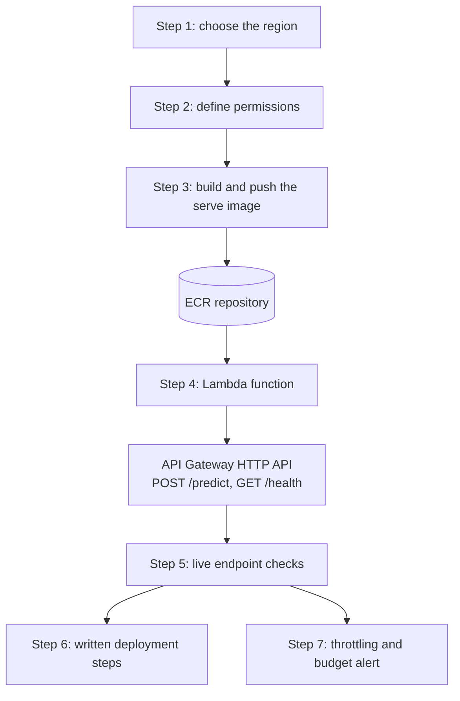
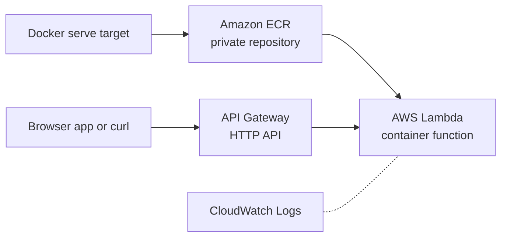

---
hide:
  - toc
---

# Phase 4: AWS Deployment

This phase publishes the serving image from [Phase 3](./phase-3-api-and-docker.md) on AWS so that anyone can send a prediction request to a public web address. The image is stored in Amazon ECR, run by AWS Lambda, and exposed through an API Gateway HTTP API.

This page owns the AWS region, permissions, resource settings, live checks, and cost limits. The S3 bucket was created for [Phase 1](./phase-1-data-and-features.md#step-2-upload-the-cleaned-table-to-s3), so its permissions are covered here.

## Phase Architecture

### Flow of Steps

### Inventory

| Item | Kind | Planned location | Built in | What it does |
| :--- | :--- | :--- | :--- | :--- |
| Region choice | Decision | `config.yaml` and the deployment commands | Step 1 | Puts every resource in one region. |
| Access for data work | AWS permissions | One IAM identity or policy | Step 2 | Reads and writes the project data bucket only. |
| Access for deployment | AWS permissions | One IAM identity or policy | Step 2 | Pushes the image, manages the function and gateway, and publishes the web app. |
| Lambda execution role | AWS permissions | One IAM role | Step 2 | Lets the running function write logs and nothing else. |
| ECR repository and image | AWS resource | Private repository in the chosen region | Step 3 | Stores the serve image, tagged with the model version. |
| Lambda function | AWS resource | One container function | Step 4 | Runs the serve image. |
| API Gateway HTTP API | AWS resource | One API with two routes | Step 4 | Gives the function a public address and applies the CORS rules and throttling. |
| Log group | AWS resource | CloudWatch Logs | Step 4 | Records each request and any error. |
| Live checks | Test steps | Run with `curl` | Step 5 | Prove the public endpoint works and behaves like the local one. |
| Deployment commands | Documentation | README | Step 6 | Let the deployment be repeated by hand. |
| Budget alert and throttle limits | AWS settings | AWS Budgets and the gateway stage | Step 7 | Limit what a public, keyless route can cost. |

## Which Requirements and Gaps Does It Cover?

- Requirement 7: Lambda behind API Gateway, with a public `/predict` that answers test requests.
- Region, permissions, and CORS: picks the region, defines permissions, and sets the CORS rules that the browser-based web app needs.
- The `deploy.yml` file from the first draft: decides what to do about it.
- Public route without a key: states how it is limited.

## How Do the Pieces Connect?

## Step 1: Choose the AWS Region

!!! abstract "Purpose"
    **Goal:** Pick one AWS region and use it for every resource in the project.

    **Why:** A Lambda function can only use a container image stored in an ECR repository in the same region. A storage bucket also cannot be moved to another region without copying all of its data.

    **If skipped:** Resources created in different regions would not work together, and fixing that would mean recreating them.

All resources use one region, so the bucket, the image repository, and the function sit together and no data crosses regions.

| Item | Design |
| :--- | :--- |
| Proposed region | `us-east-1` (US East, N. Virginia) |
| Why | It is the default for most tutorials and has the widest service availability. Any region that offers S3, ECR, Lambda, and API Gateway works. |
| Where it is stored | The region is a setting in `config.yaml` and in the deployment commands. It is not written into code. |

!!! note "Confirm: region"
    Choose a region before creating the S3 bucket in Phase 1, because moving a bucket later means copying the data. If a region closer to the users matters more than convenience, pick that region instead.

## Step 2: Define the Permissions

!!! abstract "Purpose"
    **Goal:** Create three sets of AWS permissions, each limited to one job: reading and writing the data bucket, deploying the project, and letting the running function write logs.

    **Why:** Access keys can leak or be misused. When each identity can do only its own job, a leaked data key cannot delete the Lambda function, and the running function cannot read the bucket.

    **If skipped:** One all-powerful key would exist. A single leak would give a stranger control of the whole AWS account.

The project uses three separate sets of permissions. None of them is the account's root login.

| Identity | Used for | Allowed actions |
| :--- | :--- | :--- |
| Developer credentials for data | Phase 1 upload and download, Phase 2 training | Read and write objects in the one project bucket, and list that bucket. |
| Developer credentials for deployment | Pushing the image, creating or updating the function and gateway, and publishing the web app in [Phase 5](./phase-5-front-end-and-documentation.md#step-5-host-the-app) | Push and pull images in the one ECR repository. Create and update the one Lambda function. Create and update the one HTTP API. Create the function's log group. Write objects to the one web app bucket. Create cache invalidations on the one CloudFront distribution. |
| Lambda execution role | The running function | Write logs only. The function needs no S3 access, because the model file is inside the image. |

The two developer sets can be one IAM user or role with two attached policies. The point is that no identity has wider access than its job needs. The access keys are stored in the standard AWS credential files or a named profile. They are never committed, never put in an image, and never pasted into a README.

## Step 3: Build and Push the Image

!!! abstract "Purpose"
    **Goal:** Build the `serve` image and upload it to a private Amazon ECR repository, tagged with the model version.

    **Why:** Lambda can only run container images that are stored in ECR. The tag, for example `v1.0`, shows which trained model is inside the image.

    **If skipped:** Lambda would have no image to run. Without the tag, you could not tell which model a deployed image holds.

| Item | Design |
| :--- | :--- |
| Repository | One private ECR repository in the chosen region. |
| Image tag | The model version label from `config.yaml`, for example `v1.0`, so each deployed image can be traced to a trained model. |
| Processor type | This Mac builds `arm64` images by default. The Lambda function is created with the `arm64` architecture to match. If the image is built for `amd64` instead, the function must use `x86_64`. A mismatch makes the function fail to start. |
| Authentication | The deploy step logs the container tool in to ECR with a short-lived token from the AWS command line. |
| Source | The `serve` target from Phase 3, built after training has written the model file. |

## Step 4: Create the Function and the Gateway

!!! abstract "Purpose"
    **Goal:** Create a Lambda function from the image, and create an API Gateway HTTP API with the routes `POST /predict` and `GET /health` that send requests to the function.

    **Why:** A Lambda function has no public web address of its own. API Gateway provides the address. Requirement 7 says `/predict` must be reachable publicly.

    **If skipped:** The model would be deployed, but nobody on the internet could reach it.

### Lambda Function Settings

| Setting | Proposed value | Reason |
| :--- | :--- | :--- |
| Package type | Container image from ECR | The assignment asks for a container, and the serving image is already built. |
| Architecture | `arm64` | Matches the image built on this Mac. |
| Memory | 1024 MB | Loading scikit-learn needs more than the smallest sizes. Lambda gives more processor speed with more memory. |
| Timeout | 15 seconds | A cold start loads the model before the first answer. |
| Environment variables | None | The model is in the image and no secrets are needed. |
| Execution role | Logs only, from Step 2 | Least privilege. |

These values are starting points. Step 5 measures the real cold-start time, and the values are adjusted if it comes close to the timeout.

### API Gateway Settings

| Setting | Design |
| :--- | :--- |
| API type | HTTP API (version 2 payload format), which Mangum supports. |
| Routes | `POST /predict` and `GET /health`, both integrated with the one Lambda function. |
| Stage | One default stage with automatic deployment. |
| Throttling | A request-rate limit and a burst limit on the stage. Proposed: 5 requests per second with a burst of 10. |
| Authentication | None. The route is public, as the first draft stated. |
| CORS | Required, because the web app runs in the user's browser at a different address than the API. Allowed origins: the CloudFront address of the web app and the local Vite development server address (`http://localhost:5173` by default). Allowed methods: `POST`, `GET`, and `OPTIONS`. Allowed header: `Content-Type`. The rules are set on the gateway only, and the FastAPI app adds no CORS headers, so the browser never receives duplicates. The CloudFront address does not exist until Phase 5 creates the distribution, so the first deployment allows only the local address, and Phase 5 adds the CloudFront address. |

## Step 5: Check the Live Endpoint

!!! abstract "Purpose"
    **Goal:** Send real requests to the public address with `curl`: a valid prediction request, a bad request, a health request, and a request that tests the CORS rules.

    **Why:** Requirement 7 asks for proof that the deployed endpoint answers a test request correctly. Some problems appear only after deployment: a wrong processor architecture, a timeout on the first start, or a missing permission.

    **If skipped:** You would not know whether the deployment works until the web app fails in front of a user.

Requirement 7 asks for a valid response to an HTTP request with test data. These checks run against the public URL with `curl`.

| Check | Pass condition |
| :--- | :--- |
| Valid request | `POST /predict` with the sample body returns 200 and all four response fields. |
| Same answer as local | The probability matches the local Phase 3 result for the same body, within rounding to three decimals. |
| Health | `GET /health` returns the model version that was deployed. |
| Bad input | A body with a missing field returns 422. |
| Browser preflight | An `OPTIONS` request with an `Origin` header set to an allowed address returns the CORS headers. A request from an address that is not on the list does not. |
| Cold and warm timing | The first request after a long idle gap and a following request are timed and written down. The cold time stays well below the 15 second timeout. |
| Logs | The CloudWatch log group shows the requests and no errors. |

The sample request body and the expected response go in the README so a reader can reproduce the check.

## Step 6: Decide How Deployment Is Repeated

!!! abstract "Purpose"
    **Goal:** Decide whether later deployments are done by written command-line steps in the README, or by an automated GitHub Actions workflow.

    **Why:** The first design draft listed a `deploy.yml` workflow file without describing it, so it was unclear whether the project needs one. The assignment only asks for documentation of how to deploy.

    **If skipped:** The repository could keep a workflow file that looks like deployment automation but was never tested and may not work.

The first draft listed `.github/workflows/deploy.yml`, with no description. This design proposes to drop it.

| Option | Chosen? | Reason |
| :--- | :--- | :--- |
| Written manual steps with AWS command-line commands in the README | **Yes** | The assignment asks for documentation of how to deploy, not an automated pipeline. One person deploys a few times. |
| GitHub Actions workflow that deploys on merge | No | It needs AWS keys stored as repository secrets, adds a way for a mistake to reach the public URL, and takes extra work to test. |

!!! note "Confirm: drop `deploy.yml`"
    If automated deployment is wanted, it becomes an optional extra after Phase 5 and does not block any requirement.

## Step 7: Limit Exposure and Cost

!!! abstract "Purpose"
    **Goal:** Set a limit on requests per second, set a monthly spending alert, and record that the API is intentionally public with no key.

    **Why:** Anyone who finds the address can call the API as often as they like, and AWS bills every call to your account. The assignment does not require a key.

    **If skipped:** A script that calls the API in a loop could run up charges before you notice.

The API is public and has no key. The reasoning for accepting that:

| Question | Answer |
| :--- | :--- |
| What can a caller do? | Send three numbers and receive a probability. Nothing is stored and no personal data is involved. |
| What is the main risk? | Someone sends many requests and raises the AWS bill. |
| How is it limited? | The gateway throttling from Step 4, plus an AWS Budgets alert on the account. A proposed alert level is a small monthly amount with an email at 80% of it. Lambda also has a concurrency setting that can cap how many copies run at once. |
| What happens at the end of the course? | The Lambda function, API, ECR images, web app bucket, CloudFront distribution (disabled first, then deleted), and S3 data bucket are deleted so nothing keeps billing. Check current AWS free-tier terms before relying on them. |

!!! note "Confirm: public route without a key"
    This is acceptable for a coursework prediction service. An API key or a login is not required by the assignment. A key placed in a browser app would be visible to every visitor, so it would not protect anything.

## How Is This Phase Checked?

The checks in Step 5 are the acceptance test. In addition:

| Check | Pass condition |
| :--- | :--- |
| Permissions | A request with the deployment credentials cannot read objects outside the project bucket. |
| No secrets in the repository | A search of the repository and image history finds no AWS keys. |
| Throttle works | A burst of requests above the limit receives 429 responses. |

## What Can Go Wrong?

| Problem | Effect | How it shows up |
| :--- | :--- | :--- |
| Image and function architecture differ | The function cannot start. | The function's first invocation fails with an exec format error in the logs. |
| Function times out on a cold start | The first request fails with a timeout. | The cold-timing check in Step 5 fails. Raise the memory or the timeout. |
| Role missing log permission | No logs appear. | The log group is empty after a request. |
| Wrong region in a command | The resource is not found. | A command reports that the repository or function does not exist. |
| CORS origin does not match | The browser blocks the response although `curl` works. | The browser console reports a CORS error. Compare the allowed origin with the address in the address bar, including `https` and any trailing slash. |
| Public URL abused | Unexpected charges. | The budget alert fires. |

## Commit and Pull Request Plan

Most of the work happens in AWS and not in files, so this pull request is small. A sensible grouping into commits:

1. Region setting in `config.yaml`.
2. Deployment commands written as a documented script or README section.
3. Live-check requests and the expected responses.

## What Does Phase 5 Need From This Phase?

The public base URL, the sample request and response, the cold-start timing, and the confirmed list of AWS services used.
