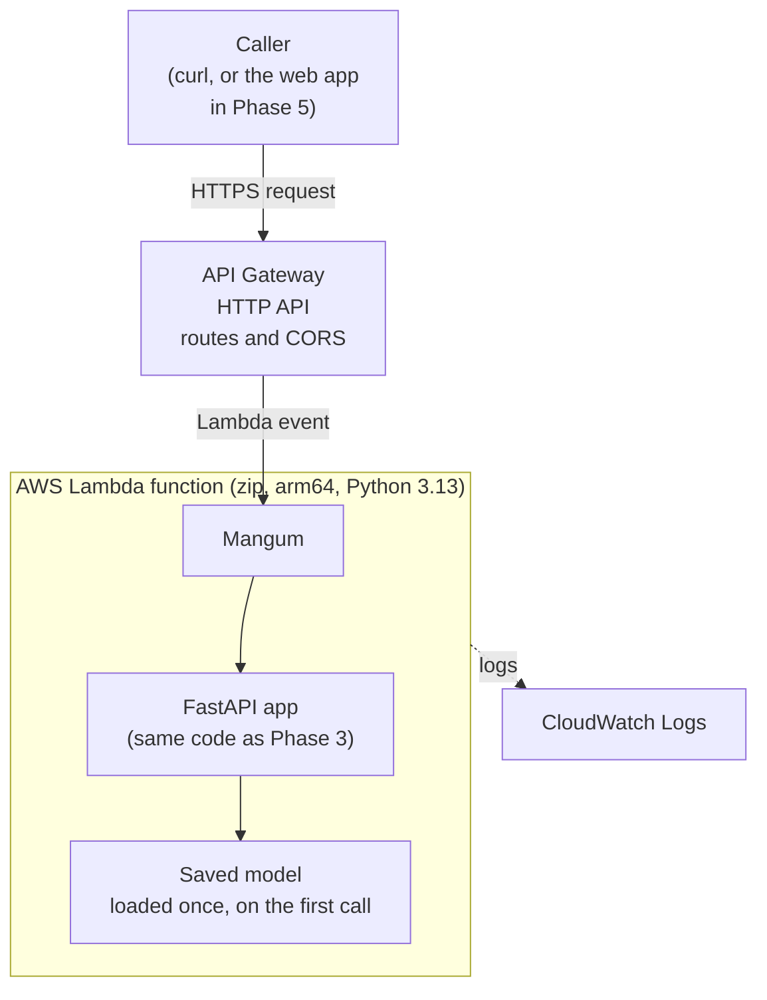
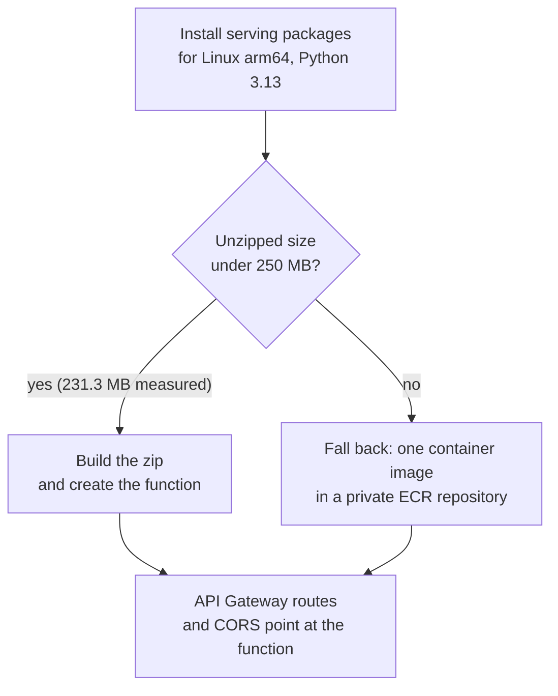

---
hide:
  - toc
---

# Phase 4 Brief: AWS Deployment

**Status: Built and tested.** All 11 steps are done. `pytest` passed 53 tests when the phase was built, and the full suite now has 95 (see the [Development Guide](./development-guide.md#how-do-i-run-all-the-tests)). The API is live at `https://9awodatqc5.execute-api.us-east-1.amazonaws.com`.

**Needs first:** Phase 3, which is built, and a trained model at `models/model.joblib`. Also an AWS account, AWS CLI version 2, and credentials on the machine, as listed in the [run environment](../phase-1/implementation.md#what-is-the-run-environment).

Phase 4 puts the Phase 3 API on the internet. The same FastAPI app runs inside an AWS Lambda function, and an API Gateway address in front of it gives the world a public URL for `POST /predict` and `GET /health`. The worked example sent to that URL returns the same answer as the local service (0.3296), and all 1,759 games give the same answers as the local model. The web app that calls it comes in [Phase 5](../phase-5/brief.md).

## How Do the Pieces Fit Together?

- **API Gateway** receives the request, applies the CORS rules, and calls the function.
- **Mangum** translates between the event Lambda hands the function and the request FastAPI expects. See [What Is Mangum?](./implementation.md#what-is-mangum).
- **The FastAPI app and the model are the Phase 3 code,** so the local tests cover what runs on AWS.

## Steps in Order

- [x] **Step 1. Add the Lambda entry point.** A new file (`src/api/lambda_handler.py`) wraps the app with Mangum. Mangum runs the app's start-up step on every request by default, which would re-read the model each time, so the entry point turns that off and loads the model itself on the first call.
- [x] **Step 2. Test the entry point with no AWS.** Call `handler` with a made-up API Gateway HTTP API event for `POST /predict`. The worked example returns status 200 and a home win probability of 0.3296.
- [x] **Step 3. Measure the package size first.** The serving packages for Linux, `arm64`, and Python 3.13 come to 231.3 MB unzipped without `pandas`, under the 250 MB limit, so the zip route works. See the [Phase 4 Implementation, Step 3](./implementation.md#step-3-measure-the-package-size).
- [x] **Step 4. Build the zip.** It holds the installed serving packages, `src/`, `config/config.yaml`, and `models/model.joblib`, in the same folder layout as the project so every path still resolves. It is 231,252,596 bytes unzipped and 63,452,500 bytes zipped.
- [x] **Step 5. Create the function.** Python 3.13, `arm64`, 1769 MB, a 10-second timeout, one environment variable, and a role that can only write logs.
- [x] **Step 6. Test the function in AWS** with the same made-up event as Step 2.
- [x] **Step 7. Create the API Gateway HTTP API** with the routes `POST /predict` and `GET /health`, both pointing at the function.
- [x] **Step 8. Set CORS on the gateway.** It allows the local web app address. The CloudFront address was added in Phase 5.
- [x] **Step 9. Check the public address** with `curl` and the worked example. It returns the same 0.3296 as the local API.
- [x] **Step 10. Check the deployed model against the local model.** All 1,759 games give the same pick and the same probability, and the accuracy equals the run summary.
- [x] **Step 11. Write the deployment steps down,** so they can be repeated. See [Deployment Guide](./deployment-guide.md).

## Details in Brief

- **Lambda runs from a zip file,** not a container image, so no Docker and no ECR are needed for this phase. The reasons are in [Design Manifest](../design-manifest.md#phase-4-aws-deployment).
- **Serving packages only.** The zip uses a shorter list than `requirements.txt`, in `requirements-serve.txt`: `scikit-learn`, `numpy`, `joblib`, `PyYAML`, `fastapi`, `pydantic`, and `mangum`, plus `scipy`, which `scikit-learn` brings in. `scipy==1.18.1` is pinned in both lists. It leaves out `pandas`, `mlflow`, `matplotlib`, `boto3`, `uvicorn`, and the test packages. Lambda already provides `boto3`, and `uvicorn` is replaced by Mangum.
- **Built for the function's platform.** The packages are installed as Linux `arm64` for Python 3.13, the same chip type and Python version the function uses. The command and what each flag does are in the [Phase 4 Implementation, Step 3](./implementation.md#how-was-the-size-measured).
- **The model is copied into the zip at build time.** It is not committed to git and is not downloaded at start-up. The saved scikit-learn version must equal the one in the zip (1.9.1), or the service refuses to start, as in Phase 3.
- **The zip is larger than the console's upload limit.** It is 63.5 MB zipped, and the console accepts about 50 MB, so the zip was uploaded through S3 (a temporary `deploy/` key in the data bucket, deleted afterward).
- **The function role can only write logs.** Each AWS identity gets only the access its job needs.
- **The API is public, with no key.** A key in a browser app would be visible to every visitor, so it would protect nothing. There is no request limit or firewall for now.
- **Function settings:** 1769 MB of memory, a 10-second timeout, and one environment variable, `JOBLIB_MULTIPROCESSING=0`, which stops a harmless joblib warning. Logs are kept for 14 days. Speed and cost were not goals, so memory is not tuned further. The measurements are in [Phase 4 Implementation, Step 5](./implementation.md#what-is-the-memory-setting).
- **Deployment is a set of written steps** with no `deploy.yml` workflow. They are in the [Deployment Guide](./deployment-guide.md).
- **Settings:** none new in `config/config.yaml`. The Lambda settings live in the deployment steps.

## What If the Zip Is Too Large?

`scikit-learn`, `scipy`, and `numpy` are large, so the zip could have gone over Lambda's 250 MB unzipped limit. Step 3 found out before anything else was built: the zip fits (231.3 MB unzipped) as long as `pandas` is left out. The fall-back is unused. If the package ever grows past the limit, build one container image, store it in a private Amazon ECR repository, and run Lambda from that image. The [Phase 6](../phase-6/brief.md) Dockerfile would be the starting point.

## Choices Made Along the Way

- **Where the zip was staged.** A temporary `deploy/` key in the private data bucket, deleted once the function existed.
- **The serving package list.** A separate pinned list, `requirements-serve.txt`, including `scipy`.
- **Memory.** 1769 MB, left untuned.
- The other Phase 4 choices (zip or container image, no API key, written steps) are in [Design Manifest](../design-manifest.md#phase-4-aws-deployment).

## What Was Created

- **Code:** `src/api/lambda_handler.py` and six tests in `tests/test_lambda_handler.py`.
- **Packaging:** `requirements-serve.txt` and the written build and deploy commands in the [Deployment Guide](./deployment-guide.md).
- **Settings:** one new warning filter in `pytest.ini`, and none in `config/config.yaml`.
- **On AWS:** one Lambda function, one function role (the identity Lambda requires the function to run as, which can only write logs), and one API Gateway HTTP API with two routes. All are in `us-east-1`.
- **Nothing committed that is generated.** The zip and the build folder stay local, and `build/` is already ignored by git.

## What Is Not in This Phase

- The web app and its hosting, in [Phase 5](../phase-5/brief.md).
- Docker, built in [Phase 6](../phase-6/brief.md). The README and the final review come after it, in [Phase 7](../phase-7/brief.md).

## Where to Read More

- [Phase 4 Implementation](./implementation.md) explains each step in detail, including the size measurement (Step 3) and [What Is Mangum?](./implementation.md#what-is-mangum).
- [Development Guide](./development-guide.md) shows how to test the entry point with no AWS account and change it.
- [Deployment Guide](./deployment-guide.md) lists every AWS command in order, including the redeploy and the commands that remove the deployment.
- [Phase 3 Implementation](../phase-3/implementation.md) describes the app and the start-up checks that run on Lambda.
- [Design Manifest](../design-manifest.md#phase-4-aws-deployment) lists the deployment choices and why.
