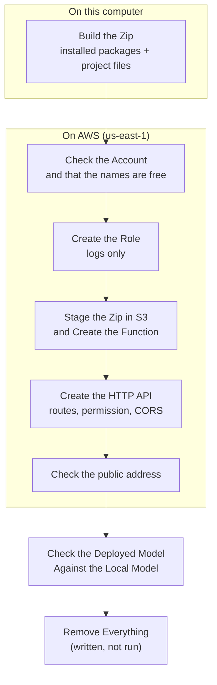

---
hide:
  - toc
---

# Phase 4 Deployment Guide

This guide lists, in order, every command that built and deployed the Phase 4 API, and the commands that remove it again. Each step is explained in the [Phase 4 Implementation](./implementation.md).

## How Do the Sections Fit Together?



- **Build the Zip** runs on this computer and calls no AWS service.
- **Check the Account** confirms the right account and that no resource with a name from this guide exists yet.
- **Create the Role**, **Stage the Zip and Create the Function**, and **Create the HTTP API** create the AWS resources, in that order, because each needs the one before it.
- **Check the Deployed Model Against the Local Model** proves the function runs the zip built here and gives the same answers as the local model.
- **Remove Everything** deletes what this guide created. The commands are written and are not run as part of the deployment.

Run these from the project folder, in order. Resource names stay as written. `<account-id>`, `<api-id>`, and `<integration-id>` stand in for values that differ between accounts.

Why these settings: accuracy is the only requirement for this deployment. Latency and cost are not concerns. Memory is 1769 MB and may be changed if it helps, but it is not a priority. `JOBLIB_MULTIPROCESSING=0` stops a harmless joblib warning about multiprocessing, which Lambda does not provide.

Before the first command:

- AWS CLI 2.35.9 is installed, and the default credentials can reach the account that owns `510-m3-nfl-dataset` in `us-east-1`.
- The project virtual environment is Python 3.13.14.
- `models/model.joblib` exists and was saved by scikit-learn 1.9.1.
- `requirements-serve.txt` and `src/api/lambda_handler.py` exist.

## Build the Zip

1. Remove the previous build folder and zip.

```bash
rm -rf build/lambda build/510-m3-nfl-predict-api.zip
```

2. Install the serving packages for Linux arm64 and Python 3.13.

```bash
.venv/bin/python -m pip install --target build/lambda --implementation cp --python-version 3.13 --platform manylinux_2_28_aarch64 --platform manylinux2014_aarch64 --only-binary=:all: --no-compile -r requirements-serve.txt
```

3. Delete cached bytecode from the build.

```bash
find build/lambda -type d -name __pycache__ -prune -exec rm -rf {} +
```

4. Copy the project files the function imports, keeping the folder layout.

```bash
mkdir -p build/lambda/src/api build/lambda/config build/lambda/models
```

```bash
cp src/config.py build/lambda/src/config.py
```

```bash
cp src/api/app.py src/api/lambda_handler.py src/api/schemas.py build/lambda/src/api/
```

```bash
cp config/config.yaml build/lambda/config/config.yaml
```

```bash
cp models/model.joblib build/lambda/models/model.joblib
```

5. Zip the contents of `build/lambda`, so `src/`, `config/`, and `models/` sit at the top.

```bash
(cd build/lambda && zip -r -q ../510-m3-nfl-predict-api.zip .)
```

## Check the Account

6. Confirm the caller and the data bucket. The bucket command prints nothing when the bucket is reachable.

```bash
aws sts get-caller-identity --region us-east-1
```

```bash
aws s3api head-bucket --bucket 510-m3-nfl-dataset --region us-east-1
```

7. Confirm the names are free. A missing function, role, or zip is the expected result. The API query should print `0`.

```bash
aws lambda get-function --function-name 510-m3-nfl-predict-api --region us-east-1
```

```bash
aws iam get-role --role-name 510-m3-nfl-predict-api-role --region us-east-1
```

```bash
aws apigatewayv2 get-apis --region us-east-1 --query "length(Items[?Name=='510-m3-nfl-predict-http-api'])" --output text
```

```bash
aws s3api head-object --bucket 510-m3-nfl-dataset --key deploy/510-m3-nfl-predict-api.zip --region us-east-1
```

## Create the Role

8. Write the trust policy. It lets only Lambda assume the role. A statement id is omitted because IAM rejects a hyphenated id.

```bash
mkdir -p build
```

```bash
cat > build/trust-policy.json <<'EOF'
{
  "Version": "2012-10-17",
  "Statement": [
    {
      "Effect": "Allow",
      "Principal": {"Service": "lambda.amazonaws.com"},
      "Action": "sts:AssumeRole"
    }
  ]
}
EOF
```

9. Create the role and attach the logs policy.

```bash
aws iam create-role --role-name 510-m3-nfl-predict-api-role --assume-role-policy-document file://build/trust-policy.json --tags Key=project,Value=510-m3 --region us-east-1
```

```bash
aws iam attach-role-policy --role-name 510-m3-nfl-predict-api-role --policy-arn arn:aws:iam::aws:policy/service-role/AWSLambdaBasicExecutionRole --region us-east-1
```

## Stage the Zip and Create the Function

10. Copy the zip into the data bucket.

```bash
aws s3 cp build/510-m3-nfl-predict-api.zip s3://510-m3-nfl-dataset/deploy/510-m3-nfl-predict-api.zip --region us-east-1
```

11. Create the function from that object. If this fails because the new role cannot be assumed yet, wait a few seconds and run it again, up to 5 times.

```bash
aws lambda create-function --function-name 510-m3-nfl-predict-api --runtime python3.13 --architectures arm64 --handler src.api.lambda_handler.handler --role arn:aws:iam::<account-id>:role/510-m3-nfl-predict-api-role --code S3Bucket=510-m3-nfl-dataset,S3Key=deploy/510-m3-nfl-predict-api.zip --memory-size 1769 --timeout 10 --environment "Variables={JOBLIB_MULTIPROCESSING=0}" --tags project=510-m3 --region us-east-1
```

12. Wait until the function is active.

```bash
aws lambda wait function-active --function-name 510-m3-nfl-predict-api --region us-east-1
```

13. Write the three test events. The predict event is the worked example. The health event has no body. The bad event sends only an out-of-range win percentage.

```bash
cat > build/predict-event.json <<'EOF'
{"version":"2.0","routeKey":"POST /predict","rawPath":"/predict","rawQueryString":"","headers":{"content-type":"application/json"},"requestContext":{"accountId":"123456789012","apiId":"test","domainName":"test.execute-api.us-east-1.amazonaws.com","http":{"method":"POST","path":"/predict","protocol":"HTTP/1.1","sourceIp":"127.0.0.1","userAgent":"test"},"requestId":"test","routeKey":"POST /predict","stage":"$default","time":"01/Jan/2026:00:00:00 +0000","timeEpoch":1767225600000},"body":"{\"win_pct_differential\": -0.5, \"point_diff_per_game_differential\": -18.0}","isBase64Encoded":false}
EOF
```

```bash
cat > build/health-event.json <<'EOF'
{"version":"2.0","routeKey":"GET /health","rawPath":"/health","rawQueryString":"","headers":{"content-type":"application/json"},"requestContext":{"accountId":"123456789012","apiId":"test","domainName":"test.execute-api.us-east-1.amazonaws.com","http":{"method":"GET","path":"/health","protocol":"HTTP/1.1","sourceIp":"127.0.0.1","userAgent":"test"},"requestId":"test","routeKey":"GET /health","stage":"$default","time":"01/Jan/2026:00:00:00 +0000","timeEpoch":1767225600000},"isBase64Encoded":false}
EOF
```

```bash
cat > build/bad-body-event.json <<'EOF'
{"version":"2.0","routeKey":"POST /predict","rawPath":"/predict","rawQueryString":"","headers":{"content-type":"application/json"},"requestContext":{"accountId":"123456789012","apiId":"test","domainName":"test.execute-api.us-east-1.amazonaws.com","http":{"method":"POST","path":"/predict","protocol":"HTTP/1.1","sourceIp":"127.0.0.1","userAgent":"test"},"requestId":"test","routeKey":"POST /predict","stage":"$default","time":"01/Jan/2026:00:00:00 +0000","timeEpoch":1767225600000},"body":"{\"win_pct_differential\": 1.5}","isBase64Encoded":false}
EOF
```

14. Invoke the worked example twice, then health, then the bad body. Add `--cli-binary-format raw-in-base64-out` on AWS CLI version 2.

```bash
aws lambda invoke --function-name 510-m3-nfl-predict-api --cli-binary-format raw-in-base64-out --payload file://build/predict-event.json --log-type Tail --region us-east-1 build/invoke-predict-1.json
```

```bash
aws lambda invoke --function-name 510-m3-nfl-predict-api --cli-binary-format raw-in-base64-out --payload file://build/predict-event.json --log-type Tail --region us-east-1 build/invoke-predict-2.json
```

```bash
aws lambda invoke --function-name 510-m3-nfl-predict-api --cli-binary-format raw-in-base64-out --payload file://build/health-event.json --log-type Tail --region us-east-1 build/invoke-health.json
```

```bash
aws lambda invoke --function-name 510-m3-nfl-predict-api --cli-binary-format raw-in-base64-out --payload file://build/bad-body-event.json --log-type Tail --region us-east-1 build/invoke-bad.json
```

15. Delete the staged zip and confirm the `deploy/` prefix is empty.

```bash
aws s3 rm s3://510-m3-nfl-dataset/deploy/510-m3-nfl-predict-api.zip --region us-east-1
```

```bash
aws s3api list-objects-v2 --bucket 510-m3-nfl-dataset --prefix deploy/ --region us-east-1
```

## Create the HTTP API

16. Create the API, one proxy integration, the two routes, and the `$default` stage.

```bash
aws apigatewayv2 create-api --name 510-m3-nfl-predict-http-api --protocol-type HTTP --tags project=510-m3 --region us-east-1
```

```bash
aws apigatewayv2 create-integration --api-id <api-id> --integration-type AWS_PROXY --integration-uri arn:aws:lambda:us-east-1:<account-id>:function:510-m3-nfl-predict-api --payload-format-version 2.0 --region us-east-1
```

```bash
aws apigatewayv2 create-route --api-id <api-id> --route-key 'POST /predict' --target integrations/<integration-id> --region us-east-1
```

```bash
aws apigatewayv2 create-route --api-id <api-id> --route-key 'GET /health' --target integrations/<integration-id> --region us-east-1
```

```bash
aws apigatewayv2 create-stage --api-id <api-id> --stage-name '$default' --auto-deploy --region us-east-1
```

17. Let this API invoke the function, and nothing broader. The statement id is `510-m3-nfl-predict-http-api`.

```bash
aws lambda add-permission --function-name 510-m3-nfl-predict-api --statement-id 510-m3-nfl-predict-http-api --action lambda:InvokeFunction --principal apigateway.amazonaws.com --source-arn arn:aws:execute-api:us-east-1:<account-id>:<api-id>/*/* --region us-east-1
```

18. Set CORS. Write the file, then apply it. The only origin is `http://localhost:5173`.

```bash
cat > build/cors.json <<'EOF'
{
  "AllowOrigins": ["http://localhost:5173"],
  "AllowMethods": ["POST", "GET", "OPTIONS"],
  "AllowHeaders": ["content-type"],
  "MaxAge": 300
}
EOF
```

```bash
aws apigatewayv2 update-api --api-id <api-id> --cors-configuration file://build/cors.json --region us-east-1
```

19. Tag the log group Lambda created.

```bash
aws logs tag-resource --resource-arn arn:aws:logs:us-east-1:<account-id>:log-group:/aws/lambda/510-m3-nfl-predict-api --tags project=510-m3 --region us-east-1
```

20. Keep the function's logs for 14 days.

```bash
aws logs put-retention-policy --log-group-name /aws/lambda/510-m3-nfl-predict-api --retention-in-days 14 --region us-east-1
```

21. Check the public address `https://<api-id>.execute-api.us-east-1.amazonaws.com`.

```bash
curl -sS -w '\nHTTP %{http_code}\n' https://<api-id>.execute-api.us-east-1.amazonaws.com/health
```

```bash
curl -sS -w '\nHTTP %{http_code}\n' -H 'content-type: application/json' -d '{"win_pct_differential": -0.5, "point_diff_per_game_differential": -18.0}' https://<api-id>.execute-api.us-east-1.amazonaws.com/predict
```

```bash
curl -sS -w '\nHTTP %{http_code}\n' -H 'content-type: application/json' -d '{"win_pct_differential": 1.5}' https://<api-id>.execute-api.us-east-1.amazonaws.com/predict
```

```bash
curl -sS -w '\nHTTP %{http_code}\n' https://<api-id>.execute-api.us-east-1.amazonaws.com/predict
```

```bash
curl -sS -o /dev/null -w 'HTTP %{http_code} time %{time_total}\n' https://<api-id>.execute-api.us-east-1.amazonaws.com/health
```

```bash
curl -sS -o /dev/null -w 'HTTP %{http_code} time %{time_total}\n' https://<api-id>.execute-api.us-east-1.amazonaws.com/health
```

```bash
curl -sS -D - -o /dev/null -X OPTIONS https://<api-id>.execute-api.us-east-1.amazonaws.com/predict -H 'Origin: http://localhost:5173' -H 'Access-Control-Request-Method: POST' -H 'Access-Control-Request-Headers: content-type'
```

```bash
curl -sS -D - -o /dev/null -X OPTIONS https://<api-id>.execute-api.us-east-1.amazonaws.com/predict -H 'Origin: http://example.com' -H 'Access-Control-Request-Method: POST' -H 'Access-Control-Request-Headers: content-type'
```

## Check the Deployed Model Against the Local Model

These checks confirm the function is running the zip built here, and that every game gets the same answer as the local model. The expected hash of the zip is `IU5bJH9pTL+rF/uEXMUAp+Eo/mik2abfaSasBXPOgbk=`, and the zip is 63,452,500 bytes. Both copies of the model hash to `8fff766505a925218eae2484ae56a8ba7baed06b62ce3413ea33c8eb15e8ea4b`. The data file hashes to `7219e8a8672b900af9facbb54d8a28f9f2a34df9ede3b8385a735768082517fb`, the same value as `data_sha256` in `results/run-summary.json`.

```bash
openssl dgst -sha256 -binary build/510-m3-nfl-predict-api.zip | base64
```

```bash
wc -c < build/510-m3-nfl-predict-api.zip
```

```bash
shasum -a 256 models/model.joblib
```

```bash
shasum -a 256 build/lambda/models/model.joblib
```

```bash
shasum -a 256 data/from-s3/nfl_matchups_2020_2026.csv
```

```bash
aws lambda get-function-configuration --function-name 510-m3-nfl-predict-api --region us-east-1
```

```bash
.venv/bin/python build/parity_check.py
```

The script `build/parity_check.py` is kept on the developer's machine and is not committed. It builds the local answers with the saved model and `src.model.features`, then posts each game to the public `/predict` route one at a time. The parity run sends 1,759 games and should print 0 retries, 1,759 status 200 answers, 1,759 exact picks, 1,759 exact probabilities, a largest difference of 0, and these correct counts: training 820 of 1,339, validation 171 of 271, test 88 of 149.

## Remove Everything

These commands remove the AWS resources this deployment created. They were written and not run. The data bucket itself is not deleted. The staged zip is already gone; the `s3 rm` line is here in case a later run left it.

```bash
aws apigatewayv2 delete-api --api-id <api-id> --region us-east-1
```

```bash
aws lambda delete-function --function-name 510-m3-nfl-predict-api --region us-east-1
```

```bash
aws logs delete-log-group --log-group-name /aws/lambda/510-m3-nfl-predict-api --region us-east-1
```

```bash
aws iam detach-role-policy --role-name 510-m3-nfl-predict-api-role --policy-arn arn:aws:iam::aws:policy/service-role/AWSLambdaBasicExecutionRole --region us-east-1
```

```bash
aws iam delete-role --role-name 510-m3-nfl-predict-api-role --region us-east-1
```

```bash
aws s3 rm s3://510-m3-nfl-dataset/deploy/510-m3-nfl-predict-api.zip --region us-east-1
```

```bash
rm -rf build/lambda build/510-m3-nfl-predict-api.zip
```
