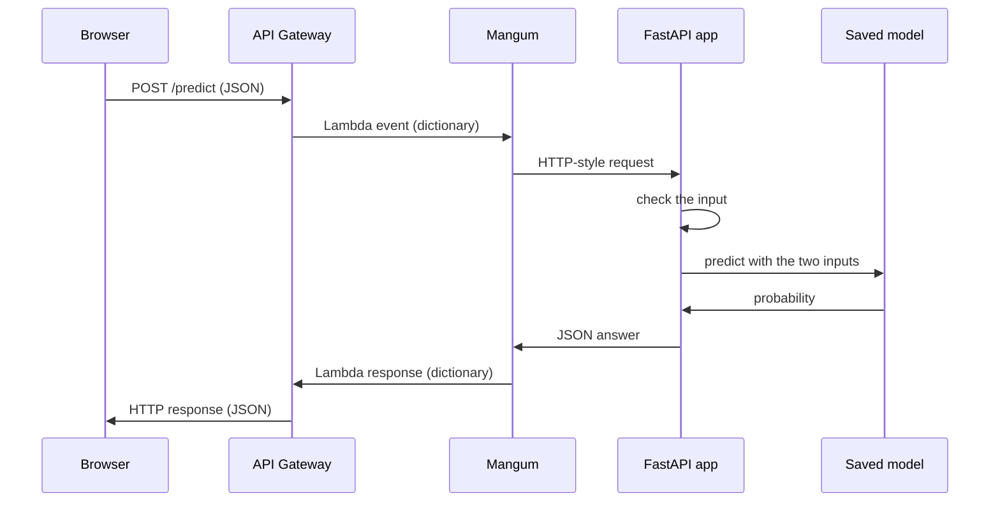
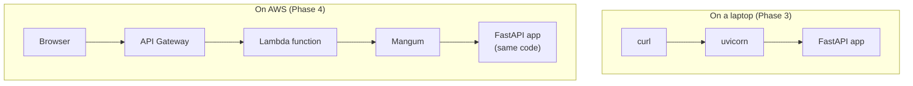
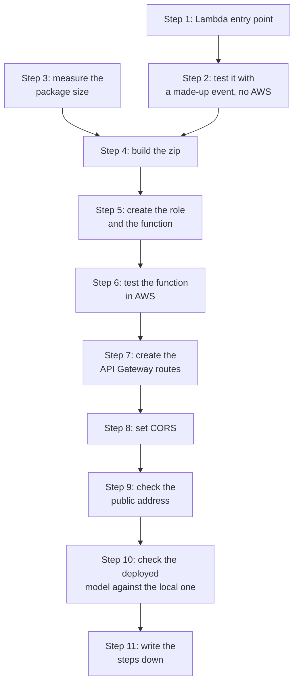
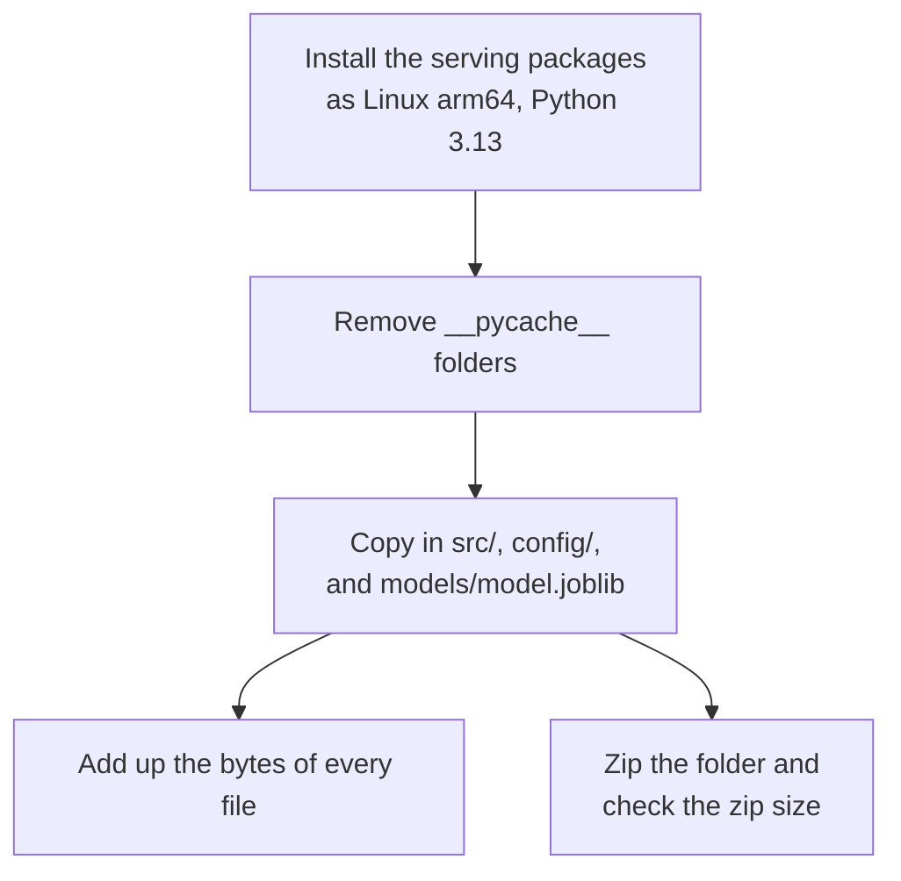

---
hide:
  - toc
---

# Phase 4 Implementation: AWS Deployment

This page explains how the Phase 4 deployment works, one step at a time, with the real results. It also holds the measurement made before anything was built: the size of the Lambda package (Step 3). For the short version, see the [Brief](./brief.md). The commands, in order, are on [Deployment Guide](./deployment-guide.md). The Deployment Guide also holds the redeploy steps. To test the entry point with no AWS account, or change its code, see the [Development Guide](./development-guide.md).

**Status: built and tested.** The Lambda entry point is `src/api/lambda_handler.py`, and its tests are in `tests/test_lambda_handler.py`. Every number below comes from the real deployment. The full test suite passes with 53 tests (the 47 from earlier phases and 6 new ones) and no warnings. The public address is `https://9awodatqc5.execute-api.us-east-1.amazonaws.com`.

## What Is Mangum?

Mangum is a small Python library that lets a FastAPI app run inside AWS Lambda. It translates between two formats, and it does nothing else.

- **A normal web server** ([`uvicorn`](https://uvicorn.dev/) on a laptop, see the [Glossary](../glossary.md#phase-3-local-prediction-api)) listens on a port and receives HTTP requests.
- **Lambda has no port.** It runs a function once per request. The function receives a dictionary (called an event) and returns a dictionary.
- **API Gateway** is what receives the browser's HTTP request, builds the event, and calls the Lambda function. This happens with or without Mangum.
- **Mangum** runs inside the function. It turns the event into a request that FastAPI understands, calls the app, and turns FastAPI's answer back into the dictionary Lambda returns.
- **In code,** the wrapper is one call, `Mangum(app, lifespan="off")`. See [Step 1](#step-1-add-the-lambda-entry-point) for why the start-up step is turned off.



The two setups run the same app. Only the front part changes:



- **Why this and not a separate Lambda function:** a hand-written function would repeat the input checks and the model call in a second place, and the local tests would not cover it. See [Decisions](../decisions.md#deployment-and-front-end).
- **What Mangum does not do:** it does not deliver requests to Lambda, set permissions, or make the public address. API Gateway and AWS permissions do those.

## What Was Deployed?

One Lambda function and one API Gateway HTTP API, both in `us-east-1`. Every new name follows the pattern of the existing data bucket, `510-m3-nfl-dataset`: all lowercase, words joined by hyphens, starting `510-m3-nfl-`, then what the thing is.

- **Lambda function:** `510-m3-nfl-predict-api`.
- **Function role:** `510-m3-nfl-predict-api-role`.
- **API Gateway HTTP API:** `510-m3-nfl-predict-http-api` (id `9awodatqc5`).
- **Staged zip (a temporary key in the existing bucket, deleted once the function was created):** `deploy/510-m3-nfl-predict-api.zip`.
- **Local zip file (not committed):** `build/510-m3-nfl-predict-api.zip`.

Each AWS resource that supports tags is tagged `project=510-m3`. The public address is `https://9awodatqc5.execute-api.us-east-1.amazonaws.com`.

**What the function role is for.** Lambda runs a function as an identity, and it requires one. The role `510-m3-nfl-predict-api-role` is that identity. It has a single permission, writing the function's own logs, and nothing else. It is not an access key and it has no access to the data bucket.

## How Do the Steps Depend on Each Other?



Steps 1 to 4 run on this computer and call no AWS service. Steps 5 to 11 use AWS.

## Which Files Were Added?

- **`src/api/lambda_handler.py`:** The Lambda entry point (Step 1).
- **`tests/test_lambda_handler.py`:** Six tests for the entry point (Step 2).
- **`requirements-serve.txt`:** The short, pinned package list for the Lambda zip (Step 4).
- **`pytest.ini`:** One new line that hides a warning raised inside Mangum (see Step 2).
- **`build/` (not committed):** The installed packages, the zip, and the test events. `build/` is already ignored by git.

- **No existing application file changed.** `src/api/app.py`, `src/config.py`, `config/config.yaml`, and `requirements.txt` are as they were.
- **No new setting** in `config/config.yaml`. The Lambda settings live in [Deployment Guide](./deployment-guide.md).

## Step 1: Add the Lambda Entry Point

!!! abstract "Purpose"
    **Goal:** Wrap the Phase 3 app so that AWS Lambda can call it.

    **Why:** Lambda hands a function a dictionary (an event), and FastAPI expects a web request. Mangum translates between them. See [What Is Mangum?](#what-is-mangum).

    **If skipped:** There would be nothing for the function to run.

The whole file is short. These are its two functions:

```python
def build_handler(app, config):
    """Load the saved model once and wrap the API so Lambda can call it."""
    app.state.model = load_model(config)
    return Mangum(app, lifespan="off")


def handler(event, context):
    """Build the wrapped handler on the first call, then reuse it for later calls."""
    global _cached_handler
    if _cached_handler is None:
        _cached_handler = build_handler(app, load_config())
    return _cached_handler(event, context)
```

- **One file, `src/api/lambda_handler.py`.** The handler setting of the function is `src.api.lambda_handler.handler`.
- **`build_handler`** loads the model with `load_model` from `src/api/app.py`, stores it on the app, and returns the app wrapped by Mangum with `lifespan="off"`.
- **`handler`** is the function Lambda calls. On the first call it builds the wrapped handler and keeps it in `_cached_handler`, so every later call reuses it. The model is therefore loaded once, on the first call.
- **Why `lifespan="off"`.** In Mangum 0.22.0 (checked in its `adapter.py`), when `lifespan` is `"auto"` or `"on"`, the app's start-up step runs at the start of every invocation. That would re-read the saved model on every request. Turning it off and loading the model once in `build_handler` avoids that.
- **Why `handler` is a function and not a ready-made object.** The model is read on the first call and not when the file is imported, so the file imports cleanly on a machine with no saved model, such as a test run.
- **No `pandas`.** The file imports only `mangum`, `src.api.app`, and `src.config`.

## Step 2: Test the Entry Point With No AWS

!!! abstract "Purpose"
    **Goal:** Prove the entry point answers a Lambda event correctly before anything is built or deployed.

    **Why:** A mistake found here costs seconds. The same mistake found on AWS costs a build, an upload, and a log search.

    **If skipped:** The first test of the wiring would be on AWS.

The tests call the entry point with a made-up event in the shape API Gateway sends for an HTTP API (payload format version 2.0). A made-up model in a temporary folder stands in for the real one, except in the last test.

1. `test_handler_serves_a_predict_event`: A `POST /predict` event returns `statusCode` 200 and the four response fields, with the made-up model's version.
2. `test_handler_serves_a_health_event`: A `GET /health` event returns 200 and `status` `ok`.
3. `test_handler_rejects_a_bad_body`: A body with only `win_pct_differential` of 1.5 returns 422 and names both fields.
4. `test_model_is_loaded_once_across_invocations`: Three calls to `handler` read the model once.
5. `test_lambda_handler_does_not_import_pandas`: The file's imports are read as text, and none is `pandas`, `mlflow`, `matplotlib`, or from `src/model/`.
6. `test_real_handler_worked_example`: With the real model (skipped if `models/model.joblib` is missing), the inputs -0.5 and -18.0 return 0.3296.

- **Result:** 53 tests pass (47 from earlier phases and 6 new). Without `models/model.joblib`, 51 pass and 2 are skipped.
- **One warning is hidden.** Mangum's adapter asks `asyncio` for the current event loop in a way Python 3.12 and later deprecate, which printed a `DeprecationWarning` from inside Mangum. `pytest.ini` hides that one warning, as it already does for one MLflow warning. Every other warning is still shown, and the run now has none.

## Step 3: Measure the Package Size

!!! abstract "Purpose"
    **Goal:** Measure the unzipped and zipped size of the Lambda package before building the function.

    **Why:** `scikit-learn` brings in `scipy` and `numpy`, which are large, and Lambda rejects a zip over its size limit. A late surprise would force a container image, ECR, and Docker into the middle of the AWS work.

    **If skipped:** The first upload could fail with a size error after the function code, the gateway, and the permissions were already set up around it.

**Status: measured.** The measurement was made on a Mac by downloading the Linux packages for Lambda. Nothing was run on AWS. Sizes in this step use 1 MB = 1,000,000 bytes.

**Answer: it fits, if the API does not install pandas.** Without pandas the unzipped package is **231.3 MB**, which is 30.8 MB under the limit. With pandas it is 278.4 MB, which is 16.3 MB over.

### What Limits Apply?

- **Unzipped package, including layers:** 250 MB (262,144,000 bytes). The hard limit for a zip deployment. The measurement below is compared with this.
- **Zip uploaded directly in the AWS console:** About 50 MB. A zip over this is uploaded through S3 or the AWS command-line tool instead.
- **Container image:** 10 GB. The fall-back if the zip does not fit.

Sources: [AWS Lambda layers documentation](https://docs.aws.amazon.com/lambda/latest/dg/adding-layers.html) for the 250 MB limit, and [an AWS re:Post answer](https://repost.aws/questions/QUyXgEPlUQSPuqPJkpnGaDVw/cannot-run-my-lambda-due-to-the-hard-coded-memory-limit) for the byte count. The 50 MB console limit is approximate. The limits can change, so check the current AWS page before relying on the numbers.

### How Was the Size Measured?



The packages were installed into a build folder with a command that picks the Lambda platform instead of the Mac's:

```bash
pip install --target build/lambda --implementation cp --python-version 3.13 --platform manylinux_2_28_aarch64 --platform manylinux2014_aarch64 --only-binary=:all: --no-compile scikit-learn==1.9.1 numpy==2.5.4 joblib==1.6.0 PyYAML==6.0.3 fastapi==0.162.2 pydantic==2.14.3 mangum==0.22.0
```

- **`--platform manylinux_2_28_aarch64` and `manylinux2014_aarch64`:** Download packages built for Linux on an `arm64` chip, which is what the Lambda function will use.
- **`--python-version 3.13` and `--implementation cp`:** Match the Python 3.13 runtime.
- **`--only-binary=:all:`:** Use ready-built packages only. Nothing is compiled on the Mac, which could not produce Linux files.
- **`--no-compile`:** Skip the cached `.pyc` files, which the zip does not need.

- **Included:** `scikit-learn`, `numpy`, `joblib`, `PyYAML`, `fastapi`, `pydantic`, `mangum`, and the packages they pull in (among them `scipy` and `narwhals`). `scipy` resolved to 1.18.1.
- **Project files added:** `src/`, `config/`, and `models/model.joblib`.
- **Left out:** `mlflow`, `matplotlib`, `boto3`, `pytest`, and `uvicorn`. Lambda does not run a web server, so `uvicorn` is not needed there, and Lambda already provides `boto3`.
- **Measured twice:** once without `pandas` and once with it, because `pandas` is large.

### What Did the Measurement Show?

| Package set | Unzipped | Zipped | Against the 250 MB limit |
| :--- | :--- | :--- | :--- |
| Without `pandas` | **231.3 MB** | 63.2 MB | 30.8 MB under |
| With `pandas` | 278.4 MB | 75.1 MB | 16.3 MB over |

The largest folders in the package without `pandas`:

| Folder | Size | What it holds |
| :--- | :--- | :--- |
| `scipy` | 89.4 MB | Math routines that `scikit-learn` depends on |
| `sklearn` | 39.4 MB | `scikit-learn` itself |
| `scipy.libs` | 31.8 MB | Compiled libraries bundled with `scipy` |
| `numpy.libs` | 28.7 MB | Compiled libraries bundled with `numpy` |
| `numpy` | 25.4 MB | `numpy` itself |
| `pydantic_core` | 4.8 MB | The compiled core of `pydantic` |
| `yaml` | 2.9 MB | `PyYAML` |
| `narwhals` | 2.1 MB | A small helper package that `scikit-learn` depends on |

- **`pandas` alone adds 46.0 MB,** which is what pushes the package over the limit.
- **Room left:** the built zip is about 30.9 MB (12% of the limit) under 262,144,000 bytes. That is room for small additions and not for `pandas`.
- **The zipped file is 63.2 MB,** which is over the console's direct-upload limit of about 50 MB. Upload it through S3 or the AWS command-line tool.
- **Result for the plan:** the zip route works, so ECR and a container image are not needed for Lambda. The [fall-back](./brief.md#what-if-the-zip-is-too-large) stays unused unless the package grows past the limit.

### What Does This Mean for the Phase 3 API?

The API must run without `pandas`. Three facts about the current code shape this:

- **`src/model/features.py` imports `pandas` at the top.** Any API file that imports from it (for example to reuse `INPUT_COLUMNS`) would pull `pandas` into the package. The saved model file already holds the input names (`feature_names`), so the API reads them from there instead.
- **The model works without `pandas`.** In a fresh environment with only `scikit-learn` 1.9.1, `numpy`, `joblib`, `scipy`, and `PyYAML`, the saved model loaded, and the inputs -0.5 and -18.0 passed in as a plain numpy array gave a home win probability of **0.3296**, the same as the worked example in [Part 2](../phase-2/implementation-part-2.md#what-is-a-worked-example). `pandas` was not imported at any point.
- **One warning is expected.** The scaler was fitted on a table with column names, so a plain array makes scikit-learn print "X does not have valid feature names". The probability is the same. The API silences this one warning.

These points are recorded in the [Phase 3 Brief](../phase-3/brief.md).

### How Is the Measurement Repeated?

Run the install command above from the project folder, then remove the cached files:

```bash
find build/lambda -name __pycache__ -type d -exec rm -rf {} +
```

Copy in `src/`, `config/`, and `models/model.joblib`, then count the bytes:

```bash
find build/lambda -type f -exec cat {} + | wc -c
```

`build/` is already in `.gitignore`. Compare the result with 262,144,000.

## Step 4: Build the Zip

!!! abstract "Purpose"
    **Goal:** Produce `build/510-m3-nfl-predict-api.zip` with exactly what the function needs.

    **Why:** The function runs only what is in the zip, on Linux, so the zip must be built for that platform and hold the project files in the layout the code expects.

    **If skipped:** There would be nothing to upload.

- **A short pinned list, `requirements-serve.txt`.** It names `scikit-learn==1.9.1`, `numpy==2.5.4`, `scipy==1.18.1`, `joblib==1.6.0`, `PyYAML==6.0.3`, `fastapi==0.162.2`, `pydantic==2.14.3`, and `mangum==0.22.0`. It leaves out `pandas`, `mlflow`, `matplotlib`, `boto3` (Lambda provides it), `uvicorn` (Mangum replaces it), and the test packages.
- **Install for the function's platform,** with the command from Step 3, reading the list with `-r requirements-serve.txt`.
- **Project files, in the project's folder layout:** `src/config.py`, `src/api/app.py`, `src/api/lambda_handler.py`, `src/api/schemas.py`, `config/config.yaml`, and `models/model.joblib`. The folders `src/data/` and `src/model/` are left out, because the function does not use them and `src/model/` imports `pandas`. `resolve_path` finds the project folder from the code's own location, so the same paths work in the zip.
- **Zip the contents,** so `src/`, `config/`, and `models/` sit at the top of the zip.
- **The built zip:**
    - 125 compiled libraries under `numpy/` and `scipy/`, every one for `aarch64`, and none for `darwin` or `x86_64`.
    - **231,252,596 bytes unzipped** and **63,452,500 bytes zipped**, matching the Step 3 measurement.
    - It holds no `pandas`, `mlflow`, or `src/model`, and `scipy-1.18.1` matches the pin.
- **The saved model must match the zip.** The model file was saved by scikit-learn 1.9.1, and the zip holds the same version, or the service refuses to start, as in Phase 3.

## Step 5: Create the Role and the Function

!!! abstract "Purpose"
    **Goal:** Create the Lambda function with permission to do one thing: write its own logs.

    **Why:** The function needs no other AWS access. Each identity gets only the access its job needs.

    **If skipped:** There would be no function for the gateway to call.

- **The role `510-m3-nfl-predict-api-role`** can be assumed only by Lambda, and has one policy attached, the AWS managed `AWSLambdaBasicExecutionRole`, which only writes logs. Its trust policy has no statement id, because IAM rejected a hyphenated one with `MalformedPolicyDocument`.
- **The zip is staged in S3.** At 63.2 MB it is over the console's direct-upload limit, so it was copied to `deploy/510-m3-nfl-predict-api.zip` in the data bucket, the function was created from it, and the staged copy was deleted. The bucket holds no `deploy/` object now.
- **Function settings:**

- **Runtime:** `python3.13`.
- **Architecture:** `arm64`.
- **Handler:** `src.api.lambda_handler.handler`.
- **Memory:** 1769 MB.
- **Timeout:** 10 seconds.
- **Environment variable:** `JOBLIB_MULTIPROCESSING` = `0` (the only one).
- **VPC, layers, reserved concurrency:** none.

- **The environment variable.** The function's first log printed "joblib will operate in serial mode", because Lambda has no multiprocessing directory. Setting `JOBLIB_MULTIPROCESSING=0` makes joblib skip that check. The function never uses multiprocessing, and the line is gone from every later log.
- **Log retention.** The log group `/aws/lambda/510-m3-nfl-predict-api` keeps logs for 14 days, and is tagged `project=510-m3`.

### What Is the Memory Setting?

Lambda gives a function CPU in proportion to its memory. The function runs at 1769 MB. Accuracy is the only priority for this deployment. Latency and cost are not concerns, so the memory may be changed if that helps, but it is not a priority. See [Decisions](../decisions.md#deployment-and-front-end).

## Step 6: Test the Function in AWS

!!! abstract "Purpose"
    **Goal:** Invoke the function directly, with no gateway, and read its logs.

    **Why:** This is the first time the Linux packages run, and a problem here is easier to read than one that comes back through the gateway.

    **If skipped:** A package that fails to import on Lambda would show up later as a plain gateway error.

- **Three invocations,** using the same made-up events as Step 2: the worked example, the health check, and a bad body.
- **Results:**
    - The worked example returned status 200 and `{"prediction": 0, "predicted_label": "away win", "home_win_probability": 0.3296, "model_version": "v1.0"}`.
    - The health check returned 200 and the expected health body.
    - The bad body returned 422, naming both fields.
    - The logs showed no start-up refusal and no import error.

## Step 7: Create the API Gateway HTTP API

!!! abstract "Purpose"
    **Goal:** Give the function a public HTTPS address with exactly two routes.

    **Why:** Lambda has no public address of its own. API Gateway receives the browser's request and calls the function.

    **If skipped:** The function could be invoked only with AWS credentials.

- **An HTTP API named `510-m3-nfl-predict-http-api`** (id `9awodatqc5`) with a Lambda proxy integration (`AWS_PROXY`, payload format version 2.0).
- **Two routes only:** `POST /predict` and `GET /health`, with no authorizer and no catch-all route.
- **The `$default` stage** with automatic deployment.
- **Permission to call the function** is given to this one API and nothing broader: the source is this API's ARN, `arn:aws:execute-api:us-east-1:<account-id>:9awodatqc5/*/*`. The permission's statement id is `510-m3-nfl-predict-http-api`.
- **The invoke URL** is `https://9awodatqc5.execute-api.us-east-1.amazonaws.com`.
- **No protection rules, request limit, or firewall for now.** The API is public, with no key.

## Step 8: Set CORS on the Gateway

!!! abstract "Purpose"
    **Goal:** Let the browser web app call `/predict` from its own address.

    **Why:** A browser refuses a response from another address unless that address is allowed. CORS is set on the gateway only, not in the FastAPI app.

    **If skipped:** The web app would work in `curl` and fail in the browser.

- **Allowed origin:** `http://localhost:5173`, the default address of the Vite development server, and nothing else at the end of Phase 4. Phase 5 added the CloudFront address, `https://d1nubiunzfwm0q.cloudfront.net`. See [The Preflight](../phase-5/implementation.md#the-preflight).
- **Allowed methods:** `POST`, `GET`, and `OPTIONS`. **Allowed headers:** `content-type`. **Max age:** 300 seconds.
- **Checks:**
    - A preflight request from `http://localhost:5173` returned status 204 with `access-control-allow-origin: http://localhost:5173`.
    - The same preflight from `http://example.com` returned 204 with no `access-control-allow-origin` header, so that origin is not allowed.

## Step 9: Check the Public Address

!!! abstract "Purpose"
    **Goal:** Confirm the deployed API answers real requests from the internet, with the same results as the local one.

    **Why:** This is the test that matters. Everything before it checked a part.

    **If skipped:** The phase would end with an API nobody has called.

```bash
curl -sS -w '\nHTTP %{http_code}\n' https://9awodatqc5.execute-api.us-east-1.amazonaws.com/health
```

```text
{"status":"ok","model_version":"v1.0","scikit_learn_version":"1.9.1"}
HTTP 200
```

```bash
curl -sS -w '\nHTTP %{http_code}\n' -H 'content-type: application/json' -d '{"win_pct_differential": -0.5, "point_diff_per_game_differential": -18.0}' https://9awodatqc5.execute-api.us-east-1.amazonaws.com/predict
```

```text
{"prediction":0,"predicted_label":"away win","home_win_probability":0.3296,"model_version":"v1.0"}
HTTP 200
```

- **`GET /health`:** 200, the health body above.
- **`POST /predict` with -0.5 and -18.0:** 200, home win probability 0.3296, prediction 0.
- **`POST /predict` with only `win_pct_differential` of 1.5:** 422, naming both fields.
- **`GET /predict`:** 404, `{"message":"Not Found"}`, because the gateway has no route for it.

## Step 10: Check the Deployed Model Against the Local Model

!!! abstract "Purpose"
    **Goal:** Prove the model on AWS gives the same answers as the local model, on every game.

    **Why:** Accuracy is the only priority. The packages on Lambda are Linux builds, so the arithmetic could in principle differ from the Mac that trained the model.

    **If skipped:** The deployed model could be slightly different and nobody would know.

**First, is the function running what was built here?**

- **The zip:** the base64 SHA-256 hash of the local zip equals the `CodeSha256` that Lambda stores for the function (`IU5bJH9pTL+rF/uEXMUAp+Eo/mik2abfaSasBXPOgbk=`).
- **The model file:** the SHA-256 of `models/model.joblib` and of the copy inside the zip are both `8fff766505a925218eae2484ae56a8ba7baed06b62ce3413ea33c8eb15e8ea4b`.
- **The data:** the SHA-256 of `data/from-s3/nfl_matchups_2020_2026.csv` equals `data_sha256` in `results/run-summary.json` (`7219e8a8672b900af9facbb54d8a28f9f2a34df9ede3b8385a735768082517fb`).

**Then, every game through the public API.** A local script (`build/parity_check.py`, kept on the developer's machine and not committed) builds the local answers with the saved model, and sends each of the 1,759 games to `POST /predict`, one at a time, then compares each answer.

- **Requests sent:** 1,759 (1,339 training, 271 validation, 149 test).
- **Retries:** 0.
- **Status 200 answers:** 1,759.
- **Picks that match the local pick:** 1,759.
- **Probabilities that match the local probability (rounded to 4 places):** 1,759, with a largest difference of 0.0.
- **Slowest and average request:** 0.29 s and 0.033 s.

| Group | Correct from the deployed answers | Committed run summary |
| :--- | :--- | :--- |
| Training | 820 of 1,339 | 820 of 1,339 |
| Validation | 171 of 271 | 171 of 271 |
| Test | 88 of 149 | 88 of 149 |

The deployed model and the local model are the same at the 4-decimal precision the API returns, and the accuracy from the deployed answers equals the accuracy in the run summary. This does not test the browser, CORS from a real front end, or behavior under load.

## Step 11: Write the Steps Down

!!! abstract "Purpose"
    **Goal:** Make the deployment repeatable by hand.

    **Why:** Written steps mean the deployment does not depend on anyone's memory, and they show exactly what was created, so it can be removed again.

    **If skipped:** Nobody could rebuild or remove the deployment without redoing the work from scratch.

- **[Deployment Guide](./deployment-guide.md)** lists every command of Steps 4 to 10, in order, with placeholders such as `<account-id>` and `<api-id>` for values that differ between accounts. It ends with the commands that remove everything this phase created. Those removal commands are written, and not run.
- **No `deploy.yml` workflow.** The steps are run by hand. See [Decisions](../decisions.md#deployment-and-front-end).
