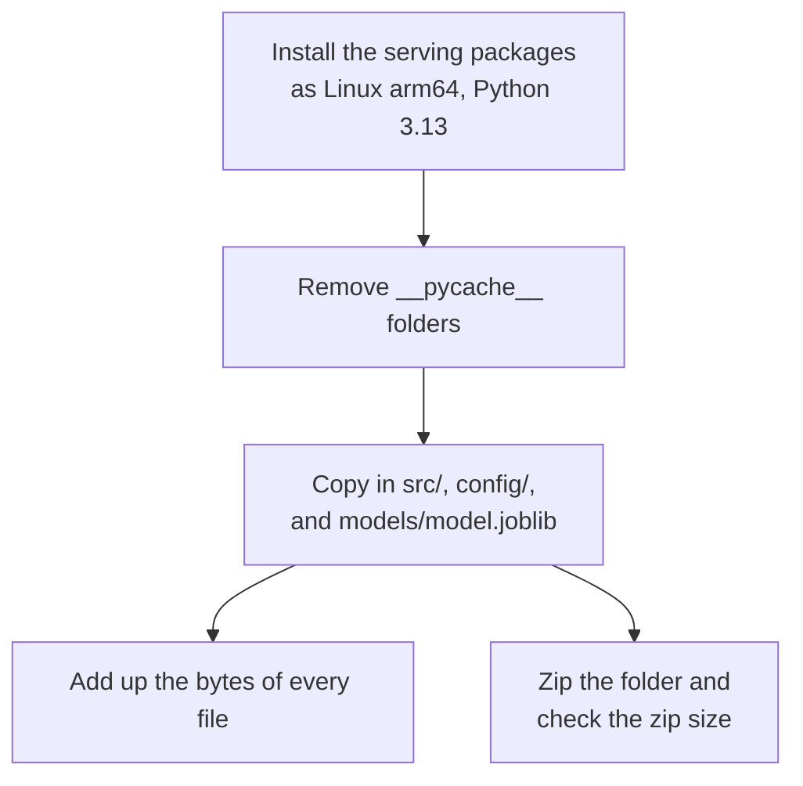

---
hide:
  - toc
---

# Phase 4, Step 3: Lambda Package Size Check

This page records the size of the zip file that AWS Lambda would run the API from, and what that size means for the code. It answers one question before anything is built: does the API fit in a zip, or does it need a container image?

**Status: measured. The function is not built or deployed yet.** The measurement was made on a Mac by downloading the Linux packages for Lambda. Nothing was run on AWS. Sizes in this page use 1 MB = 1,000,000 bytes.

**Answer: it fits, if the API does not install pandas.** Without pandas the unzipped package is **231.3 MB**, which is 30.8 MB under the limit. With pandas it is 278.4 MB, which is 16.3 MB over.

!!! abstract "Purpose"
    **Goal:** Measure the unzipped and zipped size of the Lambda package before building the function.

    **Why:** `scikit-learn` brings in `scipy` and `numpy`, which are large, and Lambda rejects a zip over its size limit. A late surprise would force a container image, ECR, and Docker into the middle of the AWS work.

    **If skipped:** The first upload could fail with a size error after the function code, the gateway, and the permissions were already set up around it.

## What Limits Apply?

| Limit | Value | What it means here |
| :--- | :--- | :--- |
| Unzipped package, including layers | 250 MB (262,144,000 bytes) | The hard limit for a zip deployment. The measurement below is compared with this. |
| Zip uploaded directly in the AWS console | About 50 MB | A zip over this is uploaded through S3 or the AWS command-line tool instead. |
| Container image | 10 GB | The fall-back if the zip does not fit. |

Sources: [AWS Lambda layers documentation](https://docs.aws.amazon.com/lambda/latest/dg/adding-layers.html) for the 250 MB limit, and [an AWS re:Post answer](https://repost.aws/questions/QUyXgEPlUQSPuqPJkpnGaDVw/cannot-run-my-lambda-due-to-the-hard-coded-memory-limit) for the byte count. The 50 MB console limit is approximate. The limits can change, so check the current AWS page before relying on the numbers.

## How Was the Size Measured?



The packages were installed into a build folder with a command that picks the Lambda platform instead of the Mac's:

```bash
pip install --target build/lambda --implementation cp --python-version 3.13 --platform manylinux_2_28_aarch64 --platform manylinux2014_aarch64 --only-binary=:all: --no-compile scikit-learn==1.9.1 numpy==2.5.4 joblib==1.6.0 PyYAML==6.0.3 fastapi==0.162.2 pydantic==2.14.3 mangum==0.22.0
```

| Part of the command | What it does |
| :--- | :--- |
| `--platform manylinux_2_28_aarch64` and `manylinux2014_aarch64` | Download packages built for Linux on an `arm64` chip, which is what the Lambda function will use. |
| `--python-version 3.13` and `--implementation cp` | Match the Python 3.13 runtime. |
| `--only-binary=:all:` | Use ready-built packages only. Nothing is compiled on the Mac, which could not produce Linux files. |
| `--no-compile` | Skip the cached `.pyc` files, which the zip does not need. |

### Which Packages Were Included?

- **Included:** `scikit-learn`, `numpy`, `joblib`, `PyYAML`, `fastapi`, `pydantic`, `mangum`, and the packages they pull in (among them `scipy` and `narwhals`). `scipy` resolved to 1.18.1.
- **Project files added:** `src/`, `config/`, and `models/model.joblib`.
- **Left out:** `mlflow`, `matplotlib`, `boto3`, `pytest`, and `uvicorn`. Lambda does not run a web server, so `uvicorn` is not needed there, and Lambda already provides `boto3`.
- **Measured twice:** once without `pandas` and once with it, because `pandas` is large.

## What Did the Measurement Show?

| Package set | Unzipped | Zipped | Against the 250 MB limit |
| :--- | :--- | :--- | :--- |
| Without `pandas` | **231.3 MB** | 63.2 MB | 30.8 MB under |
| With `pandas` | 278.4 MB | 75.1 MB | 16.3 MB over |

The largest folders in the package without `pandas`:

| Folder | Size | What it holds |
| :--- | :--- | :--- |
| `scipy` | 89.4 MB | Math routines that `scikit-learn` depends on |
| `sklearn` | 39.4 MB | `scikit-learn` itself |
| `scipy.libs` | 31.8 MB | Compiled libraries bundled with `scipy` |
| `numpy.libs` | 28.7 MB | Compiled libraries bundled with `numpy` |
| `numpy` | 25.4 MB | `numpy` itself |
| `pydantic_core` | 4.8 MB | The compiled core of `pydantic` |
| `yaml` | 2.9 MB | `PyYAML` |
| `narwhals` | 2.1 MB | A small helper package that `scikit-learn` depends on |

- **`pandas` alone adds 46.0 MB,** which is what pushes the package over the limit.
- **The zipped file is 63.2 MB,** which is over the console's direct-upload limit of about 50 MB. Upload it through S3 or the AWS command-line tool.
- **Result for the plan:** the zip route works, so ECR and a container image are not needed for Lambda. The fall-back in [Remaining Phases](../remaining-phases.md#fall-back-to-a-container-image) stays unused unless the package grows past the limit.

## What Does This Mean for the Phase 3 API?

The API must run without `pandas`. Two facts about the current code shape this:

- **`src/model/features.py` imports `pandas` at the top.** Any API file that imports from it (for example to reuse `INPUT_COLUMNS`) would pull `pandas` into the package. The saved model file already holds the input names (`feature_names`), so the API reads them from there instead.
- **The model works without `pandas`.** In a fresh environment with only `scikit-learn` 1.9.1, `numpy`, `joblib`, `scipy`, and `PyYAML`, the saved model loaded, and the inputs -0.5 and -18.0 passed in as a plain numpy array gave a home win probability of **0.3296**, the same as the worked example in [Part 2](../phase-2/implementation-part-2.md#what-is-a-worked-example). `pandas` was not imported at any point.
- **One warning is expected.** The scaler was fitted on a table with column names, so a plain array makes scikit-learn print "X does not have valid feature names". The probability is the same. The API should either silence this one warning or avoid it.

These points are recorded in the [Phase 3 Brief](../phase-3/brief.md).

## What Is Not Yet Known?

- **Run on AWS.** The packages were downloaded for Linux but never run there. A package that imports on a Mac can still fail on Lambda, so Step 6 (testing the function in the console) is the real proof.
- **Start-up time.** The first request after a quiet period has to load about 231 MB of code. The time was not measured.
- **Unpinned `scipy`.** `requirements.txt` does not pin `scipy`, which `scikit-learn` brings in. The 231.3 MB figure is for 1.18.1. A serving dependency list should pin it.
- **Growth.** The function code adds almost nothing, but a version bump of any large package changes the total. Re-measure after changing a pin.
- **Margin.** The package is 30.8 MB (about 12% of the limit) under the limit, which leaves room for small additions and not for `pandas`.

## How Is the Measurement Repeated?

Run the install command above from the project folder, then remove the cached files:

```bash
find build/lambda -name __pycache__ -type d -exec rm -rf {} +
```

Copy in `src/`, `config/`, and `models/model.joblib`, then count the bytes:

```bash
find build/lambda -type f -exec cat {} + | wc -c
```

`build/` is already in `.gitignore`. Compare the result with 262,144,000.
