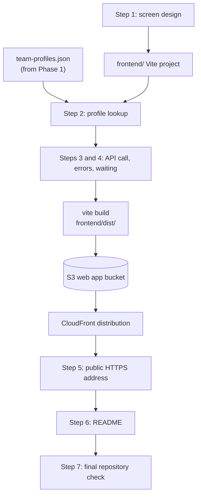

---
hide:
  - toc
---

# Phase 5: Front-End and Documentation

This phase builds the web app a person actually uses, publishes it on AWS, writes the README, and runs the final check that the repository meets every requirement. A user picks a home team and an away team, and the app shows the predicted winner and the win probability from the live API.

The web app is a Vite project: a small single-page app that runs in the user's browser. During development, the Vite development server serves it on the developer's machine with instant reload. For the public site, `vite build` turns the project into a folder of static files. Those files are stored in a private S3 bucket, and CloudFront serves them over HTTPS.

This page owns the screen design, the profile lookup, the way the app calls the API, the hosting on S3 and CloudFront, the README contents, and the final repository check.

## Phase Architecture

### Flow of Steps

### Inventory

| Item | Kind | Planned location | Built in | What it does |
| :--- | :--- | :--- | :--- | :--- |
| Vite web app | Code | `frontend/` with `package.json`, `index.html`, and `src/` | Steps 1 to 4 | Shows the form, computes the three numbers, calls the API, and displays the result. React with TypeScript is proposed. |
| Team profiles | Data file | `frontend/public/team-profiles.json` | Built in Phase 1 | Supplies the numbers for the 32 teams. |
| Build output | Generated files | `frontend/dist/`, not committed | Step 5 | The files that are published. |
| Web app bucket | AWS resource | Private S3 bucket, separate from the data bucket | Step 5 | Stores the contents of `dist/`. |
| CloudFront distribution | AWS resource | One distribution with origin access control | Step 5 | Serves the files over HTTPS at the public address. |
| Updated CORS rules | AWS setting | API Gateway | Step 5 | Adds the CloudFront address to the allowed origins. |
| README | Documentation | `README.md` | Step 6 | Gives a reader the overview, results, commands, and live links. |
| Final check | Test steps | Run by the developer | Step 7 | Confirms every requirement is met. |

## Which Requirements Does It Cover?

- Requirement 8: a public, interactive app that calls the deployed API and shows the prediction, hosted on AWS.
- Requirement 9: the final repository check.
- Requirement 10: the README contents.
- README: holds the dataset link and the evaluation result.
- Team profiles file: used by the app.
- Profiles and rest days: settles how they are chosen and how the limitation is shown.
- CORS: adds the CloudFront address to the API's allowed origins, which [Phase 4](./phase-4-aws-deployment.md) defines.

## Step 1: Design the Screen

!!! abstract "Purpose"
    **Goal:** Decide which inputs the page has (two team boxes, two optional rest-day boxes, and one button) and what it shows after the button is clicked (the predicted winner, the probability, and one summary card per team).

    **Why:** The inputs must be enough to produce the three numbers the API requires, and the result must make sense to a casual fan. Deciding this before writing code avoids rebuilding the page later.

    **If skipped:** The page might collect inputs the API cannot use, or leave one out. For example, with no rest-day boxes there would be no way to supply the rest-day difference the API requires.

| Part | Design |
| :--- | :--- |
| Title and one-line description | Names the app and says it predicts a game before kickoff from season-to-date results and rest. |
| Home team box | A select box with the 32 current teams, filled from the profiles file. |
| Away team box | The same list, with its own selection. |
| Rest days | Two optional number inputs, one per team, each defaulting to 7 days, the gap between games played one week apart. A user can change them to reflect a short week or a bye. |
| Predict button | Labeled "Predict Matchup". |
| Result area | The predicted winner's name, the winner's probability as a percentage and a progress bar, and one summary card per team. |
| Footer | A short statement of what the numbers are and what the model leaves out. See Step 6. |

Each summary card shows the team's point differential per game, win percentage, and rest days that were used. A small line under the result shows the three differences sent to the API, so the prediction can be traced.

The button is disabled, with a message, when the same team is chosen twice.

!!! note "Confirm: which Vite template"
    This design proposes the Vite React template with TypeScript, because it is the most common starting point and TypeScript catches a mistyped API field name before the app runs. Plain TypeScript or plain JavaScript also meets the requirement, which allows any web framework. The choice changes only the contents of `src/`.

## Step 2: Look Up Team Profiles

!!! abstract "Purpose"
    **Goal:** Write the logic that takes two chosen teams, reads their numbers from `team-profiles.json`, and subtracts the away team's value from the home team's value to get the three numbers the API needs.

    **Why:** Users choose team names, but the API needs three numbers. The subtraction must match how the model was trained, which is home minus away.

    **If skipped:** Without this step, a user's team choices could not be sent to the API. If the subtraction were reversed to away minus home, the predicted winner would come out backwards.

The app fetches `team-profiles.json` once when it loads. The file is served from the same CloudFront address as the app, so the browser needs no extra permission to read it. When the user clicks the button, the app takes the two selected entries and computes the three API inputs in the browser.

| API field | How the app computes it |
| :--- | :--- |
| `point_diff_differential` | Home team's point differential per game minus the away team's. |
| `win_pct_differential` | Home team's win percentage minus the away team's. |
| `rest_differential` | Home team's rest days from the input box minus the away team's. |

### Why Are the Profiles a Snapshot?

The profiles file holds each team's numbers after its last 2024 game, which is a full 17-game season (18 weeks including the bye). The model was trained on numbers from partway through seasons, such as after 5 or 10 games. Both are per-game or percentage values, so they are on the same scale. The model has not been tested on full-season inputs, though, and full-season values tend to be less spread out than early-season ones.

!!! note "Confirm: use end-of-2024 profiles and a fixed rest default"
    The alternative is to let the user pick a season and week and look up the numbers as they stood before that game. That matches training exactly, but it needs the full per-week history in the app and changes the screen from "pick two teams" to "pick two teams and a date". This design keeps the simple screen and states the limitation in the app and in the README.

The app labels the profiles as "2024 season profiles" next to the team boxes so a user knows which numbers are in use.

## Step 3: Call the API

!!! abstract "Purpose"
    **Goal:** Send the three numbers from the browser to the live API's `/predict` address using `fetch`, and read the answer.

    **Why:** The model runs only on AWS Lambda, so the browser has to ask it. Browsers also block calls to a different address unless that address allows it. This rule is called CORS, and the API's CORS rules must include the web app's address.

    **If skipped:** The page would show a form but never a prediction.

| Item | Design |
| :--- | :--- |
| Address | Read from a build-time setting named `VITE_API_BASE_URL`. Vite copies the value into the built files, so anyone can read it in the browser. That is acceptable because the API is public and the README publishes the address. No secret may ever be stored in a setting whose name starts with `VITE_`. |
| Request | `POST` to `/predict` with the three fields from [Phase 3](./phase-3-api-and-docker.md#request), sent with the browser's `fetch` and a JSON body. |
| Cross-origin rules | The page and the API have different addresses, so the browser first sends a preflight `OPTIONS` request. The gateway answers it using the CORS rules from [Phase 4](./phase-4-aws-deployment.md). The app contains no CORS code. |
| Timeout | 30 seconds, using an abort signal. A first request can wait for a cold start of the Lambda function. |
| Retry | One automatic retry on a timeout or a 5xx answer. |
| Reading the answer | `prediction`, `predicted_label`, and `home_win_probability`. The winner's name is the home team when the prediction is 1 and the away team otherwise. The winner's probability is `home_win_probability` for a home pick and one minus it for an away pick. |

### How Is the App Run Locally?

The Vite development server starts with `npm run dev` and serves the app on `http://localhost:5173` by default, with instant reload on every file save. It is for local work only. It does not use HTTPS, it is not built for public traffic, and it stops when the developer's machine does.

| Local option | How it works | Trade-off |
| :--- | :--- | :--- |
| Call the live API | The setting `VITE_API_BASE_URL` points at the Phase 4 address. The local address is already on the gateway's allowed list. | Simplest, and tests the real CORS rules. Needs the API to be deployed. |
| Call a local API through the dev server | The dev server forwards `/predict` to the FastAPI app that runs on the developer's machine. The browser sees one address, so no CORS rules are involved. | Works before Phase 4 is finished. It does not test the CORS rules. |

## Step 4: Handle Errors and Waiting

!!! abstract "Purpose"
    **Goal:** Show a "contacting the service" spinner while waiting, retry the request once if it fails, and show a plain message if it still fails.

    **Why:** The first request after an idle period can take several seconds because Lambda has to start the function. Without feedback, a user cannot tell a slow answer from a broken app.

    **If skipped:** The page would appear frozen on the first request. A user would likely click again, and a real failure would show nothing at all.

| Situation | What the user sees |
| :--- | :--- |
| Waiting for the answer | A spinner with the text "Contacting the prediction service". |
| Slow first request | The same spinner. The app does not show an error before the 30 second timeout. |
| Timeout after the retry | A message that the service did not answer and that trying again may work. |
| Browser blocks the call (CORS) | The same "could not reach the service" message. The cause is only visible in the browser console, so the README's troubleshooting list names it. |
| 422 answer | A message that the inputs were rejected, with the field name from the API. This points to a mismatch between the app and API versions. |
| 5xx answer after the retry | A message that the service had a problem. |
| Profiles file missing or malformed | The app shows a message in place of the form. |

## Step 5: Host the App

!!! abstract "Purpose"
    **Goal:** Build the app with `vite build`, upload the resulting files to a private S3 bucket, and serve them through CloudFront at a public HTTPS address.

    **Why:** The requirements call for a publicly reachable front-end. The Vite development server runs only on your own computer. CloudFront provides the public address, and keeping the bucket private means the files can be read only through CloudFront.

    **If skipped:** The app would work only on your own computer, and nobody else could open it.

### What Gets Published?

The published site is the contents of `frontend/dist/` after `vite build`: `index.html`, JavaScript and CSS files in `assets/`, and `team-profiles.json`. Nothing runs on a server. CloudFront hands the files to the browser, and the browser runs the app.

### Which AWS Resources Does It Use?

| Resource | Design |
| :--- | :--- |
| Web app bucket | A private S3 bucket in the same region as the other resources, separate from the data bucket from Phase 1. All public access is blocked. |
| Hosting method | CloudFront reads the bucket through an origin access control. The S3 "static website hosting" feature is not used, because it serves only over HTTP and needs a public bucket. |
| Bucket policy | Allows reading only to this one CloudFront distribution. |
| Distribution | Default root object `index.html`. Requests over HTTP are redirected to HTTPS. Compression is on. |
| Address | The default `*.cloudfront.net` address. No custom domain and no certificate are needed. |
| Routing | The app has one page and no client-side routes, so no fallback to `index.html` is needed. |

### How Does Caching Work?

Vite puts a hash in the name of each built JavaScript and CSS file, so a new build produces new names and old copies in the cache are never reused by mistake. Two files keep fixed names: `index.html` and `team-profiles.json`. After each publish, the deploy step creates a CloudFront invalidation for those two paths. Without it, visitors can keep seeing the old page for as long as the cache holds it.

### In What Order Is It Published?

1. Create the web app bucket and the CloudFront distribution. This gives the public address.
2. Add that address to the API's allowed origins (the CORS rules from Phase 4).
3. Set `VITE_API_BASE_URL` to the live API address and run `vite build`.
4. Upload the contents of `dist/` to the bucket, and remove files in the bucket that the new build no longer contains.
5. Create the invalidation for `index.html` and `team-profiles.json`.
6. Open the CloudFront address and run the checks below.

The commands are written in the README. The permissions for the upload and the invalidation are listed in [Phase 4](./phase-4-aws-deployment.md#step-2-define-the-permissions).

### How Is the App Checked?

| Check | Pass condition |
| :--- | :--- |
| Development server | `npm run dev` starts the app and a prediction returns through one of the local options above. |
| Build | `vite build` finishes without errors, and `dist/` holds `index.html`, hashed files in `assets/`, and `team-profiles.json`. |
| Matches the API | For one pair of teams, the three numbers shown in the trace line, sent to the API with `curl`, give the same probability as the app. |
| Same team twice | The button is disabled with a message. |
| API unreachable | With a wrong address in the build setting, the app shows the timeout message and does not crash. |
| CORS | From the CloudFront address, the call succeeds. From any address not on the allowed list, the browser blocks it. |
| Public address | The CloudFront address opens over HTTPS in a private browser window with no login and returns a result. |
| Bucket is private | The direct S3 address of any file returns access denied. |
| Fresh publish | After a second publish with a visible text change, the CloudFront address shows the change after the invalidation finishes. |

## Step 6: Write the README

!!! abstract "Purpose"
    **Goal:** Write the repository's front page with the sections the requirements list: overview, dataset link, model results, AWS services used, setup commands, and links to the live API and the live web app.

    **Why:** A reviewer reads the README first, and Requirement 10 lists exactly what it must contain.

    **If skipped:** A reviewer would not know what the project does, how to run it, or where the live app is.

The README is the front door. It holds the plain summary, one diagram, the file tree, and the commands. It links to the documentation in `docs/` for detail and does not repeat it. This table lists every required part and where its content comes from.

| README section | Contents | Source |
| :--- | :--- | :--- |
| Overview and goals | What the system predicts and who it is for, in plain words. | The first paragraphs of the [Architecture Overview](../index.md). |
| Dataset | Name, link, row counts, season window, and the target. | [Phase 1](./phase-1-data-and-features.md#what-is-the-source-data). Includes the dataset link. |
| Model and evaluation | Model type, the table of training, validation, and test accuracy next to the three home-team baselines, plus log loss and ROC-AUC. | Final run from [Phase 2](./phase-2-training-and-tracking.md#step-4-score-the-model). The numbers are copied from the final MLflow run. |
| Cloud services | Amazon S3 (data bucket and web app bucket), ECR, Lambda, API Gateway, CloudWatch Logs, and CloudFront, each with one line on its role. | [Phase 4](./phase-4-aws-deployment.md) and Step 5 above. |
| Architecture diagram | The system flow diagram. | Redrawn from the Architecture Overview. |
| Setup and usage | Run environment, then four groups of commands: train the model, build and test the API locally, deploy the API to AWS, and run, build, and publish the web app. | The Run Environment table in the overview, [Phase 3](./phase-3-api-and-docker.md#step-7-test-the-api-locally), [Phase 4](./phase-4-aws-deployment.md#step-5-check-the-live-endpoint), and Step 5 above. |
| Live links | The deployed API base URL and the CloudFront address of the web app. | Phase 4 and Step 5 above. |
| Example request and response | One `curl` call with the expected answer. | Phase 4 live check. |
| Troubleshooting | The CORS error and the old-page-after-publish problem, with the fix for each. | This page. |
| Limitations and ethics | See below. | This page. |
| Project layout | The file tree. | The repository table in the overview. |

### What Limitations and Ethical Points Does the README State?

The assignment asks for a reflection on ethical implications and limitations. The README states these plainly:

- The model uses only season-to-date point differential, win percentage, and rest. It does not know about injuries, weather, quarterbacks, or roster changes.
- Its accuracy is compared against always picking the home team, and the README reports both numbers. A model close to that baseline adds little.
- The app uses 2024 end-of-season profiles, which differ from the in-season values used in training (Step 2).
- The output is an estimate for entertainment and learning. It is not advice for betting, and a person who relies on it for money decisions takes a risk the model does not account for.
- Results come from 2016 through 2024. Rule or scheduling changes after that may make the numbers less reliable.

## Step 7: Run the Final Repository Check

!!! abstract "Purpose"
    **Goal:** Go through the Requirement 9 table and confirm that every item passes.

    **Why:** Each earlier phase checks only its own output. Nothing else checks that the repository as a whole has everything the requirements ask for.

    **If skipped:** A missing piece, such as a dependency file or a branch with a pull request, would only be discovered when a reviewer looks.

This check covers Requirement 9 and the whole project.

| Requirement 9 item | Pass condition |
| :--- | :--- |
| Code for preprocessing, training, serving, and deployment | Files exist for each, and the deployment commands are written down. |
| `config.yaml` | Present, and a changed setting changes a run. |
| Dependency files | `requirements.txt` installs cleanly and lists `boto3` and `mangum`, with no Google Cloud library and no Streamlit. `frontend/package.json` and its lock file install cleanly with npm. |
| Dockerfile | Both targets build and run (Phase 3 checks). |
| MLflow logging | The final run shows parameters, metrics, and artifacts. |
| Project structure and commit history | The layout matches the overview table. Commits are grouped as each phase document suggests. |
| Branches and pull requests | One branch per phase, each merged through a pull request, with at least one pull request on record. The developer chooses the branch names. |
| Secrets and build output | No keys, `.env` files, or credentials in the repository. `node_modules/`, `dist/`, `mlruns/`, and `models/` are ignored. |
| Links | The README opens the live API address and the live web app address. |

The git steps are done by the developer: staging, commits, pushes, pull requests, and merges.

## What Can Go Wrong?

| Problem | Effect | How it shows up |
| :--- | :--- | :--- |
| CloudFront address missing from the API's allowed origins | The browser blocks every prediction, although `curl` works. | The console shows a CORS error and the app shows the "could not reach the service" message. Add the address to the gateway rules. |
| API address not set at build time | Requests go to an undefined address. | Every call fails. Set `VITE_API_BASE_URL` and rebuild, because the value is fixed when the files are built. |
| Old page shown after a publish | Visitors see the previous version. | The invalidation was skipped or has not finished. |
| Bucket made public by mistake | Files are readable outside CloudFront. | The bucket-is-private check fails. |
| App and API use different field names | Every prediction fails with 422. | The 422 message appears in the app. |
| README numbers copied from an old run | The README does not match the model. | The evaluation numbers differ from the last MLflow run. Recopy from the final run. |

## Commit and Pull Request Plan

A sensible grouping into commits:

1. Vite project, screen, and the profile lookup.
2. API call, retry, and error messages.
3. Build settings and the publish commands.
4. README with results, links, troubleshooting, and limitations.
5. Final repository check fixes.

## What Is the Project Finished With?

The project is finished when the Step 7 table passes in full, the CloudFront address returns a prediction from the live API, and every item in the [Gap Register](../index.md#gap-register) is either built as proposed or replaced by a decision the developer has recorded.
