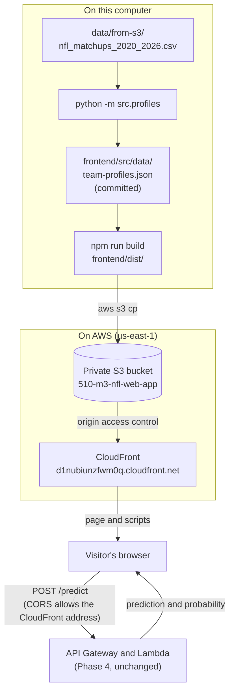
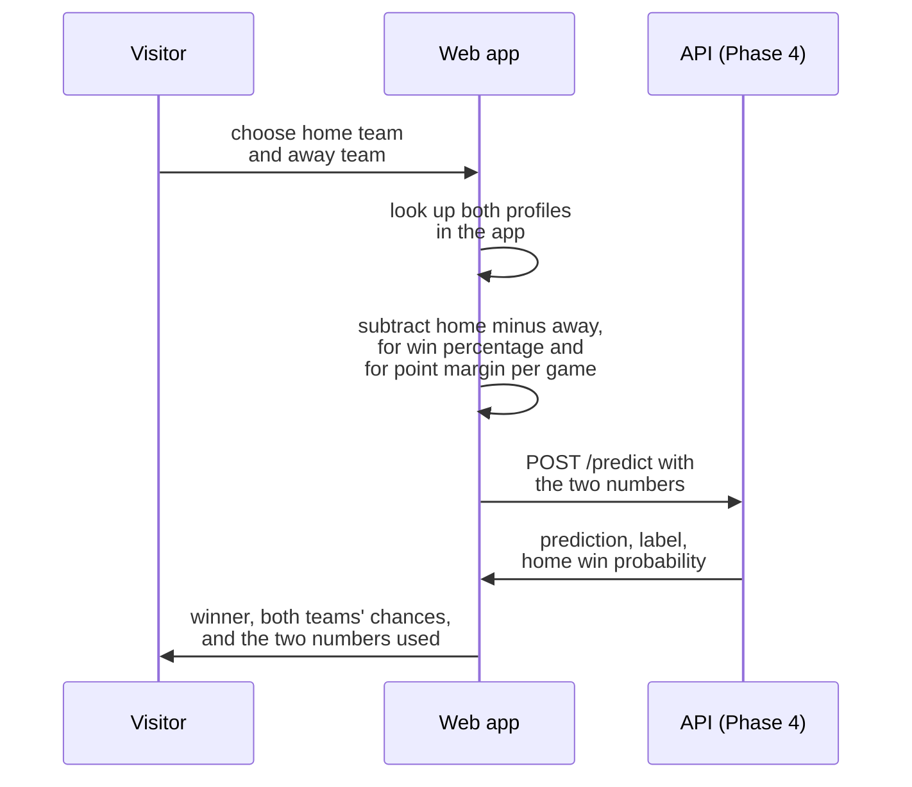

---
hide:
  - toc
---

# Phase 5 Brief: Web App and Hosting

**Status: Parts 1 and 2 built and hosted.** The site is live at **[https://d1nubiunzfwm0q.cloudfront.net](https://d1nubiunzfwm0q.cloudfront.net)**. Part 1 built one prediction page. Part 2 turned it into a five-tab site, NFL Prediction Analytics. See [Implementation Part 2](./implementation-part-2.md). The fixes found in review, including the phone layout, are done.

**Needs first:** Phase 4, whose output is the public API at `https://9awodatqc5.execute-api.us-east-1.amazonaws.com`, and Node.js with npm (Node 22.12 or later, or 24; this computer has 24.17.0 and npm 11.13.0).

Phase 5 builds the part a person uses and puts it on the internet. A visitor picks a home team and an away team in a small web app. The app looks up the two teams' standings, turns them into the model's two inputs, sends them to the live API, and shows the predicted winner and each team's chance of winning. The app's files sit in a private Amazon S3 bucket and are served over HTTPS through CloudFront. The README link to the page comes in [Phase 7](../phase-7/brief.md).

## How Do the Pieces Fit Together?

- **The standings ship inside the app.** They are a single snapshot, so the browser makes one call to the API per prediction and no other request to anything but CloudFront.
- **The API code is unchanged.** It still takes the two numbers and returns the answer. The only change to Phase 4's AWS resources is that the CloudFront address was added to the API's CORS list.

## What Happens When Someone Picks Two Teams?

## What Does the Page Show?

This list covers the Part 1 prediction page, which is now the Custom Matchup tab. The other four tabs are on [Implementation Part 2](./implementation-part-2.md#what-does-each-tab-do).

- **A header band** with the title "NFL Prediction Analytics", a chip with the model version and the standings date ("Model v1.0 · Standings through 2026 week 10"), and a "Dark theme" button.
- **A bold disclaimer banner** under the header: "**Unofficial coursework project.** Not affiliated with or endorsed by the National Football League. Predictions are for reference only."
- **Two drop-down lists,** "Home team" and "Away team", each with the 32 teams by full name. Under each, once a team is chosen, its record and margin, such as "5-5 record, -2.1 points per game". If the same team is in both, the page says "Choose two different teams." and sends nothing.
- **One button,** "Analyze" (it was "Predict" in Part 1).
- **The result:** the predicted winner by full name, taken from the API's `prediction` field, a bar split between the two teams' chances, and each team's chance as a percentage with one decimal. When both show 50.0%, the page adds "too close to call".
- **How the model saw this game:** the two numbers sent, written out in words.
- **What the model does not know:** the standings date, that the model uses only these two numbers (no injuries, weather, or anything else), that home teams get a small edge, and the model's validation score from the profiles file.
- **A readable message for each failure,** such as "Could not reach the API." or "The API had a problem (status 500)."
- **A footer** with links to the nflverse data, the source code, and the docs. The disclaimer and the model version appear only once, at the top.
- **A light and a dark theme.** The page starts in the visitor's system setting, and the button switches between the two. Both are built from white, black, purple, orange, gold, silver, and amber.
- **No outside requests.** The fonts (Oswald for headlines, Inter for text) are bundled into the build and served from CloudFront. No logos, analytics, cookies, local storage, or outside scripts.

The exact wording, the display rule, and the failure messages are on the [Implementation](./implementation-part-1.md#how-is-the-answer-shown) page.

## Where Do the Two Inputs Come From?

A browser cannot read the games table, so `python -m src.profiles` writes a small committed file, `frontend/src/data/team-profiles.json`, with each team's win percentage and point margin per game after 2026 week 10. These are the values `standings_before_week` gives for a week 11 game. The browser subtracts the away team's values from the home team's. The file keeps every digit, so the browser's subtraction gives exactly the numbers Python would. This was checked for all 992 ordered pairs of teams. The file's fields and the arithmetic are on the [Implementation](./implementation-part-1.md#who-works-out-each-number) page.

## Steps in Order

### Part 1 (Built)

- [x] **Step 1. Build the team profiles file** with `src/profiles.py` and `tests/test_profiles.py`, and a `frontend` block in `config/config.yaml`.
- [x] **Step 2. Create the Vite app in `frontend/`** with React and TypeScript, and commit the lock file.
- [x] **Step 3. Write the matchup logic** as small pure functions, tested with Vitest.
- [x] **Step 4. Build the page,** with a loading message, readable errors, labelled controls, and a layout that fits a phone.
- [x] **Step 5. Run it locally** against the local API through the dev server's proxy.
- [x] **Step 6. Check every matchup** (all 992 ordered pairs) against the live API and the local model.
- [x] **Step 7. Build the site** with the live API address, into `frontend/dist/`.
- [x] **Step 8. Create the hosting:** a private bucket, an origin access control, a CloudFront distribution, and a bucket policy that lets only that distribution read the bucket.
- [x] **Step 9. Upload the build and check the CloudFront address,** including that the bucket cannot be read directly.
- [x] **Step 10. Add the CloudFront address to the API's CORS list.** The developer still needs to check the page in a browser.
- [x] **Step 11. Write the hosting steps down** in the [Deployment Guide](./deployment-guide.md), with the commands that remove everything.
- [x] **Step 12. Style the page:** the header, disclaimer, records, probability bar, footer, the two themes, and the bundled fonts. Redeploy, and check the served files again.
- [x] **Step 13. Deploy from GitHub.** The workflow `.github/workflows/deploy-web-app.yml` redeploys the page when a change under `frontend/` reaches `main`, through an AWS role that needs no stored key. Its first run, on the merge of `phase-five`, passed.

### Part 2 (Built)

- [x] **Step 14. Build the season file** with `python -m src.season`: every 2026 game, with the standings before each week and each team's totals.
- [x] **Step 15. Rename the site and tidy the header:** NFL Prediction Analytics, the disclaimer and the model version once each at the top, and an "Analyze" button.
- [x] **Step 16. Add the tabs:** Overview, Games by Week, Custom Matchup (with a week list), Team Stats, and Feedback.
- [x] **Step 17. Add the feedback route:** a DynamoDB table, a small function, and `POST /feedback` on the same API. The prediction function is not changed. See [Feedback Path](../extras/features/feedback-path.md).
- [x] **Step 18. Add a Makefile** with the local commands. It now has nine, each explained on [Makefile](../extras/development/makefile.md).
- [x] **Step 19. Check every game,** all 272, in the browser's arithmetic and through the live API, then redeploy.
- [x] **Step 21. Keep a log of every training run** in `mlflow-reference/`: `make train` moves the last run into `previous-runs/`, writes the new one to `latest-run/`, and adds a row to `run-history.md`. See [How Do I Do a Training Run?](../phase-2/development-guide.md#how-do-i-do-a-training-run).
- [x] **Step 20. Fix what review found:** the phone width, the cramped forms, the see-through lists, two week numbers typed in manually, and the wording. See [What Was Fixed After Review?](./implementation-part-2.md#what-was-fixed-after-review).

## Results

- **Python tests:** **95 passed** for the whole project once a model is trained, or 93 passed and 2 skipped before. Part 1 added 8 for the profiles file, and Part 2 added 8 for the season file, 9 for the feedback function, and 10 for the MLflow export and its run history. The other 7 came later: 2 for the confusion-matrix picture, and 5 for the fetch and download steps.
- **App tests:** **62 passed**, across 12 test files. On a fresh checkout, 60 pass and 2 are skipped, because they need `build/expected-matchups.json` and `build/expected-season.json`.
- **Part 2, every game:** all 272 games of 2026 sent to the live API, every pick and probability equal to the local model. The check scripts are in `scripts/checks/`.
- **Part 2, feedback:** a test submission saved, read back, and deleted. The prediction function is unchanged.
- **Every matchup:** all **992** ordered pairs sent to the live API came back with status 200, and every pick and every probability (rounded to 4 places) equals the local model. The local model picks the home team in 601 and the away team in 391, with home win chances from 26.72% to 78.60%.
- **Hosting:** the files CloudFront serves are byte for byte the files the tests passed on. A request straight to the bucket gets status 403.
- **Worked example:** home New England Patriots, away Tennessee Titans gives the Patriots **63.8%** and the Titans **36.2%**.

## Decisions Made

- **React with TypeScript,** not plain TypeScript, because React makes the page's state easier to read and test.
- **One standings snapshot after 2026 week 10,** not a week picker, in Part 1. Part 2 added a week list that picks which earlier standings a game uses.
- **The model's scores are copied into the profiles file** from `results/run-summary.json`, so the page never shows a number typed in manually.
- **The folder is `frontend/`.** It was built as `web/` and renamed.
- **The bucket name `510-m3-nfl-web-app` was free** and is used as proposed.
- **TypeScript 7.0.2** works with the Vite template, so the template's older version was not needed.
- **The fonts are bundled, not loaded from a font service,** so the page still makes no outside request.
- **The theme choice is not saved.** A reload goes back to the system setting, because the app uses no cookies and no local storage.
- **GitHub deploys with a short-lived AWS sign-in,** not a stored access key. See [How Does a Change Reach the Live Page?](./implementation-part-1.md#how-does-a-change-reach-the-live-page).

## What Was Created

- **Code:** `src/profiles.py`, `tests/test_profiles.py`, and the app in `frontend/`.
- **Committed data:** `frontend/src/data/team-profiles.json`.
- **Settings:** a `frontend` block in `config/config.yaml`.
- **On AWS (`us-east-1`):** the bucket `510-m3-nfl-web-app`, the origin access control `510-m3-nfl-web-app-oac`, a CloudFront distribution tagged `510-m3-nfl-web-app`, a bucket policy, a second origin in the API's CORS list, the GitHub sign-in provider for AWS, and the deploy role `510-m3-nfl-web-app-deploy-role`.
- **Workflows:** `.github/workflows/deploy-web-app.yml`, and the repository secret `AWS_WEB_APP_DEPLOY_ROLE_ARN`, which holds the role's address. Later, `.github/workflows/test-web.yml` was added. It runs the app's tests and build on pull requests, with no AWS access. See [How Are the Web App's Tests Run on a Pull Request?](../extras/development/github-workflows.md#how-are-the-web-apps-tests-run-on-a-pull-request).
- **Docs:** this brief, the [Implementation](./implementation-part-1.md) page, the [Development Guide](./development-guide.md), and the [Deployment Guide](./deployment-guide.md).
- **Not committed:** `frontend/dist/` and `frontend/node_modules/`, which are rebuilt by `npm ci` and `npm run build`.

## What Is Not in This Phase

- Docker, built in [Phase 6](../phase-6/brief.md).
- The README and its link to the live page, and the final review, in [Phase 7](../phase-7/brief.md).
- A custom domain, protection rules, and analytics.

## Where to Read More

- [Implementation Part 1](./implementation-part-1.md) holds the exact contracts, how the page is hosted, and what was checked.
- [Implementation Part 2](./implementation-part-2.md) holds the five tabs, the season file, the team table, the feedback route, and what was checked.
- [Phase 5 Development Guide](./development-guide.md) shows how to run, test, and change the app on your own computer.
- [Phase 5 Deployment Guide](./deployment-guide.md) lists every AWS command, for the first deployment, a redeploy, and removal.
- [Phase 3 Development Guide](../phase-3/development-guide.md#how-do-i-ask-for-a-prediction) explains the two numbers, the request, and the response fields.
- [Design Manifest](../design-manifest.md#phase-5-web-app-and-hosting) lists the hosting and front-end choices and why.
