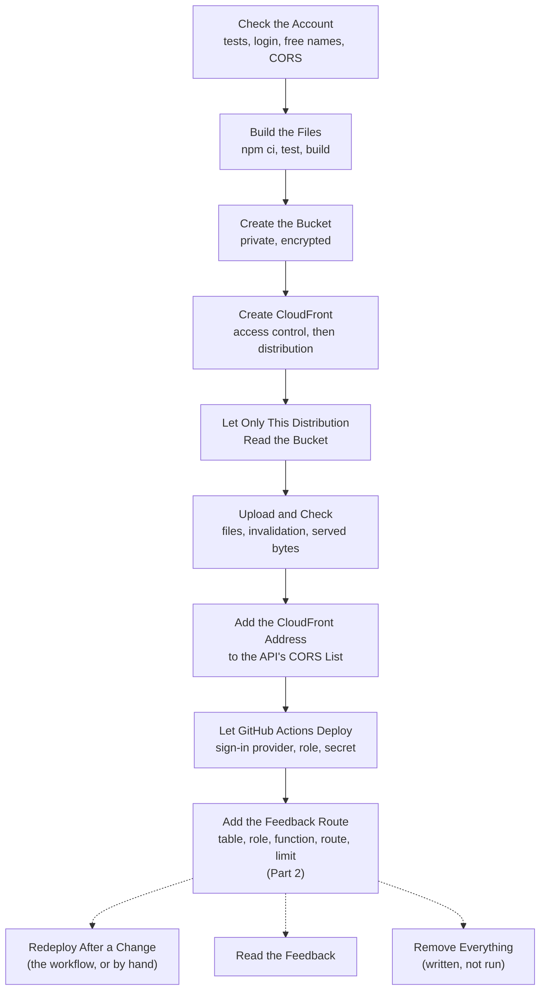

---
hide:
  - toc
---

# Phase 5 Deployment Guide

This guide holds every AWS command for the Phase 5 web app: the commands that put it online, in order, the commands that let GitHub Actions redeploy it, the commands to redeploy by hand, and the commands that remove it. How the hosting works, and why, is on the [Implementation](./implementation-part-1.md#how-is-the-page-hosted) page. To run and test the app with no AWS account, see the [Development Guide](./development-guide.md).

## How Do the Sections Fit Together?



- **The order avoids a circle.** The bucket policy needs the distribution's id, and the distribution needs the bucket. So the bucket and the access control come first, then the distribution, then the policy.
- **CORS comes after the distribution,** because the CloudFront address only exists once the distribution is created.
- **The deploy role comes after that,** because its permissions name the bucket and the distribution.
- **The feedback route comes last.** Part 2 added it to the existing API. It needs nothing from the hosting, and it does not touch the prediction function.

## Before the First Command

Run the commands from the project folder unless a step says `frontend/`. Resource names stay as written. These placeholders stand for values that differ between accounts or runs:

- `<account-id>`: the 12-digit AWS account number. It appears only inside ARNs.
- `<oac-id>`: the origin access control's id. In this deployment it is `E2S63K0CTCQG24`.
- `<distribution-id>`: the distribution's id. In this deployment it is `E1ZD23BE9RM77L`.
- `<distribution-domain>`: the distribution's address. In this deployment it is `d1nubiunzfwm0q.cloudfront.net`.
- `<invalidation-id>` and `<etag>`: values printed by the command before the one that uses them.

What must be true first:

- **Phase 4 is deployed,** and the API at `https://9awodatqc5.execute-api.us-east-1.amazonaws.com` answers `/health`.
- **AWS CLI version 2** (2.35.9 here), with default credentials for the account that owns the API, in `us-east-1`. CloudFront is a global service and ignores `--region`. It is passed anyway, so every line looks alike.
- **Node.js and npm,** as in the [Development Guide](./development-guide.md#what-is-needed-first).

**Heads up: this account holds another project's CloudFront resources,** the distribution `E14C2E7GBRK0V1` and the origin access control `sb-prod-site-oac`. They are not part of this project. Every command here names this project's own ids, and none of them touches those two.

## Check the Account

1. Run both test suites with `make pytest` and `make webtest`. The Python tests give **78 passed**. The app tests give **56 passed**, or **54 passed and 2 skipped** without the expected files in `build/`.

```bash
python -m pytest -q
```

```bash
npm test
```

2. Confirm the credentials work. The command prints your identity's ARN, which includes the account number.

```bash
aws sts get-caller-identity --query Arn --output text --region us-east-1
```

3. Confirm the bucket name is free. The expected result is an error with **404 Not Found**. A 403 means another account owns the name, and a different name is needed.

```bash
aws s3api head-bucket --bucket 510-m3-nfl-web-app --region us-east-1
```

4. Confirm there is no access control named `510-m3-nfl-web-app-oac`, and no distribution with the comment `510-m3-nfl-web-app`.

```bash
aws cloudfront list-origin-access-controls --query 'OriginAccessControlList.Items[].{Id:Id,Name:Name}' --region us-east-1
```

```bash
aws cloudfront list-distributions --query 'DistributionList.Items[].{Id:Id,Domain:DomainName,Comment:Comment}' --region us-east-1
```

5. Read the API's CORS setting. Before this phase it allows only `http://localhost:5173`, the methods `POST`, `GET`, and `OPTIONS`, the header `content-type`, and a max age of 300.

```bash
aws apigatewayv2 get-api --api-id 9awodatqc5 --region us-east-1 --query CorsConfiguration
```

6. Save a copy of that setting for the removal steps.

```bash
cat > build/cors-localhost-only.json <<'EOF'
{
  "AllowOrigins": ["http://localhost:5173"],
  "AllowMethods": ["POST", "GET", "OPTIONS"],
  "AllowHeaders": ["content-type"],
  "MaxAge": 300
}
EOF
```

7. Confirm the API is up.

```bash
curl -sS -w '\nHTTP %{http_code}\n' https://9awodatqc5.execute-api.us-east-1.amazonaws.com/health
```

## Build the Files

8. From `frontend/`, install the exact package versions, run the tests, and build.

```bash
npm ci
```

```bash
npm test
```

```bash
npm run build
```

9. Record the fingerprint of each built file. The upload is checked against these values later. The current build is `index.html` (1,105 bytes), `assets/index-KSsdwuOf.js` (233,372 bytes), `assets/index-yAxaDZ6u.css` (10,307 bytes), and 12 `.woff2` font files. The first deployment had only the first three kinds of file, under other names. The commands below use the current names. A new build gets new names, so use the ones in your own `dist/assets/`.

```bash
shasum -a 256 dist/index.html dist/assets/*
```

## Create the Bucket

10. Create the bucket, block all public access, turn on encryption, and tag it. `us-east-1` takes no location setting.

```bash
aws s3api create-bucket --bucket 510-m3-nfl-web-app --region us-east-1
```

```bash
aws s3api put-public-access-block --bucket 510-m3-nfl-web-app --public-access-block-configuration BlockPublicAcls=true,IgnorePublicAcls=true,BlockPublicPolicy=true,RestrictPublicBuckets=true --region us-east-1
```

```bash
aws s3api put-bucket-encryption --bucket 510-m3-nfl-web-app --server-side-encryption-configuration '{"Rules":[{"ApplyServerSideEncryptionByDefault":{"SSEAlgorithm":"AES256"}}]}' --region us-east-1
```

```bash
aws s3api put-bucket-tagging --bucket 510-m3-nfl-web-app --tagging 'TagSet=[{Key=project,Value=510-m3}]' --region us-east-1
```

11. Read the settings back: all four blocks `true`, `AES256`, and ownership `BucketOwnerEnforced` (the default, which turns off per-file permissions).

```bash
aws s3api get-public-access-block --bucket 510-m3-nfl-web-app --region us-east-1
```

```bash
aws s3api get-bucket-encryption --bucket 510-m3-nfl-web-app --region us-east-1
```

```bash
aws s3api get-bucket-ownership-controls --bucket 510-m3-nfl-web-app --region us-east-1
```

## Create CloudFront

12. Create the origin access control. Record the `Id` it prints as `<oac-id>`.

```bash
aws cloudfront create-origin-access-control --origin-access-control-config 'Name=510-m3-nfl-web-app-oac,Description=CloudFront signs its requests to the 510-m3-nfl-web-app bucket,SigningProtocol=sigv4,SigningBehavior=always,OriginAccessControlOriginType=s3' --region us-east-1
```

13. Write the distribution's settings, with the real `<oac-id>`. The cache policy id `658327ea-f89d-4fab-a63d-7e88639e58f6` is the AWS managed policy `Managed-CachingOptimized`. It follows each file's `Cache-Control` header, so the upload in step 18 sets how long files are kept.

```bash
cat > build/cloudfront-config.json <<'EOF'
{
  "DistributionConfig": {
    "CallerReference": "510-m3-nfl-web-app-1",
    "Comment": "510-m3-nfl-web-app",
    "Enabled": true,
    "DefaultRootObject": "index.html",
    "HttpVersion": "http2and3",
    "IsIPV6Enabled": true,
    "Origins": {
      "Quantity": 1,
      "Items": [
        {
          "Id": "510-m3-nfl-web-app-s3",
          "DomainName": "510-m3-nfl-web-app.s3.us-east-1.amazonaws.com",
          "OriginAccessControlId": "<oac-id>",
          "S3OriginConfig": { "OriginAccessIdentity": "" }
        }
      ]
    },
    "DefaultCacheBehavior": {
      "TargetOriginId": "510-m3-nfl-web-app-s3",
      "ViewerProtocolPolicy": "redirect-to-https",
      "AllowedMethods": {
        "Quantity": 2,
        "Items": ["GET", "HEAD"],
        "CachedMethods": { "Quantity": 2, "Items": ["GET", "HEAD"] }
      },
      "Compress": true,
      "CachePolicyId": "658327ea-f89d-4fab-a63d-7e88639e58f6"
    },
    "ViewerCertificate": { "CloudFrontDefaultCertificate": true }
  },
  "Tags": {
    "Items": [
      { "Key": "project", "Value": "510-m3" },
      { "Key": "Name", "Value": "510-m3-nfl-web-app" }
    ]
  }
}
EOF
```

14. Create the distribution, from the project folder, so the `file://` path is found. Record the `Id` as `<distribution-id>` and the `DomainName` as `<distribution-domain>`. Run it once. The fixed `CallerReference` makes a second run fail with `DistributionAlreadyExists`, and not create a second distribution.

```bash
aws cloudfront create-distribution-with-tags --distribution-config-with-tags file://build/cloudfront-config.json --region us-east-1
```

15. Wait until it is deployed, which takes a few minutes, then read the settings back.

```bash
aws cloudfront wait distribution-deployed --id <distribution-id> --region us-east-1
```

```bash
aws cloudfront get-distribution-config --id <distribution-id> --region us-east-1
```

## Let Only This Distribution Read the Bucket

16. Write the bucket policy, with the real account and distribution ids. It allows CloudFront to read files only when the request comes from this one distribution. Blocking public policies does not block this one, because a policy that names one distribution is not public.

```bash
cat > build/bucket-policy.json <<'EOF'
{
  "Version": "2012-10-17",
  "Statement": [
    {
      "Sid": "AllowCloudFrontReadFor510M3NflWebApp",
      "Effect": "Allow",
      "Principal": { "Service": "cloudfront.amazonaws.com" },
      "Action": "s3:GetObject",
      "Resource": "arn:aws:s3:::510-m3-nfl-web-app/*",
      "Condition": {
        "StringEquals": {
          "AWS:SourceArn": "arn:aws:cloudfront::<account-id>:distribution/<distribution-id>"
        }
      }
    }
  ]
}
EOF
```

17. Apply it, and confirm the bucket is not public (`"IsPublic": false`).

```bash
aws s3api put-bucket-policy --bucket 510-m3-nfl-web-app --policy file://build/bucket-policy.json --region us-east-1
```

```bash
aws s3api get-bucket-policy-status --bucket 510-m3-nfl-web-app --region us-east-1
```

## Upload and Check

18. Upload the hashed files first and `index.html` last, so the page is never served before the files it names. The hashed files are kept for a year, and `index.html` is checked again on every load.

```bash
aws s3 cp frontend/dist/assets/ s3://510-m3-nfl-web-app/assets/ --recursive --cache-control "public, max-age=31536000, immutable" --region us-east-1
```

```bash
aws s3 cp frontend/dist/index.html s3://510-m3-nfl-web-app/index.html --cache-control "no-cache" --content-type "text/html; charset=utf-8" --region us-east-1
```

19. Tell CloudFront to drop its copies of the page, under both the bare address and `/index.html`. Record the `Invalidation.Id` as `<invalidation-id>`, and wait for it.

```bash
aws cloudfront create-invalidation --distribution-id <distribution-id> --paths "/index.html" "/" --region us-east-1
```

```bash
aws cloudfront wait invalidation-completed --distribution-id <distribution-id> --id <invalidation-id> --region us-east-1
```

20. Check the files in the bucket. Expect every file in `frontend/dist/`, plus any earlier builds' hashed files. `index.html` has `text/html; charset=utf-8` and `no-cache`. The stylesheet has `text/css`, the script has `text/javascript`, and each font has `font/woff2`, all with `public, max-age=31536000, immutable`.

```bash
aws s3 ls s3://510-m3-nfl-web-app --recursive --region us-east-1
```

```bash
aws s3api head-object --bucket 510-m3-nfl-web-app --key index.html --region us-east-1
```

```bash
aws s3api head-object --bucket 510-m3-nfl-web-app --key assets/index-KSsdwuOf.js --region us-east-1
```

```bash
aws s3api head-object --bucket 510-m3-nfl-web-app --key assets/inter-latin-wght-normal-Dx4kXJAl.woff2 --region us-east-1
```

21. **Check that CloudFront serves the tested bytes.** Each fingerprint must equal the one from step 9. `/` and `/index.html` are both the `index.html` file. `curl` asks for no compression by default, so the bytes are the file itself.

```bash
curl -sS https://<distribution-domain>/ | shasum -a 256
```

```bash
curl -sS https://<distribution-domain>/index.html | shasum -a 256
```

```bash
for f in frontend/dist/assets/*; do printf '%s ' "$(basename "$f")"; curl -sS "https://<distribution-domain>/assets/$(basename "$f")" | shasum -a 256; done
```

22. Check the rest of the setup. Expect, in order: `content-encoding: gzip`; status 301 with `location: https://<distribution-domain>/`; status 403 for a `POST`; status 403 for both direct S3 addresses; and status 403 for a missing path.

```bash
curl -sS -D - -o /dev/null -H "Accept-Encoding: gzip" https://<distribution-domain>/assets/index-KSsdwuOf.js
```

```bash
curl -sS -D - -o /dev/null http://<distribution-domain>/
```

```bash
curl -sS -o /dev/null -w '%{http_code}\n' -X POST https://<distribution-domain>/
```

```bash
curl -sS -o /dev/null -w '%{http_code}\n' https://510-m3-nfl-web-app.s3.us-east-1.amazonaws.com/index.html
```

```bash
curl -sS -o /dev/null -w '%{http_code}\n' https://510-m3-nfl-web-app.s3.amazonaws.com/index.html
```

```bash
curl -sS -o /dev/null -w '%{http_code}\n' https://<distribution-domain>/no-such-file
```

23. Confirm the page would still be blocked. Before the next section, a preflight from the CloudFront address returns 204 with no `access-control-allow-origin` header.

```bash
curl -sS -D - -o /dev/null -X OPTIONS https://9awodatqc5.execute-api.us-east-1.amazonaws.com/predict -H "Origin: https://<distribution-domain>" -H "Access-Control-Request-Method: POST" -H "Access-Control-Request-Headers: content-type"
```

## Add the CloudFront Address to the API's CORS List

24. Write the new setting with both origins, and apply it. The update replaces the whole setting, so the local origin must be written again. The origin has no trailing slash.

```bash
cat > build/cors.json <<'EOF'
{
  "AllowOrigins": ["http://localhost:5173", "https://<distribution-domain>"],
  "AllowMethods": ["POST", "GET", "OPTIONS"],
  "AllowHeaders": ["content-type"],
  "MaxAge": 300
}
EOF
```

```bash
aws apigatewayv2 update-api --api-id 9awodatqc5 --cors-configuration file://build/cors.json --region us-east-1
```

```bash
aws apigatewayv2 get-api --api-id 9awodatqc5 --region us-east-1 --query CorsConfiguration
```

25. Check the preflight from each origin. The CloudFront address and `http://localhost:5173` each get 204 with their own `access-control-allow-origin`. `http://example.com` gets 204 with no such header.

```bash
curl -sS -D - -o /dev/null -X OPTIONS https://9awodatqc5.execute-api.us-east-1.amazonaws.com/predict -H "Origin: https://<distribution-domain>" -H "Access-Control-Request-Method: POST" -H "Access-Control-Request-Headers: content-type"
```

```bash
curl -sS -D - -o /dev/null -X OPTIONS https://9awodatqc5.execute-api.us-east-1.amazonaws.com/predict -H "Origin: http://localhost:5173" -H "Access-Control-Request-Method: POST" -H "Access-Control-Request-Headers: content-type"
```

```bash
curl -sS -D - -o /dev/null -X OPTIONS https://9awodatqc5.execute-api.us-east-1.amazonaws.com/predict -H "Origin: http://example.com" -H "Access-Control-Request-Method: POST" -H "Access-Control-Request-Headers: content-type"
```

26. Send a real prediction with the CloudFront origin. It returns status 200, `access-control-allow-origin: https://<distribution-domain>`, and `{"prediction":1,"predicted_label":"home win","home_win_probability":0.6376,"model_version":"v1.0"}`.

```bash
curl -sS -D - -X POST https://9awodatqc5.execute-api.us-east-1.amazonaws.com/predict -H "Origin: https://<distribution-domain>" -H "Content-Type: application/json" -d '{"win_pct_differential":0.3888888888888889,"point_diff_per_game_differential":5.9}'
```

27. Run the every-matchup check from the [Development Guide](./development-guide.md#how-do-i-check-every-matchup). It must end with `mismatches: 0`.

28. **Check the page in a browser** at `https://<distribution-domain>/`. Home New England Patriots and away Tennessee Titans shows the Patriots at 63.8% and the Titans at 36.2%. The same team twice shows "Choose two different teams." The browser console shows no CORS error.

## Let GitHub Actions Deploy

These steps let the workflow `.github/workflows/deploy-web-app.yml` deploy with a short-lived AWS sign-in, and no stored access key. How it works is on the [Implementation](./implementation-part-1.md#how-does-a-change-reach-the-live-page) page. Write the two policy files with the real account number, under `build/`, which git ignores.

29. Confirm there is no GitHub sign-in provider and no role with this name yet. The second command should fail with `NoSuchEntity`.

```bash
aws iam list-open-id-connect-providers --region us-east-1
```

```bash
aws iam get-role --role-name 510-m3-nfl-web-app-deploy-role --region us-east-1
```

30. Create the GitHub sign-in provider. AWS fills in the certificate thumbprint itself.

```bash
aws iam create-open-id-connect-provider --url https://token.actions.githubusercontent.com --client-id-list sts.amazonaws.com --tags Key=project,Value=510-m3 --region us-east-1
```

31. Write the trust policy. It lets only runs on `main` of this repository use the role.

```bash
cat > build/web-app-deploy-trust.json <<'EOF'
{
  "Version": "2012-10-17",
  "Statement": [
    {
      "Effect": "Allow",
      "Principal": { "Federated": "arn:aws:iam::<account-id>:oidc-provider/token.actions.githubusercontent.com" },
      "Action": "sts:AssumeRoleWithWebIdentity",
      "Condition": {
        "StringEquals": {
          "token.actions.githubusercontent.com:aud": "sts.amazonaws.com",
          "token.actions.githubusercontent.com:sub": "repo:jconnors23/510-m3-nfl-prediction-analytics:ref:refs/heads/main"
        }
      }
    }
  ]
}
EOF
```

32. Create the role, with sessions of at most an hour.

```bash
aws iam create-role --role-name 510-m3-nfl-web-app-deploy-role --assume-role-policy-document file://build/web-app-deploy-trust.json --description "GitHub Actions deploys the web app to S3 and CloudFront" --max-session-duration 3600 --tags Key=project,Value=510-m3 --region us-east-1
```

33. Write the permissions and attach them. They allow uploading files into the web app bucket, and creating and reading invalidations on this one distribution. Nothing else.

```bash
cat > build/web-app-deploy-policy.json <<'EOF'
{
  "Version": "2012-10-17",
  "Statement": [
    {
      "Sid": "UploadTheBuild",
      "Effect": "Allow",
      "Action": "s3:PutObject",
      "Resource": "arn:aws:s3:::510-m3-nfl-web-app/*"
    },
    {
      "Sid": "RefreshThePage",
      "Effect": "Allow",
      "Action": ["cloudfront:CreateInvalidation", "cloudfront:GetInvalidation"],
      "Resource": "arn:aws:cloudfront::<account-id>:distribution/<distribution-id>"
    }
  ]
}
EOF
```

```bash
aws iam put-role-policy --role-name 510-m3-nfl-web-app-deploy-role --policy-name 510-m3-nfl-web-app-deploy --policy-document file://build/web-app-deploy-policy.json --region us-east-1
```

34. Read both documents back.

```bash
aws iam get-role --role-name 510-m3-nfl-web-app-deploy-role --query Role.AssumeRolePolicyDocument --region us-east-1
```

```bash
aws iam get-role-policy --role-name 510-m3-nfl-web-app-deploy-role --policy-name 510-m3-nfl-web-app-deploy --region us-east-1
```

35. Save the role's address as the repository secret `AWS_WEB_APP_DEPLOY_ROLE_ARN`. The first command prints it. Paste it into GitHub under Settings, Secrets and variables, Actions, or use the second command with the GitHub CLI.

```bash
aws iam get-role --role-name 510-m3-nfl-web-app-deploy-role --query Role.Arn --output text --region us-east-1
```

```bash
gh secret set AWS_WEB_APP_DEPLOY_ROLE_ARN --repo jconnors23/510-m3-nfl-prediction-analytics
```

36. Merge `.github/workflows/deploy-web-app.yml` into `main`. The merge changes the workflow file, so it starts the first run. Watch it in the Actions tab. The summary lists the deployed files and says whether the served bytes matched. It is written even when a step fails, with `not checked` for a step that did not run.

## Add the Feedback Route

These steps add `POST /feedback` to the existing API, for the Feedback tab. How it works is on [Implementation Part 2](./implementation-part-2.md#how-does-the-feedback-reach-the-table). `<integration-id>` and `<route-id>` are printed by the commands that create them. In this deployment they are `y286yp2` and `lte10if`.

37. Confirm nothing exists yet. The first three commands should fail with "not found", and the last should list only `POST /predict` and `GET /health`.

```bash
aws dynamodb describe-table --table-name 510-m3-nfl-feedback --region us-east-1
```

```bash
aws lambda get-function --function-name 510-m3-nfl-feedback-api --region us-east-1
```

```bash
aws iam get-role --role-name 510-m3-nfl-feedback-api-role --region us-east-1
```

```bash
aws apigatewayv2 get-routes --api-id 9awodatqc5 --query 'Items[].RouteKey' --region us-east-1
```

38. Create the table, keyed by `feedback_id` and billed per request, then wait until it is ready.

```bash
aws dynamodb create-table --table-name 510-m3-nfl-feedback --attribute-definitions AttributeName=feedback_id,AttributeType=S --key-schema AttributeName=feedback_id,KeyType=HASH --billing-mode PAY_PER_REQUEST --tags Key=project,Value=510-m3 --region us-east-1
```

```bash
aws dynamodb wait table-exists --table-name 510-m3-nfl-feedback --region us-east-1
```

39. Write the function's trust policy (only Lambda can use the role) and its one permission (write one item to this table), with the real account number.

```bash
cat > build/feedback-trust.json <<'EOF'
{
  "Version": "2012-10-17",
  "Statement": [
    { "Effect": "Allow", "Principal": { "Service": "lambda.amazonaws.com" }, "Action": "sts:AssumeRole" }
  ]
}
EOF
```

```bash
cat > build/feedback-write.json <<'EOF'
{
  "Version": "2012-10-17",
  "Statement": [
    {
      "Sid": "SaveFeedback",
      "Effect": "Allow",
      "Action": "dynamodb:PutItem",
      "Resource": "arn:aws:dynamodb:us-east-1:<account-id>:table/510-m3-nfl-feedback"
    }
  ]
}
EOF
```

40. Create the role, let it write logs, and attach the one permission.

```bash
aws iam create-role --role-name 510-m3-nfl-feedback-api-role --assume-role-policy-document file://build/feedback-trust.json --description "The feedback function writes one item to its table" --tags Key=project,Value=510-m3 --region us-east-1
```

```bash
aws iam attach-role-policy --role-name 510-m3-nfl-feedback-api-role --policy-arn arn:aws:iam::aws:policy/service-role/AWSLambdaBasicExecutionRole --region us-east-1
```

```bash
aws iam put-role-policy --role-name 510-m3-nfl-feedback-api-role --policy-name 510-m3-nfl-feedback-write --policy-document file://build/feedback-write.json --region us-east-1
```

41. Build the zip. It holds only `src/api/feedback_handler.py`, at that path, because the function uses the `boto3` that Lambda already provides.

```bash
rm -f build/510-m3-nfl-feedback-api.zip
```

```bash
zip build/510-m3-nfl-feedback-api.zip src/api/feedback_handler.py
```

42. Create the function, then wait until it is active. If it fails because the new role cannot be used yet, wait a few seconds and run it again.

```bash
aws lambda create-function --function-name 510-m3-nfl-feedback-api --runtime python3.13 --architectures arm64 --handler src.api.feedback_handler.handler --role arn:aws:iam::<account-id>:role/510-m3-nfl-feedback-api-role --zip-file fileb://build/510-m3-nfl-feedback-api.zip --memory-size 256 --timeout 5 --environment "Variables={FEEDBACK_TABLE=510-m3-nfl-feedback}" --tags project=510-m3 --region us-east-1
```

```bash
aws lambda wait function-active-v2 --function-name 510-m3-nfl-feedback-api --region us-east-1
```

43. Connect the route. Create the integration and note its id, create the route, and let only this route call the function.

```bash
aws apigatewayv2 create-integration --api-id 9awodatqc5 --integration-type AWS_PROXY --integration-uri arn:aws:lambda:us-east-1:<account-id>:function:510-m3-nfl-feedback-api --payload-format-version 2.0 --query IntegrationId --output text --region us-east-1
```

```bash
aws apigatewayv2 create-route --api-id 9awodatqc5 --route-key "POST /feedback" --target integrations/<integration-id> --region us-east-1
```

```bash
aws lambda add-permission --function-name 510-m3-nfl-feedback-api --statement-id 510-m3-nfl-feedback-http-api --action lambda:InvokeFunction --principal apigateway.amazonaws.com --source-arn "arn:aws:execute-api:us-east-1:<account-id>:9awodatqc5/*/POST/feedback" --region us-east-1
```

44. Limit that route only, to 1 request a second with bursts of 5, then read the stage back. Only `POST /feedback` should have a limit.

```bash
aws apigatewayv2 update-stage --api-id 9awodatqc5 --stage-name '$default' --route-settings '{"POST /feedback":{"ThrottlingBurstLimit":5,"ThrottlingRateLimit":1}}' --region us-east-1
```

```bash
aws apigatewayv2 get-stage --api-id 9awodatqc5 --stage-name '$default' --query RouteSettings --region us-east-1
```

45. Check the route. A 5-character message should return 422 with "The message must be 10 to 1,000 characters." The existing CORS setting already allows `POST` with `content-type` from the CloudFront address, so nothing changes there.

```bash
curl -sS -w '\nHTTP %{http_code}\n' -X POST https://9awodatqc5.execute-api.us-east-1.amazonaws.com/feedback -H "Content-Type: application/json" -d '{"category":"general","rating":null,"message":"short","website":""}'
```

46. After the first call, tag the function's log group and keep its logs for 14 days.

```bash
aws logs tag-resource --resource-arn arn:aws:logs:us-east-1:<account-id>:log-group:/aws/lambda/510-m3-nfl-feedback-api --tags project=510-m3 --region us-east-1
```

```bash
aws logs put-retention-policy --log-group-name /aws/lambda/510-m3-nfl-feedback-api --retention-in-days 14 --region us-east-1
```

47. Confirm the prediction function did not change. Its `CodeSha256` should still be `IU5bJH9pTL+rF/uEXMUAp+Eo/mik2abfaSasBXPOgbk=`.

```bash
aws lambda get-function-configuration --function-name 510-m3-nfl-predict-api --query CodeSha256 --output text --region us-east-1
```

## Read the Feedback

The feedback is read with the AWS command line. There is no page for it. The first command counts the items. The second lists every item with its time, category, rating, and message.

```bash
aws dynamodb scan --table-name 510-m3-nfl-feedback --select COUNT --query Count --region us-east-1
```

```bash
aws dynamodb scan --table-name 510-m3-nfl-feedback --query 'Items[].{When:submitted_at.S,Category:category.S,Rating:rating.N,Message:message.S}' --output table --region us-east-1
```

To change the feedback function's code, rebuild the zip with step 41, then update the function. Its `CodeSha256` changes, and the prediction function's does not.

```bash
aws lambda update-function-code --function-name 510-m3-nfl-feedback-api --zip-file fileb://build/510-m3-nfl-feedback-api.zip --region us-east-1
```

## Redeploy After a Change

**The workflow does this by itself** when a change under `frontend/` reaches `main`. The steps below are the same thing by hand, for a deploy without GitHub. The bucket, the distribution, and CORS stay as they are.

1. From `frontend/`, install, test, and build. The new script and stylesheet get new hashed names.

```bash
npm ci
```

```bash
npm test
```

```bash
npm run build
```

2. Upload the hashed files, then `index.html`. Old hashed files stay in the bucket, so a visitor who loaded the previous page a moment earlier still gets the files it names.

```bash
aws s3 cp frontend/dist/assets/ s3://510-m3-nfl-web-app/assets/ --recursive --cache-control "public, max-age=31536000, immutable" --region us-east-1
```

```bash
aws s3 cp frontend/dist/index.html s3://510-m3-nfl-web-app/index.html --cache-control "no-cache" --content-type "text/html; charset=utf-8" --region us-east-1
```

3. Invalidate the page, and wait.

```bash
aws cloudfront create-invalidation --distribution-id <distribution-id> --paths "/index.html" "/" --region us-east-1
```

```bash
aws cloudfront wait invalidation-completed --distribution-id <distribution-id> --id <invalidation-id> --region us-east-1
```

4. Repeat steps 21 and 28 with the new file names: the served fingerprints must equal the local build, and the known matchup must show the same answer in a browser.

## Remove Everything

These commands were written and not run. They remove only this project's deploy role, bucket, distribution, and access control, and put the API's CORS list back to the local origin. The other project's distribution `E14C2E7GBRK0V1` is never touched.

**To remove only the feedback route,** delete these in order. They leave the prediction routes and the hosting in place.

```bash
aws apigatewayv2 delete-route --api-id 9awodatqc5 --route-id <route-id> --region us-east-1
```

```bash
aws apigatewayv2 delete-integration --api-id 9awodatqc5 --integration-id <integration-id> --region us-east-1
```

```bash
aws apigatewayv2 update-stage --api-id 9awodatqc5 --stage-name '$default' --route-settings '{}' --region us-east-1
```

```bash
aws lambda delete-function --function-name 510-m3-nfl-feedback-api --region us-east-1
```

```bash
aws logs delete-log-group --log-group-name /aws/lambda/510-m3-nfl-feedback-api --region us-east-1
```

```bash
aws iam delete-role-policy --role-name 510-m3-nfl-feedback-api-role --policy-name 510-m3-nfl-feedback-write --region us-east-1
```

```bash
aws iam detach-role-policy --role-name 510-m3-nfl-feedback-api-role --policy-arn arn:aws:iam::aws:policy/service-role/AWSLambdaBasicExecutionRole --region us-east-1
```

```bash
aws iam delete-role --role-name 510-m3-nfl-feedback-api-role --region us-east-1
```

```bash
aws dynamodb delete-table --table-name 510-m3-nfl-feedback --region us-east-1
```

**To remove everything, start with the feedback route above, then remove the deploy role,** so no workflow run can upload while the rest is taken down. Then delete the secret `AWS_WEB_APP_DEPLOY_ROLE_ARN` in GitHub. Delete the GitHub sign-in provider only if nothing else in the account uses it. The last command shows its address.

```bash
aws iam delete-role-policy --role-name 510-m3-nfl-web-app-deploy-role --policy-name 510-m3-nfl-web-app-deploy --region us-east-1
```

```bash
aws iam delete-role --role-name 510-m3-nfl-web-app-deploy-role --region us-east-1
```

```bash
aws iam list-open-id-connect-providers --region us-east-1
```

```bash
aws iam delete-open-id-connect-provider --open-id-connect-provider-arn arn:aws:iam::<account-id>:oidc-provider/token.actions.githubusercontent.com --region us-east-1
```

1. Put CORS back to `http://localhost:5173` only. If `build/` was cleared, recreate the file with step 6 first.

```bash
aws apigatewayv2 update-api --api-id 9awodatqc5 --cors-configuration file://build/cors-localhost-only.json --region us-east-1
```

2. Turn the distribution off. A distribution must be off before it can be deleted. The first command saves its settings and prints the `ETag` to use as `<etag>`. The second writes a copy of the settings with `Enabled` set to `false`. The third sends that copy back.

```bash
aws cloudfront get-distribution-config --id <distribution-id> --region us-east-1 > build/distribution-config.json
```

```bash
python -c "import json; d = json.load(open('build/distribution-config.json')); print(d['ETag']); c = d['DistributionConfig']; c['Enabled'] = False; json.dump(c, open('build/distribution-disabled.json', 'w'), indent=2)"
```

```bash
aws cloudfront update-distribution --id <distribution-id> --if-match <etag> --distribution-config file://build/distribution-disabled.json --region us-east-1
```

```bash
aws cloudfront wait distribution-deployed --id <distribution-id> --region us-east-1
```

3. Delete the distribution. Turning it off changed its `ETag`, so read the new one first.

```bash
aws cloudfront get-distribution --id <distribution-id> --query ETag --output text --region us-east-1
```

```bash
aws cloudfront delete-distribution --id <distribution-id> --if-match <etag> --region us-east-1
```

4. Delete the access control, with its own `ETag`.

```bash
aws cloudfront get-origin-access-control --id <oac-id> --query ETag --output text --region us-east-1
```

```bash
aws cloudfront delete-origin-access-control --id <oac-id> --if-match <etag> --region us-east-1
```

5. Empty the bucket and delete it.

```bash
aws s3 rm s3://510-m3-nfl-web-app --recursive --region us-east-1
```

```bash
aws s3api delete-bucket --bucket 510-m3-nfl-web-app --region us-east-1
```
