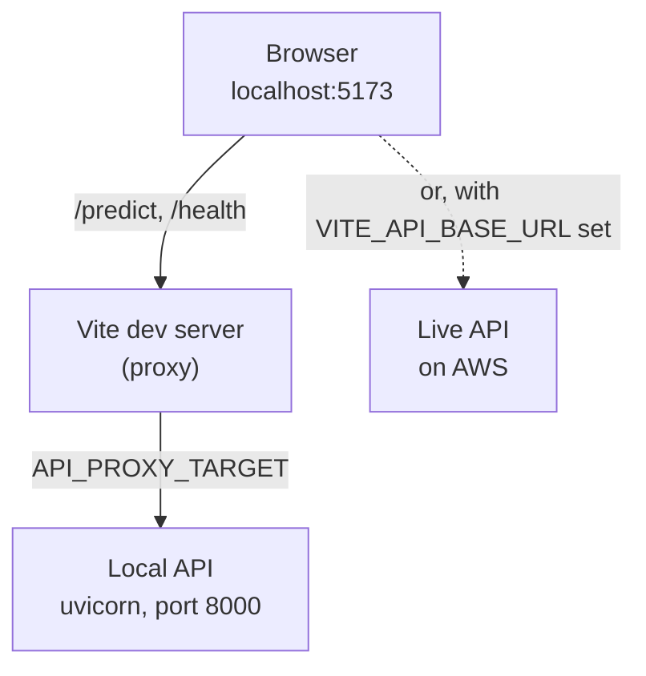
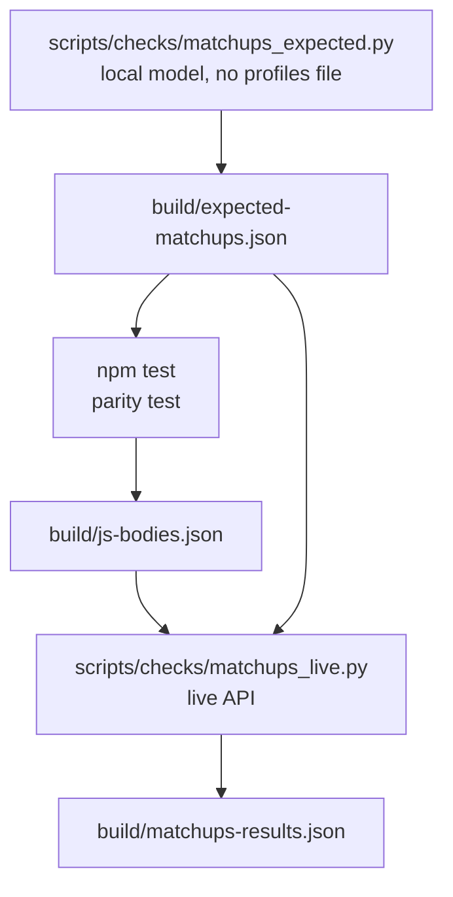

---
hide:
  - toc
---

# Phase 5 Development Guide

This guide shows how to run the web app on your own computer, test it, build it, check every matchup against the live API, and change it. Nothing on this page creates or changes anything on AWS. To put a new build online, see the [Deployment Guide](./deployment-guide.md). The contracts and the reasons are on the [Implementation](./implementation-part-1.md) page.

## What Is Needed First?

- **Node.js 22.12 or later, or 24, with npm.** This matches the Vitest requirement and `frontend/package.json`. This computer has Node 24.17.0 and npm 11.13.0. Check with `node --version`.
- **The installed packages,** from `frontend/`. `npm ci` installs exactly the versions in `frontend/package-lock.json`, the way `requirements.txt` pins the Python packages:

```bash
npm ci
```

- **For the local API and the profiles file:** the project's Python environment, set up with the [Phase 1 commands](../phase-1/development-guide.md#what-is-needed-first), and the saved model `models/model.joblib` (run `python -m src.model.train` if it is missing).
- **No AWS account.** The live API is public, and nothing here writes to AWS.

Run every `npm` command from `frontend/`, and every `python` command from the project folder.

## Which Make Commands Are There?

This guide uses three of them: `make start` (the local API), `make start-web` (the web app's dev server), and `make web-test` (the app's tests). Every command, what it needs, and the port it uses are on [Makefile](../extras/development/makefile.md).

For a local run, use two terminals: `make start` in one, then `make start-web` in the other. 
- **Port 8000 must be free for `make start`.** A `mkdocs serve` on its default port holds 8000. Use `make docs` instead, which serves the docs on 8001.
- **The Feedback tab does not work locally.** The `/feedback` route exists only on AWS, so the form gets status 404 from the local service. See [Feedback Path](../extras/features/feedback-path.md).

## How Do I Run It Locally?



### Step 1: Start the Local API

From the project folder:

```bash
python -m uvicorn src.api.app:app --port 8000
```

This is the Phase 3 service. Leave it running. If port 8000 is taken, for example by `mkdocs serve`, use `--port 8001` and see Step 2.

### Step 2: Start the Dev Server

From `frontend/`:

```bash
npm run dev
```

Open `http://localhost:5173`. The page calls its own address, and the dev server forwards `/predict`, `/health`, and `/feedback` to `http://127.0.0.1:8000`, so no CORS is involved. If the API is on another port, tell the dev server where it is:

```bash
API_PROXY_TARGET=http://127.0.0.1:8001 npm run dev
```

- **Port 5173 is fixed.** If something else holds it, the dev server stops with `Port 5173 is already in use` and does not move to another port. The live API's CORS list allows `http://localhost:5173` and no other local port.
- **Changes show at once.** Saving a file under `frontend/src/` reloads the page.
- **Stop it** with `Ctrl+C`, and stop the API the same way.

### Step 3: Try the Live API From the Dev Server (Optional)

To call the AWS API instead of the local one, set the address when you start the dev server. A value set in the shell takes priority over `frontend/.env.development`.

```bash
VITE_API_BASE_URL=https://9awodatqc5.execute-api.us-east-1.amazonaws.com npm run dev
```

The browser now sends a preflight to the live API, which allows `http://localhost:5173`. No local API is needed for this step.

### Step 4: Check a Known Matchup

Open the **Custom Matchup** tab. Pick **New England Patriots** as the home team and **Tennessee Titans** as the away team, then click Analyze. The page shows the Patriots as the winner at **63.8%**, the Titans at **36.2%**, and the two numbers sent, 0.389 and 5.9. The full worked example is on the [Implementation](./implementation-part-1.md#what-is-a-worked-example) page.

## How Do I Run the Tests?

### App Tests

From `frontend/`:

```bash
npm test
```

Expected: **65 passed** when `build/expected-matchups.json` and `build/expected-season.json` exist, and **63 passed with 2 skipped** when they do not, as on a fresh checkout or on GitHub. The tests use a stand-in for the network, so they make no real request. What each test checks is on the [Implementation](./implementation-part-1.md#which-tests-pin-these-contracts) page.

### Python Tests for the Profiles File

From the project folder:

```bash
python -m pytest tests/test_profiles.py
```

Expected: **8 passed**. The whole project gives **95 passed** with `make pytest`. `tests/test_season.py` (8), `tests/test_feedback.py` (9), and `tests/test_export_mlflow.py` (10) cover the Part 2 Python code.

## How Do I Build and Preview the Site?

From `frontend/`:

```bash
npm run build
```

It checks the types (`tsc -b`) and then writes `frontend/dist/`: `index.html` and an `assets/` folder whose script and stylesheet have a content hash in their names. The live API address from `frontend/.env.production` is written into the script. To serve the built files locally:

```bash
npm run preview
```

Open the address it prints (`http://localhost:4173`). The preview calls the live API. Its port is not on the CORS list, so in a browser the calls from the preview are blocked. Use the preview to check that the files load. Use the dev server with `VITE_API_BASE_URL` (Step 3 above) to check predictions.

## How Do I Check Every Matchup?

This repeats the Phase 5 accuracy check: every one of the 992 ordered pairs of teams, sent to the live API, compared with the local model. Run it after any change to the profiles file, the matchup logic, the model, or the API.



The two scripts are committed in `scripts/checks/`, next to the Phase 4 parity script. They write their files into `build/`, which git ignores, and need `models/model.joblib` from `make train`. From the project folder:

```bash
.venv/bin/python scripts/checks/matchups_expected.py
```

It prints `pairs: 992`. Then, from `frontend/`:

```bash
npm test
```

No test may fail, and the every-matchup parity test must now run instead of being skipped, because its expected file exists. Then, from the project folder:

```bash
.venv/bin/python scripts/checks/matchups_live.py
```

It sends 992 requests, one at a time, and exits with an error on any mismatch. On the current data it prints 992 requests, 0 retries, 992 status 200 answers, 992 matching picks, 992 matching probabilities, 601 home picks and 391 away picks, and `mismatches: 0`.

The same kind of check exists for every 2026 game of the Games by Week tab: `scripts/checks/season_expected.py`, then `npm test` (which writes `build/season-bodies.json`), then `scripts/checks/season_live.py`, which sends 272 requests to the live API. The last one ends with 272 of 272 games matched and 0 mismatches. They are run the same way, as `.venv/bin/python scripts/checks/<name>.py` from the project folder.

## How Do I Develop It?

### Where Is Each Piece?

- **The page:** `frontend/src/App.tsx`.
- **The styles and both color themes:** `frontend/src/index.css`. Every color is a custom property at the top of the file, set once for the light theme and once for the dark theme.
- **The fonts:** imported at the top of `frontend/src/main.tsx` from the two `@fontsource-variable` packages.
- **The matchup logic** (the two inputs, the chances, the bar, the winner, and each team's record line): `frontend/src/matchup.ts`.
- **The list used for every choice:** `frontend/src/Picker.tsx`. It follows the select-only combobox pattern, so it works with a keyboard and a screen reader. Tests choose an option by clicking the combobox by its label, then the option by its text.
- **The API call and the answer check:** `frontend/src/api.ts`.
- **The API address check:** `frontend/src/config.ts`.
- **The types:** `frontend/src/types.ts`.
- **The profiles file:** `frontend/src/data/team-profiles.json`, written by `src/profiles.py`.
- **The settings:** `frontend/vite.config.ts` (port, proxy, build folder), `frontend/.env.development` and `frontend/.env.production` (the API address), and the `frontend` block of `config/config.yaml` (where the profiles file is written).
- **The tests:** `frontend/src/*.test.ts` and `frontend/src/*.test.tsx`, and `tests/test_profiles.py`.
- **The Part 2 tabs, season data, and feedback form:** `src/tabs.ts`, `src/schedule.ts`, `src/teamStats.ts`, `src/feedback.ts`, and `src/data/season-2026.json`, all inside `frontend/`. They are explained in [What Changed in the App's Code?](./implementation-part-2.md#what-changed-in-the-apps-code).
- **The automatic deploy:** `.github/workflows/deploy-web-app.yml`. See [How Does a Change Reach the Live Page?](./implementation-part-1.md#how-does-a-change-reach-the-live-page).

### What Rules Does the App Keep?

- **What is sent is never rounded.** The request comes straight from `buildPredictRequest`, which only subtracts.
- **The winner comes from the API's `prediction`,** never from the displayed percentages.
- **No outside requests.** The only requests the app makes to another address are `POST /predict` and, from the Feedback tab, `POST /feedback`. Both go to the API. The fonts come with the build. It uses no analytics, no cookies, and no local storage. The deploy workflow fails a build that names any other web address.
- **Every color pair stays readable in both themes:** at least 4.5 to 1 for text, and 3 to 1 for the bar and the focus ring. Check a new color in both themes.
- **Text a test looks for stays in one piece.** Testing Library matches the text directly inside an element, so a `<strong>` or `<span>` in the middle of a tested sentence breaks the test.
- **Nothing secret goes in a `VITE_` variable,** because Vite writes those values into the built files.
- **The profiles file is never edited directly.** `tests/test_profiles.py` and `profiles.test.ts` catch an edit.

### How Do I Rebuild the Profiles File?

Run this after the data or the model changes:

```bash
python -m src.profiles
```

It prints `teams: 32`, `as of: 2026 week 10`, and `saved: frontend/src/data/team-profiles.json`. Then run both test suites, rebuild the expected answers and the every-matchup check, and redeploy. If the data now covers more weeks, raise `window.test_through_week` in `config/config.yaml` first. The page's dates and scores come from the file, so they update by themselves.

### How Do I Change the Page?

1. Edit `frontend/src/App.tsx` or `frontend/src/index.css`, with the dev server running. Check the change in both themes, with the "Dark theme" button, and at a phone width, with the browser's device view.
2. If you change any text a test looks for, update `frontend/src/App.test.tsx` to match.
3. Run `npm test` and `npm run build`.
4. Open a pull request. The Test Web App workflow runs `npm ci`, `npm test`, and `npm run build` on it, with no AWS access (see [How Are the Web App's Tests Run on a Pull Request?](../extras/development/github-workflows.md#how-are-the-web-apps-tests-run-on-a-pull-request)). Merge the change into `main`. The deploy workflow builds, tests, uploads, and checks it. To deploy from your computer instead, use the [Deployment Guide](./deployment-guide.md#redeploy-after-a-change).

### How Do I Point the App at a Different API?

1. Change `VITE_API_BASE_URL` in `frontend/.env.production`. It must start with `https://`, or the page shows a configuration message in place of the form.
2. Add the CloudFront address to the new API's CORS list.
3. Rebuild and redeploy. The address is written into the built files, so the change reaches the live page only through a new build. Also change the allowed host in the workflow's outside-address check, or the run stops.

### How Do I Change a Package Version?

1. Run `npm install <package>@<version>` in `frontend/`. This updates `package.json` and `package-lock.json` together.
2. Run `npm test`, `npm run build`, and `npm audit`.
3. Commit both files, so `npm ci` installs the same versions everywhere.
