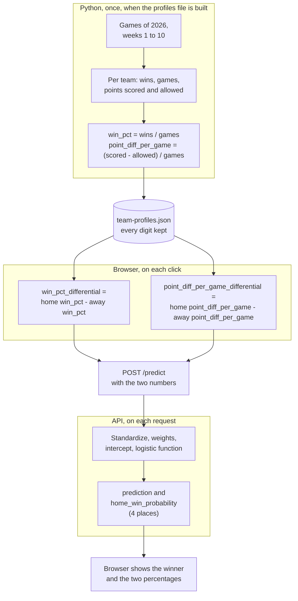
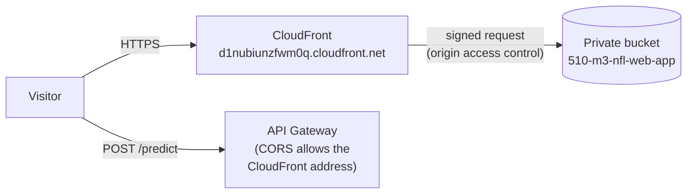

---
hide:
  - toc
---

# Phase 5 Implementation Part 1: Web App and Hosting

This page holds the exact contracts for the Phase 5 web app and explains how it is hosted. A contract here is the precise shape of what one part hands to another: the JSON the browser sends to the API, the JSON that comes back, the file that holds each team's standings, and the types and functions inside the app. It also answers one question directly: which part of the system does the arithmetic on each number. For the short version, see the [Brief](./brief.md). To run or change the app, see the [Development Guide](./development-guide.md). The AWS commands are on the [Deployment Guide](./deployment-guide.md).

**Status: Built and hosted.** Every contract below is what the code in `frontend/` and `src/profiles.py` does now, and every example was sent to the live API or run in Node (the JavaScript engine a browser uses).

## Who Works Out Each Number?

**The browser does the arithmetic for both numbers, and it is one subtraction each:** the home team's value minus the away team's value. The per-game values themselves are worked out earlier, in Python, and stored in the profiles file. The browser never counts wins or adds points.

| Quantity | Worked out by | When | How |
| :--- | :--- | :--- | :--- |
| Wins, games played, points scored, points allowed, for each team | Python | When the profiles file is built | `standings_before_week` counts the 2026 games of weeks 1 to 10. |
| `win_pct` | Python | When the profiles file is built | wins ÷ games. For SF, 8 ÷ 9 = 0.8888888888888888. |
| `point_diff_per_game` | Python | When the profiles file is built | (points scored − points allowed) ÷ games. For SF, 9.444444444444445. |
| `win_pct_differential` | **Browser** | Each time Analyze is clicked | home `win_pct` − away `win_pct` |
| `point_diff_per_game_differential` | **Browser** | Each time Analyze is clicked | home `point_diff_per_game` − away `point_diff_per_game` |
| Standardizing, the two weights, the intercept, the logistic function | API | Each request | The browser sends the raw differences. The scaler inside the saved model standardizes them. |
| `prediction` and the rounding of the probability to 4 places | API | Each request | `prediction` is 1 when the unrounded probability is above 0.5. |
| The winner's name, and the two percentages shown | Browser | When the answer arrives | See [How Is the Answer Shown?](#how-is-the-answer-shown) |



### What Is a Worked Example?

Home team NE, away team TEN. The values come from the profiles file, written with every digit.

- NE has 5 wins in 10 games, so `win_pct` is 0.5, and `point_diff_per_game` is -2.1.
- TEN has 1 win in 9 games, so `win_pct` is 0.1111111111111111, and `point_diff_per_game` is -8.0.
- The browser works out `win_pct_differential`: 0.5 − 0.1111111111111111 = **0.3888888888888889**.
- The browser works out `point_diff_per_game_differential`: -2.1 − (-8.0) = **5.9**.
- The body it sends is `{"win_pct_differential":0.3888888888888889,"point_diff_per_game_differential":5.9}`.
- The API answers `{"prediction":1,"predicted_label":"home win","home_win_probability":0.6376,"model_version":"v1.0"}`.
- The page shows New England Patriots as the winner, with **63.8%**, and Tennessee Titans at **36.2%**.

### Is the Browser's Subtraction the Same as Python's?

Yes, and this was checked and not assumed. JavaScript numbers and Python floats are both 64-bit floating-point numbers, so the same two inputs give the same difference. The profiles file keeps every digit, and Python writes each number with the fewest digits that read back exactly.

The profiles file (5,860 bytes, 32 teams) was read in Node 24.17.0, and every ordered pair of teams was subtracted. The committed test `frontend/src/matchups.parity.test.ts` repeats this check whenever the expected answers file exists (see [Which Tests Pin These Contracts?](#which-tests-pin-these-contracts)).

- **992 of 992** pairs gave exactly the same two numbers as the Python subtraction in `build_model_table` (`==`, not "close").
- The saved model gave identical probabilities for the Node numbers and the Python numbers, for all 992 pairs.
- The JSON text differs from Python's text in 114 of 992 bodies, and in one way only: JavaScript writes a whole number as `0`, and Python writes `0.0`. The numbers are equal, and the API accepts both (see [The Request Body](#the-request-body)).
- No body uses exponent notation. The smallest nonzero difference is 0.022222222222222143, and JavaScript switches to exponent notation only below 0.000001.

## What Does the Browser Send?

### The Request

- **Method and address:** `POST {VITE_API_BASE_URL}/predict`. The live address is `https://9awodatqc5.execute-api.us-east-1.amazonaws.com/predict`.
- **Headers:** `Content-Type: application/json`, and nothing else the app sets. The API's CORS setting allows only the `content-type` header, so any other custom header would fail the preflight.
- **No cookies and no credentials.** The app does not send an `Authorization` header or use `credentials`.
- **Body:** one JSON object with exactly two keys.

```ts
const response = await fetch(`${baseUrl}/predict`, {
  method: "POST",
  headers: { "Content-Type": "application/json" },
  body: JSON.stringify(request),
  signal,
});
```

### The Request Body

| Field | JSON type | Allowed values | Worked out as |
| :--- | :--- | :--- | :--- |
| `win_pct_differential` | number | -1 to 1, finite | home `win_pct` − away `win_pct` |
| `point_diff_per_game_differential` | number | -100 to 100, finite | home `point_diff_per_game` − away `point_diff_per_game` |

- **Both fields are required,** and the order of the keys does not matter.
- **No other key is allowed.** An extra key gets status 422 with the error type `extra_forbidden`.
- **The values must be numbers, not text.** `"0.5"` gets status 422 with `float_type`. Whole numbers are fine: the body `{"win_pct_differential":0,...}` returned status 200 when sent to the live API (home ARI, away ATL, a pair with equal win percentages). So did a body with a margin of `0` (home CIN, away SF).
- **No `NaN` or infinity.** `JSON.stringify` turns `NaN` and infinity into `null`, and the API rejects `null` with status 422 and `float_type`, so the app refuses to send a request unless both numbers are finite.
- **The values are sent unrounded.** The page shows rounded numbers to the visitor, and that rounding never touches what is sent.
- **The largest values** across all 992 matchups are 0.7777777777777777 and 24.444444444444443 (and the same with a minus sign), well inside the limits.

Exact bodies, written by `JSON.stringify` and sent to the live API:

- **Home SF, away MIA:** `{"win_pct_differential":0.7777777777777777,"point_diff_per_game_differential":17.88888888888889}`
- **Home MIA, away SF:** `{"win_pct_differential":-0.7777777777777777,"point_diff_per_game_differential":-17.88888888888889}`
- **Home NE, away TEN:** `{"win_pct_differential":0.3888888888888889,"point_diff_per_game_differential":5.9}`

### The Preflight

A page on one address that sends a JSON body to another address makes the browser ask first, with an `OPTIONS` request. This is the real exchange with the live API.

- **The browser asks:** `Origin: http://localhost:5173`, `Access-Control-Request-Method: POST`, and `Access-Control-Request-Headers: content-type`.
- **The API answers 204** with these headers:
    - `access-control-allow-origin: http://localhost:5173`
    - `access-control-allow-methods: GET,OPTIONS,POST`
    - `access-control-allow-headers: content-type`
    - `access-control-max-age: 300`
- **From an address that is not on the list** (`http://example.com`), the API also answers 204, with none of the `access-control-*` headers. The browser then refuses to send the `POST`.

| Where the page runs | Address the page calls | Preflight | Origin the API must allow |
| :--- | :--- | :--- | :--- |
| Dev server, local API through the proxy | `http://localhost:5173/predict`, forwarded to `http://127.0.0.1:8000/predict` | No, because the address is the page's own | None |
| Dev server, live API | `https://9awodatqc5.execute-api.us-east-1.amazonaws.com/predict` | Yes | `http://localhost:5173` (already allowed) |
| CloudFront page | the same live address | Yes | `https://d1nubiunzfwm0q.cloudfront.net` (added in this phase) |

- **From the CloudFront page,** the same preflight with `Origin: https://d1nubiunzfwm0q.cloudfront.net` returns 204 and `access-control-allow-origin: https://d1nubiunzfwm0q.cloudfront.net`, and a real `POST` with that origin returns the answer and the same header.

The CORS setting now on the API, written with `aws apigatewayv2 update-api --cors-configuration`. The command replaces the whole setting, so both origins are written together.

```json
{
  "AllowOrigins": ["http://localhost:5173", "https://d1nubiunzfwm0q.cloudfront.net"],
  "AllowMethods": ["POST", "GET", "OPTIONS"],
  "AllowHeaders": ["content-type"],
  "MaxAge": 300
}
```

## What Comes Back?

### The Response

Status 200, `Content-Type: application/json`, and one object with four fields. These are real answers from the live API for the three bodies above.

- **Home SF, away MIA:** `{"prediction":1,"predicted_label":"home win","home_win_probability":0.763,"model_version":"v1.0"}`
- **Home MIA, away SF:** `{"prediction":0,"predicted_label":"away win","home_win_probability":0.2937,"model_version":"v1.0"}`
- **Home NE, away TEN:** `{"prediction":1,"predicted_label":"home win","home_win_probability":0.6376,"model_version":"v1.0"}`

| Field | JSON type | Values | Meaning |
| :--- | :--- | :--- | :--- |
| `prediction` | whole number | `1` or `0` | 1 is a home win. It is decided from the unrounded probability, and exactly 0.5 gives 0. |
| `predicted_label` | text | `"home win"` or `"away win"` | The same pick in words. |
| `home_win_probability` | number | 0 to 1, at most 4 decimal places | The model's chance that the home team wins. JSON writes `0.763` for 0.7630. |
| `model_version` | text | for example `"v1.0"` | The model that answered. |

### How Is the Answer Shown?

- **The winner** comes from `prediction`: 1 is the home team, and 0 is the away team. The page never works out the pick again from the rounded probability.
- **The percentages** are whole tenths of a percent, worked out with integers so that no floating-point residue can show:
    1. `units` = `Math.round(home_win_probability × 10000)`, a whole number from 0 to 10000.
    2. `homeTenths` = `Math.round(units ÷ 10)`. A half rounds up.
    3. `awayTenths` = 1000 − `homeTenths`.
    4. Each is shown as `(tenths ÷ 10).toFixed(1)` followed by `%`.
- **The two always add up to exactly 100.0%,** and the winner's percentage is never below 50.0%. For all 10,001 values the API can return (0.0000 to 1.0000), the whole-unit step was exact and the total was exact.

| `home_win_probability` | Home shown | Away shown | Case |
| :--- | :--- | :--- | :--- |
| 0.3296 | 33.0% | 67.0% | The worked example in the model docs (-0.5 and -18.0) |
| 0.5364 | 53.6% | 46.4% | Inputs 0 and 0, the home-field edge alone |
| 0.7630 | 76.3% | 23.7% | Home SF, away MIA |
| 0.2937 | 29.4% | 70.6% | Home MIA, away SF |
| 0.6376 | 63.8% | 36.2% | Home NE, away TEN |
| 0.2672 | 26.7% | 73.3% | The lowest of the 992 matchups |
| 0.7860 | 78.6% | 21.4% | The highest of the 992 matchups |
| 0.4999 | 50.0% | 50.0% | Home ARI, away ATL. `prediction` is 0, so the away team is named. |
| 0.5000 | 50.0% | 50.0% | Exactly 0.5 gives 0, so the away team is named. |

- **The bar uses the same integers.** `chanceTenths` returns `homeTenths` and `awayTenths`, and `formatChances` calls it. The bar's two segments are `homeTenths ÷ 10` and `awayTenths ÷ 10` percent wide, so they always add up to 100% and match the numbers shown. For NE and TEN, that is 63.8% and 36.2%.
- **When the percentages show 50.0% and 50.0%,** the winner is still the one `prediction` names. The page says "too close to call" next to it.
- **Each chosen team's record** is shown under its list by `describeRecord`, for example "5-5 record, -2.1 points per game" for NE and "8-1 record, +9.4 points per game" for SF. Losses are games minus wins, because tied games are not in the data. A margin that rounds to 0.0 is written with no sign. This is display only and does not touch what is sent.
- **The numbers used** are shown as `win_pct_differential` to 3 decimal places and `point_diff_per_game_differential` to 1 decimal place. This is display only.
- **The result always belongs to the teams on screen.** Changing either team clears the result, a new Analyze click cancels any call still waiting, and an answer to a cancelled call is ignored.
- **The version check.** The scores in the note under the result belong to the model version in the profiles file. If the API's `model_version` is different, the note says which version the scores are for instead of showing them as current.

### What Can Go Wrong in a Call?

| Situation | What the page receives | What the page shows |
| :--- | :--- | :--- |
| Success | Status 200 and the four fields | The result |
| The API refuses the body | Status 422 and `{"detail":[{"type","loc","msg","input"}]}` | "The API rejected the request (status 422)" and the first `msg`. It should not happen, because the app checks the numbers first. |
| The path or method is not routed | Status 404 with `{"message":"Not Found"}` from the gateway, which only forwards `POST /predict` and `GET /health` | "Unexpected answer from the API (status N)" |
| The function fails | A 5xx status. API Gateway's standard body is `{"message":"Internal Server Error"}`. This was not seen in this project. | "The API had a problem (status N)" |
| No answer at all | `fetch` rejects with a `TypeError`: offline, a wrong address, or a CORS block. The page cannot tell which. | "Could not reach the API." |
| Too slow | The page cancels the call after 15 seconds, which is longer than the function's 10-second limit | "The API took too long to answer." |
| Status 200, wrong shape | A body that is missing a field, or has `prediction` outside 0 and 1, or a probability outside 0 to 1 | "The API answered with something unexpected." No result is shown. |

The shape check is a small function in the app, with no extra library.

## What Does the Profiles File Hold?

### The File

- **Path:** `frontend/src/data/team-profiles.json`. It is committed, so the web build needs no Python and no data.
- **Built by:** `python -m src.profiles`, which reads the downloaded table `data/from-s3/nfl_matchups_2020_2026.csv`.
- **Size and fingerprint:** 5,860 bytes, SHA-256 `344d21b7859e0fbe67593fe24255cb5c231046b12ade7044f2cba91f13feb3bc`.
- **Same content, same bytes.** The teams are sorted by abbreviation, the numbers are not rounded, and the file is written with `json.dumps(..., indent=2)` and a final newline. Writing goes to a `.partial` file that then replaces the real one, like `results/run-summary.json`.

An excerpt of the committed file (2 of the 32 teams):

```text
{
  "as_of": {
    "season": 2026,
    "through_week": 10
  },
  "model": {
    "version": "v1.0",
    "validation_games": 271,
    "validation_correct": 171,
    "validation_accuracy": 0.630996,
    "validation_baseline": 0.538745
  },
  "teams": [
    ...
    {
      "team": "MIA",
      "name": "Miami Dolphins",
      "games": 9,
      "wins": 1,
      "win_pct": 0.1111111111111111,
      "point_diff_per_game": -8.444444444444445
    },
    {
      "team": "NE",
      "name": "New England Patriots",
      "games": 10,
      "wins": 5,
      "win_pct": 0.5,
      "point_diff_per_game": -2.1
    },
    ...
  ]
}
```

| Field | Type | How it is built | Empty? |
| :--- | :--- | :--- | :--- |
| `as_of.season` | whole number | `window.end_season` in `config/config.yaml` (2026) | Never |
| `as_of.through_week` | whole number | `window.test_through_week` (10). The standings count weeks up to and including this one. | Never |
| `model.version` | text | `model_version` in `results/run-summary.json` | Never |
| `model.validation_games`, `validation_correct` | whole numbers | `scores.validation` in the run summary (271 and 171) | Never |
| `model.validation_accuracy`, `validation_baseline` | numbers | The same block (0.630996 and 0.538745, already rounded to 6 places there) | Never |
| `teams[].team` | text | The team abbreviation in the data | Never |
| `teams[].name` | text | The full name from the table below | Never |
| `teams[].games` | whole number | Games played before week `through_week` + 1 | Never. Every team has at least 8. |
| `teams[].wins` | whole number | Games the team won in those weeks | Never |
| `teams[].win_pct` | number | `wins` ÷ `games`, not rounded | Never |
| `teams[].point_diff_per_game` | number | (points scored − points allowed) ÷ `games`, not rounded | Never |

- **32 teams,** one entry each, and no team appears twice.
- **The same function as the model.** The numbers come from `standings_before_week(games, as_of.season, as_of.through_week + 1, teams)`, so they are exactly the values the model would use for a week 11 game.
- **A team with no games** would be 0.5 and 0.0 in that function. It does not occur in this data.

### Which Names Are Used?

The data holds only abbreviations. `src/profiles.py` holds this table, and a test checks that its 32 keys equal the 32 abbreviations in the data.

| Abbreviation | Name | Abbreviation | Name |
| :--- | :--- | :--- | :--- |
| ARI | Arizona Cardinals | LA | Los Angeles Rams |
| ATL | Atlanta Falcons | LAC | Los Angeles Chargers |
| BAL | Baltimore Ravens | LV | Las Vegas Raiders |
| BUF | Buffalo Bills | MIA | Miami Dolphins |
| CAR | Carolina Panthers | MIN | Minnesota Vikings |
| CHI | Chicago Bears | NE | New England Patriots |
| CIN | Cincinnati Bengals | NO | New Orleans Saints |
| CLE | Cleveland Browns | NYG | New York Giants |
| DAL | Dallas Cowboys | NYJ | New York Jets |
| DEN | Denver Broncos | PHI | Philadelphia Eagles |
| DET | Detroit Lions | PIT | Pittsburgh Steelers |
| GB | Green Bay Packers | SEA | Seattle Seahawks |
| HOU | Houston Texans | SF | San Francisco 49ers |
| IND | Indianapolis Colts | TB | Tampa Bay Buccaneers |
| JAX | Jacksonville Jaguars | TEN | Tennessee Titans |
| KC | Kansas City Chiefs | WAS | Washington Commanders |

### The Command and Its Settings

The existing `window` settings supply the season and the week. One block was added to the end of `config/config.yaml`:

```yaml
# Phase 5: where the frontend's team profiles file is written. The season and the last week
# counted come from the window settings above, so they are not written here a second time.
frontend:
  profiles_path: frontend/src/data/team-profiles.json
```

The command prints three lines:

```text
teams: 32
as of: 2026 week 10
saved: frontend/src/data/team-profiles.json
```

- **Missing table:** it stops with the message the other commands use, `No downloaded table at data/from-s3/nfl_matchups_2020_2026.csv. Run the download step first.`
- **Missing run summary:** it stops with `No run summary at results/run-summary.json. Run python -m src.model.train first.`
- **A team code with no name, or a name with no team:** it stops and lists both.
- **A failed write** leaves the old file in place. The new text goes to a `.partial` file first and replaces the real file only when the write finishes.

## What Are the App's Types and Functions?

### Types

The field names match the JSON exactly, so they use underscores and not the usual JavaScript style.

```ts
export interface TeamProfile {
  team: string;
  name: string;
  games: number;
  wins: number;
  win_pct: number;
  point_diff_per_game: number;
}

export interface TeamProfiles {
  as_of: { season: number; through_week: number };
  model: {
    version: string;
    validation_games: number;
    validation_correct: number;
    validation_accuracy: number;
    validation_baseline: number;
  };
  teams: TeamProfile[];
}

export interface PredictRequest {
  win_pct_differential: number;
  point_diff_per_game_differential: number;
}

export interface PredictResponse {
  prediction: 0 | 1;
  predicted_label: "home win" | "away win";
  home_win_probability: number;
  model_version: string;
}

export type PredictOutcome =
  | { kind: "ok"; response: PredictResponse }
  | { kind: "http-error"; status: number; message: string }
  | { kind: "unexpected-body" }
  | { kind: "unreachable" }
  | { kind: "timeout" };
```

### Functions

Paths are inside `frontend/`.

- **`buildPredictRequest` in `src/matchup.ts`:** `(home: TeamProfile, away: TeamProfile) => PredictRequest`. Returns home minus away for each field. Throws if the two teams are the same, if a result is not finite, or if a result is outside -1 to 1 (win percentage) or -100 to 100 (margin). Does not round.
- **`formatChances` in `src/matchup.ts`:** `(homeProbability: number) => { home: string; away: string }`. The integer rule in [How Is the Answer Shown?](#how-is-the-answer-shown).
- **`winnerOf` in `src/matchup.ts`:** `(response: PredictResponse, home: TeamProfile, away: TeamProfile) => TeamProfile`. `home` when `prediction` is 1, otherwise `away`.
- **`isPredictResponse` in `src/api.ts`:** `(value: unknown) => value is PredictResponse`. True only for the four fields with the types and ranges in the response table.
- **`predict` in `src/api.ts`:** `(request: PredictRequest, options: { baseUrl: string; timeoutMs: number; signal?: AbortSignal }) => Promise<PredictOutcome>`. Never throws. Every failure in the table above becomes one outcome kind. `timeoutMs` is 15000.
- **`readApiBaseUrl` in `src/config.ts`:** `(raw: string | undefined, isProduction: boolean) => string`. Removes one trailing `/`. In production, an empty value, or a value that does not start with `https://`, throws a configuration error, and the page shows that message in place of the form. Outside production, an empty value is allowed and means "call this page's own address".
- **`describeInputs` in `src/matchup.ts`:** `(request: PredictRequest) => { winPct: string; margin: string }`. The two numbers sent, with 3 and 1 decimal places, for display only.
- **`chanceTenths` in `src/matchup.ts`:** `(homeProbability: number) => { home: number; away: number }`. The two integers behind the percentages and the bar.
- **`describeRecord` in `src/matchup.ts`:** `(team: TeamProfile) => string`. A team's record and margin per game, for display only.
- **`App` in `src/App.tsx`:** the page. It reads the profiles file through an import, keeps the two chosen teams, the latest outcome, and the theme, and cancels a waiting call when a team changes or Predict is clicked again. It works out the request, the chances, and the bar once per render.

### Themes and Fonts

- **Two themes.** `src/index.css` defines every color as a CSS custom property, once for the light theme and once for the dark theme. Each is built from white, black, purple, orange, gold, silver, and amber. Every text color has at least 4.5 to 1 contrast on its background, and the bar and focus ring at least 3 to 1, in both themes.
- **The starting theme** comes from the visitor's system setting, in CSS alone, so the page never shows the wrong theme first.
- **The "Dark theme" button** sets `data-theme="dark"` or `data-theme="light"` on the page, which overrides the system setting. Its name stays "Dark theme", and `aria-pressed` says whether it is on. When it is on, the button is filled (`--brand` text on `--brand-soft`, 8.80 to 1 in the light theme and 9.72 to 1 in the dark theme), so a sighted visitor can see the state too. The choice is not saved, so a reload goes back to the system setting.
- **One column for every band.** The header, the disclaimer, the cards, and the footer all line up in the same centered column, at most 48rem wide. The header, disclaimer, and footer bands stretch the full width behind it. On a phone, the "Dark theme" button wraps under the standings chip. The footer reaches the bottom of the window on a short page.
- **The fonts** are Oswald for headlines and Inter for text, installed from the npm packages `@fontsource-variable/oswald` and `@fontsource-variable/inter` (5.3.0, SIL Open Font License 1.1). Vite copies them into the build as 12 `.woff2` files, one per alphabet, and a browser downloads only the Latin files the text needs. They are served from CloudFront, so the page makes no outside request.

### Settings

- **`VITE_API_BASE_URL`** is read as `import.meta.env.VITE_API_BASE_URL`.
    - In `frontend/.env.development` it is empty, so the app calls its own address and the dev server's proxy forwards `/predict` and `/health` to the local API.
    - In `frontend/.env.production` it is `https://9awodatqc5.execute-api.us-east-1.amazonaws.com`.
    - A value set in the shell, such as `VITE_API_BASE_URL=https://... npm run dev`, takes priority over both files.
- **`API_PROXY_TARGET`** is where the dev server's proxy forwards to. It defaults to `http://127.0.0.1:8000`. It has no `VITE_` prefix, so it never reaches the browser. It exists because port 8000 is often taken, for example by `mkdocs serve`.
- **The dev server** uses port 5173 with `strictPort`, so it stops with an error and does not move to another port that CORS would block.
- **Nothing secret** goes in any `VITE_` variable, because Vite writes the values into the built files.

## How Is the Page Hosted?

The page is a set of static files that run in the visitor's browser, so there is no server to run. The commands are on the [Deployment Guide](./deployment-guide.md). For why CloudFront was chosen over Streamlit, Gradio, and free hosts, see [Design Manifest](../design-manifest.md#phase-5-web-app-and-hosting).



### What Was Created on AWS?

Every name follows the pattern of the data bucket, `510-m3-nfl-dataset`: lowercase words joined by hyphens, starting `510-m3-nfl-`.

- **The bucket `510-m3-nfl-web-app`** holds the built files: `index.html`, the hashed script and stylesheet, the 12 font files, and the earlier builds' hashed files. It is private, with all four public-access blocks on, AES-256 encryption, and no website hosting. It is a separate bucket, so the data bucket's settings were not touched.
- **The origin access control `510-m3-nfl-web-app-oac`** lets CloudFront sign its requests to the bucket.
- **The CloudFront distribution `E1ZD23BE9RM77L`,** tagged `510-m3-nfl-web-app`, at `https://d1nubiunzfwm0q.cloudfront.net`, on CloudFront's own certificate. There is no custom domain.
- **The bucket policy** allows `s3:GetObject` to the CloudFront service only, and only when the request comes from this one distribution. Anyone who asks S3 directly gets status 403.
- **The API's CORS list** now has the CloudFront address next to `http://localhost:5173`.
- **The GitHub sign-in provider** (`token.actions.githubusercontent.com`) and **the deploy role `510-m3-nfl-web-app-deploy-role`**, used by the workflow. See [How Does a Change Reach the Live Page?](#how-does-a-change-reach-the-live-page).

### How Is the Distribution Set Up?

- **`index.html`** is returned for the bare address (the default root object).
- **HTTP is sent on to HTTPS** with status 301.
- **Only GET and HEAD are allowed.** A `POST` to the page's address gets status 403.
- **Compression is on.** The 233,372-byte script is sent as 73,717 bytes of gzip when the browser asks for it. The font files are already compressed.
- **No custom error pages.** The app is one page with no routes. A path that does not exist gets status 403, because the bucket policy grants no list permission, so S3 does not say whether a file exists.
- **No protection rules, request limit, firewall, or access logs,** as in Phase 4.

### How Are Files Cached?

- **The script, stylesheet, and font files** have a hash of their contents in their names (`assets/index-KSsdwuOf.js`), so a changed file always gets a new name. The font files have not changed since they were added, so they keep their names. They are uploaded with `Cache-Control: public, max-age=31536000, immutable`, and browsers and CloudFront keep them for a year.
- **`index.html`** keeps one name, so it is uploaded with `Cache-Control: no-cache`. Browsers ask again on every load, and CloudFront keeps it for at most 1 second, the lowest time in the AWS managed cache policy `Managed-CachingOptimized` that the distribution uses.
- **Each deploy invalidates both `/index.html` and `/`.** A visitor who opens the bare address is served under the path `/`, which CloudFront caches apart from `/index.html`.
- **Old hashed files are left in the bucket** on a redeploy, so a visitor who loaded the previous page a moment earlier still gets the files it names.

## How Does a Change Reach the Live Page?

A GitHub Actions workflow, `.github/workflows/deploy-web-app.yml`, tests, builds, and redeploys the page when a change under `frontend/` reaches `main`, signing in to AWS without a stored key. Its first run, on the merge of `phase-five` into `main`, passed. The workflow serves every phase, so its steps and its AWS role are explained in [How Does a Change Reach the Live Web App?](../extras/development/github-workflows.md#how-does-a-change-reach-the-live-web-app).

## Which Tests Pin These Contracts?

Each literal below was computed in Python and confirmed in Node.

### Python: `tests/test_profiles.py` (8 Tests)

1. `test_team_names_match_the_teams_in_the_data`: the 32 names cover exactly the 32 abbreviations in the data.
2. `test_profiles_equal_the_standings_before_week_11`: each team's games, wins, win percentage, and margin equal a recount of the raw 2026 rows through week 10, done with plain integer arithmetic, compared with `==`.
3. `test_file_layout_and_key_order`: the keys are in the order shown above, with 32 teams sorted by abbreviation, and `as_of` is 2026 and 10.
4. `test_model_block_comes_from_the_run_summary`: the `model` block equals the run summary's values, unrounded.
5. `test_no_blank_or_non_finite_value`: every number is finite, every team has at least 1 game, and wins are between 0 and games.
6. `test_the_same_input_writes_the_same_bytes`: two builds give the same text, and it equals the committed file.
7. `test_missing_table_stops_with_a_clear_message`: a missing table stops with `No downloaded table at`.
8. `test_failed_write_keeps_the_old_file`: a failed write keeps the old file and leaves no `.partial` file.

### App Tests Written in Part 1 (Vitest)

These are the six files and 35 tests Part 1 wrote. Part 2 added more tests to `App.test.tsx` (now 16) and six more test files, so the app now has 62 tests in 12 files. The full list is in [What Was Checked?](./implementation-part-2.md#what-was-checked) on Part 2.

- **`matchup.test.ts` (11):** the two display helpers: `chanceTenths` gives 638 and 362 for 0.6376 and 500 and 500 for both 0.4999 and 0.5, and agrees with `formatChances` for every row of the display table; `describeRecord` gives the NE, SF, and TEN strings above, and `0.0` with no sign for margins of 0 and -0.04. Also: the request for home SF, away MIA (`0.7777777777777777` and `17.88888888888889`, and the exact JSON text); the signs flip when the teams swap; the request for home NE, away TEN (`0.3888888888888889` and `5.9`, and the exact JSON text); the same team twice, a non-finite value, and an out-of-range value each throw; `formatChances` for every row of the display table; the winner comes from `prediction` even when both sides show 50.0%; and the inputs are described with 3 and 1 decimals.
- **`api.test.ts` (8):** the exact request (address, method, one header, body, no `credentials` or `mode`); `ok` for a valid answer; `http-error` with the first message for a 422; `http-error` for the gateway's 404; `unreachable` when `fetch` rejects or the caller cancels; `timeout` when the timer cancels; `unexpected-body` for five broken answers; and `isPredictResponse` accepts three well-formed answers.
- **`config.test.ts` (4):** one trailing slash removed, an empty value allowed outside production, and an empty or `http://` value refused in production.
- **`profiles.test.ts` (2):** the imported file has 32 sorted teams with finite numbers and a name each, and the `as_of` and `model` blocks. This catches a manual edit of the file.
- **`App.test.tsx` (9 in Part 1),** run in a simulated browser (jsdom): the same team twice sends no request; home NE, away TEN shows the Patriots, 63.8% in the home row, 36.2% in the away row, both inputs, and the validation scores, and the call carries the exact body; home MIA, away SF names the 49ers; an unreachable API shows the message and no result; changing a team clears the result; a different `model_version` changes the scores sentence; each chosen team's record shows; and the disclaimer, the footer line, and the standings date show before anything is chosen. A last test checks the theme button: it starts with `aria-pressed="false"`, one click sets the dark theme, and a second sets the light theme.
- **`matchups.parity.test.ts` (1):** for all 992 ordered pairs, the browser's subtraction equals the Python numbers in `build/expected-matchups.json`, with `toBe`. It is skipped when that file does not exist. With Part 2's tests, a fresh checkout reports 60 passed and 2 skipped (the second skipped test is Part 2's `season.parity.test.ts`).

### The Every-Matchup Check Against the Live API

Two scripts in `scripts/checks/` compare the live API with the local model for every ordered pair. They write their files into the git-ignored `build/` folder. The steps are in the [Development Guide](./development-guide.md#how-do-i-check-every-matchup).

- `scripts/checks/matchups_expected.py` scores all 992 pairs with the saved model, without reading the profiles file, and writes `build/expected-matchups.json`.
- The parity test above checks the browser's numbers against that file and writes the 992 request bodies to `build/js-bodies.json`.
- `scripts/checks/matchups_live.py` posts each body to the live API and compares the answer with the local model.

## What Was Checked?

- **The profiles file:** 5,860 bytes, the SHA-256 above, and the team values shown on this page.
- **The tests, when Part 1 was built:** 61 Python tests passed for the whole project, and 35 app tests passed. The project now has 95 Python tests and 62 app tests. `npm audit` found 0 vulnerabilities.
- **Every matchup:** 992 requests to the live API, 0 retries, 992 answers with status 200, 992 picks and 992 probabilities equal to the local model, and a largest difference of 0. The local model picks the home team in 601 and the away team in 391, with home win chances from 0.26717521743574985 to 0.7859705938178196.
- **Through the dev server's proxy:** the NE and TEN body returned the expected answer from the local API.
- **The build:** `index.html` (1,105 bytes), `assets/index-KSsdwuOf.js` (233,372 bytes), `assets/index-yAxaDZ6u.css` (10,307 bytes), and 12 font files (313,620 bytes together), with no source map. Building twice gives the same bytes. The only web addresses in the Part 1 build are the live API, `www.w3.org` (SVG name text), and `react.dev` (text in React's error messages). Neither of the last two is a request. Part 2's footer links add `github.com` and `jconnors23.github.io`, which are links and not requests, and the deploy workflow allows all five hosts and no others. The file names and sizes in this list are from the Part 1 build. Every build gets new script and stylesheet names.
- **The hosting:** all 16 files CloudFront serves (`/`, `/index.html`, the script, the stylesheet, and the 12 fonts) have the same SHA-256 as the local build. The fonts are served as `font/woff2`. Both direct S3 addresses return 403. HTTP returns 301 to HTTPS, and a `POST` returns 403.
- **The deploy role:** read back from AWS, it trusts only `main` of this repository, has exactly the one inline policy above, and has no attached policies. The secret `AWS_WEB_APP_DEPLOY_ROLE_ARN` is set in the repository.
- **The workflow's two checks** (no outside address, and the served bytes) were first run manually against the live site and passed. The workflow has since run, as the last item in this list says.
- **Screenshots of the page** at 360 and 390 pixels wide and at 1280, in both themes: nothing overlaps, nothing scrolls sideways, every band lines up on the same column, and the footer reaches the bottom of the window.
- **A real prediction in a real browser.** Headless Chrome opened the live page, chose New England Patriots as home and Tennessee Titans as away, and clicked Predict, once on a 1280-pixel screen in the light theme and once on a 390-pixel phone screen in the dark theme. Both showed "Predicted winner: New England Patriots", 63.8% and 36.2%, a bar split 63.8% to 36.2%, and the two record lines. The browser sent one preflight (`OPTIONS`) and then the `POST` to the API, and cached the preflight for the second run. It contacted only two hosts, CloudFront and the API, loaded both bundled fonts, and logged no console error, no warning, and no failed request. This is the check that proves CORS works from the CloudFront page, which `curl` cannot.
- **CORS:** the preflight from the CloudFront address and from `http://localhost:5173` is allowed, and from `http://example.com` it is not.
- **The display rule,** for all 10,001 probabilities the API can return.

- **The two workflows' first runs,** on the merge of `phase-five` into `main` (pull request #5): Deploy Web App passed in 53 seconds, and Deploy Docs passed in 30 seconds.
