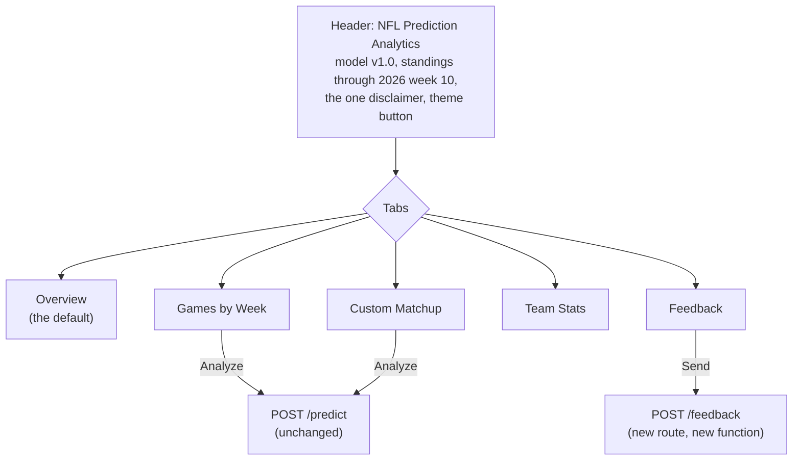
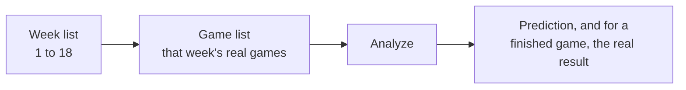
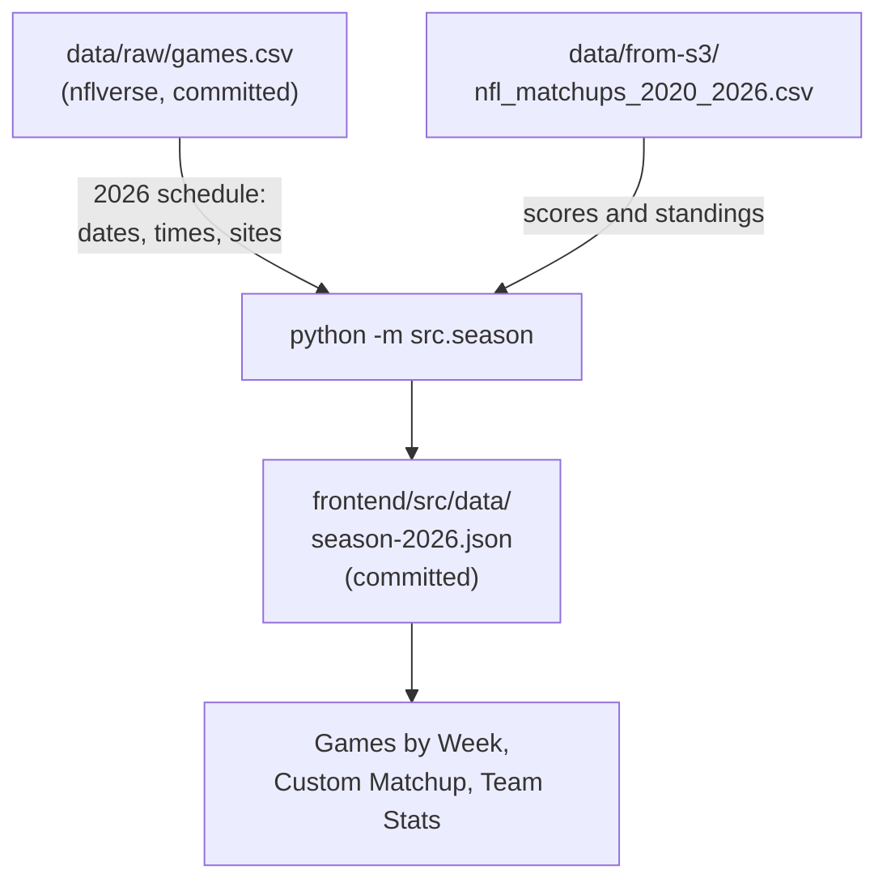
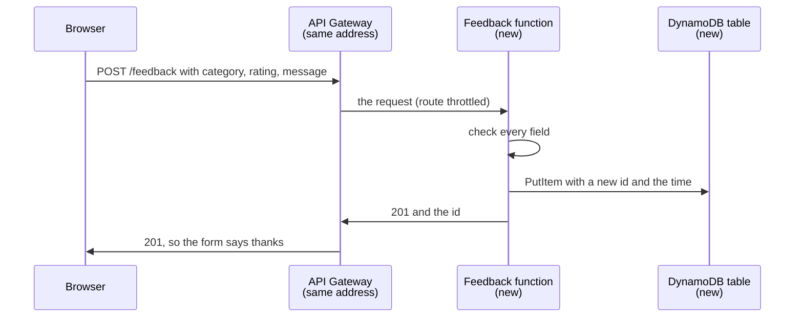

---
hide:
  - toc
---

# Phase 5 Implementation Part 2: Tabs, Schedule, Team Stats, and Feedback

Part 2 turns the one-page app into a small site called **NFL Prediction Analytics**, with five tabs: an overview, every 2026 game by week, a custom matchup, a team stats table, and a feedback form. The predictions keep using the same API, with no change to the prediction code. Only the feedback form needs something new on AWS: one small function, one route, and one table. [Part 1](./implementation-part-1.md) holds the contracts this page builds on: who works out each number, the request and response, the profiles file, and the hosting.

**Status: Built and live** at [https://d1nubiunzfwm0q.cloudfront.net](https://d1nubiunzfwm0q.cloudfront.net), including a round of fixes found in review. See [What Was Fixed After Review?](#what-was-fixed-after-review). The checks that were run are in [What Was Checked?](#what-was-checked).

## What Does the Site Look Like?



- **The name** is NFL Prediction Analytics, in the page title and the header.
- **The disclaimer appears once,** in the banner under the header: "**Unofficial coursework project.** Not affiliated with or endorsed by the National Football League. Predictions are for reference only." The footer no longer repeats it.
- **The model version appears once,** in the header next to the standings date ("Model v1.0 · Standings through 2026 week 10"). The footer no longer repeats it.
- **The button that runs the model is called "Analyze"** on every tab.
- **Each tab has its own address,** such as `#games` or `#teams`, so a link opens the right tab and the browser's Back button works. The part after `#` never reaches CloudFront, so the hosting needs no change.

## What Does Each Tab Do?

### Overview

The tab a visitor lands on. It explains, in plain text:

- **What the site does:** predicts the winner of a 2026 NFL regular-season game from two numbers about the teams.
- **How the model works:** the home team's win percentage minus the away team's, and the home team's point margin per game minus the away team's, both from earlier games of the same season. A logistic regression trained on 2020 to 2024 turns them into a home win chance.
- **How to read a result:** the predicted winner, the bar split between the two teams, the two percentages, "too close to call", and the two numbers the model saw.
- **What each tab is for,** with a link to each.
- **What the model does not know:** injuries, weather, anything else beyond its two numbers, and anything after the standings date.
- **Where to read more:** links to the documentation site and the code repository.

### Games by Week

This tab combines "the upcoming 2026 games" and "any week" into one place. A visitor picks a week, then one of that week's real games, then clicks Analyze.



- **The week list** has all 18 weeks, each with its dates and status, for example "Week 5 · Oct 8 – Oct 12 · Final" and "Week 11 · Nov 19 – Nov 23 · Upcoming". It starts on the first upcoming week, week 11.
- **The game list** has that week's games in kickoff order, each labelled so it is clear which game is chosen, for example "Sun Nov 22 · 1:00 PM ET · Miami Dolphins at Buffalo Bills". A finished game adds its score: "Final · Sun Sep 13 · ... · 24–20". Kickoff times are Eastern time, as the nflverse file writes them.
- **The inputs come from the standings before that week,** the same way the model's training data is built. A week 5 game uses weeks 1 to 4. A week 1 game uses no earlier games, so both inputs are 0 and every week 1 game gets the home-field edge alone, 53.64%.
- **Upcoming games use the latest standings.** Only weeks 1 to 10 have scores, so every game in weeks 11 to 18 uses the standings through week 10. The page says so for those weeks. Checked: standings before weeks 12 to 18 are identical to standings before week 11.
- **A finished game shows the real result next to the prediction:** the score, the winner, and whether the model's pick was right. Week 5's tied game, New York Giants at Washington Commanders, shows "Tie. There is no winner, so the pick is not scored."
- **A neutral-site game** (9 of the 272) says "Neutral site: the schedule lists <home team> as the home team, and the model treats them as home."

### Custom Matchup

The Part 1 page, kept for any two teams. It adds a week list, so a visitor can ask how two teams compared before any week. It starts on week 11, which gives exactly the Part 1 standings. The same-team check, the record lines, and the result are as in Part 1.

### Team Stats

A table of every team's 2026 games through week 10, with only the numbers the model uses or is built from.

- **Columns:** Team, Games, Wins, Losses, Points For, Points Against, Point Difference, **Win %**, and **Margin per Game**. The last two are the model's inputs and are marked as such in the column headers.
- **Sorting:** by Win %, then Margin per Game, both highest first. Clicking a column header sorts by that column, highest first (the Team column sorts A to Z first). Clicking the same header again flips the direction. Teams with equal values are always ordered by Win %, then Margin per Game, then name.
- **Formatting:** Win % with 3 decimals (`0.889`), Margin per Game with 1 decimal and a sign (`+9.4`), and the rest as whole numbers.
- **Ties:** the tied game counts for neither team, so New York Giants and Washington Commanders each have one game fewer.
- **Example rows, checked:** Buffalo Bills 9 games, 8–1, 287 for, 199 against, +88, 0.889, +9.8. San Francisco 49ers 9 games, 8–1, 281 for, 196 against, +85, 0.889, +9.4.

### Feedback

A short form whose answers are saved in a DynamoDB table.

- **Category:** General, Predictions, The site, or Something is broken.
- **Rating (optional):** 1 to 5.
- **Message (required):** 10 to 1,000 characters.
- **No personal details are asked for,** and the form says not to include any. Nothing identifies the visitor: no name, email, address, or cookie.
- **After sending:** "Thanks. Your feedback was saved." A failure shows a readable message, as the predictions do.
- **A hidden field catches simple spam bots.** It is invisible to people. A submission that fills it gets the same thanks message, but nothing is saved.

## Does the API Need to Change?

**Not for predictions.** Every prediction on every tab is the same request, two numbers to `POST /predict`, so the prediction function, its zip, and its checks stay exactly as they are.

- **Games by Week:** every game's two inputs come from standings the site already ships, worked out the same way as the training data.
- **Custom Matchup:** the same, for any week.
- **Already checked against the live API:** every upcoming game uses the week 10 standings, so each of the 122 upcoming games is one of the 992 ordered pairs checked in Part 1. Each of the 149 finished games was sent through the live API in Phase 4, which checked all 1,759 games.

**The feedback form needs a new route,** because a browser cannot write to S3 or DynamoDB without AWS credentials, and no credentials can be put in a public page. The route goes on the same API address, and a separate small function handles it, so the prediction function is not touched.

## Where Do the Season's Games Come From?



- **The schedule comes from the raw nflverse file,** because the cleaned table keeps only finished games and drops the dates. The raw file holds all 272 regular-season games of 2026, weeks 1 to 18, with a date and a kickoff time for each: 150 finished (149 with a winner and 1 tie) and 122 upcoming (weeks 11 to 18).
- **The scores and standings come from the downloaded table,** as every other phase does. The command checks that every finished 2026 game in the raw file with a winner is in the downloaded table with the same scores, and stops if not.
- **The file keeps every digit,** like the profiles file, so the browser's subtraction gives exactly the numbers Python gives.
- **It is committed,** so the web build needs no Python and no data, and `python -m src.season` rebuilds the identical file.

### The Season File

An excerpt of the committed file. Week 1 has no earlier games, so its standings give every team 0.5 and 0.0, the values `standings_before_week` uses for a team with no games.

```text
{
  "season": 2026,
  "through_week": 10,
  "weeks": [
    {
      "week": 11,
      "first_day": "2026-11-19",
      "last_day": "2026-11-23",
      "status": "upcoming",
      "standings_before_week": 11,
      "games": [
        {
          "game_id": "2026_11_IND_HOU",
          "gameday": "2026-11-19",
          "weekday": "Thursday",
          "gametime": "20:15",
          "home": "HOU",
          "away": "IND",
          "neutral_site": false,
          "status": "upcoming",
          "home_score": null,
          "away_score": null
        },
        ...
      ]
    },
    ...
  ],
  "standings": [
    { "before_week": 1, "teams": [ { "team": "ARI", "games": 0, "wins": 0, "win_pct": 0.5, "point_diff_per_game": 0.0 }, ... ] },
    ...
    { "before_week": 11, "teams": [ ... ] }
  ],
  "team_totals": [
    { "team": "BUF", "games": 9, "wins": 8, "losses": 1, "points_for": 287, "points_against": 199, "point_diff": 88, "win_pct": 0.8888888888888888, "point_diff_per_game": 9.777777777777779 },
    ...
  ]
}
```

- **`weeks`:** all 18, in order. `status` is `final` when every game that week has a score, otherwise `upcoming`. `standings_before_week` is the week number for weeks 1 to 11, and 11 for weeks 12 to 18.
- **`games[].status`:** `final`, `tie`, or `upcoming`. Scores are `null` for an upcoming game.
- **`standings`:** 11 sets, before weeks 1 to 11, each with all 32 teams sorted by abbreviation, from `standings_before_week`.
- **`team_totals`:** one row per team, through week 10, for the Team Stats tab.
- **Team names** come from `TEAM_NAMES` in `src/profiles.py`, so there is one list of names.

### How Do the Browser's Numbers Match the Model's?

- **Finished games:** for all 149 finished games with a winner, the home team's standings minus the away team's, taken before the game's week, equal `win_pct_differential` and `point_diff_per_game_differential` in `build_model_table`, exactly. Checked: 0 mismatches.
- **The model on those games:** 88 of 149 correct, the test-set score in the run summary. By week: 10 of 16, 6 of 16, 8 of 16, 10 of 16, 9 of 14, 8 of 14, 6 of 14, 9 of 14, 12 of 15, and 10 of 14, for weeks 1 to 10.
- **Upcoming games:** the standings before week 11 must equal the Part 1 profiles file, team by team, exactly.
- **Example upcoming answers from the local model:** Indianapolis Colts at Houston Texans 60.01% for the Texans, Miami Dolphins at Buffalo Bills 76.49% for the Bills.

## How Does the Feedback Reach the Table?



### The Request and the Answer

- **Request:** `POST {VITE_API_BASE_URL}/feedback`, `Content-Type: application/json`, and a body with exactly these keys:
    - `category`: one of `general`, `predictions`, `site`, `broken`.
    - `rating`: a whole number from 1 to 5, or `null`.
    - `message`: text, 10 to 1,000 characters after trimming spaces.
    - `website`: the hidden field. It must be an empty string.
- **Answer when saved:** status 201 and `{"status":"received","feedback_id":"<id>"}`.
- **Answer when a field is wrong:** status 422 and `{"detail":"<what is wrong>"}`, such as "The message must be 10 to 1,000 characters."
- **A body over 4,096 bytes, or one that is not JSON:** status 400.
- **The hidden field filled in:** status 201 with the same answer, and nothing is saved.
- **CORS:** the API's current setting already allows `POST` with the `content-type` header from the CloudFront address, for every route. Nothing changes there.

### What Is Saved

One item per submission, in the table `510-m3-nfl-feedback`:

- `feedback_id`: a random UUID made by the function. It is the table's key.
- `submitted_at`: the time in UTC, such as `2026-11-23T14:05:09Z`.
- `category`, `rating` (left out when `null`), and `message`, as sent.

Nothing else is saved: no address, no browser details, and no cookie.

### What Is Created on AWS

All in `us-east-1`, tagged `project=510-m3`, with names that follow the project's pattern.

- **The DynamoDB table `510-m3-nfl-feedback`:** key `feedback_id` (text), billed per request, encrypted with the default AWS key.
- **The function `510-m3-nfl-feedback-api`:** Python 3.13 on arm64. Its zip holds one file, `src/api/feedback_handler.py`, and uses the `boto3` that the Lambda runtime provides, so it adds no packages. The table name comes from the setting `FEEDBACK_TABLE`.
- **The role `510-m3-nfl-feedback-api-role`:** it can write logs and call `dynamodb:PutItem` on this one table, and nothing else.
- **The route `POST /feedback`** on the existing HTTP API `510-m3-nfl-predict-http-api`, with its own integration and its own permission to call the new function.
- **A request limit on that route only:** 1 request a second, with bursts of up to 5. The prediction routes stay without a limit, as before. The form writes to a table, so it has a limit, and the predictions only read.
- **Log retention:** 14 days, as for the prediction function.

**The prediction function is not changed.** Its code fingerprint (`CodeSha256`) is the same before and after.

To read the feedback, see [Read the Feedback](./deployment-guide.md#read-the-feedback) in the Deployment Guide.

## What Changed in the App's Code?

Paths are inside `frontend/`.

- **`src/tabs.ts`:** the five tab names and their addresses, and a function that reads the tab from the address and falls back to Overview.
- **`src/schedule.ts`:** pure functions for the week and game labels (dates and times written from the text in the file, never through the browser's clock, so the time zone cannot shift them), the inputs for a game, and the result line for a finished game.
- **`src/teamStats.ts`:** the table's rows, sorting, and formatting.
- **`src/feedback.ts`:** the feedback check and the `fetch` call, which never throws, like `predict`.
- **`src/App.tsx`:** the header, the banner, the tab bar, and one component per tab.
- **`src/Picker.tsx`:** the list used for every choice on the site, drawn by the page so it is solid when open.
- **`src/data/season-2026.json`:** the season file.
- **The tab bar** follows the standard pattern for tabs: a `tablist` with one `tab` per tab and one `tabpanel` for the open tab, and the arrow keys move between tabs.

## What Else Was Added?

### A Makefile

A `Makefile` in the project folder for the six commands used most:

- `make train`: one training run. It fits and scores the model, logs the run to MLflow, and adds it to `mlflow-reference/`.
- `make pytest`: every Python test.
- `make webtest`: the web app's tests.
- `make start`: the FastAPI prediction service on your computer, at `http://127.0.0.1:8000`.
- `make start-web`: the web app's dev server, at `http://localhost:5173`. It forwards `/predict` and `/health` to the service started by `make start`.
- `make docs`: the docs site on your computer, at `http://127.0.0.1:8001`, so it does not take the API's port.

Rebuilding the data files and the production build are left out, because they are run rarely: `python -m src.profiles`, `python -m src.season`, and `npm run build` in `frontend/`.

## What Was Checked?

The tests cover the season file and the feedback function in Python, using a stand-in for DynamoDB so no AWS account is needed. On the app side they cover the tabs, the labels, the inputs for a game, the result lines, the team table's sorting and formatting, the feedback check, and each tab's page.

- **The tests:** 88 Python tests and 62 app tests pass. On GitHub, or on a fresh checkout, the app gives 60 passed and 2 skipped, because the two every-game checks need files in the ignored `build/` folder. A fresh checkout with no saved model gives 86 Python tests passed and 2 skipped.
- **The season file:** 272 games (150 finished or tied, 122 upcoming), 18 weeks, 11 sets of standings, and 32 team rows. It is 157,894 bytes, SHA-256 `9c2acb0bb239cbeb86cf9425c113deeecfe86dee68381a55a8b8291a710b6525`, and rebuilding it gives the same bytes.
- **Finished games:** for all 149 with a winner, the browser's inputs equal `build_model_table`'s exactly.
- **Every game through the live API:** all 272 sent, 272 answers with status 200, every pick and every probability equal to the local model, 0 retries, and 0 mismatches.
- **The prediction function is unchanged.** Its code fingerprint is `IU5bJH9pTL+rF/uEXMUAp+Eo/mik2abfaSasBXPOgbk=` before and after.
- **The feedback route:**
    - One test submission was saved, read back, and deleted. The table now holds 0 items.
    - A filled hidden field saved nothing.
    - A 5-character message got 422 with "The message must be 10 to 1,000 characters."
    - A preflight from the CloudFront address got 204.
    - The stage's only route limit is `POST /feedback` (1 a second, bursts of 5).
    - The function's role can only write logs and call `dynamodb:PutItem` on this one table.
- **The served files:** all 16 (the page, the script, the stylesheet, and 12 fonts) match the local build byte for byte.
- **The live site in a real browser.** Headless Chrome visited every tab on the live site:
    - **The header:** the title and heading are "NFL Prediction Analytics", the disclaimer appears once, and the model version appears once, in the header chip.
    - **Games by Week:** it opens on "Week 11 · Nov 19 – Nov 23 · Upcoming" and "Thu Nov 19 · 8:15 PM ET · Indianapolis Colts at Houston Texans". Analyze gives the Texans 60.0%, with the note that week 10 standings are used.
    - **Week 5's tie:** it shows "Final: New York Giants 27, Washington Commanders 27. Tie. There is no winner, so the pick is not scored."
    - **Custom Matchup:** at its default week, home New England Patriots and away Tennessee Titans still gives 63.8%.
    - **Team Stats:** 32 rows, starting "Buffalo Bills 9 8 1 287 199 +88 0.889 +9.8".
    - **Feedback:** a 5-character message shows the length message and sends nothing.
    - **The browser:** it contacted only CloudFront and the API, and logged no error, warning, or failed request.

### What Was Fixed After Review?

- **The page was wider than a phone screen.** At 390 pixels wide, every tab's page was 802 pixels wide. The tab bar was centered with automatic margins inside a flex column, which made it as wide as its row of tabs. It now has a set width, and its tabs scroll inside it. Checked on all five tabs, locally and live: the page is 390 pixels wide.
- **The forms were cramped.** Labels sat inline, the message box was a tiny default box beside its label, and nothing spaced one field from the next. Every label and its control now sit in one field style: the label on its own line, space between fields, and a full-width message box about 6 lines tall.
- **An open list showed the button through it.** A native drop-down opens a list the operating system draws, and on macOS that list is translucent, so the orange Analyze button showed through. All seven lists now use `src/Picker.tsx`, a list the page draws itself, built to the standard select-only combobox pattern: the arrow keys, Home and End, Enter, Escape, and jumping to a typed letter. Checked: the open list is fully opaque, and it covers the button.
- **Two week numbers were typed by hand.** Custom Matchup's starting week and the last-week fallback now come from the season file.
- **The site mentioned betting.** The banner now reads "**Unofficial coursework project.** Not affiliated with or endorsed by the National Football League. Predictions are for reference only." No page text mentions betting, and a test checks every tab.

## What Part 2 Does Not Do

- **No change to the model, its inputs, or the prediction API.**
- **No login, no saved predictions, and no tracking.**
- **No live scores.** The season file is a snapshot through week 10, and it changes only when the data is downloaded again and the command is rerun.
- **No "analyze every game this week" button.** Each game is analyzed on its own, so the site sends one request per click.
- **No page for reading the feedback.** The developer reads the table with the AWS command in the Deployment Guide.
