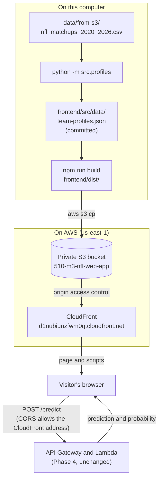
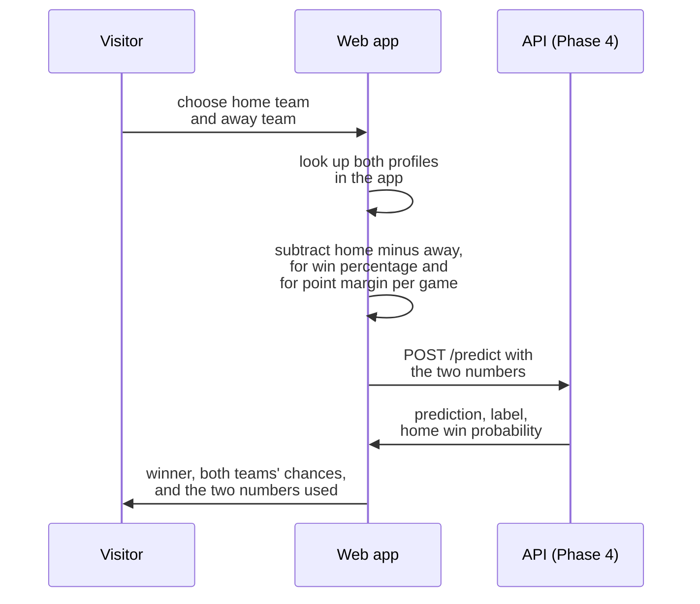
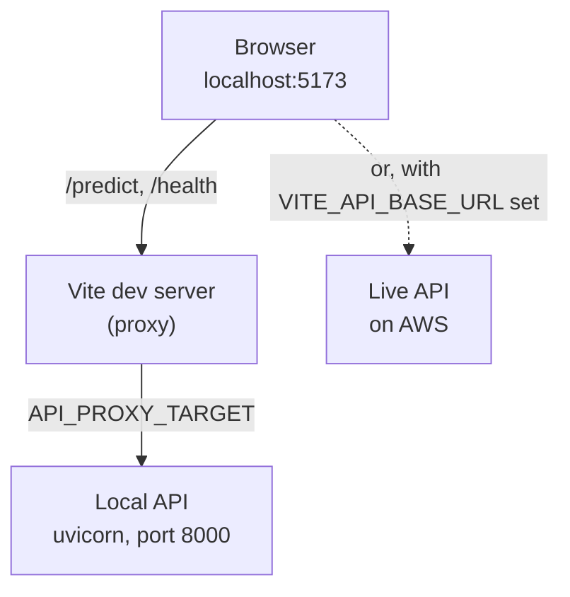
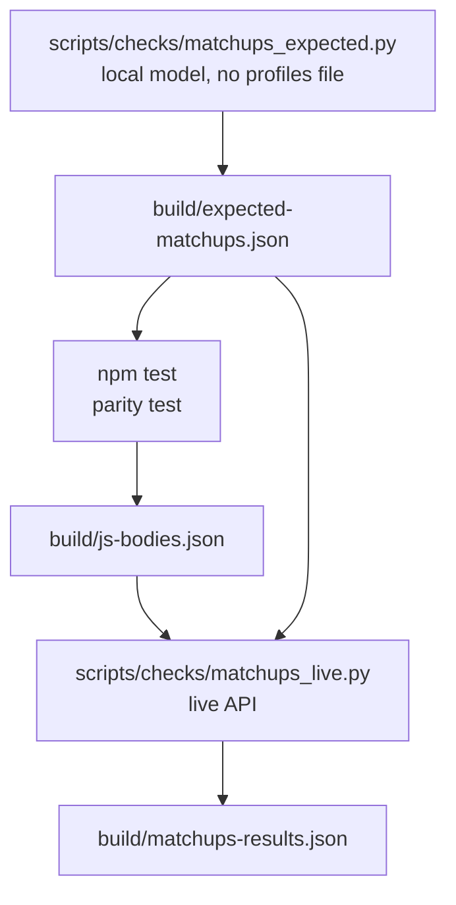
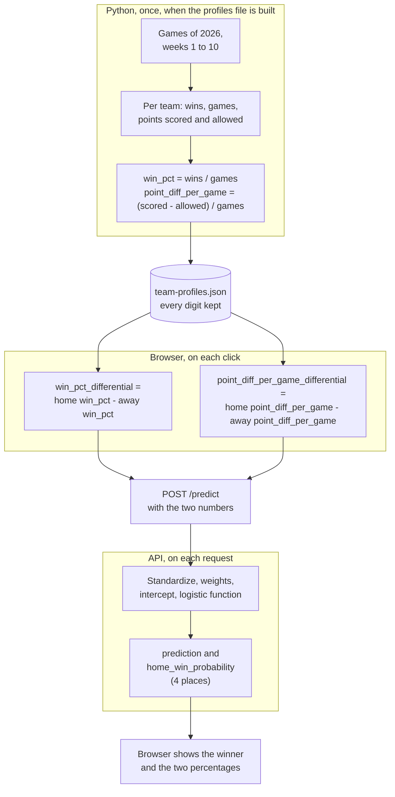
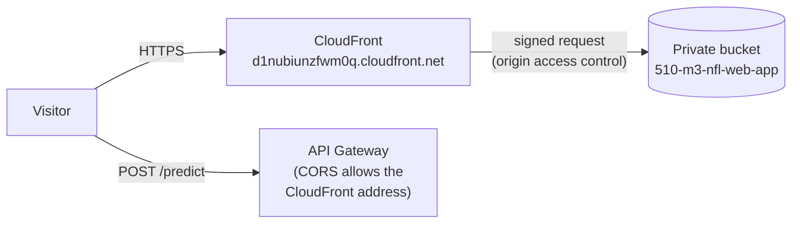
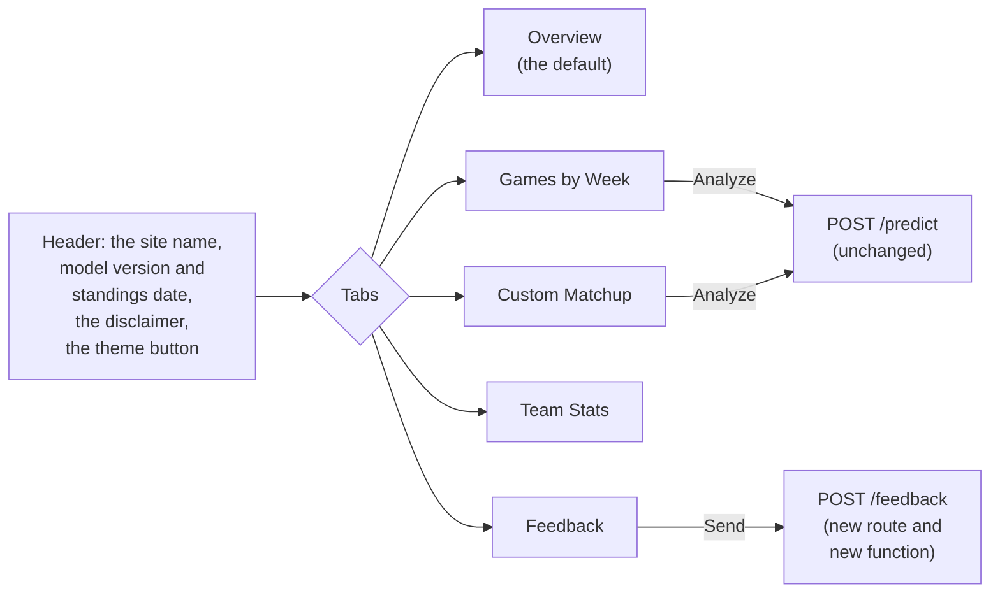
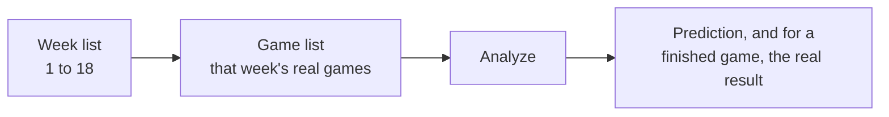
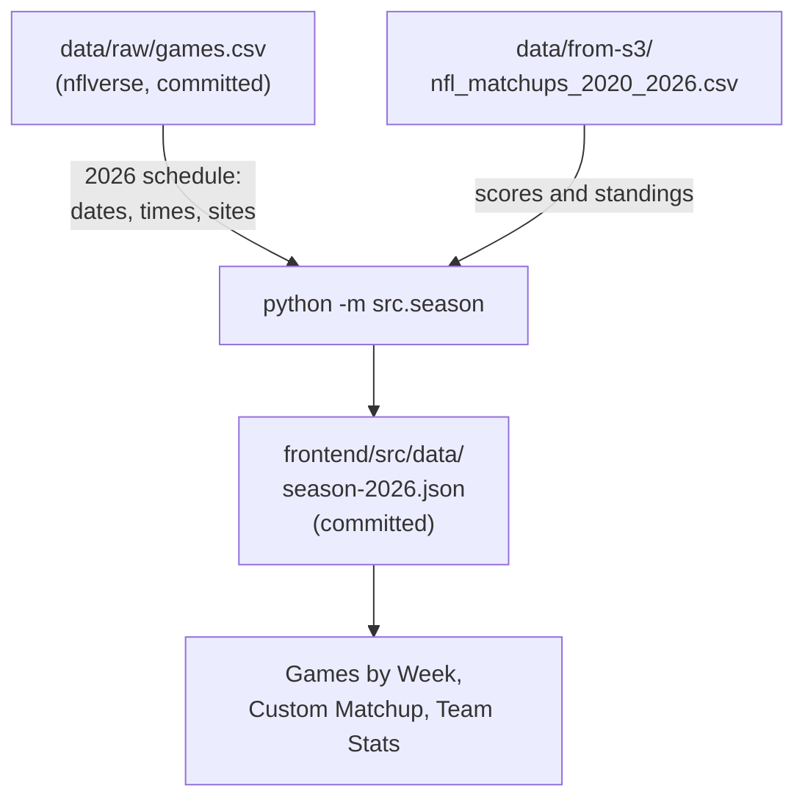

---
hide:
  - toc
---

# Phase 5: Front-End Web App

!!! success "Delivered in Pull Requests #5 and #6"
    Each pull request's **Files changed** tab shows what it delivered.

    - **[Pull request #5 (`phase-five`)](https://github.com/jconnors23/510-m3-nfl-prediction-analytics/pull/5):** Part 1: the Custom Matchup page, its hosting on S3 and CloudFront, and the deploy workflow.
    - **[Pull request #6 (`phase-five-p2`)](https://github.com/jconnors23/510-m3-nfl-prediction-analytics/pull/6):** Part 2: the Overview, Games by Week, Team Stats, and Feedback tabs, and the feedback API.

**Status: Parts 1 and 2 built and hosted.** The site is live at **[https://d1nubiunzfwm0q.cloudfront.net](https://d1nubiunzfwm0q.cloudfront.net)**. Part 1 built one prediction page. Part 2 turned it into a five-tab site, NFL Prediction Analytics, described in [Implementation Part 2](#implementation-part-2) below. The fixes found in review, including the phone layout, are done.

**Needs first:** Phase 4, whose output is the public API at `https://9awodatqc5.execute-api.us-east-1.amazonaws.com`, and Node.js with npm (versions are in [What Is Needed First?](#what-is-needed-first)).

Phase 5 builds the part a person uses and puts it on the internet. A visitor picks a home team and an away team in a small web app. The app looks up the two teams' standings, turns them into the model's two inputs, sends them to the live API, and shows the predicted winner and each team's chance of winning. The app's files sit in a private Amazon S3 bucket and are served over HTTPS through CloudFront.

## How Do the Pieces Fit Together?



- **The standings ship inside the app.** They are a single snapshot, so the browser makes one call to the API per prediction and no other request to anything but CloudFront.
- **The API code is unchanged.** It still takes the two numbers and returns the answer. The only change to Phase 4's AWS resources is that the CloudFront address was added to the API's CORS list.

## What Happens When Someone Picks Two Teams?



## What Does the Page Show?

This list covers the Part 1 prediction page, which is now the Custom Matchup tab. The other four tabs are described in [What Does Each Tab Do?](#what-does-each-tab-do) in Implementation Part 2.

- **A header band** with the title "NFL Prediction Analytics", a chip with the model version and the standings date ("Model v1.0 · Standings through 2026 week 10"), and a "Dark theme" button.
- **A bold disclaimer banner** under the header: "**Unofficial coursework project.** Not affiliated with or endorsed by the National Football League. Predictions are for reference only."
- **Two drop-down lists,** "Home team" and "Away team", each with the 32 teams by full name. Under each, once a team is chosen, its record and margin, such as "5-5 record, -2.1 points per game". If the same team is in both, the page says "Choose two different teams." and sends nothing.
- **One button,** "Analyze" (it was "Predict" in Part 1).
- **The result:** the predicted winner by full name, taken from the API's `prediction` field, a bar split between the two teams' chances, and each team's chance as a percentage with one decimal. When both show 50.0%, the page adds "too close to call".
- **Why the Model Picked This:** the two numbers sent, each with its sign and the team it favors.
- **Keep in Mind:** the standings date, that the model uses only these two numbers (no injuries, weather, or anything else), that home teams get a small edge, and the model's validation score from the profiles file.
- **A readable message for each failure,** such as "Could not reach the API." or "The API had a problem (status 500)."
- **A footer** with links to the nflverse data, the source code, and the docs. The disclaimer and the model version appear only once, at the top.
- **A light and a dark theme.** The page starts in the visitor's system setting, and the button switches between the two. Both are built from white, black, purple, orange, gold, silver, and amber.
- **No outside requests.** The fonts (Oswald for headlines, Inter for text) are bundled into the build and served from CloudFront. No logos, analytics, cookies, local storage, or outside scripts.

The exact wording, the display rule, and the failure messages are in [How Is the Answer Shown?](#how-is-the-answer-shown) in Implementation Part 1.

## Where Do the Two Inputs Come From?

A browser cannot read the games table, so `python -m src.profiles` writes a small committed file, `frontend/src/data/team-profiles.json`, with each team's win percentage and point margin per game after 2026 week 10. These are the values `standings_before_week` gives for a week 11 game. The browser subtracts the away team's values from the home team's. The file keeps every digit, so the browser's subtraction gives exactly the numbers Python would. This was checked for all 992 ordered pairs of teams. The file's fields and the arithmetic are in [Who Works Out Each Number?](#who-works-out-each-number) in Implementation Part 1.

## Steps in Order

### Part 1 (Built)

- [x] **Step 1. Build the team profiles file** with `src/profiles.py` and `tests/test_profiles.py`, and a `frontend` block in `config/config.yaml`.
- [x] **Step 2. Create the Vite app in `frontend/`** with React and TypeScript, and commit the lock file.
- [x] **Step 3. Write the matchup logic** as small pure functions, tested with Vitest.
- [x] **Step 4. Build the page,** with a loading message, readable errors, labelled controls, and a layout that fits a phone.
- [x] **Step 5. Run it locally** against the local API through the dev server's proxy.
- [x] **Step 6. Check every matchup** (all 992 ordered pairs) against the live API and the local model.
- [x] **Step 7. Build the site** with the live API address, into `frontend/dist/`.
- [x] **Step 8. Create the hosting:** a private bucket, an origin access control, a CloudFront distribution, and a bucket policy that lets only that distribution read the bucket.
- [x] **Step 9. Upload the build and check the CloudFront address,** including that the bucket cannot be read directly.
- [x] **Step 10. Add the CloudFront address to the API's CORS list.** The developer still needs to check the page in a browser.
- [x] **Step 11. Write the hosting steps down** in the [Deployment Guide](./deployment-guide.md), with the commands that remove everything.
- [x] **Step 12. Style the page:** the header, disclaimer, records, probability bar, footer, the two themes, and the bundled fonts. Redeploy, and check the served files again.
- [x] **Step 13. Deploy from GitHub.** The workflow `.github/workflows/deploy-web-app.yml` redeploys the page when a change under `frontend/` reaches `main`, through an AWS role that needs no stored key. Its first run, on the merge of `phase-five`, passed.

### Part 2 (Built)

- [x] **Step 14. Build the season file** with `python -m src.season`: every 2026 game, with the standings before each week and each team's totals.
- [x] **Step 15. Rename the site and tidy the header:** NFL Prediction Analytics, the disclaimer and the model version once each at the top, and an "Analyze" button.
- [x] **Step 16. Add the tabs:** Overview, Games by Week, Custom Matchup (with a week list), Team Stats, and Feedback.
- [x] **Step 17. Add the feedback route:** a DynamoDB table, a small function, and `POST /feedback` on the same API. The prediction function is not changed. See the feedback route section of [Frontend and Backend Connection](../extras/architecture/frontend-backend-connection.md#how-does-the-feedback-route-fit-in).
- [x] **Step 18. Add a Makefile** with the local commands. It now has nine, each explained on [Makefile](../extras/development/makefile.md).
- [x] **Step 19. Check every game,** all 272, in the browser's arithmetic and through the live API, then redeploy.
- [x] **Step 20. Fix what review found:** the phone width, the cramped forms, the see-through lists, two week numbers typed in by the developer, and the wording. See [What Was Fixed After Review?](#what-was-fixed-after-review).
- [x] **Step 21. Keep a log of every training run** in `mlflow-reference/`: `make train` moves the last run into `previous-runs/`, writes the new one to `latest-run/`, and adds a row to `run-history.md`. See [How Do I Do a Training Run?](../phase-2/index.md#how-do-i-do-a-training-run).

## Results

- **Python tests:** **95 passed** for the whole project with a trained model (93 passed and 2 skipped without one). Phase 5 added 35 of them: 8 for the profiles file, 8 for the season file, 9 for the feedback function, and 10 for the MLflow export and its run history.
- **App tests:** **65 passed**, across 12 test files. On a fresh checkout, 63 pass and 2 are skipped, because they need `build/expected-matchups.json` and `build/expected-season.json`.
- **Part 2, every game:** all 272 games of 2026 sent to the live API, every pick and probability equal to the local model. The check scripts are in `scripts/checks/`.
- **Part 2, feedback:** a test submission saved, read back, and deleted. The prediction function is unchanged.
- **Every matchup:** all **992** ordered pairs sent to the live API came back with status 200, and every pick and every probability (rounded to 4 places) equals the local model. The details are in [What Was Checked?](#what-was-checked).
- **Hosting:** the files CloudFront serves are byte for byte the files the tests passed on. A request straight to the bucket gets status 403.
- **Worked example:** home New England Patriots, away Tennessee Titans gives the Patriots **63.8%** and the Titans **36.2%**.

## Decisions Made

- **React with TypeScript,** not plain TypeScript, because React makes the page's state easier to read and test.
- **One standings snapshot after 2026 week 10,** not a week picker, in Part 1. Part 2 added a week list that picks which earlier standings a game uses.
- **The model's scores are copied into the profiles file** from `results/run-summary.json`, so the page never shows a number typed in separately.
- **The folder is `frontend/`.** It was built as `web/` and renamed.
- **The bucket name `510-m3-nfl-web-app` was free** and is used as proposed.
- **TypeScript 7.0.2** works with the Vite template, so the template's older version was not needed.
- **The fonts are bundled, not loaded from a font service,** so the page still makes no outside request.
- **The theme choice is not saved.** A reload goes back to the system setting, because the app uses no cookies and no local storage.
- **GitHub deploys with a short-lived AWS sign-in,** not a stored access key. See [How Does a Change Reach the Live Page?](#how-does-a-change-reach-the-live-page).

## What Was Created

- **Code:** `src/profiles.py`, `tests/test_profiles.py`, and the app in `frontend/`.
- **Committed data:** `frontend/src/data/team-profiles.json`.
- **Settings:** a `frontend` block in `config/config.yaml`.
- **On AWS (`us-east-1`):** the bucket `510-m3-nfl-web-app`, the origin access control `510-m3-nfl-web-app-oac`, a CloudFront distribution tagged `510-m3-nfl-web-app`, a bucket policy, a second origin in the API's CORS list, the GitHub sign-in provider for AWS, and the deploy role `510-m3-nfl-web-app-deploy-role`.
- **Workflows:** `.github/workflows/deploy-web-app.yml`, and the repository secret `AWS_WEB_APP_DEPLOY_ROLE_ARN`, which holds the role's address. Later, `.github/workflows/test-web.yml` was added. It runs the app's tests and build on pull requests, with no AWS access. See [How Are the Web App's Tests Run on a Pull Request?](../extras/development/github-workflows.md#how-are-the-web-apps-tests-run-on-a-pull-request).
- **Docs:** this phase's [Development Guide](#development-guide), [Implementation Part 1](#implementation-part-1), and [Implementation Part 2](#implementation-part-2) sections, and the [Deployment Guide](./deployment-guide.md).
- **Not committed:** `frontend/dist/` and `frontend/node_modules/`, which are rebuilt by `npm ci` and `npm run build`.

## What Is Not in This Phase

- Docker, built in [Phase 6](../phase-6/index.md).
- The README and its link to the live page, and the final review, in [Phase 7](../phase-7/index.md).
- A custom domain, protection rules, and analytics.

## Where to Read More

- [Phase 5 Deployment Guide](./deployment-guide.md) lists every AWS command, for the first deployment, a redeploy, and removal.
- [Phase 3 Development Guide](../phase-3/index.md#how-do-i-ask-for-a-prediction) explains the two numbers, the request, and the response fields.
- [Design Manifest](../design-manifest.md#phase-5-front-end-web-app) lists the hosting and front-end choices and why.

## Development Guide

This section shows how to run, test, build, and change the web app on your own computer, and how to check every matchup against the live API. Nothing here creates or changes anything on AWS. To put a new build online, see the [Deployment Guide](./deployment-guide.md).

### What Is Needed First?

- **Node.js 22.12 or later, or 24, with npm.** This matches the Vitest requirement and `frontend/package.json`. This computer has Node 24.17.0 and npm 11.13.0. Check with `node --version`.
- **The installed packages,** from `frontend/`. `npm ci` installs exactly the versions in `frontend/package-lock.json`, the way `requirements.txt` pins the Python packages:

```bash
npm ci
```

- **For the local API and the profiles file:** the project's Python environment, set up with the [Phase 1 commands](../phase-1/index.md#what-is-needed-first), and the saved model `models/model.joblib` (run `python -m src.model.train` if it is missing).
- **No AWS account.** The live API is public, and nothing here writes to AWS.

Run every `npm` command from `frontend/`, and every `python` command from the project folder.

### Which Make Commands Are There?

This section uses three of them: `make start` (the local API), `make start-web` (the web app's dev server), and `make web-test` (the app's tests). Every command, what it needs, and the port it uses are on [Makefile](../extras/development/makefile.md).

For a local run, use two terminals: `make start` in one, then `make start-web` in the other.

- **Port 8000 must be free for `make start`.** A `mkdocs serve` on its default port holds 8000. Use `make docs` instead, which serves the docs on 8001.
- **The Feedback tab does not work locally.** The `/feedback` route exists only on AWS, so the form gets status 404 from the local service. See the feedback route section of [Frontend and Backend Connection](../extras/architecture/frontend-backend-connection.md#how-does-the-feedback-route-fit-in).

### How Do I Run It Locally?



#### Step 1: Start the Local API

From the project folder:

```bash
python -m uvicorn src.api.app:app --port 8000
```

This is the Phase 3 service. Leave it running. If port 8000 is taken, for example by `mkdocs serve`, use `--port 8001` and see Step 2.

#### Step 2: Start the Dev Server

From `frontend/`:

```bash
npm run dev
```

Open `http://localhost:5173`. The page calls its own address, and the dev server forwards `/predict`, `/health`, and `/feedback` to `http://127.0.0.1:8000`, so no CORS is involved. If the API is on another port, tell the dev server where it is:

```bash
API_PROXY_TARGET=http://127.0.0.1:8001 npm run dev
```

- **Port 5173 is fixed.** If something else holds it, the dev server stops with `Port 5173 is already in use` and does not move to another port. The live API's CORS list allows `http://localhost:5173` and no other local port.
- **Changes show at once.** Saving a file under `frontend/src/` reloads the page.
- **Stop it** with `Ctrl+C`, and stop the API the same way.

#### Step 3: Try the Live API From the Dev Server (Optional)

To call the AWS API instead of the local one, set the address when you start the dev server. A value set in the shell takes priority over `frontend/.env.development`.

```bash
VITE_API_BASE_URL=https://9awodatqc5.execute-api.us-east-1.amazonaws.com npm run dev
```

The browser now sends a preflight to the live API, which allows `http://localhost:5173`. No local API is needed for this step.

#### Step 4: Check a Known Matchup

Open the **Custom Matchup** tab. Pick **New England Patriots** as the home team and **Tennessee Titans** as the away team, then click Analyze. The page shows the Patriots as the winner at **63.8%**, the Titans at **36.2%**, and the two numbers sent, 0.389 and 5.9. The full worked example is in [What Is a Worked Example?](#what-is-a-worked-example) in Implementation Part 1.

### How Do I Run the Tests?

#### App Tests

From `frontend/`:

```bash
npm test
```

Expected: **65 passed** when `build/expected-matchups.json` and `build/expected-season.json` exist, and **63 passed with 2 skipped** when they do not, as on a fresh checkout or on GitHub. The tests use a stand-in for the network, so they make no real request. What each test checks is in [Which Tests Pin These Contracts?](#which-tests-pin-these-contracts) in Implementation Part 1.

#### Python Tests for the Profiles File

From the project folder:

```bash
python -m pytest tests/test_profiles.py
```

Expected: **8 passed**. The whole project gives **95 passed** with `make pytest`. `tests/test_season.py` (8), `tests/test_feedback.py` (9), and `tests/test_export_mlflow.py` (10) cover the Part 2 Python code.

### How Do I Build and Preview the Site?

From `frontend/`:

```bash
npm run build
```

It checks the types (`tsc -b`) and then writes `frontend/dist/`: `index.html` and an `assets/` folder whose script and stylesheet have a content hash in their names. The live API address from `frontend/.env.production` is written into the script. To serve the built files locally:

```bash
npm run preview
```

Open the address it prints (`http://localhost:4173`). The preview calls the live API. Its port is not on the CORS list, so in a browser the calls from the preview are blocked. Use the preview to check that the files load. Use the dev server with `VITE_API_BASE_URL` (Step 3 above) to check predictions.

### How Do I Check Every Matchup?

This repeats the accuracy check described in [What Was Checked?](#what-was-checked): every one of the 992 ordered pairs of teams, sent to the live API, compared with the local model. Run it after any change to the profiles file, the matchup logic, the model, or the API.



The two scripts are committed in `scripts/checks/`, next to the Phase 4 parity script. They write their files into `build/`, which git ignores, and need `models/model.joblib` from `make train`. From the project folder:

```bash
.venv/bin/python scripts/checks/matchups_expected.py
```

It prints `pairs: 992`. Then, from `frontend/`:

```bash
npm test
```

No test may fail, and the every-matchup parity test must now run instead of being skipped, because its expected file exists. Then, from the project folder:

```bash
.venv/bin/python scripts/checks/matchups_live.py
```

It sends 992 requests, one at a time, and exits with an error on any mismatch. On the current data it prints 992 requests, 0 retries, 992 status 200 answers, 992 matching picks, 992 matching probabilities, 601 home picks and 391 away picks, and `mismatches: 0`.

The same kind of check exists for every 2026 game of the Games by Week tab: `scripts/checks/season_expected.py`, then `npm test` (which writes `build/season-bodies.json`), then `scripts/checks/season_live.py`, which sends 272 requests to the live API. The last one ends with 272 of 272 games matched and 0 mismatches. They are run the same way, as `.venv/bin/python scripts/checks/<name>.py` from the project folder.

### How Do I Develop It?

#### Where Is Each Piece?

- **The page:** `frontend/src/App.tsx`.
- **The styles and both color themes:** `frontend/src/index.css`. Every color is a custom property at the top of the file, set once for the light theme and once for the dark theme.
- **The fonts:** imported at the top of `frontend/src/main.tsx` from the two `@fontsource-variable` packages.
- **The matchup logic** (the two inputs, the chances, the bar, the winner, and each team's record line): `frontend/src/matchup.ts`.
- **The list used for every choice:** `frontend/src/Picker.tsx`. It follows the select-only combobox pattern, so it works with a keyboard and a screen reader. Tests choose an option by clicking the combobox by its label, then the option by its text.
- **The API call and the answer check:** `frontend/src/api.ts`.
- **The API address check:** `frontend/src/config.ts`.
- **The types:** `frontend/src/types.ts`.
- **The profiles file:** `frontend/src/data/team-profiles.json`, written by `src/profiles.py`.
- **The settings:** `frontend/vite.config.ts` (port, proxy, build folder), `frontend/.env.development` and `frontend/.env.production` (the API address), and the `frontend` block of `config/config.yaml` (where the profiles file is written).
- **The tests:** `frontend/src/*.test.ts` and `frontend/src/*.test.tsx`, and `tests/test_profiles.py`.
- **The Part 2 tabs, season data, and feedback form:** `src/tabs.ts`, `src/schedule.ts`, `src/teamStats.ts`, `src/feedback.ts`, and `src/data/season-2026.json`, all inside `frontend/`. They are explained in [What Changed in the App's Code?](#what-changed-in-the-apps-code).
- **The automatic deploy:** `.github/workflows/deploy-web-app.yml`. See [How Does a Change Reach the Live Page?](#how-does-a-change-reach-the-live-page).

#### What Rules Does the App Keep?

- **What is sent is never rounded.** The request comes straight from `buildPredictRequest`, which only subtracts.
- **The winner comes from the API's `prediction`,** never from the displayed percentages.
- **No outside requests.** The only requests the app makes to another address are `POST /predict` and, from the Feedback tab, `POST /feedback`. Both go to the API. The fonts come with the build. It uses no analytics, no cookies, and no local storage. The deploy workflow fails a build that names any other web address.
- **Every color pair stays readable in both themes:** at least 4.5 to 1 for text, and 3 to 1 for the bar and the focus ring. Check a new color in both themes.
- **Text a test looks for stays in one piece.** Testing Library matches the text directly inside an element, so a `<strong>` or `<span>` in the middle of a tested sentence breaks the test.
- **Nothing secret goes in a `VITE_` variable,** because Vite writes those values into the built files.
- **The profiles file is never edited directly.** `tests/test_profiles.py` and `profiles.test.ts` catch an edit.

#### How Do I Rebuild the Profiles File?

Run this after the data or the model changes:

```bash
python -m src.profiles
```

It prints `teams: 32`, `as of: 2026 week 10`, and `saved: frontend/src/data/team-profiles.json`. Then run both test suites, rebuild the expected answers and the every-matchup check, and redeploy. If the data now covers more weeks, raise `window.test_through_week` in `config/config.yaml` first. The page's dates and scores come from the file, so they update by themselves.

#### How Do I Change the Page?

1. Edit `frontend/src/App.tsx` or `frontend/src/index.css`, with the dev server running. Check the change in both themes, with the "Dark theme" button, and at a phone width, with the browser's device view.
2. If you change any text a test looks for, update `frontend/src/App.test.tsx` to match.
3. Run `npm test` and `npm run build`.
4. Open a pull request. The Test Web App workflow runs `npm ci`, `npm test`, and `npm run build` on it, with no AWS access (see [How Are the Web App's Tests Run on a Pull Request?](../extras/development/github-workflows.md#how-are-the-web-apps-tests-run-on-a-pull-request)). Merge the change into `main`. The deploy workflow builds, tests, uploads, and checks it. To deploy from your computer instead, use the [Deployment Guide](./deployment-guide.md#redeploy-after-a-change).

#### How Do I Point the App at a Different API?

1. Change `VITE_API_BASE_URL` in `frontend/.env.production`. It must start with `https://`, or the page shows a configuration message in place of the form.
2. Add the CloudFront address to the new API's CORS list.
3. Rebuild and redeploy. The address is written into the built files, so the change reaches the live page only through a new build. Also change the allowed host in the workflow's outside-address check, or the run stops.

#### How Do I Change a Package Version?

1. Run `npm install <package>@<version>` in `frontend/`. This updates `package.json` and `package-lock.json` together.
2. Run `npm test`, `npm run build`, and `npm audit`.
3. Commit both files, so `npm ci` installs the same versions everywhere.

## Implementation Part 1

This part holds the exact contracts for the web app and explains how it is hosted. A contract is the precise shape of what one part hands to another: the JSON the browser sends to the API, the JSON that comes back, the file of team standings, and the types and functions inside the app. The AWS commands are in the [Deployment Guide](./deployment-guide.md).

Every contract below is what the code in `frontend/` and `src/profiles.py` does now, and every example was sent to the live API or run in Node (the JavaScript engine a browser uses).

### Who Works Out Each Number?

**The browser does the arithmetic for both numbers, and it is one subtraction each:** the home team's value minus the away team's value. The per-game values themselves are worked out earlier, in Python, and stored in the profiles file. The browser never counts wins or adds points.

| Quantity | Worked out by | When | How |
| :--- | :--- | :--- | :--- |
| Wins, games played, points scored, points allowed, for each team | Python | When the profiles file is built | `standings_before_week` counts the 2026 games of weeks 1 to 10. |
| `win_pct` | Python | When the profiles file is built | wins ÷ games. For SF, 8 ÷ 9 = 0.8888888888888888. |
| `point_diff_per_game` | Python | When the profiles file is built | (points scored − points allowed) ÷ games. For SF, 9.444444444444445. |
| `win_pct_differential` | **Browser** | Each time Analyze is clicked | home `win_pct` − away `win_pct` |
| `point_diff_per_game_differential` | **Browser** | Each time Analyze is clicked | home `point_diff_per_game` − away `point_diff_per_game` |
| Standardizing, the two weights, the intercept, the logistic function | API | Each request | The browser sends the raw differences. The scaler inside the saved model standardizes them. |
| `prediction` and the rounding of the probability to 4 places | API | Each request | `prediction` is 1 when the unrounded probability is above 0.5. |
| The winner's name, and the two percentages shown | Browser | When the answer arrives | See [How Is the Answer Shown?](#how-is-the-answer-shown) |



#### What Is a Worked Example?

Home team NE, away team TEN. The values come from the profiles file, written with every digit.

- NE has 5 wins in 10 games, so `win_pct` is 0.5, and `point_diff_per_game` is -2.1.
- TEN has 1 win in 9 games, so `win_pct` is 0.1111111111111111, and `point_diff_per_game` is -8.0.
- The browser works out `win_pct_differential`: 0.5 − 0.1111111111111111 = **0.3888888888888889**.
- The browser works out `point_diff_per_game_differential`: -2.1 − (-8.0) = **5.9**.
- The body it sends is `{"win_pct_differential":0.3888888888888889,"point_diff_per_game_differential":5.9}`.
- The API answers `{"prediction":1,"predicted_label":"home win","home_win_probability":0.6376,"model_version":"v1.0"}`.
- The page shows New England Patriots as the winner, with **63.8%**, and Tennessee Titans at **36.2%**.

#### Is the Browser's Subtraction the Same as Python's?

Yes, and this was checked and not assumed. JavaScript numbers and Python floats are both 64-bit floating-point numbers, so the same two inputs give the same difference. The profiles file keeps every digit, and Python writes each number with the fewest digits that read back exactly.

The profiles file (5,860 bytes, 32 teams) was read in Node 24.17.0, and every ordered pair of teams was subtracted. The committed test `frontend/src/matchups.parity.test.ts` repeats this check whenever the expected answers file exists (see [Which Tests Pin These Contracts?](#which-tests-pin-these-contracts)).

- **992 of 992** pairs gave exactly the same two numbers as the Python subtraction in `build_model_table` (`==`, not "close").
- The saved model gave identical probabilities for the Node numbers and the Python numbers, for all 992 pairs.
- The JSON text differs from Python's text in 114 of 992 bodies, and in one way only: JavaScript writes a whole number as `0`, and Python writes `0.0`. The numbers are equal, and the API accepts both (see [The Request Body](#the-request-body)).
- No body uses exponent notation. The smallest nonzero difference is 0.022222222222222143, and JavaScript switches to exponent notation only below 0.000001.

### What Does the Browser Send?

#### The Request

- **Method and address:** `POST {VITE_API_BASE_URL}/predict`. The live address is `https://9awodatqc5.execute-api.us-east-1.amazonaws.com/predict`.
- **Headers:** `Content-Type: application/json`, and nothing else the app sets. The API's CORS setting allows only the `content-type` header, so any other custom header would fail the preflight.
- **No cookies and no credentials.** The app does not send an `Authorization` header or use `credentials`.
- **Body:** one JSON object with exactly two keys.

```ts
const response = await fetch(`${baseUrl}/predict`, {
  method: "POST",
  headers: { "Content-Type": "application/json" },
  body: JSON.stringify(request),
  signal,
});
```

#### The Request Body

| Field | JSON type | Allowed values | Worked out as |
| :--- | :--- | :--- | :--- |
| `win_pct_differential` | number | -1 to 1, finite | home `win_pct` − away `win_pct` |
| `point_diff_per_game_differential` | number | -100 to 100, finite | home `point_diff_per_game` − away `point_diff_per_game` |

- **Both fields are required,** and the order of the keys does not matter.
- **No other key is allowed.** An extra key gets status 422 with the error type `extra_forbidden`.
- **The values must be numbers, not text.** `"0.5"` gets status 422 with `float_type`. Whole numbers are fine: the body `{"win_pct_differential":0,...}` returned status 200 when sent to the live API (home ARI, away ATL, a pair with equal win percentages). So did a body with a margin of `0` (home CIN, away SF).
- **No `NaN` or infinity.** `JSON.stringify` turns `NaN` and infinity into `null`, and the API rejects `null` with status 422 and `float_type`, so the app refuses to send a request unless both numbers are finite.
- **The values are sent unrounded.** The page shows rounded numbers to the visitor, and that rounding never touches what is sent.
- **The largest values** across all 992 matchups are 0.7777777777777777 and 24.444444444444443 (and the same with a minus sign), well inside the limits.

Exact bodies, written by `JSON.stringify` and sent to the live API:

- **Home SF, away MIA:** `{"win_pct_differential":0.7777777777777777,"point_diff_per_game_differential":17.88888888888889}`
- **Home MIA, away SF:** `{"win_pct_differential":-0.7777777777777777,"point_diff_per_game_differential":-17.88888888888889}`
- **Home NE, away TEN:** `{"win_pct_differential":0.3888888888888889,"point_diff_per_game_differential":5.9}`

#### The Preflight

A page on one address that sends a JSON body to another address makes the browser ask first, with an `OPTIONS` request. This is the real exchange with the live API.

- **The browser asks:** `Origin: http://localhost:5173`, `Access-Control-Request-Method: POST`, and `Access-Control-Request-Headers: content-type`.
- **The API answers 204** with these headers:
    - `access-control-allow-origin: http://localhost:5173`
    - `access-control-allow-methods: GET,OPTIONS,POST`
    - `access-control-allow-headers: content-type`
    - `access-control-max-age: 300`
- **From an address that is not on the list** (`http://example.com`), the API also answers 204, with none of the `access-control-*` headers. The browser then refuses to send the `POST`.

| Where the page runs | Address the page calls | Preflight | Origin the API must allow |
| :--- | :--- | :--- | :--- |
| Dev server, local API through the proxy | `http://localhost:5173/predict`, forwarded to `http://127.0.0.1:8000/predict` | No, because the address is the page's own | None |
| Dev server, live API | `https://9awodatqc5.execute-api.us-east-1.amazonaws.com/predict` | Yes | `http://localhost:5173` (already allowed) |
| CloudFront page | the same live address | Yes | `https://d1nubiunzfwm0q.cloudfront.net` (added in this phase) |

- **From the CloudFront page,** the same preflight with `Origin: https://d1nubiunzfwm0q.cloudfront.net` returns 204 and `access-control-allow-origin: https://d1nubiunzfwm0q.cloudfront.net`, and a real `POST` with that origin returns the answer and the same header.

The CORS setting now on the API, written with `aws apigatewayv2 update-api --cors-configuration`. The command replaces the whole setting, so both origins are written together.

```json
{
  "AllowOrigins": ["http://localhost:5173", "https://d1nubiunzfwm0q.cloudfront.net"],
  "AllowMethods": ["POST", "GET", "OPTIONS"],
  "AllowHeaders": ["content-type"],
  "MaxAge": 300
}
```

### What Comes Back?

#### The Response

Status 200, `Content-Type: application/json`, and one object with four fields. These are real answers from the live API for the three bodies above.

- **Home SF, away MIA:** `{"prediction":1,"predicted_label":"home win","home_win_probability":0.763,"model_version":"v1.0"}`
- **Home MIA, away SF:** `{"prediction":0,"predicted_label":"away win","home_win_probability":0.2937,"model_version":"v1.0"}`
- **Home NE, away TEN:** `{"prediction":1,"predicted_label":"home win","home_win_probability":0.6376,"model_version":"v1.0"}`

| Field | JSON type | Values | Meaning |
| :--- | :--- | :--- | :--- |
| `prediction` | whole number | `1` or `0` | 1 is a home win. It is decided from the unrounded probability, and exactly 0.5 gives 0. |
| `predicted_label` | text | `"home win"` or `"away win"` | The same pick in words. |
| `home_win_probability` | number | 0 to 1, at most 4 decimal places | The model's chance that the home team wins. JSON writes `0.763` for 0.7630. |
| `model_version` | text | for example `"v1.0"` | The model that answered. |

#### How Is the Answer Shown?

- **The winner** comes from `prediction`: 1 is the home team, and 0 is the away team. The page never works out the pick again from the rounded probability.
- **The percentages** are whole tenths of a percent, worked out with integers so that no floating-point residue can show:
    1. `units` = `Math.round(home_win_probability × 10000)`, a whole number from 0 to 10000.
    2. `homeTenths` = `Math.round(units ÷ 10)`. A half rounds up.
    3. `awayTenths` = 1000 − `homeTenths`.
    4. Each is shown as `(tenths ÷ 10).toFixed(1)` followed by `%`.
- **Under the percentages, "Why the Model Picked This"** shows the two numbers sent, each with its sign and the team it favors, for example `+0.389` and `+5.9`, each "New England Patriots ahead". **"Keep in Mind"** lists the standings date, that the model uses only these two numbers, the home-field edge, and the validation score.
- **The two always add up to exactly 100.0%,** and the winner's percentage is never below 50.0%. For all 10,001 values the API can return (0.0000 to 1.0000), the whole-unit step was exact and the total was exact.

| `home_win_probability` | Home shown | Away shown | Case |
| :--- | :--- | :--- | :--- |
| 0.3296 | 33.0% | 67.0% | The worked example in the model docs (-0.5 and -18.0) |
| 0.5364 | 53.6% | 46.4% | Inputs 0 and 0, the home-field edge alone |
| 0.7630 | 76.3% | 23.7% | Home SF, away MIA |
| 0.2937 | 29.4% | 70.6% | Home MIA, away SF |
| 0.6376 | 63.8% | 36.2% | Home NE, away TEN |
| 0.2672 | 26.7% | 73.3% | The lowest of the 992 matchups |
| 0.7860 | 78.6% | 21.4% | The highest of the 992 matchups |
| 0.4999 | 50.0% | 50.0% | Home ARI, away ATL. `prediction` is 0, so the away team is named. |
| 0.5000 | 50.0% | 50.0% | Exactly 0.5 gives 0, so the away team is named. |

- **The bar uses the same integers.** `chanceTenths` returns `homeTenths` and `awayTenths`, and `formatChances` calls it. The bar's two segments are `homeTenths ÷ 10` and `awayTenths ÷ 10` percent wide, so they always add up to 100% and match the numbers shown. For NE and TEN, that is 63.8% and 36.2%.
- **When the percentages show 50.0% and 50.0%,** the winner is still the one `prediction` names. The page says "too close to call" next to it.
- **Each chosen team's record** is shown under its list by `describeRecord`, for example "5-5 record, -2.1 points per game" for NE and "8-1 record, +9.4 points per game" for SF. Losses are games minus wins, because tied games are not in the data. A margin that rounds to 0.0 is written with no sign. This is display only and does not touch what is sent.
- **The numbers used** are shown as `win_pct_differential` to 3 decimal places and `point_diff_per_game_differential` to 1 decimal place. This is display only.
- **The result always belongs to the teams on screen.** Changing either team clears the result, a new Analyze click cancels any call still waiting, and an answer to a cancelled call is ignored.
- **The version check.** The scores in the note under the result belong to the model version in the profiles file. If the API's `model_version` is different, the note says which version the scores are for instead of showing them as current.

#### What Can Go Wrong in a Call?

| Situation | What the page receives | What the page shows |
| :--- | :--- | :--- |
| Success | Status 200 and the four fields | The result |
| The API refuses the body | Status 422 and `{"detail":[{"type","loc","msg","input"}]}` | "The API rejected the request (status 422)" and the first `msg`. It should not happen, because the app checks the numbers first. |
| The path or method is not routed | Status 404 with `{"message":"Not Found"}` from the gateway, which only forwards `POST /predict` and `GET /health` | "Unexpected answer from the API (status N)" |
| The function fails | A 5xx status. API Gateway's standard body is `{"message":"Internal Server Error"}`. This was not seen in this project. | "The API had a problem (status N)" |
| No answer at all | `fetch` rejects with a `TypeError`: offline, a wrong address, or a CORS block. The page cannot tell which. | "Could not reach the API." |
| Too slow | The page cancels the call after 15 seconds, which is longer than the function's 10-second limit | "The API took too long to answer." |
| Status 200, wrong shape | A body that is missing a field, or has `prediction` outside 0 and 1, or a probability outside 0 to 1 | "The API answered with something unexpected." No result is shown. |

The shape check is a small function in the app, with no extra library.

### What Does the Profiles File Hold?

#### The File

- **Path:** `frontend/src/data/team-profiles.json`. It is committed, so the web build needs no Python and no data.
- **Built by:** `python -m src.profiles`, which reads the downloaded table `data/from-s3/nfl_matchups_2020_2026.csv`.
- **Size and fingerprint:** 5,860 bytes, SHA-256 `344d21b7859e0fbe67593fe24255cb5c231046b12ade7044f2cba91f13feb3bc`.
- **Same content, same bytes.** The teams are sorted by abbreviation, the numbers are not rounded, and the file is written with `json.dumps(..., indent=2)` and a final newline. Writing goes to a `.partial` file that then replaces the real one, like `results/run-summary.json`.

An excerpt of the committed file (2 of the 32 teams):

```text
{
  "as_of": {
    "season": 2026,
    "through_week": 10
  },
  "model": {
    "version": "v1.0",
    "validation_games": 271,
    "validation_correct": 171,
    "validation_accuracy": 0.630996,
    "validation_baseline": 0.538745
  },
  "teams": [
    ...
    {
      "team": "MIA",
      "name": "Miami Dolphins",
      "games": 9,
      "wins": 1,
      "win_pct": 0.1111111111111111,
      "point_diff_per_game": -8.444444444444445
    },
    {
      "team": "NE",
      "name": "New England Patriots",
      "games": 10,
      "wins": 5,
      "win_pct": 0.5,
      "point_diff_per_game": -2.1
    },
    ...
  ]
}
```

| Field | Type | How it is built | Empty? |
| :--- | :--- | :--- | :--- |
| `as_of.season` | whole number | `window.end_season` in `config/config.yaml` (2026) | Never |
| `as_of.through_week` | whole number | `window.test_through_week` (10). The standings count weeks up to and including this one. | Never |
| `model.version` | text | `model_version` in `results/run-summary.json` | Never |
| `model.validation_games`, `validation_correct` | whole numbers | `scores.validation` in the run summary (271 and 171) | Never |
| `model.validation_accuracy`, `validation_baseline` | numbers | The same block (0.630996 and 0.538745, already rounded to 6 places there) | Never |
| `teams[].team` | text | The team abbreviation in the data | Never |
| `teams[].name` | text | The full name from the table below | Never |
| `teams[].games` | whole number | Games played before week `through_week` + 1 | Never. Every team has at least 8. |
| `teams[].wins` | whole number | Games the team won in those weeks | Never |
| `teams[].win_pct` | number | `wins` ÷ `games`, not rounded | Never |
| `teams[].point_diff_per_game` | number | (points scored − points allowed) ÷ `games`, not rounded | Never |

- **32 teams,** one entry each, and no team appears twice.
- **The same function as the model.** The numbers come from `standings_before_week(games, as_of.season, as_of.through_week + 1, teams)`, so they are exactly the values the model would use for a week 11 game.
- **A team with no games** would be 0.5 and 0.0 in that function. It does not occur in this data.

#### Which Names Are Used?

The data holds only abbreviations. `src/profiles.py` holds this table, and a test checks that its 32 keys equal the 32 abbreviations in the data.

| Abbreviation | Name | Abbreviation | Name |
| :--- | :--- | :--- | :--- |
| ARI | Arizona Cardinals | LA | Los Angeles Rams |
| ATL | Atlanta Falcons | LAC | Los Angeles Chargers |
| BAL | Baltimore Ravens | LV | Las Vegas Raiders |
| BUF | Buffalo Bills | MIA | Miami Dolphins |
| CAR | Carolina Panthers | MIN | Minnesota Vikings |
| CHI | Chicago Bears | NE | New England Patriots |
| CIN | Cincinnati Bengals | NO | New Orleans Saints |
| CLE | Cleveland Browns | NYG | New York Giants |
| DAL | Dallas Cowboys | NYJ | New York Jets |
| DEN | Denver Broncos | PHI | Philadelphia Eagles |
| DET | Detroit Lions | PIT | Pittsburgh Steelers |
| GB | Green Bay Packers | SEA | Seattle Seahawks |
| HOU | Houston Texans | SF | San Francisco 49ers |
| IND | Indianapolis Colts | TB | Tampa Bay Buccaneers |
| JAX | Jacksonville Jaguars | TEN | Tennessee Titans |
| KC | Kansas City Chiefs | WAS | Washington Commanders |

#### The Command and Its Settings

The existing `window` settings supply the season and the week. One block was added to the end of `config/config.yaml`:

```yaml
# Phase 5: where the frontend's team profiles file is written. The season and the last week
# counted come from the window settings above, so they are not written here a second time.
frontend:
  profiles_path: frontend/src/data/team-profiles.json
```

The command prints three lines:

```text
teams: 32
as of: 2026 week 10
saved: frontend/src/data/team-profiles.json
```

- **Missing table:** it stops with the message the other commands use, `No downloaded table at data/from-s3/nfl_matchups_2020_2026.csv. Run the download step first.`
- **Missing run summary:** it stops with `No run summary at results/run-summary.json. Run python -m src.model.train first.`
- **A team code with no name, or a name with no team:** it stops and lists both.
- **A failed write** leaves the old file in place. The new text goes to a `.partial` file first and replaces the real file only when the write finishes.

### What Are the App's Types and Functions?

#### Types

The field names match the JSON exactly, so they use underscores and not the usual JavaScript style.

```ts
export interface TeamProfile {
  team: string;
  name: string;
  games: number;
  wins: number;
  win_pct: number;
  point_diff_per_game: number;
}

export interface TeamProfiles {
  as_of: { season: number; through_week: number };
  model: {
    version: string;
    validation_games: number;
    validation_correct: number;
    validation_accuracy: number;
    validation_baseline: number;
  };
  teams: TeamProfile[];
}

export interface PredictRequest {
  win_pct_differential: number;
  point_diff_per_game_differential: number;
}

export interface PredictResponse {
  prediction: 0 | 1;
  predicted_label: "home win" | "away win";
  home_win_probability: number;
  model_version: string;
}

export type PredictOutcome =
  | { kind: "ok"; response: PredictResponse }
  | { kind: "http-error"; status: number; message: string }
  | { kind: "unexpected-body" }
  | { kind: "unreachable" }
  | { kind: "timeout" };
```

#### Functions

Paths are inside `frontend/`.

- **`buildPredictRequest` in `src/matchup.ts`:** `(home: TeamProfile, away: TeamProfile) => PredictRequest`. Returns home minus away for each field. Throws if the two teams are the same, if a result is not finite, or if a result is outside -1 to 1 (win percentage) or -100 to 100 (margin). Does not round.
- **`formatChances` in `src/matchup.ts`:** `(homeProbability: number) => { home: string; away: string }`. The integer rule in [How Is the Answer Shown?](#how-is-the-answer-shown).
- **`winnerOf` in `src/matchup.ts`:** `(response: PredictResponse, home: TeamProfile, away: TeamProfile) => TeamProfile`. `home` when `prediction` is 1, otherwise `away`.
- **`isPredictResponse` in `src/api.ts`:** `(value: unknown) => value is PredictResponse`. True only for the four fields with the types and ranges in the response table.
- **`predict` in `src/api.ts`:** `(request: PredictRequest, options: { baseUrl: string; timeoutMs: number; signal?: AbortSignal }) => Promise<PredictOutcome>`. Never throws. Every failure in the table above becomes one outcome kind. `timeoutMs` is 15000.
- **`readApiBaseUrl` in `src/config.ts`:** `(raw: string | undefined, isProduction: boolean) => string`. Removes one trailing `/`. In production, an empty value, or a value that does not start with `https://`, throws a configuration error, and the page shows that message in place of the form. Outside production, an empty value is allowed and means "call this page's own address".
- **`describeInputs` in `src/matchup.ts`:** `(request: PredictRequest) => { winPct: string; margin: string }`. The two numbers sent, with 3 and 1 decimal places, for display only.
- **`describeGap` in `src/matchup.ts`:** `(formatted: string, homeName: string, awayName: string) => { signed: string; ahead: string }`. Adds a `+` to a positive number and names the team it favors ("New England Patriots ahead"), or "Even" when the number shows as zero. It reads the formatted text, so the words always match the digits shown.
- **`chanceTenths` in `src/matchup.ts`:** `(homeProbability: number) => { home: number; away: number }`. The two integers behind the percentages and the bar.
- **`describeRecord` in `src/matchup.ts`:** `(team: TeamProfile) => string`. A team's record and margin per game, for display only.
- **`App` in `src/App.tsx`:** the page. It reads the profiles file through an import, keeps the two chosen teams, the latest outcome, and the theme, and cancels a waiting call when a team changes or Analyze is clicked again. It works out the request, the chances, and the bar once per render.

#### Themes and Fonts

- **Two themes.** `src/index.css` defines every color as a CSS custom property, once for the light theme and once for the dark theme. Each is built from white, black, purple, orange, gold, silver, and amber. Every text color has at least 4.5 to 1 contrast on its background, and the bar and focus ring at least 3 to 1, in both themes.
- **The starting theme** comes from the visitor's system setting, in CSS alone, so the page never shows the wrong theme first.
- **The "Dark theme" button** sets `data-theme="dark"` or `data-theme="light"` on the page, which overrides the system setting. Its name stays "Dark theme", and `aria-pressed` says whether it is on. When it is on, the button is filled (`--brand` text on `--brand-soft`, 8.80 to 1 in the light theme and 9.72 to 1 in the dark theme), so a sighted visitor can see the state too. The choice is not saved, so a reload goes back to the system setting.
- **One column for every band.** The header, the disclaimer, the cards, and the footer all line up in the same centered column, at most 48rem wide. The header, disclaimer, and footer bands stretch the full width behind it. On a phone, the "Dark theme" button wraps under the standings chip. The footer reaches the bottom of the window on a short page.
- **The fonts** are Oswald for headlines and Inter for text, installed from the npm packages `@fontsource-variable/oswald` and `@fontsource-variable/inter` (5.3.0, SIL Open Font License 1.1). Vite copies them into the build as 12 `.woff2` files, one per alphabet, and a browser downloads only the Latin files the text needs. They are served from CloudFront, so the page makes no outside request.

#### Settings

- **`VITE_API_BASE_URL`** is read as `import.meta.env.VITE_API_BASE_URL`.
    - In `frontend/.env.development` it is empty, so the app calls its own address and the dev server's proxy forwards `/predict` and `/health` to the local API.
    - In `frontend/.env.production` it is `https://9awodatqc5.execute-api.us-east-1.amazonaws.com`.
    - A value set in the shell, such as `VITE_API_BASE_URL=https://... npm run dev`, takes priority over both files.
- **`API_PROXY_TARGET`** is where the dev server's proxy forwards to. It defaults to `http://127.0.0.1:8000`. It has no `VITE_` prefix, so it never reaches the browser. It exists because port 8000 is often taken, for example by `mkdocs serve`.
- **The dev server** uses port 5173 with `strictPort`, so it stops with an error and does not move to another port that CORS would block.
- **Nothing secret** goes in any `VITE_` variable, because Vite writes the values into the built files.

### How Is the Page Hosted?

The page is a set of static files that run in the visitor's browser, so there is no server to run. The commands are on the [Deployment Guide](./deployment-guide.md). For why CloudFront was chosen over Streamlit, Gradio, and free hosts, see [Design Manifest](../design-manifest.md#phase-5-front-end-web-app).



#### What Was Created on AWS?

Every name follows the pattern of the data bucket, `510-m3-nfl-dataset`: lowercase words joined by hyphens, starting `510-m3-nfl-`.

- **The bucket `510-m3-nfl-web-app`** holds the built files: `index.html`, the hashed script and stylesheet, the 12 font files, and the earlier builds' hashed files. It is private, with all four public-access blocks on, AES-256 encryption, and no website hosting. It is a separate bucket, so the data bucket's settings were not touched.
- **The origin access control `510-m3-nfl-web-app-oac`** lets CloudFront sign its requests to the bucket.
- **The CloudFront distribution `E1ZD23BE9RM77L`,** tagged `510-m3-nfl-web-app`, at `https://d1nubiunzfwm0q.cloudfront.net`, on CloudFront's own certificate. There is no custom domain.
- **The bucket policy** allows `s3:GetObject` to the CloudFront service only, and only when the request comes from this one distribution. Anyone who asks S3 directly gets status 403.
- **The API's CORS list** now has the CloudFront address next to `http://localhost:5173`.
- **The GitHub sign-in provider** (`token.actions.githubusercontent.com`) and **the deploy role `510-m3-nfl-web-app-deploy-role`**, used by the workflow. See [How Does a Change Reach the Live Page?](#how-does-a-change-reach-the-live-page).

#### How Is the Distribution Set Up?

- **`index.html`** is returned for the bare address (the default root object).
- **HTTP is sent on to HTTPS** with status 301.
- **Only GET and HEAD are allowed.** A `POST` to the page's address gets status 403.
- **Compression is on.** The 233,372-byte script is sent as 73,717 bytes of gzip when the browser asks for it. The font files are already compressed.
- **No custom error pages.** The app is one page with no routes. A path that does not exist gets status 403, because the bucket policy grants no list permission, so S3 does not say whether a file exists.
- **No request limit, firewall, or access logs,** as in Phase 4.

#### How Are Files Cached?

- **The script, stylesheet, and font files** have a hash of their contents in their names (`assets/index-KSsdwuOf.js`), so a changed file always gets a new name. The font files have not changed since they were added, so they keep their names. They are uploaded with `Cache-Control: public, max-age=31536000, immutable`, and browsers and CloudFront keep them for a year.
- **`index.html`** keeps one name, so it is uploaded with `Cache-Control: no-cache`. Browsers ask again on every load, and CloudFront keeps it for at most 1 second, the lowest time in the AWS managed cache policy `Managed-CachingOptimized` that the distribution uses.
- **Each deploy invalidates both `/index.html` and `/`.** A visitor who opens the bare address is served under the path `/`, which CloudFront caches apart from `/index.html`.
- **Old hashed files are left in the bucket** on a redeploy, so a visitor who loaded the previous page a moment earlier still gets the files it names.

### How Does a Change Reach the Live Page?

A GitHub Actions workflow, `.github/workflows/deploy-web-app.yml`, tests, builds, and redeploys the page when a change under `frontend/` reaches `main`, signing in to AWS without a stored key. Its first run, on the merge of `phase-five` into `main`, passed. The workflow serves every phase, so its steps and its AWS role are explained in [How Does a Change Reach the Live Web App?](../extras/development/github-workflows.md#how-does-a-change-reach-the-live-web-app).

### Which Tests Pin These Contracts?

Each literal below was computed in Python and confirmed in Node.

#### Python: `tests/test_profiles.py` (8 Tests)

1. `test_team_names_match_the_teams_in_the_data`: the 32 names cover exactly the 32 abbreviations in the data.
2. `test_profiles_equal_the_standings_before_week_11`: each team's games, wins, win percentage, and margin equal a recount of the raw 2026 rows through week 10, done with plain integer arithmetic, compared with `==`.
3. `test_file_layout_and_key_order`: the keys are in the order shown above, with 32 teams sorted by abbreviation, and `as_of` is 2026 and 10.
4. `test_model_block_comes_from_the_run_summary`: the `model` block equals the run summary's values, unrounded.
5. `test_no_blank_or_non_finite_value`: every number is finite, every team has at least 1 game, and wins are between 0 and games.
6. `test_the_same_input_writes_the_same_bytes`: two builds give the same text, and it equals the committed file.
7. `test_missing_table_stops_with_a_clear_message`: a missing table stops with `No downloaded table at`.
8. `test_failed_write_keeps_the_old_file`: a failed write keeps the old file and leaves no `.partial` file.

#### App Tests Written in Part 1 (Vitest)

These are the six files and 35 tests Part 1 wrote. Part 2 added more tests to `App.test.tsx` (now 16) and six more test files, so the app now has 65 tests in 12 files. The full list is in [What Was Checked in Part 2?](#what-was-checked-in-part-2).

- **`matchup.test.ts` (11):** the two display helpers: `chanceTenths` gives 638 and 362 for 0.6376 and 500 and 500 for both 0.4999 and 0.5, and agrees with `formatChances` for every row of the display table; `describeRecord` gives the NE, SF, and TEN strings above, and `0.0` with no sign for margins of 0 and -0.04. Also: the request for home SF, away MIA (`0.7777777777777777` and `17.88888888888889`, and the exact JSON text); the signs flip when the teams swap; the request for home NE, away TEN (`0.3888888888888889` and `5.9`, and the exact JSON text); the same team twice, a non-finite value, and an out-of-range value each throw; the winner comes from `prediction` even when both sides show 50.0%; and the inputs are described with 3 and 1 decimals.
- **`api.test.ts` (8):** the exact request (address, method, one header, body, no `credentials` or `mode`); `ok` for a valid answer; `http-error` with the first message for a 422; `http-error` for the gateway's 404; `unreachable` when `fetch` rejects or the caller cancels; `timeout` when the timer cancels; `unexpected-body` for five broken answers; and `isPredictResponse` accepts three well-formed answers.
- **`config.test.ts` (4):** one trailing slash removed, an empty value allowed outside production, and an empty or `http://` value refused in production.
- **`profiles.test.ts` (2):** the imported file has 32 sorted teams with finite numbers and a name each, and the `as_of` and `model` blocks. This catches an edit made directly to the file.
- **`App.test.tsx` (9 in Part 1),** run in a simulated browser (jsdom): the same team twice sends no request; home NE, away TEN shows the Patriots, 63.8% in the home row, 36.2% in the away row, both inputs, and the validation scores, and the call carries the exact body; home MIA, away SF names the 49ers; an unreachable API shows the message and no result; changing a team clears the result; a different `model_version` changes the scores sentence; each chosen team's record shows; and the disclaimer, the footer line, and the standings date show before anything is chosen. A last test checks the theme button: it starts with `aria-pressed="false"`, one click sets the dark theme, and a second sets the light theme.
- **`matchups.parity.test.ts` (1):** for all 992 ordered pairs, the browser's subtraction equals the Python numbers in `build/expected-matchups.json`, with `toBe`. It is skipped when that file does not exist. With Part 2's tests, a fresh checkout reports 63 passed and 2 skipped (the second skipped test is Part 2's `season.parity.test.ts`).

#### The Every-Matchup Check Against the Live API

Two scripts in `scripts/checks/` compare the live API with the local model for every ordered pair. They write their files into the git-ignored `build/` folder. The steps are in the [Development Guide](#how-do-i-check-every-matchup).

- `scripts/checks/matchups_expected.py` scores all 992 pairs with the saved model, without reading the profiles file, and writes `build/expected-matchups.json`.
- The parity test above checks the browser's numbers against that file and writes the 992 request bodies to `build/js-bodies.json`.
- `scripts/checks/matchups_live.py` posts each body to the live API and compares the answer with the local model.

### What Was Checked?

- **The profiles file:** 5,860 bytes, the SHA-256 above, and the team values shown above.
- **The tests, when Part 1 was built:** 61 Python tests and 35 app tests passed (the project now has 95 and 65). `npm audit` found 0 vulnerabilities.
- **Every matchup:** 992 requests to the live API, 0 retries, 992 answers with status 200, 992 picks and 992 probabilities equal to the local model, and a largest difference of 0. The local model picks the home team in 601 and the away team in 391, with home win chances from 0.26717521743574985 to 0.7859705938178196.
- **Through the dev server's proxy:** the NE and TEN body returned the expected answer from the local API.
- **The build:** `index.html` (1,105 bytes), `assets/index-KSsdwuOf.js` (233,372 bytes), `assets/index-yAxaDZ6u.css` (10,307 bytes), and 12 font files (313,620 bytes together), with no source map. Building twice gives the same bytes. The only web addresses in the Part 1 build are the live API, `www.w3.org` (SVG name text), and `react.dev` (text in React's error messages). Neither of the last two is a request. Part 2's footer links add `github.com` and `jconnors23.github.io`, which are links and not requests, and the deploy workflow allows all five hosts and no others. The file names and sizes in this list are from the Part 1 build. Every build gets new script and stylesheet names.
- **The hosting:** all 16 files CloudFront serves (`/`, `/index.html`, the script, the stylesheet, and the 12 fonts) have the same SHA-256 as the local build. The fonts are served as `font/woff2`. Both direct S3 addresses return 403. HTTP returns 301 to HTTPS, and a `POST` returns 403.
- **The deploy role:** read back from AWS, it trusts only `main` of this repository, has exactly the one inline policy above, and has no attached policies. The secret `AWS_WEB_APP_DEPLOY_ROLE_ARN` is set in the repository.
- **The workflow's two checks** (no outside address, and the served bytes) were first run from a terminal against the live site and passed. The workflow's own first runs are the last item in this list.
- **Screenshots of the page** at 360 and 390 pixels wide and at 1280, in both themes: nothing overlaps, nothing scrolls sideways, every band lines up on the same column, and the footer reaches the bottom of the window.
- **A real prediction in a real browser.** Headless Chrome opened the live page, chose New England Patriots as home and Tennessee Titans as away, and clicked the button (then labelled "Predict"), once on a 1280-pixel screen in the light theme and once on a 390-pixel phone screen in the dark theme. Both showed "Predicted winner: New England Patriots", 63.8% and 36.2%, a bar split 63.8% to 36.2%, and the two record lines. The browser sent one preflight (`OPTIONS`) and then the `POST` to the API, and cached the preflight for the second run. It contacted only two hosts, CloudFront and the API, loaded both bundled fonts, and logged no console error, no warning, and no failed request. This is the check that proves CORS works from the CloudFront page, which `curl` cannot.
- **CORS:** the preflight from the CloudFront address and from `http://localhost:5173` is allowed, and from `http://example.com` it is not.
- **The display rule,** for all 10,001 probabilities the API can return.
- **The two workflows' first runs,** on the merge of `phase-five` into `main` (pull request #5): Deploy Web App passed in 53 seconds, and Deploy Docs passed in 30 seconds.

## Implementation Part 2

This part describes the five-tab site built on the Part 1 contracts: the tabs, the season file, the changes to the app's code, and what was checked. Only the feedback form needs something new on AWS: one small function, one route, and one table. [Implementation Part 1](#implementation-part-1) holds the contracts it builds on.

The review fixes are in [What Was Fixed After Review?](#what-was-fixed-after-review), and the checks are in [What Was Checked in Part 2?](#what-was-checked-in-part-2).

### What Does the Site Look Like?



- **The name** is NFL Prediction Analytics, in the page title and the header.
- **The disclaimer appears once,** in the banner under the header. The footer does not repeat it. The wording is in [What Does the Page Show?](#what-does-the-page-show).
- **The model version appears once,** in the header chip next to the standings date. The footer does not repeat it.
- **The button that runs the model is called "Analyze"** on every tab.
- **Each tab has its own address,** such as `#games` or `#teams`, so a link opens the right tab and the browser's Back button works. The part after `#` never reaches CloudFront, so the hosting needs no change.

### What Does Each Tab Do?

#### Overview

The tab a visitor lands on. It explains, in plain text:

- **What the site does:** predicts the winner of a 2026 NFL regular-season game from two numbers about the teams.
- **How the model works:** the home team's win percentage minus the away team's, and the home team's point margin per game minus the away team's, both from earlier games of the same season. A logistic regression trained on 2020 to 2024 turns them into a home win chance.
- **How to read a result:** the predicted winner, the bar split between the two teams, the two percentages, "too close to call", and "Why the Model Picked This", the two numbers the model used and which team each favors.
- **What each tab is for,** with a link to each.
- **Keep in Mind:** injuries, weather, anything else beyond its two numbers, and anything after the standings date.
- **Where to read more:** links to the documentation site and the code repository.

#### Games by Week

This tab covers both the upcoming 2026 games and the finished ones. A visitor picks a week, then one of that week's real games, then clicks Analyze.



- **The week list** has all 18 weeks, each with its dates and status, for example "Week 5 · Oct 8 – Oct 12 · Final" and "Week 11 · Nov 19 – Nov 23 · Upcoming". It starts on the first upcoming week, week 11.
- **The game list** has that week's games in kickoff order, each labelled so it is clear which game is chosen, for example "Sun Nov 22 · 1:00 PM ET · Miami Dolphins at Buffalo Bills". A finished game adds its score: "Final · Sun Sep 13 · ... · 24–20". Kickoff times are Eastern time, as the nflverse file writes them.
- **The inputs come from the standings before that week,** the same way the model's training data is built. A week 5 game uses weeks 1 to 4. A week 1 game uses no earlier games, so both inputs are 0 and every week 1 game gets the home-field edge alone, 53.64%.
- **Upcoming games use the latest standings.** Only weeks 1 to 10 have scores, so every game in weeks 11 to 18 uses the standings through week 10. The page says so for those weeks. Checked: standings before weeks 12 to 18 are identical to standings before week 11.
- **A finished game shows the real result next to the prediction:** the score, the winner, and whether the model's pick was right. Week 5's tied game, New York Giants at Washington Commanders, shows "Tie. There is no winner, so the pick is not scored."
- **A neutral-site game** (9 of the 272) says "Neutral site: the schedule lists <home team> as the home team, and the model treats them as home."

#### Custom Matchup

The Part 1 page, kept for any two teams. It adds a week list, so a visitor can ask how two teams compared before any week. It starts on week 11, which gives exactly the Part 1 standings. The same-team check, the record lines, and the result are as in Part 1.

#### Team Stats

A table of every team's 2026 games through week 10, with only the numbers the model uses or is built from.

- **Columns:** Team, Games, Wins, Losses, Points For, Points Against, Point Difference, **Win %**, and **Margin per Game**. The last two are the model's inputs and are marked as such in the column headers.
- **Sorting:** by Win %, then Margin per Game, both highest first. Clicking a column header sorts by that column, highest first (the Team column sorts A to Z first). Clicking the same header again flips the direction. Teams with equal values are always ordered by Win %, then Margin per Game, then name.
- **Formatting:** Win % with 3 decimals (`0.889`), Margin per Game with 1 decimal and a sign (`+9.4`), and the rest as whole numbers.
- **Ties:** the tied game counts for neither team, so New York Giants and Washington Commanders each have one game fewer.
- **Example rows, checked:** Buffalo Bills 9 games, 8–1, 287 for, 199 against, +88, 0.889, +9.8. San Francisco 49ers 9 games, 8–1, 281 for, 196 against, +85, 0.889, +9.4.

#### Feedback

A short form (a category, an optional rating, and a message) whose answers are saved in a DynamoDB table by a function of its own. The form goes beyond the assignment, so it is explained in full in the feedback route section of [Frontend and Backend Connection](../extras/architecture/frontend-backend-connection.md#how-does-the-feedback-route-fit-in).

### Does the API Need to Change?

**Not for predictions.** Every prediction on every tab is the same request, two numbers to `POST /predict`, so the prediction function, its zip, and its checks stay exactly as they are.

- **Games by Week:** every game's two inputs come from standings the site already ships, worked out the same way as the training data.
- **Custom Matchup:** the same, for any week.
- **Already checked against the live API:** every upcoming game uses the week 10 standings, so each of the 122 upcoming games is one of the 992 ordered pairs checked in Part 1. Each of the 149 finished games was sent through the live API in Phase 4, which checked all 1,759 games.

**The feedback form needs a new route,** `POST /feedback`, on the same API address, handled by a separate small function, so the prediction function is not touched. See [Why Does It Need Its Own Route?](../extras/architecture/frontend-backend-connection.md#why-does-it-need-its-own-route).

### Where Do the Season's Games Come From?



- **The schedule comes from the raw nflverse file,** because the cleaned table keeps only finished games and drops the dates. The raw file holds all 272 regular-season games of 2026, weeks 1 to 18, with a date and a kickoff time for each: 150 finished (149 with a winner and 1 tie) and 122 upcoming (weeks 11 to 18).
- **The scores and standings come from the downloaded table,** as every other phase does. The command checks that every finished 2026 game in the raw file with a winner is in the downloaded table with the same scores, and stops if not.
- **The file keeps every digit,** like the profiles file, so the browser's subtraction gives exactly the numbers Python gives.
- **It is committed,** so the web build needs no Python and no data, and `python -m src.season` rebuilds the identical file.

#### The Season File

An excerpt of the committed file. Week 1 has no earlier games, so its standings give every team 0.5 and 0.0, the values `standings_before_week` uses for a team with no games.

```text
{
  "season": 2026,
  "through_week": 10,
  "weeks": [
    {
      "week": 11,
      "first_day": "2026-11-19",
      "last_day": "2026-11-23",
      "status": "upcoming",
      "standings_before_week": 11,
      "games": [
        {
          "game_id": "2026_11_IND_HOU",
          "gameday": "2026-11-19",
          "weekday": "Thursday",
          "gametime": "20:15",
          "home": "HOU",
          "away": "IND",
          "neutral_site": false,
          "status": "upcoming",
          "home_score": null,
          "away_score": null
        },
        ...
      ]
    },
    ...
  ],
  "standings": [
    { "before_week": 1, "teams": [ { "team": "ARI", "games": 0, "wins": 0, "win_pct": 0.5, "point_diff_per_game": 0.0 }, ... ] },
    ...
    { "before_week": 11, "teams": [ ... ] }
  ],
  "team_totals": [
    { "team": "BUF", "games": 9, "wins": 8, "losses": 1, "points_for": 287, "points_against": 199, "point_diff": 88, "win_pct": 0.8888888888888888, "point_diff_per_game": 9.777777777777779 },
    ...
  ]
}
```

- **`weeks`:** all 18, in order. `status` is `final` when every game that week has a score, otherwise `upcoming`. `standings_before_week` is the week number for weeks 1 to 11, and 11 for weeks 12 to 18.
- **`games[].status`:** `final`, `tie`, or `upcoming`. Scores are `null` for an upcoming game.
- **`standings`:** 11 sets, before weeks 1 to 11, each with all 32 teams sorted by abbreviation, from `standings_before_week`.
- **`team_totals`:** one row per team, through week 10, for the Team Stats tab.
- **Team names** come from `TEAM_NAMES` in `src/profiles.py`, so there is one list of names.

#### How Do the Browser's Numbers Match the Model's?

- **Finished games:** for all 149 finished games with a winner, the home team's standings minus the away team's, taken before the game's week, equal `win_pct_differential` and `point_diff_per_game_differential` in `build_model_table`, exactly. Checked: 0 mismatches.
- **The model on those games:** 88 of 149 correct, the test-set score in the run summary. By week: 10 of 16, 6 of 16, 8 of 16, 10 of 16, 9 of 14, 8 of 14, 6 of 14, 9 of 14, 12 of 15, and 10 of 14, for weeks 1 to 10.
- **Upcoming games:** the standings before week 11 must equal the Part 1 profiles file, team by team, exactly.
- **Example upcoming answers from the local model:** Indianapolis Colts at Houston Texans 60.01% for the Texans, Miami Dolphins at Buffalo Bills 76.49% for the Bills.

### What Changed in the App's Code?

Paths are inside `frontend/`.

- **`src/tabs.ts`:** the five tab names and their addresses, and a function that reads the tab from the address and falls back to Overview.
- **`src/schedule.ts`:** pure functions for the week and game labels (dates and times written from the text in the file, never through the browser's clock, so the time zone cannot shift them), the inputs for a game, and the result line for a finished game.
- **`src/teamStats.ts`:** the table's rows, sorting, and formatting.
- **`src/feedback.ts`:** the feedback check and the `fetch` call, which never throws, like `predict`.
- **`src/App.tsx`:** the header, the banner, the tab bar, and one component per tab.
- **`src/Picker.tsx`:** the list used for every choice on the site, drawn by the page so it is solid when open.
- **`src/data/season-2026.json`:** the season file.
- **The tab bar** follows the standard pattern for tabs: a `tablist` with one `tab` per tab and one `tabpanel` for the open tab, and the arrow keys move between tabs.

### What Was Checked in Part 2?

The tests cover the season file and the feedback function in Python, using a stand-in for DynamoDB so no AWS account is needed. On the app side they cover the tabs, the labels, the inputs for a game, the result lines, the team table's sorting and formatting, the feedback check, the list component, and each tab's page.

- **The tests:** 95 Python tests and 65 app tests pass. The 65 app tests are in 12 files: `App.test.tsx` (16), `matchup.test.ts` (14), `schedule.test.ts` (9), `api.test.ts` (8), `config.test.ts` (4), `feedback.test.ts` (3), `teamStats.test.ts` (3), `Picker.test.tsx` (3), `profiles.test.ts` (2), `tabs.test.ts` (1), and the two every-game parity tests, `matchups.parity.test.ts` (1) and `season.parity.test.ts` (1). On GitHub, or on a fresh checkout, the app gives 63 passed and 2 skipped, because the two parity tests need `build/expected-matchups.json` and `build/expected-season.json`, which sit in the ignored `build/` folder. The Test Web App workflow runs them on pull requests (see [How Are the Web App's Tests Run on a Pull Request?](../extras/development/github-workflows.md#how-are-the-web-apps-tests-run-on-a-pull-request)). Without a saved model, the Python suite gives 93 passed and 2 skipped.
- **The season file:** 272 games (150 finished or tied, 122 upcoming), 18 weeks, 11 sets of standings, and 32 team rows. It is 157,894 bytes, SHA-256 `9c2acb0bb239cbeb86cf9425c113deeecfe86dee68381a55a8b8291a710b6525`, and rebuilding it gives the same bytes.
- **Finished games:** for all 149 with a winner, the browser's inputs equal `build_model_table`'s exactly.
- **Every game through the live API:** all 272 sent, 272 answers with status 200, every pick and every probability equal to the local model, 0 retries, and 0 mismatches. The check scripts are committed in `scripts/checks/` (`season_expected.py` and `season_live.py`), and write into the git-ignored `build/` folder. Run each as `.venv/bin/python scripts/checks/<name>.py` from the project folder, after `make train`.
- **The prediction function is unchanged.** Its code fingerprint is `IU5bJH9pTL+rF/uEXMUAp+Eo/mik2abfaSasBXPOgbk=` before and after.
- **The feedback route:** saved, read back, and deleted a test submission, and refused a short message. See [What Was Checked?](../extras/architecture/frontend-backend-connection.md#what-was-checked) on the feedback page.
- **The served files:** all 16 (the page, the script, the stylesheet, and 12 fonts) match the local build byte for byte.
- **The live site in a real browser.** Headless Chrome visited every tab on the live site:
    - **The header:** the title and heading are "NFL Prediction Analytics", the disclaimer appears once, and the model version appears once, in the header chip.
    - **Games by Week:** it opens on "Week 11 · Nov 19 – Nov 23 · Upcoming" and "Thu Nov 19 · 8:15 PM ET · Indianapolis Colts at Houston Texans". Analyze gives the Texans 60.0%, with the note that week 10 standings are used.
    - **Week 5's tie:** it shows "Final: New York Giants 27, Washington Commanders 27. Tie. There is no winner, so the pick is not scored."
    - **Custom Matchup:** at its default week, home New England Patriots and away Tennessee Titans still gives 63.8%.
    - **Team Stats:** 32 rows, starting "Buffalo Bills 9 8 1 287 199 +88 0.889 +9.8".
    - **Feedback:** a 5-character message shows the length message and sends nothing.
    - **The browser:** it contacted only CloudFront and the API, and logged no error, warning, or failed request.

#### What Was Fixed After Review?

- **The page was wider than a phone screen.** At 390 pixels wide, every tab's page was 802 pixels wide. The tab bar was centered with automatic margins inside a flex column, which made it as wide as its row of tabs. It now has a set width, and its tabs scroll inside it. Checked on all five tabs, locally and live: the page is 390 pixels wide.
- **The forms were cramped.** Labels sat inline, the message box was a tiny default box beside its label, and nothing spaced one field from the next. Every label and its control now sit in one field style: the label on its own line, space between fields, and a full-width message box about 6 lines tall.
- **An open list showed the button through it.** A native drop-down opens a list the operating system draws, and on macOS that list is translucent, so the orange Analyze button showed through. All seven lists now use `src/Picker.tsx`, a list the page draws itself, built to the standard select-only combobox pattern: the arrow keys, Home and End, Enter, Escape, and jumping to a typed letter. Checked: the open list is fully opaque, and it covers the button.
- **Two week numbers were hard-coded in the app.** Custom Matchup's starting week and the last-week fallback now come from the season file.
- **The banner wording was changed** to the text shown under [What Does the Site Look Like?](#what-does-the-site-look-like). A test checks the text of every tab for words the site must not use.

### What Part 2 Does Not Do

- **No change to the model, its inputs, or the prediction API.**
- **No login, no saved predictions, and no tracking.**
- **No live scores.** The season file is a snapshot through week 10, and it changes only when the data is downloaded again and the command is rerun.
- **No "analyze every game this week" button.** Each game is analyzed on its own, so the site sends one request per click.
- **No page for reading the feedback.** The developer reads the table with the AWS command in [Read the Feedback](./deployment-guide.md#read-the-feedback).
