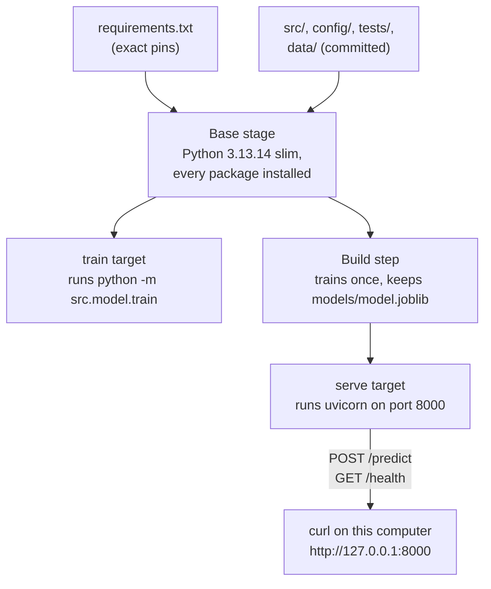

---
hide:
  - toc
---

# Phase 6 Brief: Docker

**Status: Built and checked.** Both images build and run on this computer, and the containers reproduce the project's numbers. See the [Implementation](./implementation.md) page for what was checked, and the [Development Guide](./development-guide.md) to build and run them.

**Needs first:** Phases 1 to 5, which are built, and Docker Desktop, running.

Phase 6 packages the project so it runs from a container. One `Dockerfile` has two targets. The `train` target trains the model from the committed data and logs the run to MLflow. The `serve` target starts the same FastAPI service as Phase 3, with a model trained while the image is built. A person with Docker and a copy of the repository can train and serve without installing Python or any package. The container answers the worked example with the same probability as the local service, **0.3296**.

The images run on a laptop only. AWS keeps running the API from the Phase 4 zip, and the web app is unchanged.

## How Do the Pieces Fit Together?

- **One install, two entry points.** Both targets start from the same base stage, so the Python version and every package pin are written once. This follows the choice in [Design Manifest](../design-manifest.md#phase-6-docker).
- **The data is already in the repository.** Training reads `data/from-s3/nfl_matchups_2020_2026.csv`, which is committed, so training needs no AWS credentials and no download. Only the S3 upload and download steps need credentials.
- **The serve image carries its own model.** `models/model.joblib` is git-ignored, so a fresh copy of the repository has no model. Training during the build means `docker build --target serve` alone gives a working service.

## What Does Each Target Do?

### The `train` Target

- **Runs:** `python -m src.model.train`, the same command as `make train`.
- **Writes, inside the container:** `models/model.joblib`, `mlflow.db`, `mlartifacts/`, `results/run-summary.json`, and the readable copy in `mlflow-reference/`.
- **Keeps only the run summary on this computer.** Every other file is deleted with the container. `make docker-train` mounts `build/docker/results/` over the container's `results/`, so the new `run-summary.json` can be checked against the committed one.
- **Can also run the tests:** `python -m pytest` inside the same image, with no extra install.
- **Can also run the data steps:** the image holds the whole `src/` folder, so the Phase 1 data steps and the two web app data steps run in it too. See [Run the Data Steps in the Container](./development-guide.md#run-the-data-steps-in-the-container).

### The `serve` Target

- **Runs:** `uvicorn src.api.app:app` on port 8000 inside the container, listening on every address the container has, so Docker can forward a port to it.
- **Published only to this computer:** the run command maps `127.0.0.1:8000` to the container, so nobody else on the network can reach it, as in Phase 3.
- **Routes:** `POST /predict` and `GET /health`, the Phase 3 service unchanged. The [feedback route](../extras/features/feedback-path.md) stays on AWS only, because it writes to a DynamoDB table.

## Steps in Order

- [x] **Step 1. Install Docker Desktop** and check that `docker version` reports both a client and a server (Engine 29.9.3).
- [x] **Step 2. Write `.dockerignore`,** which leaves everything out of the image unless it is named.
- [x] **Step 3. Write the `Dockerfile`** with a base stage and the `train` and `serve` targets. The image runs as a user that is not root, and it holds no AWS credentials.
- [x] **Step 4. Build and run the `train` target.** The scores and the run summary's SHA-256 match the committed ones.
- [x] **Step 5. Run the tests inside both images.** The counts are under Results.
- [x] **Step 6. Build and run the `serve` target.** `/health` and the three Phase 3 examples give the same answers as the local API.
- [x] **Step 7. Check what is inside the image:** no `.git/`, no secrets, no `mlflow.db` from this computer, and a user that is not root.
- [x] **Step 8. Write it down:** the implementation page, the development guide, and the Docker entries in the [Requirements Rubric](../requirements/requirements-rubric.md#step-5-containerize-with-docker) and [Design Manifest](../design-manifest.md#phase-6-docker).

## Results

- **Training in the container:** validation **63.10%** (171 of 271) and test **59.06%** (88 of 149), and a run summary byte for byte the committed one.
- **The service in the container:** the worked example gives **0.3296**, and the other two Phase 3 examples give 0.5364 and 0.6467.
- **Tests:** 93 passed and 2 skipped in the train image (it has no saved model), 95 passed in the serve image, and 95 passed on this computer.
- **Images:** about 1.4 GB each on disk. The first build takes about a minute, and a rebuild with no change takes under a second.

## Decisions Made

- **Docker Desktop for Mac,** the most common choice. Colima is a free command-line alternative that runs the same `docker` commands.
- **Train the model during the serve build,** so the serve image works from a fresh copy of the repository. Turned down: mounting `models/` from this computer, which fails when no model has been trained yet and makes the image depend on files outside it.
- **Install `requirements.txt` in both targets.** The serve target then carries `pandas` and `mlflow`, which it does not use, but one install keeps the two targets on the same pins. Turned down: `requirements-serve.txt` for the serve target, because it leaves out `uvicorn` and would need a second list of pins.
- **Pin the base image** to `python:3.13.14-slim`, so a rebuild months later uses the same Python. Python 3.13 matches this computer and the Lambda function.
- **Build for this computer's chip only.** This Mac uses `arm64`. Building for other chips is not needed for a laptop image.
- **Accept that a container run records no git commit.** `.git/` is left out of the image, and the export still finishes without it.
- **Two make commands,** `make docker-train` and `make docker-serve`. See [Makefile](../extras/development/makefile.md).

## What Was Created

- **Files:** `Dockerfile` and `.dockerignore` in the project folder, and two commands in the `Makefile`.
- **Images on this computer:** `510-m3-nfl-train` and `510-m3-nfl-serve`. They are not pushed anywhere.
- **Docs:** this brief, the [Implementation](./implementation.md) page, and the [Development Guide](./development-guide.md).
- **No AWS changes.**

## What Is Not in This Phase

- Pushing the image to a registry such as Amazon ECR, or running Lambda from an image. The zip fits Lambda's limit, as measured in the [Phase 4 Brief](../phase-4/brief.md#what-if-the-zip-is-too-large).
- The web app in a container. It is static files on CloudFront and needs no server.
- Building the image in GitHub Actions.
- The README and the final review, in [Phase 7](../phase-7/brief.md).

## Where to Read More

- [Project Requirements](../requirements/project-requirements.md) lists the Docker requirement: every dependency installed, entry points for training and serving, and an image that builds and runs locally.
- [Phase 2 Development Guide](../phase-2/development-guide.md#how-do-i-do-a-training-run) explains what a training run writes.
- [Phase 3 Development Guide](../phase-3/development-guide.md#how-do-i-ask-for-a-prediction) explains the requests and the answers the serve target gives.
- [Design Manifest](../design-manifest.md#phase-6-docker) explains why Docker comes in this phase, and why there is one Dockerfile.
