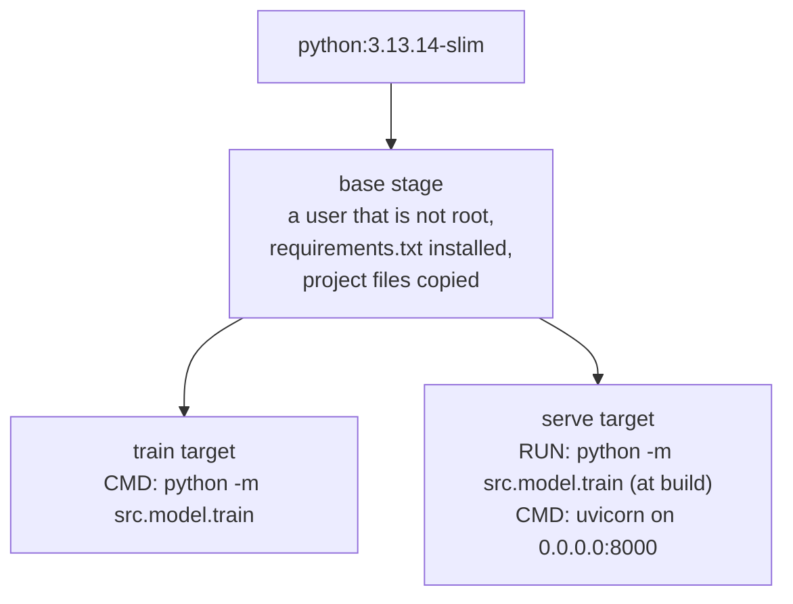

---
hide:
  - toc
---

# Phase 6 Implementation: Docker

This page records how the project was packaged in Docker: what goes into the image, how the `Dockerfile` is laid out, and the numbers the containers reproduced. The [Phase 6 Brief](./brief.md) explains why the phase exists and the choices behind it, and the [Phase 6 Development Guide](./development-guide.md) shows how to build and run each image.

**Status: Built and checked.** Both images build and run on this computer (Docker Desktop, Engine 29.9.3, `linux/arm64`). The train container writes a run summary identical to the committed one, and the serve container answers the worked example with **0.3296**, as the local API does.

## What Goes Into the Image?

The `.dockerignore` file lists what may enter the image, and everything else is left out. Listing what to include is safer than listing what to leave out, because a new private file is excluded by default.

- **Included:**
    - `requirements.txt` and `pytest.ini`
    - `config/`, `src/`, and `tests/`
    - `data/`: the raw nflverse file, the cleaned table, and the copy downloaded from S3. All three are committed, and training reads `data/from-s3/nfl_matchups_2020_2026.csv`.
    - `results/`: the committed run summary
    - `frontend/src/data/`: the two committed JSON files that `tests/test_profiles.py` and `tests/test_season.py` compare against
- **Left out by default:**
    - `.git/` and `.venv/`
    - the rest of `frontend/`
    - `build/`, `site/`, `models/`, `mlflow.db`, and `mlartifacts/`
    - `mlflow-reference/`, so a container run never adds to the committed run history
    - `docs/`, `local/`, `local-docs/`, `specs/`, `.cursor/`, and `.kiro/`
    - any `.env`, `*.pem`, or credentials file
    - every `__pycache__/` folder, `.pyc` file, and `.DS_Store` file
- **Checked:** `/app` in the image holds only `config`, `data`, `frontend`, `pytest.ini`, `requirements.txt`, `results`, `src`, and `tests`, and a search for `*.pem`, `.env`, and `__pycache__` finds nothing.

## How Is the Dockerfile Laid Out?

- **The base stage:**
    - Starts from the official `python:3.13.14-slim` image, the same Python as this computer. Its digest when built was `sha256:9662417aace5ae7b8e2609cce472b72a8958e134ba372808abe9cc1a0c0125e6`.
    - Sets `PYTHONDONTWRITEBYTECODE=1`, `PYTHONUNBUFFERED=1` (so log lines appear at once), `PIP_NO_CACHE_DIR=1`, `PIP_DISABLE_PIP_VERSION_CHECK=1`, and `MLFLOW_DISABLE_AGENT_HINT=1`.
    - Creates a user named `app` with id 10001, and uses `/app` as the working folder, owned by that user.
    - Copies `requirements.txt` on its own and installs it before copying the code, so a code change reuses the slow install step from Docker's cache.
    - Copies the included files, owned by `app`, and switches to that user.
- **The `train` target** adds nothing to the base. Its command is `python -m src.model.train`. Because the base holds all of `src/`, the same image also runs the data steps and the tests. The commands are in [Run the Data Steps in the Container](./development-guide.md#run-the-data-steps-in-the-container).
- **The `serve` target** runs `python -m src.model.train` once while the image is built, so the image holds `models/model.joblib`. Its command is `python -m uvicorn src.api.app:app --host 0.0.0.0 --port 8000`. Inside a container, `0.0.0.0` is needed so Docker can forward a port to the service. The run command publishes that port only on `127.0.0.1`.
- **Exec form** (`CMD ["python", ...]`) is used for both commands, so Python receives Ctrl+C and the stop signal directly. `docker stop` ended the service in 0.5 seconds. Ctrl+C (the same signal, sent to `docker run`) ended it in under a second with exit code 0, uvicorn printed its normal shutdown lines, and `--rm` removed the container.
- **`serve` is the last stage,** so a plain `docker build` with no `--target` gives the service.

### What Happens to MLflow's Git Details?

`.git/` is left out of the image, and the slim image has no `git`. MLflow prints three warnings that it cannot find `git`, records no `mlflow.source.git.*` tags, and the export still finishes, ending with `saved: mlflow-reference/latest-run`. That copy stays inside the container. The committed history on this computer is never touched by a container run.

## Which Make Commands Run It?

Two commands were added to the `Makefile`: `make docker-train` and `make docker-serve`. What each one runs is in the [Phase 6 Development Guide](./development-guide.md). The full list of make commands is on [Makefile](../extras/development/makefile.md).

## What Was Checked?

- **Training in the container:**
    - The eight scoring lines match `make train` on this computer: training 61.24% (820 of 1,339), validation **63.10%** (171 of 271), test **59.06%** (88 of 149), validation log loss 0.6451, and test log loss 0.6815, with the same always-home baselines.
    - `build/docker/results/run-summary.json` is byte for byte `results/run-summary.json` (SHA-256 `bd14becd53dc68dc59da97addb67102e3f2e5a9051b8805ba40537d4d4d56112`). The summary rounds every number to 6 places, so it is the check to rely on. The model file is not compared byte for byte, because the container runs Linux and this computer runs macOS. The service's answers are checked instead.
    - The export to the container's own `mlflow-reference/` finishes without `.git/`.
- **Tests in the container:**
    - The `train` image, with no saved model: **93 passed, 2 skipped**. The skipped tests are the last test in `tests/test_api.py` and the last in `tests/test_lambda_handler.py`, which need `models/model.joblib`.
    - The `serve` image, which holds a model: **95 passed**.
- **The service in the container:**
    - `GET /health` returns `{"status":"ok","model_version":"v1.0","scikit_learn_version":"1.9.1"}`.
    - The worked example (`-0.5`, `-18.0`) returns `home_win_probability` **0.3296**, an away win.
    - Both inputs at 0 return 0.5364, and `0.25` with `10.0` returns 0.6467, both home wins.
    - A request missing a field returns status 422.
    - Docker publishes `127.0.0.1:8000->8000/tcp`, with no `0.0.0.0` binding on this computer.
- **What is inside the image:** the user id is 10001, not root, and there is no `.git/`, `.env`, `*.pem`, `mlflow.db` from this computer, or `mlflow-reference/`.
- **Sizes and times:**
    - `510-m3-nfl-train` is 1.42 GB on disk and `510-m3-nfl-serve` is 1.43 GB. Both are 317 MB of compressed content, and the base image is 203 MB.
    - The first `make docker-train` took 57.9 seconds, 32.7 of them installing packages. A second build with no change took 0.6 seconds, because every step came from the cache.
    - The serve build took 6.4 seconds after the train build, 5.7 of them training.
- **On this computer:** `make pytest` gives 95 passed, `make web-test` 62 passed, and `results/run-summary.json` and `models/model.joblib` kept their bytes.

## What Is Left Out

- Pushing an image anywhere, and any AWS change. AWS keeps running the API from the Phase 4 zip.
- A Docker health check, and images for other chips. The image is for this laptop.
- The web app, which is static files on CloudFront.
- A smaller serve image. It installs all of `requirements.txt`, including `pandas` and `mlflow`, which the service does not use, so both targets keep the same pins.
