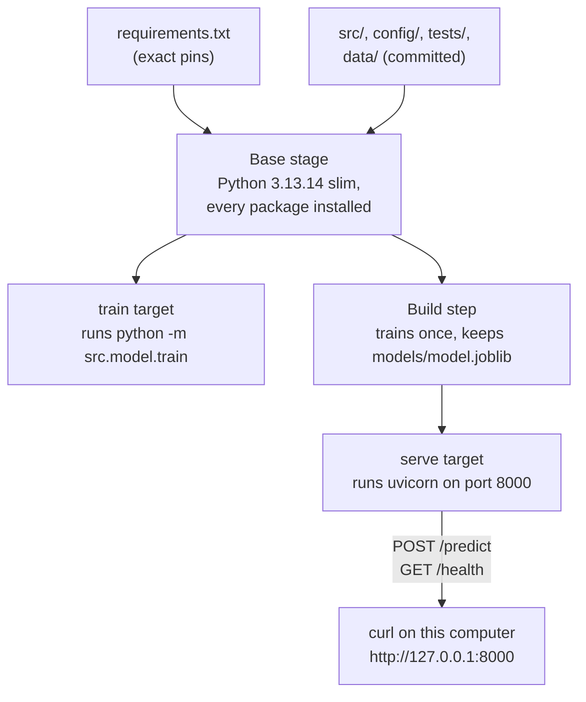
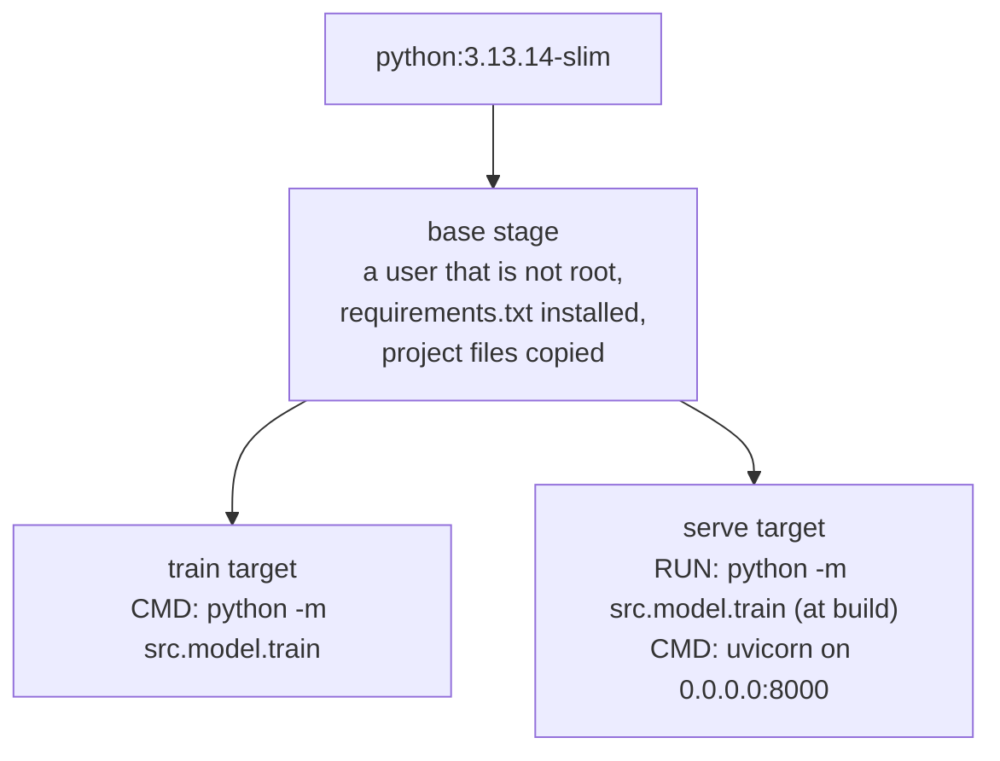

---
hide:
  - toc
---

# Phase 6: Docker

!!! success "Delivered in Pull Request #7"
    **[Pull request #7 (`phase-six`)](https://github.com/jconnors23/510-m3-nfl-prediction-analytics/pull/7)** merged the Docker train and serve images into `main`. Its **Files changed** tab shows everything this phase delivered.

**Status: Built and checked.** Both images build and run on this computer, and the containers reproduce the project's numbers. The [Implementation](#implementation) section below records what was checked, and the [Development Guide](#development-guide) section below shows how to build and run them.

**Needs first:** Phases 1 to 5, which are built, and Docker Desktop, running.

Phase 6 packages the project so it runs from a container. One `Dockerfile` has two targets. The `train` target trains the model from the committed data and logs the run to MLflow. The `serve` target starts the same FastAPI service as Phase 3, with a model trained while the image is built. A person with Docker and a copy of the repository can train and serve without installing Python or any package. The container answers the worked example with the same probability as the local service, **0.3296**.

The images run on a laptop only. AWS keeps running the API from the Phase 4 zip, and the web app is unchanged.

## How Do the Pieces Fit Together?



- **One install, two entry points.** Both targets start from the same base stage, so the Python version and every package pin are written once. This follows the choice in [Design Manifest](../design-manifest.md#phase-6-docker).
- **The data is already in the repository.** Training reads `data/from-s3/nfl_matchups_2020_2026.csv`, which is committed, so training needs no AWS credentials and no download. Only the S3 upload and download steps need credentials.
- **The serve image carries its own model.** `models/model.joblib` is git-ignored, so a fresh copy of the repository has no model. Training during the build means `docker build --target serve` alone gives a working service.

## What Does Each Target Do?

### The `train` Target

- **Runs:** `python -m src.model.train`, the same command as `make train`.
- **Writes, inside the container:** `models/model.joblib`, `mlflow.db`, `mlartifacts/`, `results/run-summary.json`, and the readable copy in `mlflow-reference/`.
- **Keeps only the run summary on this computer.** Every other file is deleted with the container. `make docker-train` mounts `build/docker/results/` over the container's `results/`, so the new `run-summary.json` can be checked against the committed one.
- **Can also run the tests:** `python -m pytest` inside the same image, with no extra install.
- **Can also run the data steps:** the image holds the whole `src/` folder, so the Phase 1 data steps and the two web app data steps run in it too. See [Run the Data Steps in the Container](#run-the-data-steps-in-the-container).

### The `serve` Target

- **Runs:** `uvicorn src.api.app:app` on port 8000 inside the container, listening on every address the container has, so Docker can forward a port to it.
- **Published only to this computer:** the run command maps `127.0.0.1:8000` to the container, so nobody else on the network can reach it, as in Phase 3.
- **Routes:** `POST /predict` and `GET /health`, the Phase 3 service unchanged. The [feedback route](../extras/architecture/frontend-backend-connection.md#how-does-the-feedback-route-fit-in) stays on AWS only, because it writes to a DynamoDB table.

## Steps in Order

- [x] **Step 1. Install Docker Desktop** and check that `docker version` reports both a client and a server (Engine 29.9.3).
- [x] **Step 2. Write `.dockerignore`,** which leaves everything out of the image unless it is named.
- [x] **Step 3. Write the `Dockerfile`** with a base stage and the `train` and `serve` targets. The image runs as a user that is not root, and it holds no AWS credentials.
- [x] **Step 4. Build and run the `train` target.** The scores and the run summary's SHA-256 match the committed ones.
- [x] **Step 5. Run the tests inside both images.** The counts are under Results.
- [x] **Step 6. Build and run the `serve` target.** `/health` and the three Phase 3 examples give the same answers as the local API.
- [x] **Step 7. Check what is inside the image:** no `.git/`, no secrets, no `mlflow.db` from this computer, and a user that is not root.
- [x] **Step 8. Write it down:** the Development Guide and Implementation sections below, and the Docker entries in the [Requirements Rubric](../requirements/requirements-rubric.md#step-5-containerize-with-docker) and [Design Manifest](../design-manifest.md#phase-6-docker).

## Results

- **Training in the container:** validation **63.10%** (171 of 271) and test **59.06%** (88 of 149), and a run summary byte for byte the committed one.
- **The service in the container:** the worked example gives **0.3296**, and the other two Phase 3 examples give 0.5364 and 0.6467.
- **Tests:** 93 passed and 2 skipped in the train image (it has no saved model), 95 passed in the serve image, and 95 passed on this computer.
- **Images:** about 1.4 GB each on disk. The first build takes about a minute, and a rebuild with no change takes under a second.

## Decisions Made

- **Docker Desktop for Mac,** the most common choice. Colima is a free command-line alternative that runs the same `docker` commands.
- **Train the model during the serve build,** so the serve image works from a fresh copy of the repository. Turned down: mounting `models/` from this computer, which fails when no model has been trained yet and makes the image depend on files outside it.
- **Install `requirements.txt` in both targets.** The serve target then carries `pandas` and `mlflow`, which it does not use, but one install keeps the two targets on the same pins. Turned down: `requirements-serve.txt` for the serve target, because it leaves out `uvicorn` and would need a second list of pins.
- **Pin the base image** to `python:3.13.14-slim`, so a rebuild months later uses the same Python. Python 3.13 matches this computer and the Lambda function.
- **Build for this computer's chip only.** This Mac uses `arm64`. Building for other chips is not needed for a laptop image.
- **Accept that a container run records no git commit.** `.git/` is left out of the image, and the export still finishes without it.
- **Two make commands,** `make docker-train` and `make docker-serve`. See [Makefile](../extras/development/makefile.md).

## What Was Created

- **Files:** `Dockerfile` and `.dockerignore` in the project folder, and two commands in the `Makefile`.
- **Images on this computer:** `510-m3-nfl-train` and `510-m3-nfl-serve`. They are not pushed anywhere.
- **Docs:** this page, including its Development Guide and Implementation sections.
- **No AWS changes.**

## What Is Not in This Phase

- Pushing the image to a registry such as Amazon ECR, or running Lambda from an image. The zip fits Lambda's limit, as measured in [What If the Zip Is Too Large?](../phase-4/index.md#what-if-the-zip-is-too-large) in Phase 4.
- The web app in a container. It is static files on CloudFront and needs no server.
- Building the image in GitHub Actions.
- The README and the final review, in [Phase 7](../phase-7/index.md).

## Where to Read More

- [Project Requirements](../requirements/project-requirements.md) lists the Docker requirement: every dependency installed, entry points for training and serving, and an image that builds and runs locally.
- [Phase 2 Development Guide](../phase-2/index.md#how-do-i-do-a-training-run) explains what a training run writes.
- [Phase 3 Development Guide](../phase-3/index.md#how-do-i-ask-for-a-prediction) explains the requests and the answers the serve target gives.
- [Design Manifest](../design-manifest.md#phase-6-docker) explains why Docker comes in this phase, and why there is one Dockerfile.

## Development Guide

This section shows how to build and run the two Docker images on your own computer. A copy of the repository is all you need, because Python and the packages come inside the image.

### What Is Needed First?

- **Docker Desktop, running.** Check it with the command below. It must print both a `Client` and a `Server` section. If the server part is missing, start Docker Desktop and try again.

```bash
docker version
```

- **A copy of the repository.** No virtual environment, no trained model, and no AWS account are needed. Training reads the committed data.
- **Port 8000 free,** for the serve image. `make start` and a plain `mkdocs serve` both use it.

Terms such as image, container, bind mount, and published port are in the [Glossary](../extras/glossary.md#phase-6-docker).

### How Do I Train in a Container?

```bash
make docker-train
```

It runs three steps:

1. Makes the folder `build/docker/results/` on your computer, if it is missing, and lets any user write to it. The container runs as user 10001, and on Linux a mounted folder keeps this computer's permissions.
2. Builds the `train` image as `510-m3-nfl-train`. The first build downloads the base image and installs every package, which takes about a minute. Later builds reuse the cache and take about a second, unless `requirements.txt` changed.
3. Runs one container from it. The container trains, prints the same eight scoring lines as `make train`, logs one MLflow run inside itself, and stops. The container is then removed.

- **Expected scores:** validation **63.10%** (171 of 271) and test **59.06%** (88 of 149).
- **Three warnings about `git` are expected.** The image has no `.git/` folder, so MLflow cannot record the commit.
- **Only the run summary is kept.** The container's `results/` folder is your `build/docker/results/` folder, so its `run-summary.json` stays after the container is gone. Everything else it wrote is deleted with the container. Your `mlflow.db`, `models/`, and `mlflow-reference/` are not touched.

#### Check That It Matches the Project

Compare the container's run summary with the committed one. The two lines must show the same SHA-256, `bd14becd53dc68dc59da97addb67102e3f2e5a9051b8805ba40537d4d4d56112`:

```bash
shasum -a 256 build/docker/results/run-summary.json results/run-summary.json
```

#### Run the Tests in the Container

```bash
docker run --rm 510-m3-nfl-train python -m pytest
```

Expected: **93 passed, 2 skipped**. The two skipped tests need a saved model, and the train image has none until a container trains.

#### Run the Data Steps in the Container

The train image also holds the Phase 1 data steps and the two web app data steps, so the whole project can run in Docker. Build the image first (`make docker-train` does this), then run each step in its own container. Each container starts from the committed files inside the image and is removed when it stops, so a file it writes is gone afterward unless a folder from your computer is mounted over it.

Download the nflverse games file. It prints the address, the time, `rows: 7548`, and `saved: data/raw/games.csv`:

```bash
docker run --rm 510-m3-nfl-train python -m src.data.fetch_raw
```

Clean the games into the model's table, with your `build/docker/processed/` folder mounted so the result is kept. Make the folder first, and let the container's user write to it, as `make docker-train` does for its folder:

```bash
mkdir -p build/docker/processed
```

```bash
chmod a+rwx build/docker/processed
```

```bash
docker run --rm -v "$PWD/build/docker/processed:/app/data/processed" 510-m3-nfl-train python -m src.data.clean
```

It prints the row counts at each filter, ending at 1,759 games, and writes `build/docker/processed/nfl_matchups_2020_2026.csv`. Its SHA-256 must be `7219e8a8672b900af9facbb54d8a28f9f2a34df9ede3b8385a735768082517fb`, the same as the committed table:

```bash
shasum -a 256 build/docker/processed/nfl_matchups_2020_2026.csv
```

Print a summary of the two model inputs for each season group (training 1,339 rows, validation 271, test 149):

```bash
docker run --rm 510-m3-nfl-train python -m src.model.features
```

Build the web app's two data files. They print `teams: 32` and `games: 272 (150 final or tie, 122 upcoming)`. The files stay inside the container, so these runs check that the steps work and leave the committed copies alone:

```bash
docker run --rm 510-m3-nfl-train python -m src.profiles
```

```bash
docker run --rm 510-m3-nfl-train python -m src.season
```

The S3 upload and download need AWS credentials, which the image does not hold. To run them, mount your own AWS settings folder, read-only:

```bash
docker run --rm -v ~/.aws:/home/app/.aws:ro 510-m3-nfl-train python -m src.data.upload_to_s3
```

### How Do I Run the API in a Container?

```bash
make docker-serve
```

It builds the `serve` image as `510-m3-nfl-serve`, which trains the model once during the build, then starts the API at `http://127.0.0.1:8000`. The terminal stays busy while it runs. Use a second terminal for the checks below.

#### What the Output Means

- **`CACHED` on every build step:** nothing changed since the last build, so Docker reuses the saved image, training step included, and the build takes under a second.
- **`Uvicorn running on http://0.0.0.0:8000`:** that address is inside the container. On your computer, Docker publishes the port only on `127.0.0.1`, so only this machine can reach it.
- **Requests from `172.17.0.1`:** Docker's own address for your computer, as seen from inside the container. Every request from your browser or `curl` shows this address.
- **`GET / HTTP/1.1" 404 Not Found`:** the API has no page at `/`. Its addresses are `/predict`, `/health`, and the test page `/docs`. A browser also asks for `/favicon.ico` by itself, which gets a 404 too.

#### Check That It Answers

```bash
curl http://127.0.0.1:8000/health
```

```json
{"status":"ok","model_version":"v1.0","scikit_learn_version":"1.9.1"}
```

The worked example:

```bash
curl -X POST http://127.0.0.1:8000/predict -H "Content-Type: application/json" -d '{"win_pct_differential": -0.5, "point_diff_per_game_differential": -18.0}'
```

```json
{"prediction":0,"predicted_label":"away win","home_win_probability":0.3296,"model_version":"v1.0"}
```

The same answer as the local API. More requests, and what each field means, are in [How Do I Ask for a Prediction?](../phase-3/index.md#how-do-i-ask-for-a-prediction). FastAPI's test page is at `http://127.0.0.1:8000/docs`.

#### Stop It

Press `Ctrl+C` in the terminal where it runs. The log shows `Shutting down`, the container is removed, and port 8000 is free again.

#### Run the Tests in the Serve Image

```bash
docker run --rm 510-m3-nfl-serve python -m pytest
```

Expected: **95 passed**, because this image holds a model.

### How Do I Change the Image?

- **The files:** `Dockerfile` and `.dockerignore` in the project folder.
- **Rebuilding:** both make commands build the image before they run it, so a change shows up the next time either command runs. A plain `docker run` uses the image as it was last built.
- **Adding a file to the image:** add a line starting with `!` to `.dockerignore`. Everything not listed is left out.
- **Changing a package:** change its pin in `requirements.txt`. The next build installs it again. The laptop's `.venv/` and the image then both follow the same file.
- **Changing the Python version:** change `PYTHON_VERSION` at the top of the `Dockerfile`, and keep it on the same minor version as the laptop and the Lambda function (3.13).

### How Do I Remove the Images?

The images use about 1.4 GB each on disk. To remove them:

```bash
docker image rm 510-m3-nfl-train 510-m3-nfl-serve
```

The next make command builds them again.

## Implementation

This section records what goes into the image, how the `Dockerfile` is laid out, and the numbers the containers reproduced. The checks ran on Docker Desktop, Engine 29.9.3, `linux/arm64`.

### What Goes Into the Image?

The `.dockerignore` file lists what may enter the image, and everything else is left out. Listing what to include is safer than listing what to leave out, because a new private file is excluded by default.

- **Included:**
    - `requirements.txt` and `pytest.ini`
    - `config/`, `src/`, and `tests/`
    - `data/`: the raw nflverse file, the cleaned table, and the copy downloaded from S3. All three are committed, and training reads `data/from-s3/nfl_matchups_2020_2026.csv`.
    - `results/`: the committed run summary
    - `frontend/src/data/`: the two committed JSON files that `tests/test_profiles.py` and `tests/test_season.py` compare against
- **Left out by default:**
    - `.git/` and `.venv/`
    - the rest of `frontend/`
    - `build/`, `site/`, `models/`, `mlflow.db`, and `mlartifacts/`
    - `mlflow-reference/`, so a container run never adds to the committed run history
    - `docs/`, `local/`, `local-docs/`, `specs/`, `.cursor/`, and `.kiro/`
    - any `.env`, `*.pem`, or credentials file
    - every `__pycache__/` folder, `.pyc` file, and `.DS_Store` file
- **Checked:** `/app` in the image holds only `config`, `data`, `frontend`, `pytest.ini`, `requirements.txt`, `results`, `src`, and `tests`, and a search for `*.pem`, `.env`, and `__pycache__` finds nothing.

### How Is the Dockerfile Laid Out?



- **The base stage:**
    - Starts from the official `python:3.13.14-slim` image, the same Python as this computer. Its digest when built was `sha256:9662417aace5ae7b8e2609cce472b72a8958e134ba372808abe9cc1a0c0125e6`.
    - Sets `PYTHONDONTWRITEBYTECODE=1`, `PYTHONUNBUFFERED=1` (so log lines appear at once), `PIP_NO_CACHE_DIR=1`, `PIP_DISABLE_PIP_VERSION_CHECK=1`, and `MLFLOW_DISABLE_AGENT_HINT=1`.
    - Creates a user named `app` with id 10001, and uses `/app` as the working folder, owned by that user.
    - Copies `requirements.txt` on its own and installs it before copying the code, so a code change reuses the slow install step from Docker's cache.
    - Copies the included files, owned by `app`, and switches to that user.
- **The `train` target** adds nothing to the base. Its command is `python -m src.model.train`. Because the base holds all of `src/`, the same image also runs the data steps and the tests. The commands are under [Run the Data Steps in the Container](#run-the-data-steps-in-the-container).
- **The `serve` target** runs `python -m src.model.train` once while the image is built, so the image holds `models/model.joblib`. Its command is `python -m uvicorn src.api.app:app --host 0.0.0.0 --port 8000`. Inside a container, `0.0.0.0` is needed so Docker can forward a port to the service. Docker then publishes that port only on `127.0.0.1`, as described under [The `serve` Target](#the-serve-target).
- **Exec form** (`CMD ["python", ...]`) is used for both commands, so Python receives Ctrl+C and the stop signal directly. `docker stop` ended the service in 0.5 seconds. Ctrl+C ended it in under a second with exit code 0, and `--rm` removed the container.
- **`serve` is the last stage,** so a plain `docker build` with no `--target` gives the service.

#### What Happens to MLflow's Git Details?

`.git/` is left out of the image, and the slim image has no `git`. MLflow prints three warnings that it cannot find `git`, records no `mlflow.source.git.*` tags, and the export still finishes, ending with `saved: mlflow-reference/latest-run`. That copy stays inside the container. The committed history on this computer is never touched by a container run.

### Which Make Commands Run It?

Two commands were added to the `Makefile`: `make docker-train` and `make docker-serve`. What each one runs is in [How Do I Train in a Container?](#how-do-i-train-in-a-container) and [How Do I Run the API in a Container?](#how-do-i-run-the-api-in-a-container). The full list of make commands is on [Makefile](../extras/development/makefile.md).

### What Was Checked?

- **Training in the container:**
    - The eight scoring lines match `make train` on this computer: training 61.24% (820 of 1,339), validation **63.10%** (171 of 271), test **59.06%** (88 of 149), validation log loss 0.6451, and test log loss 0.6815, with the same always-home baselines.
    - `build/docker/results/run-summary.json` is byte for byte `results/run-summary.json` (SHA-256 `bd14becd53dc68dc59da97addb67102e3f2e5a9051b8805ba40537d4d4d56112`). The summary rounds every number to 6 places, which is why it can match across platforms. The model file is not compared byte for byte, because the container runs Linux and this computer runs macOS. The service's answers are checked instead.
    - The export to the container's own `mlflow-reference/` finishes without `.git/`.
- **Tests in the container:**
    - The `train` image, with no saved model: **93 passed, 2 skipped**. The skipped tests are the last test in `tests/test_api.py` and the last in `tests/test_lambda_handler.py`, which need `models/model.joblib`.
    - The `serve` image, which holds a model: **95 passed**.
- **The service in the container:**
    - `GET /health` returns `{"status":"ok","model_version":"v1.0","scikit_learn_version":"1.9.1"}`.
    - The worked example (`-0.5`, `-18.0`) returns `home_win_probability` **0.3296**, an away win.
    - Both inputs at 0 return 0.5364, and `0.25` with `10.0` returns 0.6467, both home wins.
    - A request missing a field returns status 422.
    - Docker publishes `127.0.0.1:8000->8000/tcp`, with no `0.0.0.0` binding on this computer.
- **What is inside the image:** the user id is 10001, not root, and there is no `.git/`, `.env`, `*.pem`, `mlflow.db` from this computer, or `mlflow-reference/`.
- **Sizes and times:**
    - `510-m3-nfl-train` is 1.42 GB on disk and `510-m3-nfl-serve` is 1.43 GB. Both are 317 MB of compressed content, and the base image is 203 MB.
    - The first `make docker-train` took 57.9 seconds, 32.7 of them installing packages. A second build with no change took 0.6 seconds, because every step came from the cache.
    - The serve build took 6.4 seconds after the train build, 5.7 of them training.
- **On this computer:** `make pytest` gives 95 passed, `make web-test` 62 passed (the count when Phase 6 was built; the project now has 65 app tests in 12 files, or 63 passed and 2 skipped without the `build/` expected files), and `results/run-summary.json` and `models/model.joblib` kept their bytes.

### What Is Left Out

- Pushing an image, AWS changes, and a container for the web app, as listed under [What Is Not in This Phase](#what-is-not-in-this-phase).
- A Docker health check, and images for other chips. The image is for this laptop.
- A smaller serve image. It installs all of `requirements.txt`, including `pandas` and `mlflow`, which the service does not use, so both targets keep the same pins.
