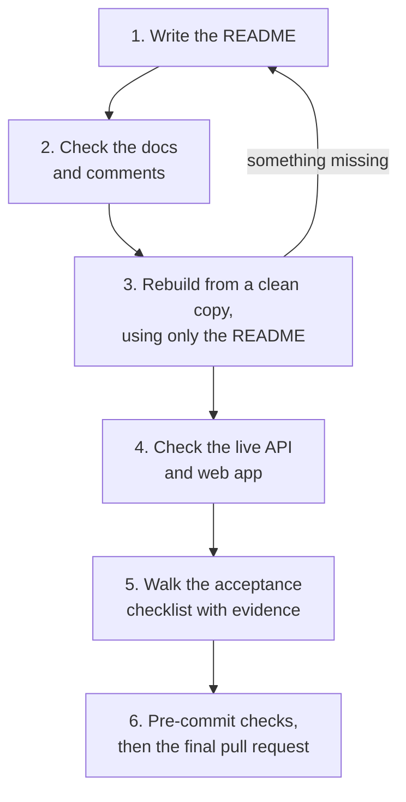

---
hide:
  - toc
---

# Phase 7 Brief: Review

**Status: In progress.** Phases 1 to 6 are built. The README draft is written (Step 1), the [Requirements Rubric](../requirements/requirements-rubric.md) maps every requirement of the assignment, and the end-to-end check found and fixed five problems. The clean rebuild from the README, the live checks, and the final pull request remain.

Phase 7 finishes the project and checks it before it is handed in. It writes the README, the front page of the repository and the one requirement still open. Then it checks the docs and comments against the finished code, rebuilds the project from a clean copy using only the README, and walks the assignment's acceptance checklist with evidence for each item. It combines what were planned as two phases, the documentation (Phase 7) and the review (Phase 8), because both read the finished project and neither adds code.

**Needs first:** Phases 1 to 6, all built, and every phase branch merged into `main`.

## How Does the Phase Run?

- **The README comes first,** because the clean rebuild follows only the README. Anything the rebuild needs that the README does not say goes back into the README.
- **The checks come last,** so they run on the finished files.

## Checklist

### Step 1: Write the README

The README is `README.md` in the project folder. It must hold everything in [10. README](../requirements/project-requirements.md#10-readme), and it links to these docs for detail instead of repeating them.

- [x] **Project overview and goals:** what the project predicts, who it is for, and that it is a coursework project not affiliated with the National Football League.
- [x] **The dataset:** the nflverse games file, with its link, and the games used (regular season, 2020 through 2026 week 10).
- [x] **The model and its result:** logistic regression on two inputs, validation **63.10%** (171 of 271) against the always-home baseline of 53.87%, and test **59.06%** (88 of 149). Each number is recomputed from `results/run-summary.json` before it is written.
- [x] **The cloud services:** S3 for the data and the web app, Lambda behind API Gateway for the API, CloudFront for the web app, DynamoDB for the feedback form, and GitHub Pages for the docs.
- [x] **How to train the model:** `make train`, and what it writes.
- [x] **How to build and test the API locally:** `make start`, a `curl` request with the worked example, and `make pytest`.
- [x] **How to run it in Docker:** `make docker-train` and `make docker-serve`.
- [x] **How to deploy to the cloud:** a short summary with links to the Phase 4 and Phase 5 Deployment Guides.
- [x] **Links:** the live API (`https://9awodatqc5.execute-api.us-east-1.amazonaws.com`), the live web app (`https://d1nubiunzfwm0q.cloudfront.net`), the docs site, and the dataset.
- [x] **The run environment:** Python 3.13, the pinned `requirements.txt`, Node.js 22.12 or later for the web app, Docker Desktop for the images, and AWS CLI version 2 for deployment.
- [x] **Limitations and ethics:** what the model leaves out (injuries, weather, anything after the standings date), that predictions are for reference only, and that no personal data is collected. The assignment asks for this reflection.
- [x] **A file tree and a short diagram** of how the pieces fit together.
- [x] **Add the README to the docs:** the docs home page is a condensed copy of it and links to it, and the [Requirements Rubric](../requirements/requirements-rubric.md) marks the README requirements met.

### Step 2: Check the Docs and Comments

- [ ] **Every page describes what exists now.** Each column, command, output file, and chart caption matches the current code. Anything the code no longer does is removed.
- [ ] **Every number is recomputed** from the data or the code: test totals, scores, game counts, file sizes, and hashes. Where a number appears on more than one page, every copy matches.
- [ ] **One page owns each explanation.** Other pages link to it instead of repeating it.
- [x] **The Requirements Rubric covers every requirement,** each quoted from the brief, with its file, function, setting, or command, and the page that explains it.
- [ ] **The comments and docstrings** read plainly, explain why rather than repeat the code, and match what the code does. A comment-only edit is checked to leave the code unchanged.
- [ ] **The docs site builds** with `mkdocs build --strict`, and the published site on GitHub Pages shows the latest pages.
- [x] **The Design Manifest page** has no empty "Open Decisions" section.

### Step 3: Rebuild From a Clean Copy

Clone the repository into a new folder and follow only the README. Write down every step the README does not cover, and add it.

- [ ] Create the virtual environment and install `requirements.txt`.
- [ ] `make pytest` gives **93 passed, 2 skipped** before training (the two skipped tests need a saved model).
- [ ] `make train` prints the expected scores, and `results/run-summary.json` stays byte for byte the committed one.
- [ ] `make pytest` gives **95 passed** after training.
- [ ] `make start` and the worked example return **0.3296**.
- [ ] `make web-test` gives **60 passed, 2 skipped** (the two every-game checks need files in the ignored `build/` folder).
- [ ] `make docker-train` and `make docker-serve` build and give the same numbers.
- [ ] `make start-web-ml` shows the runs, and `make docs` shows the site.

### Step 4: Check the Live Services

- [ ] `GET /health` on the live API returns status 200 with model `v1.0`.
- [ ] `POST /predict` on the live API with the worked example returns **0.3296**.
- [ ] The live web app loads every tab. Custom Matchup with home New England Patriots and away Tennessee Titans gives **63.8%**.
- [ ] The browser contacts only CloudFront and the API, and logs no error.
- [ ] The latest runs of all three GitHub workflows passed, including the first run of Test Python.

### Step 5: Walk the Acceptance Checklist

For each item in the [Acceptance Checklist](../requirements/project-requirements.md#acceptance-checklist), write down the evidence: the file, the command, and its result.

- [ ] **1. Problem and dataset:** public dataset, task, target, and metric named.
- [ ] **2. Cloud storage:** cleaned data in S3, and a script that downloads it.
- [ ] **3. Pipeline:** ingestion, preprocessing, split, training, and evaluation, driven by `config.yaml`.
- [ ] **4. Tracking:** runs, parameters, metrics, and artifacts logged to MLflow.
- [ ] **5. Docker:** the image builds and runs locally, with training and serving entry points.
- [ ] **6. API:** `/predict` returns a prediction from JSON input, checked locally.
- [ ] **7. Deployment:** the API on Lambda behind API Gateway, publicly reachable, with CORS allowing the web app.
- [ ] **8. Front-end:** the Vite app on S3 and CloudFront calls the live API and shows predictions.
- [ ] **9. Repository:** every required file present, and work merged through pull requests (#1 to #7 so far).
- [ ] **10. README:** overview, dataset, model, cloud services, setup and usage, and both live links.

### Step 6: Pre-Commit Checks and the Final Pull Request

- [ ] **No secrets or generated files are tracked:** no `.env`, `*.pem`, or credentials file, and `build/`, `site/`, `models/`, `mlflow.db`, `mlartifacts/`, `node_modules/`, `frontend/dist/`, `local/`, `local-docs/`, `specs/`, `.cursor/`, and `.kiro/` are ignored.
- [ ] **No absolute path or user name** in any committed file, including `mlflow-reference/`.
- [ ] **Every relative link resolves** in `README.md` and `docs/`.
- [ ] **An independent review** of the code and settings, with each finding fixed or noted.
- [ ] **The final pull request** is opened and merged by the developer.

### Small Items Left From Earlier Phases

- [ ] **The confusion-matrix picture (optional):** the axis name "What the model picked" sits under the grid while its column labels sit above it, and there is a gap above the legend. Moving the axis name to the top and closing the gap is a small change in `plot_confusion_matrix`.
- [ ] **The MLflow artifacts screenshot:** `mlflow-reference/screenshots/run-artifacts.png` shows the collapsed file list, because previewing the picture in MLflow shows an absolute path. Keep it, or crop a preview so no path shows.
- [ ] **The latest MLflow run's commit tag:** after the last merge, one `make train` tags the run with a commit on `main`. The scores do not change.

## What Is Not in This Phase

- New features, new models, or new inputs.
- Changes to AWS, except to fix something the live checks find.

## Where to Read More

- [Project Requirements](../requirements/project-requirements.md) lists every requirement and the acceptance checklist.
- [Requirements Rubric](../requirements/requirements-rubric.md) shows where each finished requirement lives.
- [Makefile](../extras/makefile.md) explains every command the README will use.
