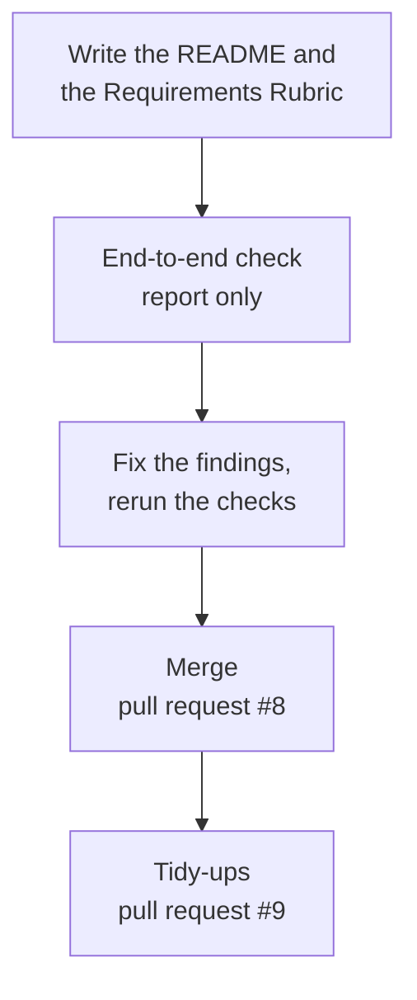

---
hide:
  - toc
---

# Phase 7 Implementation: Review

Phase 7 wrote the README and the Requirements Rubric, checked the whole project twice from a fresh copy, fixed what the checks found, and tidied the remaining small items. The checklist is on the [Phase 7 Brief](./brief.md).

## How Was the Review Done?

Cursor ran each check from a written spec. The developer reviewed the results, decided what to fix, and ran every git command.

## What Did the Checks Find and Fix?

| Finding | Fix |
| :--- | :--- |
| The download did not check the four columns `src/season.py` reads | Added to `NEEDED_COLUMNS` in `src/data/fetch_raw.py` |
| No workflow ran the Python tests | New `test-python.yml` runs `make pytest` on each pull request |
| scipy, which training uses, was pinned only for serving | `scipy==1.18.1` pinned in `requirements.txt` too |
| The download and S3 download steps had no tests | New `tests/test_fetch_raw.py` and `tests/test_download_from_s3.py` |
| Two pages gave only the before-training test count | Every page gives 93 passed and 2 skipped before training, 95 after |
| An unused setting and two misnamed tests | `OMITTED_TAGS` removed, two web tests renamed |

The second check rebuilt everything in a fresh copy of the committed files and matched on every step: the tests, the scores and run summary hash, the local API, both Docker images, and the AWS role permissions.

## What Was Tidied After the Merge?

- **The every-game check scripts** moved from the ignored `build/` folder to `scripts/checks/`, and a rerun matched the live API on every game with 0 mismatches. See the [Testing Guide](../extras/development/testing-guide.md#which-larger-checks-were-run-against-the-live-api).
- **The web app's tests** now run on each pull request that changes `frontend/`, through `test-web.yml`.
- **The confusion matrix picture** has its axis name above the grid. See [Confusion Matrix](../extras/features/confusion-matrix.md).
- **A new training run,** `49a0841f`, is tagged with a commit on `main`. The scores did not change.
- **The data steps run in the train image.** See [Run the Data Steps in the Container](../phase-6/development-guide.md#run-the-data-steps-in-the-container).
- **The docs were reorganized** for the [Version 1.0 Release Notes](../extras/release-notes/version-1-0.md): the Overview first, Extras grouped by topic, and every diagram fitted to the page width.

## What Was Left As Is?

- **The data stops at 2026 week 10.** The project is a fixed snapshot.
- **`POST /predict` has no rate limit.** Only `POST /feedback` is throttled, because it writes to the database.
- **The deployed Lambda zip was not replaced.** The live API already matches the local model on every game.
