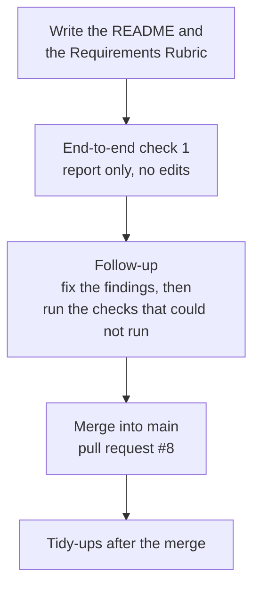

---
hide:
  - toc
---

# Phase 7 Implementation: Review

This page records what Phase 7 did to finish and check the project: the README, the Requirements Rubric, two end-to-end checks of the whole project, the fixes they led to, and the tidy-ups done after the merge of pull request #8. It is for a reviewer who wants to know what was checked, what was found, and what changed as a result. The checklist of what the phase had to do is on the [Phase 7 Brief](./brief.md).

## How Was the Review Done?

- **The README and the rubric came first,** so the checks ran against the finished front page and the finished list of requirements.
- **The first end-to-end check only reported.** Cursor followed a written spec, rebuilt the project in a fresh copy of the committed files, checked the live services, and wrote a report with findings and a suggested fix for each. It changed no file.
- **The follow-up fixed the findings,** then ran the steps the first check could not finish: the local API (port 8000 was busy), Docker (the Docker server was not running), and the read-only AWS role checks.
- **The developer reviewed each step,** decided what to fix and what to leave, and ran every git command.

## What Did the First End-to-End Check Find?

Most steps passed: the data steps rebuilt the same cleaned table (SHA-256 `7219e8a8…`), training gave the same scores and the same run summary (SHA-256 `bd14becd…`), and the live API, the web app, the CORS settings, the web bucket, and the feedback table all answered as documented. The five findings marked "should fix" were:

| Finding | What was wrong | Fix |
| :--- | :--- | :--- |
| 1. The download did not check every column it needs | `fetch_raw` refused a file missing a column that cleaning reads, but not one missing `gameday`, `weekday`, `gametime`, or `location`, which `src/season.py` reads | The four columns were added to `NEEDED_COLUMNS` in `src/data/fetch_raw.py` |
| 2. No workflow ran the Python tests | The two workflows of that time published the docs and the web app. Only the web app's tests ran on GitHub | New workflow `.github/workflows/test-python.yml` runs `make pytest` on each pull request and each push to `main` |
| 3. scipy was pinned for serving only | scikit-learn's solver uses scipy while fitting, so a later install of `requirements.txt` could pick a different scipy and train different weights | `scipy==1.18.1` is pinned in `requirements.txt` as well as `requirements-serve.txt` |
| 4. Two data steps had no tests | No test imported `src/data/fetch_raw.py` or `src/data/download_from_s3.py` | New `tests/test_fetch_raw.py` (3 tests) and `tests/test_download_from_s3.py` (2 tests), with stand-ins for the internet and for S3 |
| 5. Two pages gave an incomplete test count | Two pages gave the before-training count as the project's total | Every page now gives both counts: 93 passed and 2 skipped before training, and 95 passed after |

Three minor findings were fixed in the same pass:

- **An unused setting:** the `OMITTED_TAGS` tuple in `src/model/export_mlflow.py` was never read, and was deleted. The comment above `KEPT_TAGS` now says which MLflow tags are left out and why.
- **Two test names:** a test in `frontend/src/App.test.tsx` and one in `frontend/src/api.test.ts` were renamed to match what they check.
- **The confusion-matrix layout:** the gap above the legend was noted and fixed after the merge (see [What Was Tidied After the Merge?](#what-was-tidied-after-the-merge)).

The finding about the docs preview, which answers its root address with a redirect to `/510-m3-nfl-prediction-analytics/`, was left as is, because that prefix is the published site's address.

## What Did the Follow-Up Check?

The follow-up made a new copy of the committed files (173 files, with no virtual environment, packages, model, or MLflow records) and ran each step in it.

| Check | Result |
| :--- | :--- |
| `make pytest` before training | 93 passed, 2 skipped |
| `make pytest PYTHON=python`, as the workflow runs it | 93 passed, 2 skipped |
| `make train` | validation 63.10% (171 of 271), test 59.06% (88 of 149), and the same run summary SHA-256 |
| `make pytest` after training | 95 passed |
| `make web-test` | 60 passed, 2 skipped |
| `make start` and the three example requests | 0.3296, 0.5364, and 0.6467, the same as the live API |
| Five kinds of bad input to the local API | each refused with status 422 |
| `make docker-train` | the same scores and the same run summary SHA-256 |
| Tests in the train image and the serve image | 93 passed and 2 skipped, and 95 passed |
| `make docker-serve` | the same three answers, on `127.0.0.1:8000` only |
| A comment-only code change, then a rebuild | the package install step stayed cached, and the rebuild took 0.56 seconds |
| The three AWS roles, read with read-only commands | each allows only what [Cloud Architecture](../extras/architecture/cloud-architecture.md) lists |

Two results differed from the spec, and both were accepted:

- **Ctrl+C on `make start` or `make docker-serve`** stops the server cleanly, and the shell reports signal 2 instead of exit code 0. That comes from `make`, not from the server.
- **The web app's deploy role** can also read the status of an invalidation (`cloudfront:GetInvalidation`) on its one distribution. The workflow needs that to wait for an invalidation to finish.

## What Was Tidied After the Merge?

After pull request #8 merged, a short spec covered the small items left over, merged as pull request #9. The scores and the live services did not change.

- **The every-game check scripts are committed.** The five scripts that compare the live API with the local model moved from the ignored `build/` folder to `scripts/checks/`. Only the path to the project folder changed, and each now creates `build/` before writing to it. Their outputs stay in `build/`. A rerun matched on all 1,759 games, all 992 ordered pairs of teams, and all 272 games of 2026, with 0 mismatches. How to run them is on the [Testing Guide](../extras/development/testing-guide.md#which-larger-checks-were-run-against-the-live-api).
- **The web app's tests run on each pull request.** New workflow `.github/workflows/test-web.yml` runs `npm ci`, `npm test`, and `npm run build` when a pull request changes `frontend/`. See [GitHub Workflows](../extras/development/github-workflows.md#how-are-the-web-apps-tests-run-on-a-pull-request).
- **The confusion-matrix picture** has its axis name above the grid, next to the column labels, and its legend just under the grid. The picture is now 1034 by 1014 pixels. See [Confusion Matrix](../extras/features/confusion-matrix.md).
- **A new training run** after the merge tagged run `49a0841f` with commit `9562f88` on `main`. The earlier run moved to `mlflow-reference/previous-runs/`. The run summary is byte for byte the same.
- **The MLflow screenshots were retaken.** The artifacts screenshot shows the picture's preview, cropped so no file path shows.
- **The data steps were run in the train image:** the download, the cleaning (the same table SHA-256), the inputs summary, and the two web app data files. See [Run the Data Steps in the Container](../phase-6/development-guide.md#run-the-data-steps-in-the-container).

## How Were the Docs Organized for Version 1.0?

- **The Overview** is the first page, a condensed copy of the README, and names the course (Duke AIPI 510) and the model version (1.0, November 2026).
- **The [Requirements Rubric](../requirements/requirements-rubric.md)** replaced the earlier requirements map. It is a checklist of all 48 requirements, each with its status, code, docs, and evidence.
- **The [Design Manifest](../design-manifest.md)** replaced the earlier decisions page, and records how the developer built the project with AI tools augmenting the work.
- **The Extras** are grouped into Architecture, Development, Features, and Release Notes, with the Glossary. The [Version 1.0 Release Notes](../extras/release-notes/version-1-0.md) summarize the release.
- **Every diagram fits the page width,** measured in a browser at the site's 938-pixel content column.

## What Was Left As Is?

These were looked at and kept on purpose:

- **The data stops at 2026 week 10.** The committed games file has no scores for week 11, and the project keeps its snapshot. How the cutoff is set is in the [Phase 1 Development Guide](../phase-1/development-guide.md).
- **Training reads the committed copy of the S3 file,** not S3 itself, so the project trains with no AWS account. The download step from S3 is a separate command.
- **`POST /predict` has no rate limit.** Only `POST /feedback` is throttled, because it writes to the database.
- **The deployed Lambda zip was not replaced.** A rebuild in the fresh copy was 63,452,901 bytes, 401 bytes more than the deployed 63,452,500, so its hash differs. The deployed function's size and hash match the Phase 4 pages, and the live API matched the local model on every game, so the function was left as deployed.
