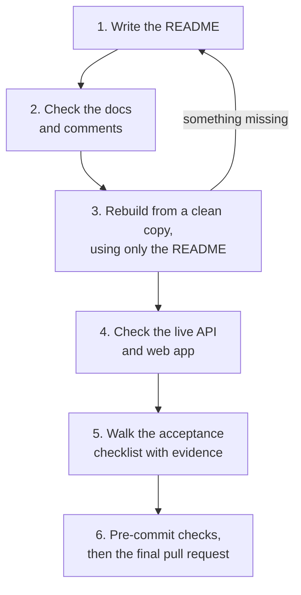
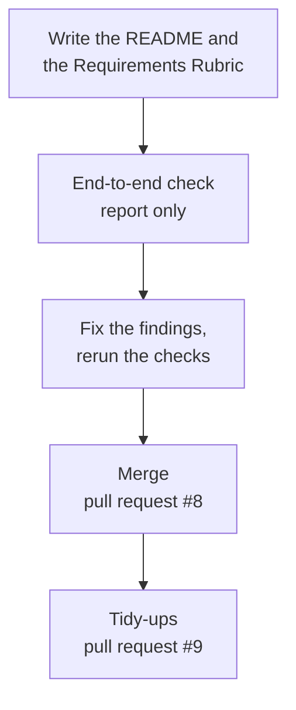

---
hide:
  - toc
---

# Phase 7: Review

!!! success "Delivered in Pull Requests #8 and #9"
    Each pull request's **Files changed** tab shows what it delivered.

    - **[Pull request #8 (`phase-seven`)](https://github.com/jconnors23/510-m3-nfl-prediction-analytics/pull/8):** the README, the Requirements Rubric, and the fixes from the end-to-end review.
    - **[Pull request #9 (`phase-seven-p2`)](https://github.com/jconnors23/510-m3-nfl-prediction-analytics/pull/9):** the tidy-ups: the committed check scripts, the web test workflow, and the reorganized docs.

**Status: Built.** Merged into `main` as pull request #8, with the follow-up tidy-ups and docs reorganization merged as pull request #9. The README is written, and the [Requirements Rubric](../requirements/requirements-rubric.md) maps every requirement to the code and docs that meet it. Two end-to-end checks rebuilt the project from a clean copy, checked the live services, and found and fixed the problems listed in [What Did the Checks Find and Fix?](#what-did-the-checks-find-and-fix). The three GitHub workflows that existed then passed on the merge.

Phase 7 finishes the project and checks it before it is handed in. It writes the README, checks the docs and comments against the finished code, rebuilds the project from a clean copy using only the README, and walks the acceptance checklist with evidence for each item. Writing the README and reviewing the project are one phase because both read the finished project and neither adds code.

**Needs first:** Phases 1 to 6, all built, and every phase branch merged into `main`.

## How Does the Phase Run?

- **The README comes first,** because the clean rebuild follows only the README. Anything the rebuild needs that the README does not say goes back into the README.
- **The checks come last,** so they run on the finished files.

## Checklist

### Step 1: Write the README

The README is `README.md` in the project folder. It must hold everything in [10. README](../requirements/project-requirements.md#10-readme), and it links to these docs for detail.

- [x] **Project overview:** what the project predicts, who it is for, and that it is a coursework project not affiliated with the National Football League.
- [x] **The dataset:** the nflverse games file, with its link, and the games used (regular season, 2020 through 2026 week 10).
- [x] **The model and its result:** logistic regression on two inputs, validation **63.10%** (171 of 271) against the always-home baseline of 53.87%, and test **59.06%** (88 of 149). Each number is recomputed from `results/run-summary.json` before it is written.
- [x] **The cloud services:** S3 for the data and the web app, Lambda behind API Gateway for the API, CloudFront for the web app, DynamoDB for the feedback form, and GitHub Pages for the docs.
- [x] **How to train the model:** `make train`, and what it writes.
- [x] **How to build and test the API locally:** `make start`, a `curl` request with the worked example, and `make pytest`.
- [x] **How to run it in Docker:** `make docker-train` and `make docker-serve`.
- [x] **How to deploy to the cloud:** a short summary with links to the Phase 4 and Phase 5 Deployment Guides.
- [x] **Links:** the live API (`https://9awodatqc5.execute-api.us-east-1.amazonaws.com`), the live web app (`https://d1nubiunzfwm0q.cloudfront.net`), the docs site, and the dataset.
- [x] **The run environment:** Python 3.13, the pinned `requirements.txt`, Node.js 22.12 or later for the web app, Docker Desktop for the images, and AWS CLI version 2 for deployment.
- [x] **Limitations:** what the model leaves out (injuries, weather, anything after the standings date), that predictions are for reference only, and that no personal data is collected.
- [x] **A file tree and a short diagram** of how the pieces fit together.
- [x] **Add the README to the docs:** the docs home page is a condensed copy of it and links to it, and the [Requirements Rubric](../requirements/requirements-rubric.md) marks the README requirements met.

### Step 2: Check the Docs and Comments

- [x] **Every page describes what exists now.** Each column, command, output file, and chart caption matches the current code. Anything the code no longer does is removed.
- [x] **Every number is recomputed** from the data or the code: test totals, scores, game counts, file sizes, and hashes. Where a number appears on more than one page, every copy matches.
- [x] **One page owns each explanation.** Other pages link to it instead of repeating it.
- [x] **The Requirements Rubric covers every requirement,** each quoted from [Project Requirements](../requirements/project-requirements.md), with its file, function, setting, or command, and the page that explains it.
- [x] **The comments and docstrings** read plainly, explain why rather than repeat the code, and match what the code does. A comment-only edit is checked to leave the code unchanged.
- [x] **The docs site builds** with `mkdocs build --strict`, and the published site on GitHub Pages shows the latest pages.

### Step 3: Rebuild From a Clean Copy

Done in the end-to-end checks, on a copy of exactly the files git commits (no virtual environment, no installed packages, no trained model, and no MLflow records), following the README's setup steps. Nothing the copy needed was missing from the README.

- [x] Create the virtual environment and install `requirements.txt`.
- [x] `make pytest` gives **93 passed, 2 skipped** before training (the two skipped tests need a saved model).
- [x] `make train` prints the expected scores, and `results/run-summary.json` stays byte for byte the committed one.
- [x] `make pytest` gives **95 passed** after training.
- [x] `make start` and the worked example return **0.3296**.
- [x] `make web-test` gives **60 passed, 2 skipped** (the count at the time of the check; the two every-game checks need files in the ignored `build/` folder). The web tests have grown since: the project now has 65 in 12 files, or 63 passed and 2 skipped without those files.
- [x] `make docker-train` and `make docker-serve` build and give the same numbers.
- [x] `make start-web-ml` shows the runs, and `make docs` shows the site.

### Step 4: Check the Live Services

Done in the end-to-end checks, against the live API and the live web app. The workflow runs are from the merge of pull request #8.

- [x] `GET /health` on the live API returns status 200 with model `v1.0`.
- [x] `POST /predict` on the live API with the worked example returns **0.3296**.
- [x] The live web app loads every tab. Custom Matchup with home New England Patriots and away Tennessee Titans gives **63.8%**.
- [x] The browser contacts only CloudFront and the API, and no tab shows an error. The headless browser did not keep a console log, so a console warning with no visible effect would not have been recorded.
- [x] The latest runs of all three GitHub workflows passed on the merge of pull request #8. Test Python's first run, on the pull request itself, also passed.

### Step 5: Walk the Acceptance Checklist

The evidence for each item (the file, the command, and its result) is on the [Requirements Rubric](../requirements/requirements-rubric.md).

- [x] **1. Problem and dataset:** public dataset, task, target, and metric named.
- [x] **2. Cloud storage:** cleaned data in S3, and a script that downloads it.
- [x] **3. Pipeline:** ingestion, preprocessing, split, training, and evaluation, driven by `config.yaml`.
- [x] **4. Tracking:** runs, parameters, metrics, and artifacts logged to MLflow.
- [x] **5. Docker:** the image builds and runs locally, with training and serving entry points.
- [x] **6. API:** `/predict` returns a prediction from JSON input, checked locally.
- [x] **7. Deployment:** the API on Lambda behind API Gateway, publicly reachable, with CORS allowing the web app.
- [x] **8. Front-end:** the Vite app on S3 and CloudFront calls the live API and shows predictions.
- [x] **9. Repository:** every required file present, and work merged through pull requests #1 to #9.
- [x] **10. README:** overview, dataset, model, cloud services, setup and usage, and both endpoint links.
- [x] **11. Ethics and limitations:** the README's Limitations section.

### Step 6: Pre-Commit Checks and the Final Pull Request

- [x] **No secrets or generated files are tracked:** no `.env`, `*.pem`, or credentials file, and `build/`, `site/`, `models/`, `mlflow.db`, `mlartifacts/`, `node_modules/`, `frontend/dist/`, `local/`, `local-docs/`, `specs/`, `.cursor/`, and `.kiro/` are ignored.
- [x] **No absolute path or user name** in any committed file, including `mlflow-reference/`.
- [x] **Every relative link resolves** in `README.md` and `docs/`.
- [x] **An independent review** of the code and settings, with each finding fixed or noted: two end-to-end checks by Cursor (one report-only, one with fixes), and a review of the project's structure against the requirements.
- [x] **The final pull requests** are opened and merged by the developer: pull request #8, then pull request #9 for the follow-up.

### Small Items Left From Earlier Phases

These are tidy-ups, not requirements. They were done after the merge of pull request #8, and merged in pull request #9.

- [x] **The confusion-matrix picture:** the axis name "What the model picked" now sits above the grid with its column labels, and the legend sits just under the grid. See [Confusion Matrix](../phase-2/index.md#what-does-the-confusion-matrix-show).
- [x] **The MLflow artifacts screenshot:** `mlflow-reference/screenshots/run-artifacts.png` now shows the picture's preview, cropped so no path shows.
- [x] **The latest MLflow run's commit tag:** one `make train` after the merge tagged run `49a0841f` with commit `9562f88` on `main`. The scores did not change, and `results/run-summary.json` is byte for byte the same.
- [x] **The every-game check scripts are committed** in `scripts/checks/`, so a fresh copy can rerun them. Their outputs stay in the git-ignored `build/` folder. A rerun matched the live API on every game with 0 mismatches. See the [Testing Guide](../extras/development/testing-guide.md#which-larger-checks-were-run-against-the-live-api).
- [x] **The web app's tests run on each pull request** that changes `frontend/`, through the new Test Web App workflow.
- [x] **The data steps run in the train image.** See [Run the Data Steps in the Container](../phase-6/index.md#run-the-data-steps-in-the-container).

## What Is Not in This Phase

- New features, new models, or new inputs.
- Changes to AWS, except to fix something the live checks find.

## Where to Read More

- [Project Requirements](../requirements/project-requirements.md) lists every requirement and the acceptance checklist.
- [Requirements Rubric](../requirements/requirements-rubric.md) shows where each finished requirement lives.
- [Makefile](../extras/development/makefile.md) explains every command the README uses.

## Implementation

This section records how the review was run, what the two checks found and fixed, and what was left as is.

### How Was the Review Done?

Cursor ran each check from a written spec. The developer reviewed the results, decided what to fix, and ran every git command.

### What Did the Checks Find and Fix?

| Finding | Fix |
| :--- | :--- |
| The download did not check the four columns `src/season.py` reads | Added to `NEEDED_COLUMNS` in `src/data/fetch_raw.py` |
| No workflow ran the Python tests | New `test-python.yml` runs `make pytest` on each pull request |
| scipy, which training uses, was pinned only for serving | `scipy==1.18.1` pinned in `requirements.txt` too |
| The download and S3 download steps had no tests | New `tests/test_fetch_raw.py` and `tests/test_download_from_s3.py` |
| Two pages gave only the before-training test count | Every page gives 93 passed and 2 skipped before training, 95 after |
| An unused setting and two misnamed tests | `OMITTED_TAGS` removed, two web tests renamed |

The second check rebuilt everything in a fresh copy of the committed files and matched on every step: the tests, the scores and run summary hash, the local API, both Docker images, and the AWS role permissions.

### What Was Tidied After the Merge?

The small items under [Small Items Left From Earlier Phases](#small-items-left-from-earlier-phases) were all done in pull request #9. Further details:

- **The every-game check scripts** moved from the ignored `build/` folder to `scripts/checks/`.
- **The web app's tests** run through `test-web.yml`.
- **The docs were reorganized** for the [Version 1.0 Release Notes](../extras/release-notes/version-1-0.md): the Overview first, the Developer Docs and Extras grouped by topic, and every diagram fitted to the page width.

### What Was Left As Is?

- **The data stops at 2026 week 10.** The project is a fixed snapshot.
- **`POST /predict` has no rate limit.** Only `POST /feedback` is throttled, because it writes to the database.
- **The deployed Lambda zip was not replaced.** The live API already matches the local model on every game.
