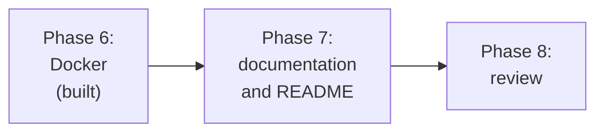

---
hide:
  - toc
---

# Remaining Phases

Phases 1 to 6 are built. Each has its own pages, the latest being [Phase 5](./phase-5/brief.md) (the web app, live at [https://d1nubiunzfwm0q.cloudfront.net](https://d1nubiunzfwm0q.cloudfront.net)) and [Phase 6](./phase-6/brief.md) (Docker). Work that belongs to no one phase is in [Extras](./extras/brief.md). Phases 7 and 8 are not started, so this page stays high level. Each gets a detailed page when it begins.

The README and the review come last because they describe and check the finished project.

## Phase 6: Docker

Built. One Dockerfile with a `train` target and a `serve` target. See the [Phase 6 Brief](./phase-6/brief.md).

## Phase 7: Documentation and README

Write the front door of the repository, and make the docs match the finished project.

- **Write the README** with the project overview and goals, the dataset and its link, the model and its result, the cloud services used, setup and usage steps (how to train the model, how to build and test the API locally, how to run it in Docker, and how to deploy to the cloud), and links to the live API, the live web app, and the docs site. It is listed with the other cross-phase pieces in [Extras](./extras/brief.md#the-readme-not-written-yet).
- **Check the docs against the finished code.** Every page describes what exists, every number is recomputed from the data or the code, and every link resolves in a strict docs build.
- **Complete the requirements map** so every requirement has the file, function, setting, or command that covers it, and the docs page that explains it.
- **Check the comments and docstrings** in the code read plainly and match what the code does.
- **Keep the docs site published on GitHub Pages** by the `deploy-docs.yml` workflow, and link it from the README.

## Phase 8: Review

Check the finished project against the requirements before it is handed in.

- **Walk the acceptance checklist** item by item, and write down the evidence for each one.
- **Rebuild from a clean checkout,** following only the README. Train, run the tests, start the API locally, and build both Docker images, and note anything the README leaves out.
- **Run the pre-commit checks:** no secrets or generated files are tracked, local-only files are ignored, relative links resolve, and the docs match the latest code.
- **Review the code and configuration independently,** and fix or note each finding.
- **Check the repository contents:** code, `config.yaml`, a dependency file, a Dockerfile, MLflow logging, a clear structure, and at least one merged pull request.
- **Check the live API and the live web app** with real requests.
