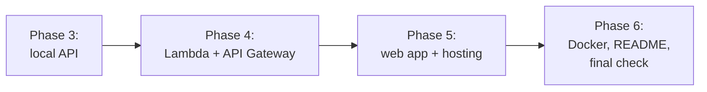
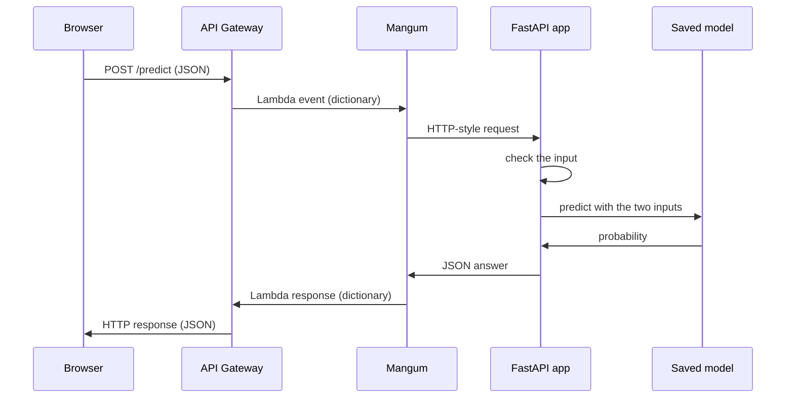
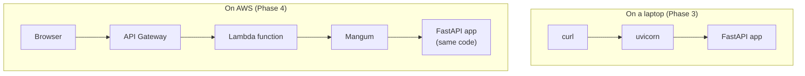
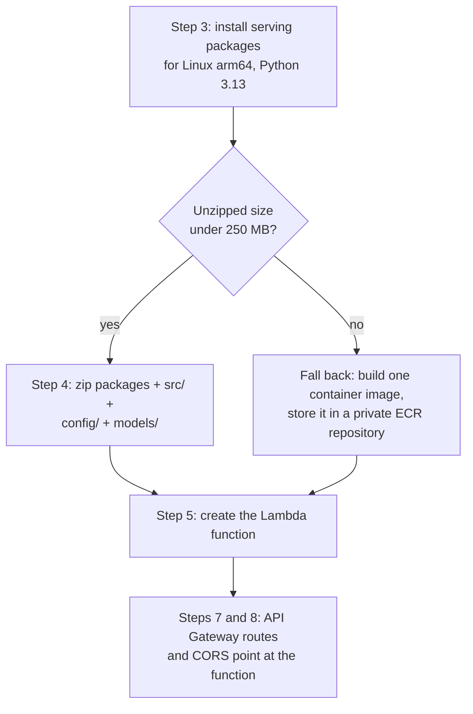

---
hide:
  - toc
---

# Remaining Phases

Phase 3 is built, and has its own [brief](./phase-3/brief.md) and [implementation page](./phase-3/implementation.md). Phases 4 to 6 are not started, so this page stays high level. Each phase gets a detailed page when it begins.

The order is: local API, then AWS, then the web app, then Docker last. Docker is last because nothing before it needs an image. AWS Lambda runs the API from a zip file, so there is no container registry unless the zip turns out to be too large (see Phase 4).

## Phase 3: Local API

**Built.** Wrap the trained model in a small web service that runs on a laptop. See the [Phase 3 Brief](./phase-3/brief.md) for the steps, and the [Implementation](./phase-3/implementation.md#how-do-i-run-it-locally) for how to run it and example `curl` commands.

- **Serve the model with FastAPI.** One `POST /predict` route takes the two model inputs as JSON and returns the prediction and the home win probability as JSON. A `GET /health` route reports the model version.
- **Reject bad input.** A missing, unknown, or out-of-range field returns a clear error.
- **Test it locally** with `curl` or Postman. No Docker and no AWS.

## Phase 4: AWS Deployment

Put the API on the internet. The same FastAPI app from Phase 3 runs inside AWS Lambda, behind an API Gateway HTTP API in `us-east-1` (already decided).

### What Is Mangum?

Mangum is a small Python library that lets a FastAPI app run inside AWS Lambda. It translates between two formats, and it does nothing else.

- **A normal web server** ([`uvicorn`](https://uvicorn.dev/) on a laptop, see the [Glossary](./glossary.md#phase-3-local-prediction-api)) listens on a port and receives HTTP requests.
- **Lambda has no port.** It runs a function once per request. The function receives a dictionary (called an event) and returns a dictionary.
- **API Gateway** is what receives the browser's HTTP request, builds the event, and calls the Lambda function. This happens with or without Mangum.
- **Mangum** runs inside the function. It turns the event into a request that FastAPI understands, calls the app, and turns FastAPI's answer back into the dictionary Lambda returns.
- **In code,** it is one line: `handler = Mangum(app)`. The Lambda function setting then points at that `handler`.

The two setups run the same app. Only the front part changes:

- **Why this and not a separate Lambda function:** a hand-written function would repeat the input checks and the model call in a second place, and the local tests would not cover it. See [Decisions](./decisions.md#deployment-and-front-end).
- **What Mangum does not do:** it does not deliver requests to Lambda, set permissions, or make the public address. API Gateway and AWS permissions do those.

### Implementation Steps

- [ ] **Step 1. Add the Lambda entry point.** A new file (proposed: `src/api/lambda_handler.py`) holds `handler = Mangum(app)`. `mangum` is already pinned in `requirements.txt`.
- [ ] **Step 2. Test the entry point with no AWS.** Call `handler` with a made-up API Gateway HTTP API event for `POST /predict`. The worked example must return status 200 and a home win probability of 0.3296.
- [x] **Step 3. Measure the package size first.** The serving packages for Linux, `arm64`, and Python 3.13 come to 231.3 MB unzipped without `pandas`, under the 250 MB limit, so the zip route works. With `pandas` it is 278.4 MB, over the limit, so the API must not use `pandas`. See the [Package Size Check](./phase-4/package-size-check.md).
- [ ] **Step 4. Build the zip.** It holds the installed packages, `src/`, `config/config.yaml`, and `models/model.joblib`, in the same folder layout as the project so every path still resolves.
- [ ] **Step 5. Create the function.** Python 3.13, `arm64`, the handler setting pointing at `handler`, and a role that can only write logs. Upload the zip. Set memory and the time limit with the first-request (cold start) time in mind.
- [ ] **Step 6. Test the function in the AWS console** with the same made-up event as Step 2.
- [ ] **Step 7. Create the API Gateway HTTP API** with the routes `POST /predict` and `GET /health`, both pointing at the function. Set the request limit (5 per second, burst of 10).
- [ ] **Step 8. Set CORS on the gateway.** At first it allows the local web app address. The CloudFront address is added once it exists (Phase 5).
- [ ] **Step 9. Check the public address** with `curl` and the worked example. It must return the same 0.3296 as the local API.
- [ ] **Step 10. Add a budget alert and write the deployment steps down,** so they can be repeated by hand.

### Fall Back to a Container Image

`scikit-learn`, `scipy`, and `numpy` are large, so the zip might be over Lambda's 250 MB unzipped limit. Step 3 found out before anything else was built: the zip fits (231.3 MB unzipped) as long as `pandas` is left out. This fall-back stays unused unless the package grows past the limit. In that case, build one container image, store it in a private Amazon ECR repository, and run Lambda from that image. Docker is then needed earlier than Phase 6, for this one step. Otherwise ECR is not used.

## Phase 5: Web App and Hosting

Build the part a person uses.

- **Build a Vite web app.** The user picks a home team and an away team, the app calls the API, and it shows the predicted winner and probability.
- **Build the team profiles file** (`python -m src.profiles`), which holds each team's record, win percentage, and point margin per game, so the browser can compute the two inputs.
- **Develop against the local API first.** The Vite development server can forward `/predict` requests to the local API, which avoids needing CORS while working locally. Then point the app at the live API.
- **Host the built files** in a private S3 bucket served over HTTPS through CloudFront. Add the CloudFront address to the gateway's CORS settings.

## Phase 6: Docker, README, and Final Check

Package the project and finish the repository.

- **Write a Dockerfile** that installs every dependency and has entry points for both training and serving. The image must build and run on a laptop. It uses the same Python version and package pins as everything before it.
- **Check the image gives the same answers.** The container must return the same probability as the local API for the worked example.
- **Write the README** with the project overview, the dataset and its link, the model and its result, the cloud services used, setup and usage steps, and links to the live API and the live web app.
- **Run a final check** that the repository holds code, `config.yaml`, a dependency file, a Dockerfile, MLflow logging, a clear structure, and at least one merged pull request.

## Open Decisions

Each shows the proposed answer first.

- **Probability field name.** Proposed: `home_win_probability`. Alternative: `win_probability`, with a written rule that it is the home team's chance.
- **Lambda package.** Proposed: a zip file. Alternative: a container image in ECR, used only if the zip is over the size limit.
- **Dockerfile layout.** Proposed: one file with `train` and `serve` targets. Alternative: two Dockerfiles.
- **Repeating the deployment.** Proposed: written command-line steps, no `deploy.yml`. Alternative: a GitHub Actions workflow.
- **API key.** Proposed: no key, with a request limit and a budget alert, because a key in a browser app is visible to every visitor. Alternative: an API key.
- **Standings in the app.** Proposed: one snapshot after 2026 week 10. Alternative: standings for each of weeks 1 to 10 with a week picker.
- **Vite template.** Proposed: React with TypeScript. Alternative: plain TypeScript or JavaScript.

The settled hosting and API choices are in [Decisions](./decisions.md).
