---
hide:
  - toc
---

# Overview

This project predicts the winner of an NFL game before kickoff. A user picks a home team and an away team in a web app, and the app shows a predicted winner and a win probability.

## What Is the Idea?

Teams that win more often, and outscore opponents by more, tend to win later games. The model compares the two teams on exactly two numbers, using only games already played earlier in the same season:

- **Win percentage difference:** the home team's win percentage minus the away team's.
- **Point margin difference:** the home team's average points scored minus points allowed per game, minus the away team's.

A logistic regression turns those two numbers into a home win probability. The numbers start over every season. The project does not use play-by-play data, injuries, weather, or betting lines. It is a small, complete example of a machine learning system, from data storage to a public web app.

The data is the [nflverse](https://github.com/nflverse/nfldata/blob/master/data/games.csv) game results file, limited to regular-season games from 2020 through week 10 of 2026.

## How Do the Pieces Fit Together?

```mermaid
flowchart LR
    A[Download game results] --> B[Clean and store in S3]
    B --> C[Build the two inputs<br/>and split by season]
    C --> D[Train, score, and<br/>track with MLflow]
    D --> E[Serve with a<br/>local API]
    E --> F[Deploy on AWS Lambda<br/>behind API Gateway]
    F --> G[Web app on CloudFront]
    G --> H[Package in Docker]
    H --> I[Write the README<br/>and finish the docs]
    I --> J[Review against<br/>the requirements]
```

## What Are the Phases and Steps?

Each phase ends with something that runs. Git commits and pull requests are done by the developer.

**[Phase 1: Data Pipeline](./implementation/phase-1/brief.md)** (built)

- Fetch the raw game file and save it unchanged.
- Clean it: regular season only, 2020 to 2026 week 10, no ties.
- Upload the cleaned table to a private S3 bucket.
- Download it back from S3, so later steps start from the cloud copy.

**[Phase 2: Features, Training, and Tracking](./implementation/phase-2/brief.md)** (built)

- Build the two inputs and split games by season: train 2020 to 2024, validate 2025, test 2026.
- Train the model and score it against the always-pick-home baseline.
- Record every run in MLflow and save the trained model.

**[Phase 3: Local Prediction API](./implementation/phase-3/brief.md)** (built)

- Serve the model on your own computer with a FastAPI `/predict` route and a `/health` route.
- Reject bad input with a clear error, and test with `curl`.

**[Phase 4: AWS Deployment](./implementation/phase-4/brief.md)** (built)

- Deploy the API to AWS Lambda behind API Gateway, with a public address.
- Check that all 1,759 games get the same answers from the deployed model as from the local one.
- See the [implementation page](./implementation/phase-4/implementation.md) for the steps and the Lambda package size, and [Deployment Guide](./implementation/phase-4/deployment-guide.md) for the commands.

**[Remaining Phases](./implementation/remaining-phases.md)** (planned)

- **Phase 5:** build the Vite web app and host it on S3 and CloudFront.
- **Phase 6:** package the project in Docker.
- **Phase 7:** write the README and finish the documentation.
- **Phase 8:** review the finished project against the requirements.

## Where Is Everything Else?

- [Requirements Map](./implementation/requirements/requirements-map.md): where each finished requirement lives in the repository (files, functions, settings, and commands).
- [Decisions](./implementation/decisions.md): choices made, why, and the open decisions waiting on the developer.
- [Glossary](./implementation/glossary.md): plain-language meaning of the terms used here.
- [Assignment Brief](./implementation/requirements/assignment-brief.md) and [Project Requirements](./implementation/requirements/project-requirements.md): the original brief and the checkable requirements, kept unchanged.
